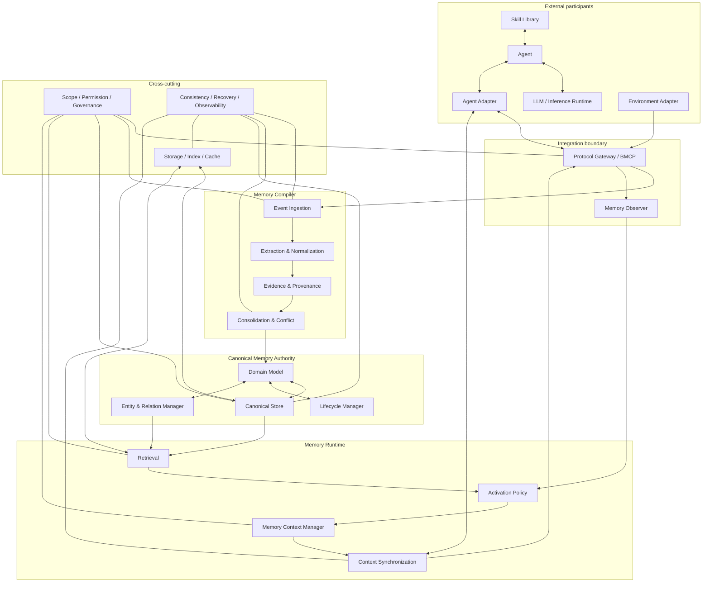

---
document_metadata:
  domain: architecture
  role: design-specification
  lifecycle:
    approval:
      decision_status: Draft
      approver: null
      decision_date: null
      approved_version: null
      approval_scope:
        type: Full-document
      approval_applicability: Not-Applicable-To-Current-Version
      evidence_reference:
        - "14-ai-development/work-items/AID-2026-200/evidence.md"
      revocation: null
    evidence_verification:
      verification_status: Unverified
      last_verified_date: "2026-11-27"
      last_verification_note: "GOV-DOC-002 classification of a normative root that carried no front-matter: records domain, role and the status the document states in its own body (Status: DECIDED for authority and primary collaboration). Claims no canonical authority (canonical_status stays Non-Canonical) and records no Owner approval. Pre-metadata content blob: 50ddbeed51d88aecbeee0403a4021e21a668dbcb."
    usage_status: Active
    modification_status: Modified
    supersession:
      supersedes: []
      supersession_reason: null
      effective_date: null
    archival:
      archived_date: null
      archival_reason: null
      archival_reference: null
  authority:
    canonical_status: Non-Canonical
    canonical_conflict_status: None
    normative_status: Normative
  bilingual_counterpart:
    source: null
    en: "docs/en/01-system-architecture/component-interactions.md"
    zh-CN: "docs/zh-CN/01-system-architecture/component-interactions.md"
---
# Component Interactions

**Status:** DECIDED for authority and primary collaboration; CANDIDATE for orchestration patterns and call topology; OPEN for protocol details delegated to Session H.  
**Scope:** Inter-component contracts, inputs/outputs, sequencing, ownership, and failure behavior at system level.

## 1. Interaction model

Components interact through explicit contracts, not shared undocumented state. A logical interaction may be an in-process call, durable message, stream, or protocol request; deployment topology is not prescribed.

Rules:
- The primary owner defines semantics and authoritative state.
- Supporting components may validate, transform, transport, or cache but cannot create competing authority.
- Every external boundary performs identity, Scope, Permission, schema, and resource-limit checks.
- Asynchronous work has durable correlation and retry semantics.
- State-changing retries are idempotent.
- Context version changes are serialized by MCM; Sync tracks delivery only.
- Acknowledgement semantics are explicit and do not overstate what was observed.

## 2. Complete logical component relationship

The diagram shows logical dependencies, not mandatory synchronous calls. Governance and consistency are cross-cutting policies/services, not a universal central bottleneck; each boundary must enforce the applicable local contract.

## 3. Component input/output matrix

| Component | Inputs | Outputs | Authoritative state owned | Must not |
|---|---|---|---|---|
| Protocol Gateway / BMCP | Authenticated messages, capability profile, protocol version | Validated normalized request, protocol error, negotiated capability | Protocol session/negotiation state if specified | Interpret semantic truth or own memory |
| Event Ingestion | Authorized event envelope, scope, source, idempotency key | Durable receipt, Event reference, processing status | Acceptance/idempotency record and ingress state | Wait for LLM compilation before durable acceptance |
| Memory Observer | Structured telemetry, stream sequence, freshness | Normalized task/environment signals and observation events | Observer cursor/derived state only | Inspect private Agent internals or infer outcomes from plans |
| Extraction & Normalization | Accepted Event/source reference | Candidate Memory/Claim proposals and extraction metadata | Processing checkpoint, not canonical truth | Directly bypass canonical lifecycle |
| Evidence & Provenance | Candidate claims, source spans/references, derivation steps | Evidence links, provenance graph/records | Evidence/provenance records under Brain contract | Invent unsupported evidence |
| Consolidation & Conflict | Candidate claims, canonical candidates, evidence | Consolidation proposal, conflict set, resolution proposal | Work-item state; not final canonical authority unless delegated explicitly | Silently overwrite conflicting claims |
| Domain Model | Typed object operations and metadata | Validation rules, canonical semantic representation | Domain definitions and semantic constraints | Own physical persistence |
| Canonical Store | Authorized canonical read/write transaction | Persisted version, commit result, canonical query result | Durable canonical records and versions | Decide epistemic truth independently of domain/lifecycle rules |
| Lifecycle Manager | Candidate and transition request, evidence, policy | Accept/defer/reject/transition decision | Lifecycle state and transition history | Erase provenance/conflict history silently |
| Entity & Relation Manager | Entity mentions, identity evidence, relation proposals | Entity resolution and typed relation results | Entity identity and relation history | Merge identities without traceable decision |
| Retrieval Engine | Scoped query, filters, task signals, authorized indexes | Ranked candidates with evidence/freshness metadata | Query execution state and disposable working state | Activate context or expose unauthorized candidates |
| Activation Policy | Telemetry, retrieved candidates, risk/freshness | Activation proposal and rationale | Policy/config version; no context authority | Mutate Canonical Memory |
| MCM | Activation proposal, explicit edit request, current context version, budget | New Context version, Change Set, reconcile result | Memory Context and sole version sequence | Treat Remove as Forget or accept parallel authority |
| Context Synchronization | Change Set/snapshot, Adapter capability and acknowledgements | Delivery, status transitions, reconciliation request | Delivery attempts/status, not context semantics | Create semantic Context versions |
| Governance | Principal, action, resource, scope, policy | Allow/deny, obligations, audit event | Policy and governance/audit state | Treat Scope alone as permission |
| Storage/Index/Cache | Canonical change feed, queries, invalidations | Persisted bytes, index/cache results and version markers | Physical representations only; indexes/cache derived | Claim authority over canonical truth |
| Consistency/Recovery/Observability | Commit markers, event/change streams, checkpoints, metrics | Replay/reconciliation, repair, traces/health | Recovery checkpoints and telemetry records | Change domain semantics during repair |

## 4. Primary interaction contracts

### 4.1 Gateway → Ingestion

**Input:** authenticated source, event payload/reference, Scope, schema version, idempotency key, source timestamps, provenance metadata.  
**Output:** durable receipt with stable Event identifier or explicit rejection.  
**Guarantee — DECIDED:** `Accepted` is returned only after the Event and its recoverable compile intent are durable at the same atomic acceptance boundary (or an equivalent crash-safe protocol). Duplicate retries return the original receipt and do not create another Event or intent. This is not a claim that work has been dispatched or compiled.

**Bounded implementation evidence:** PR #246 commit `fcdecf0a4e638c8b3c9ac0e4623f97c98ed21291`; exact-head Rust run `44261068522` SUCCESS; GOV-DOC-001 run `44261068531` SUCCESS; post-merge Main Rust run `44261208110` SUCCESS. Scope is the SQLite Event Store intent ledger/backfill only.  
**Failure:** Invalid schema/permission is rejected; storage unavailability yields retryable unavailable/backpressure, not false acceptance.

### 4.2 Ingestion → Compiler

**Input:** durable Event reference and immutable source metadata.  
**Output:** processing work item and stage status.  
**Guarantee:** At-least-once dispatch is acceptable only with idempotent stage processing.  
**Failure:** Compiler outage leaves pending work; replay resumes from durable state.

### 4.3 Compiler → Canonical authority

**Input:** candidate object proposals, claims, evidence/provenance references, source epistemic status, temporal metadata, Scope.  
**Output:** canonical identifiers/versions and lifecycle decision, or deferred/rejected result with reason.  
**Guarantee:** Compiler proposes; canonical/lifecycle authority accepts and owns canonical version.  
**Failure:** Conflict is preserved; no blind overwrite. Candidate remains traceable.

### 4.4 Canonical authority → Retrieval / indexes

**Input:** committed canonical change event with version/generation.  
**Output:** index/cache updates and visible indexed generation.  
**Guarantee:** Canonical Store remains authoritative; secondary structures expose their indexed generation and are rebuildable.  
**Failure:** Retry/rebuild from canonical change history; reject stale candidates when generation is behind a required fence.

### 4.5 Observer → Activation / Retrieval

**Input:** canonical telemetry fields, stream identity/sequence, timestamps, uncertainty, task/environment scope.  
**Output:** task-state delta, freshness assessment, recall trigger/proposal.  
**Guarantee:** Telemetry is source-attributed; prospective state is not outcome evidence.  
**Failure:** Gaps/out-of-order updates are marked; stale state cannot silently supersede newer observations.

### 4.6 Retrieval → Activation

**Input:** scoped query and retrieval constraints.  
**Output:** candidates with canonical references, relevance signals, evidence, validity/freshness, and permission-filter result.  
**Guarantee:** Retrieval supplies candidates, not final context membership.  
**Failure:** Partial/degraded/timeout result is explicit; permission failures do not leak snippets.

### 4.7 Activation → MCM

**Input:** activation proposal, reason codes, target context, candidate references, urgency/expiry hints.  
**Output:** committed context version or no-op/deferred result.  
**Guarantee:** MCM applies budget, scope, duplicate and version rules; it owns context sequence.  
**Failure:** Stale base version causes explicit re-plan/rebase or rejection; never last-write-wins silently.

### 4.8 MCM → Sync → Adapter

**Input:** immutable Change Set with context ID, base/target versions, operations or snapshot, expiry, capability constraints.  
**Output:** delivery status and Adapter acknowledgement.  
**Guarantee:** Sync owns transport status; Adapter reports Received/Accepted/Rejected/Applied. Applied names exact target version and boundary receipt.  
**Failure:** Retry same delivery idempotently; missing version chain triggers full snapshot/reconciliation.

### 4.9 Governance across all interactions

Every operation checks principal, action, resource, Scope, Permission, purpose, and applicable retention/consent obligations. The component performing the operation enforces the result at its boundary; a remote prior check is not sufficient if authority or scope may have changed.

## 5. Synchronous versus asynchronous interaction matrix

| Interaction | Default | Reason |
|---|---|---|
| Authentication/schema/permission validation | Synchronous at boundary | No unauthorized operation proceeds |
| Durable Event acceptance | Synchronous to durable receipt | Caller needs truthful acceptance result |
| Semantic compilation | Asynchronous | LLM/model latency and outages must not block ingestion |
| Canonical lifecycle decision | Internal transaction/workflow; may be async relative to ingress | Preserve canonical policy and evidence |
| Index/cache propagation | Asynchronous | Derived and rebuildable |
| Explicit Runtime Recall | Synchronous bounded request/response | Agent needs timely candidates |
| Background proactive recall | Asynchronous candidate | Avoid blocking Agent task loop |
| Context version commit | Atomic MCM operation | One authoritative sequence |
| Context delivery | Asynchronous | Adapter may be offline |
| Applied acknowledgement | Adapter report after boundary; delivered asynchronously | Proof follows actual application |
| Forget propagation | Durable staged workflow | Multi-target cleanup and recovery |

## 6. Concurrency and transaction boundaries

- Ingestion deduplicates by idempotency scope and key.
- Compiler stage outputs are idempotent and linked to immutable Event/source references.
- Canonical mutations use version preconditions or equivalent concurrency control; conflict is explicit.
- Context mutations serialize per context or use compare-and-swap against Base Version.
- A single Context ID has one authoritative version sequence, owned by MCM.
- Delivery retries do not increment Context Version.
- Adapter Applied reports are monotonic for a given Context Session; stale acknowledgements cannot roll back applied version.
- Forget creates a durable governance job/fence before asynchronous derivative cleanup.
- Cross-component multi-record workflows use durable state machines/outbox or equivalent recoverable protocol; no assumption of a distributed ACID transaction across all components.

## 7. Error and result taxonomy

System-level outcomes should distinguish:
- `Rejected`: invalid, unauthorized, unsupported, or policy-denied request.
- `RetryableUnavailable`: temporary dependency/storage/transport issue.
- `AcceptedPending`: durably accepted but asynchronous work incomplete.
- `Partial`: a read/recall completed with declared omissions/degraded dependencies.
- `Conflict`: base/version/semantic conflict requiring reconciliation.
- `Expired`: operation/delivery no longer valid.
- `Superseded`: a newer desired version replaces this work.
- `Applied`: exact Context version applied at the agreed Adapter boundary, not model comprehension.

Exact codes and message envelopes belong to BMCP.

## 8. Observability and correlation

Each cross-boundary workflow should carry correlation and causation IDs, actor/principal, scope reference, event/context/memory references, idempotency identity, version/generation, stage, attempt, and timestamps. Logs must not indiscriminately copy sensitive source payloads. Metrics should expose queue age, stage latency, retries, version lag, stale-index rejects, denied operations, and reconciliation outcomes.

## 9. Fault containment

| Component failure | Containment behavior |
|---|---|
| Gateway failure | External operations unavailable; canonical data unchanged |
| Ingestion failure | No Accepted receipt unless durable acceptance completed |
| Compiler failure | Accepted Events queue; no canonical corruption |
| Canonical Store failure | Canonical mutations stop; no false success |
| Index/cache failure | Recall degraded or bypasses index if safe; canonical remains correct |
| Retrieval failure | Explicit timeout/partial result; no context mutation inferred |
| Activation failure | Agent can continue without proactive update; explicit status |
| MCM failure | No new context version; last committed version remains authoritative |
| Sync failure | Delivery pending; desired version persists |
| Adapter failure | No Applied acknowledgement; retry/reconcile later |
| Governance failure | Fail closed for protected operations |
| Observability failure | Core data path may continue only if audit obligations remain met; otherwise governed writes fail closed |

## 10. Interface questions for other sessions

| Owner | Question to confirm |
|---|---|
| B — Domain Model | Canonical IDs, Event/Memory/Claim distinction, time and epistemic fields, provenance references |
| C — Agent Integration | Minimum telemetry, freshness/sequence semantics, Agent instance and environment identity |
| D — Memory Brain | Candidate acceptance, canonical versioning, lifecycle transition contract, conflict semantics |
| E — Memory Compiler | Stage outputs, idempotency, recompile semantics, raw source retention |
| F — Memory Runtime | Recall request/result, activation reasons, freshness and degraded-result semantics |
| G — Memory Context | Context ID/version authority, Change Set operations, base-version conflict/reconciliation |
| H — BMCP / Adapter | Message envelope, auth, capability negotiation, ack state names, error codes, compatibility |
| I — Infrastructure | Durable acceptance, outbox, index generation, deletion propagation, replay and backup guarantees |

## 11. Acceptance tests

1. Each component's writes are rejected if they attempt to mutate another component's authoritative state.
2. Duplicate Event submission returns the same Event receipt.
3. Compiler failure leaves Event durable and pending.
4. Compiler proposal cannot bypass lifecycle decision.
5. Retrieval result does not automatically mutate context.
6. Activation proposal cannot mutate canonical memory.
7. Two concurrent context edits against same base cannot silently overwrite.
8. Duplicate delivery does not increment context version.
9. Adapter Applied is impossible without exact context/version and boundary receipt.
10. Old acknowledgement cannot regress current delivery/application state.
11. Unauthorized cross-scope retrieval returns no protected candidate details.
12. Index/cache loss can be repaired from canonical change history.
13. Forget retries are monotonic and auditable.
14. Environment and Skill Library interfaces cannot be used as hidden Brain actuation paths.

## 12. Open decisions

- **OPEN:** Canonical protocol message and error schemas (Session H).
- **OPEN:** Principal identity, authentication, key rotation, and audit redaction details (Session I).
- **CANDIDATE:** Durable outbox for event and canonical change publication; compare against equivalent recoverable mechanisms.
- **TO_VALIDATE:** Whether high-impact Recall requires a synchronous Agent-side preflight in each Adapter tier.
- **OPEN:** Cross-component audit availability requirements during observability subsystem outage.

## 13. Decision summary

- **DECIDED:** Component ownership follows responsibility matrix; no shared mutable authority.
- **DECIDED:** Ingestion receipt, compiler completion, canonical acceptance, index visibility, context delivery, and Applied are distinct milestones.
- **DECIDED:** Retrieval returns candidates; Activation proposes; MCM commits context; Sync delivers; Adapter applies and acknowledges.
- **DECIDED:** All external and cross-subsystem calls carry explicit scope, permission, version, correlation, and idempotency semantics as applicable.
- **OPEN:** Exact protocol, identity, and storage mechanisms remain with the assigned sessions.
