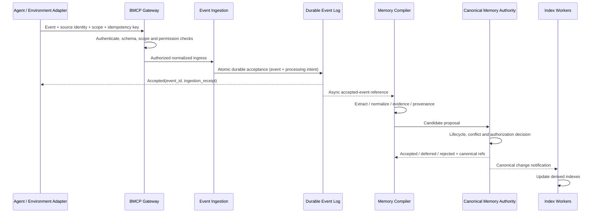
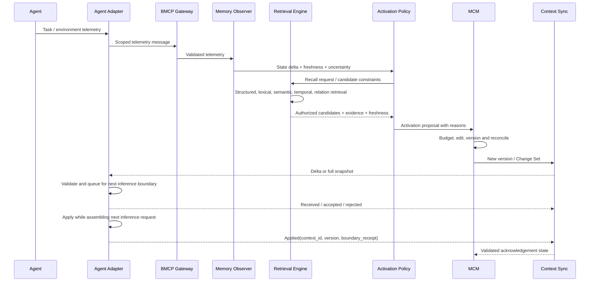
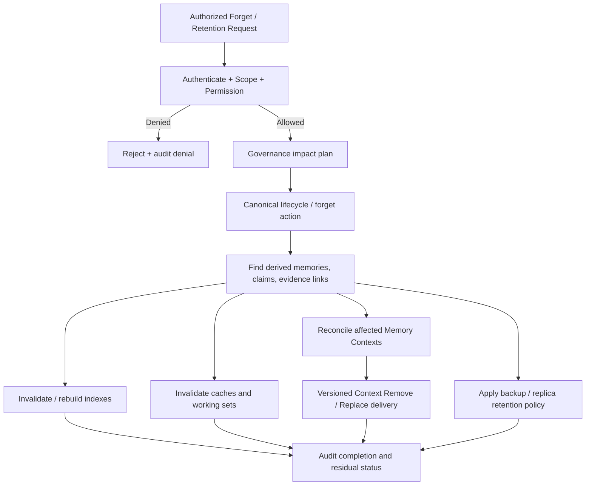

---
document_metadata:
  domain: architecture
  role: design-specification
  lifecycle:
    approval:
      decision_status: Draft
      approver: null
      decision_date: null
      approved_version: null
      approval_scope:
        type: Full-document
      approval_applicability: Not-Applicable-To-Current-Version
      evidence_reference:
        - "14-ai-development/work-items/AID-2026-190/evidence.md"
      revocation: null
    evidence_verification:
      verification_status: Unverified
      last_verified_date: "2026-11-27"
      last_verification_note: "GOV-DOC-002 classification of a normative root that carried no front-matter: records domain, role and the status the document states in its own body (Status: DECIDED for ownership and semantic boundaries). Claims no canonical authority (canonical_status stays Non-Canonical) and records no Owner approval. Pre-metadata content blob: 24bc5867749d234238e6d75aadd4119f359de9f8."
    usage_status: Active
    modification_status: Modified
    supersession:
      supersedes: []
      supersession_reason: null
      effective_date: null
    archival:
      archived_date: null
      archival_reason: null
      archival_reference: null
  authority:
    canonical_status: Non-Canonical
    canonical_conflict_status: None
    normative_status: Normative
  bilingual_counterpart:
    source: null
    en: "docs/en/01-system-architecture/data-flows.md"
    zh-CN: "docs/zh-CN/01-system-architecture/data-flows.md"
---
# System Data Flows

**Status:** DECIDED for ownership and semantic boundaries; CANDIDATE for scheduling/transport choices; TO_VALIDATE for quantitative targets.  
**Scope:** End-to-end logical data paths. Internal extraction, retrieval, lifecycle, and BMCP algorithms are delegated to their subsystem specifications.

## 1. Design rules

1. Durable Event acceptance is separate from semantic compilation.
2. Event Ingestion and Runtime Recall have distinct latency, reliability, and authorization profiles.
3. Canonical Memory changes only through Brain-owned lifecycle/canonical workflows.
4. Memory Context changes are versioned and owned by MCM.
5. Delivery and application are distinct; Applied requires Adapter acknowledgement.
6. No in-flight inference mutation is assumed; updates take effect at the next inference assembly boundary.
7. Every flow carries Scope, Permission context, provenance/correlation, and idempotency where state-changing.
8. Async work must be observable, retryable, and replay-safe; accepted source data must not be lost because a downstream stage is unavailable.

## 2. Event Ingestion versus Runtime Recall

**DECIDED:** They are logically distinct channels even if a first deployment shares a process, transport, or storage engine.

| Dimension | Event Ingestion channel | Runtime Recall channel |
|---|---|---|
| Purpose | Accept source occurrences/observations for durable processing | Answer a scoped memory query or activation request |
| Typical caller | Agent Adapter, Environment Adapter, authorized import/source | Agent Adapter / Runtime integration |
| Latency contract | Durable acceptance; semantic work may be deferred | Bounded interactive response |
| Durability | Accepted Event survives compiler/model/index outage | Query is read-oriented; derived caches may be disposable |
| Processing | Validate → authorize → deduplicate → persist → enqueue compile | Authenticate → authorize → route retrieval → filter/rank → return candidates |
| Failure policy | Do not acknowledge accepted until durable commit; retry idempotently | Return explicit timeout/degraded/partial result; never invent results |
| Ordering | Per source/stream ordering where declared; global order not assumed | Query snapshot/version semantics declared per request |
| Backpressure | Queue limits, admission control, durable backlog | Concurrency/latency budgets, bounded candidate/graph expansion |
| Side effects | Creates immutable source Event and processing work | Must not mutate Canonical Memory merely by reading |

**CANDIDATE:** Separate logical API endpoints and queue classes; physical isolation is decided only after load and failure testing.

## 3. Memory formation flow

### 3.1 Input contract

Minimum logical fields:
- source principal and source type;
- explicit Scope including relevant Agent/session/environment dimensions;
- event payload or durable source reference;
- event time when known, recorded-at assigned by Brain;
- schema version and idempotency key;
- provenance metadata and correlation/causation identifiers where available.

Optional fields include source confidence/quality, content type, locale, source retention constraints, and structured observation metadata. Exact wire schema belongs to BMCP/domain specs.

### 3.2 Acceptance semantics

**DECIDED:** `Accepted` means the Event and its processing intent are durably recorded, not that a Memory has been created, verified, indexed, or activated.

**DECIDED (logical acceptance contract):** `Accepted` requires both the Event and a recoverable compile-intent record to be durably recorded before acknowledgement. The Event and compile intent share one atomic durable acceptance boundary (or an equivalent protocol with the same crash semantics); duplicate retries return the original receipt and do not create duplicate Events or intents. This does not imply dispatch, worker lease/delivery, compiler execution, or Canonical Memory creation.

**IMPLEMENTED / bounded evidence:** PR #246 merged at `fcdecf0a4e638c8b3c9ac0e4623f97c98ed21291`; exact PR-head Rust Workspace Tests run `44261068522` SUCCESS, GOV-DOC-001 run `44261068531` SUCCESS, and post-merge Main Rust Workspace Tests run `44261208110` SUCCESS. The verified implementation is the SQLite Event Store compile-intent ledger and startup backfill. It does not prove dispatcher/worker execution, payload-byte custody/hash verification, multi-process/production topology, or production readiness.

### 3.3 Asynchronous compilation

Compiler work is asynchronous by default and may include deterministic validation, model-assisted extraction, entity resolution, evidence linking, consolidation, and canonical proposal. Each stage records status and retryability. Raw accepted input remains recoverable if a model is unavailable or a stage fails.

A compiler proposal is not automatically canonical truth. Lifecycle/canonical authority may accept, defer, reject, or request more evidence. Intent/plan telemetry remains prospective unless an outcome Event supports a completed outcome.

## 4. Runtime recall and activation flow

### 4.1 Telemetry-to-context semantics

Telemetry is evidence about Agent-reported state, not direct Brain introspection. Brain may update its task/environment model and assess memory needs. Brain cannot infer that an intended action happened solely from a plan or pending-action field.

**CANDIDATE:** Asynchronous pre-activation for ordinary task progression plus synchronous preflight Recall for declared high-impact/high-risk transitions. Thresholds and trigger classes require validation; no scoring weights are fixed here.

### 4.2 Context Change Set delivery

MCM owns the desired Context version and semantic changes. Sync owns delivery attempts and delivery lifecycle. A delivery envelope identifies context, base version, target version, protocol version, and delta or full snapshot.

Adapter processing stages are distinct:
- **Received:** transport payload arrived.
- **Accepted:** Adapter validated and can apply/queue it.
- **Applied:** Adapter installed exactly the specified version in the Brain-managed region at the agreed inference assembly boundary.
- **Rejected / Expired / Superseded:** explicit non-application outcome.

Applied is protocol-level evidence only; it does not prove the model attended to, understood, or followed the memory.

### 4.3 Reconnect, offline, and version mismatch

On reconnect, Adapter reports its last known applied context/version and supported capabilities. Brain compares that state with MCM's authoritative desired version:
- if equal, resume incremental sync;
- if behind but delta chain retained and compatible, send contiguous deltas;
- if a gap, unknown base, incompatible schema, or history compaction exists, send a full snapshot;
- if Adapter reports a version ahead or conflicting context identity, stop incremental application and reconcile explicitly;
- if old delivery is no longer current, mark it Superseded and send current state.

**DECIDED:** Version gaps never silently advance Applied. **OPEN:** Exact retention horizon for delta history and full-snapshot fallback threshold.

## 5. Forget / retention data flow

### 5.1 Semantics

- Context Remove only removes a Context Entry from a particular Memory Context; it does not alter Canonical Memory.
- Forget is a governed operation against canonical assets and applicable derivatives.
- Forget must identify provenance descendants, evidence, indexes, caches, working sets, context entries, replicas, and backups in scope.
- Where immediate physical erasure is impossible, the system records pending erasure, access suppression, deadline, and residual location; it must not claim complete deletion prematurely.
- Audit records must avoid retaining the sensitive payload that the Forget operation is intended to remove; exact tombstone/minimal metadata policy is OPEN for governance design.

### 5.2 Ordering and failure windows

**CANDIDATE:** First authorize and durably record a Forget job/fence; then prevent new reads/activations of the target; then mutate canonical state and enumerate derivatives; then invalidate/rebuild secondary representations; reconcile contexts; finally execute backup/replica policy and mark completion only when all required targets report success.

A crash after the fence but before derivative cleanup must leave the job resumable. A crash after canonical mutation but before index invalidation must not expose stale data: readers must consult a generation/fence or reject stale index results. Exact transactional mechanism belongs to consistency/storage specs.

## 6. Synchronization classes

| Flow | Default mode | Required guarantee | May be eventual? |
|---|---|---|---|
| Event durable acceptance | Synchronous acknowledgement after durable commit | No false Accepted; idempotent retry | No |
| Event → Compiler scheduling | Asynchronous | Recoverable pending work, at-least-once dispatch with idempotent processing | Yes |
| Compiler → Canonical proposal | Asynchronous | Provenance retained; lifecycle authority decides | Yes |
| Canonical → index/cache | Asynchronous | Versioned change feed; stale results detectable; rebuild possible | Yes |
| Runtime Recall | Synchronous request/response for explicit query | Scope/permission correctness; bounded deadline; explicit degraded result | No for response |
| Telemetry → Observer | Usually asynchronous stream; synchronous preflight is candidate | Ordered per declared stream or sequence; stale signals detectable | Yes, except explicit preflight contract |
| Activation → MCM | Internal call/transaction boundary | One authoritative context sequence | No within MCM commit |
| MCM → Adapter delivery | Asynchronous | Durable delivery state; retries idempotent; ordering/version checks | Yes |
| Adapter Applied acknowledgement | Async report after boundary application | Exact context/version/boundary evidence | Report may be delayed; state not inferred |
| Forget propagation | Durable workflow, staged async execution | Access suppression/fence before claiming completion; auditable residuals | Physical cleanup may be eventual under declared policy |

## 7. Data-flow identifiers and envelope metadata

**CANDIDATE** common cross-flow metadata:
- `request_id`, `correlation_id`, `causation_id`;
- `principal_id`, `scope_ref`, `permission_context`;
- `schema_version`, `occurred_at`, `recorded_at`;
- `idempotency_key` for state-changing ingress/commands;
- `source_ref`, `event_id`, `memory_ref`, `context_id`, as applicable;
- `base_version`, `target_version`, `delivery_id`, as applicable;
- deadline/expiry and payload digest where needed.

Exact naming and wire types are reserved for Domain Model and BMCP specifications.

## 8. Backpressure, retries, and idempotency

- Ingestion admission control rejects or defers before acceptance when durable capacity cannot be guaranteed; it never reports Accepted for volatile-only buffering.
- Accepted Events are retried from durable work records; retries reuse stable idempotency identity.
- Model-assisted stages use bounded retries, classified errors, and dead-letter/quarantine states; accepted raw data remains retained under policy.
- Recall uses deadlines, bounded candidate counts, graph depth, and explicit partial/degraded status.
- Context delivery retries do not create new semantic versions; duplicate acknowledgements are idempotent.
- Forget jobs are resumable and monotonic: completed targets are not undone by retry.

Exact retry schedules, queue sizing, and timeout values are **TO_VALIDATE**.

## 9. Failure and recovery scenarios

| Failure | Required behavior |
|---|---|
| LLM unavailable during ingestion | Event accepted; compilation pending |
| Compiler crashes after extraction | Resume from durable stage checkpoint or replay idempotently |
| Canonical write succeeds, index update fails | Canonical remains authoritative; index catches up/rebuilds; stale index version detectable |
| Recall exceeds deadline | Explicit timeout/partial response; no permission bypass |
| Agent goes offline | Keep desired Context version; no false Applied |
| Adapter restarts with old version | Delta replay if contiguous, otherwise snapshot |
| Adapter claims unknown future version | Quarantine/reconcile; do not overwrite blindly |
| Forget worker crashes | Resume from durable job and per-target completion records |
| Cache invalidation fails | Generation fence prevents stale cached content from being served as current |
| Environment event delayed | Preserve event time and recorded time; freshness is visible |

## 10. Performance measurement points

Measure separately:
- durable Event acceptance latency and rejection rate;
- compile queue age, stage duration, retry count, and time-to-canonical;
- Recall end-to-end and per-stage latency, timeout/partial rate, candidate count;
- telemetry-to-context-plan delay;
- Context Change Set creation-to-delivery and delivery-to-Applied delay;
- reconnect reconciliation duration and snapshot frequency;
- Forget time-to-access-suppression and time-to-policy-complete.

No numerical SLO is fixed until workload, hardware, data size, and Adapter tier are declared.

## 11. Acceptance scenarios

1. Submit the same Event twice with same idempotency key; one durable Event and stable receipt result.
2. Disable LLM after Event acceptance; Event remains queryable for processing and later compiles.
3. Submit plan without outcome; no completed-outcome memory is asserted.
4. Force index worker outage; canonical reads remain correct and index catches up.
5. Disconnect Adapter during context update; desired version persists and Applied remains unchanged.
6. Reconnect with contiguous base; receive ordered delta chain and acknowledge target version.
7. Reconnect with a missing delta; receive full snapshot rather than silently skipping.
8. Send duplicate Applied acknowledgement; state does not regress or duplicate side effects.
9. Remove a context entry; canonical memory remains intact.
10. Execute Forget with injected crash at each stage; job resumes and never reports completion while required derivatives remain.
11. Attempt unauthorized Recall/Forget; no protected data or side effect leaks.
12. Deliver stale Environment observation; freshness/valid-time handling prevents it silently overriding newer state.

## 12. Open questions

| ID | Status | Question |
|---|---|---|
| DF-01 | OPEN | Exact event ordering guarantees per source and behavior for out-of-order observations. |
| DF-02 | CANDIDATE | Physically separate ingress and recall queues; validate under contention/failure. |
| DF-03 | OPEN | Define delta retention window and snapshot compaction policy. |
| DF-04 | OPEN | Define Forget completion semantics for offline replicas and immutable backups. |
| DF-05 | TO_VALIDATE | Set p50/p95/p99 budgets for acceptance, recall, sync, and forgetting. |
| DF-06 | OPEN | Define which risk classes require synchronous preflight Recall. |

## 13. Decision summary

- **DECIDED:** Event Ingestion and Runtime Recall are distinct logical channels with different guarantees.
- **DECIDED:** Durable acceptance precedes asynchronous compilation; Accepted is not equivalent to compiled/canonical/active.
- **DECIDED:** Recall is bounded and read-oriented; Activation/MCM own context selection and versioning.
- **DECIDED:** Context delivery and Applied are distinct; version gaps require reconciliation/full snapshot.
- **DECIDED:** Forget is a governed multi-target workflow; Context Remove is not Forget.
- **CANDIDATE:** Outbox-backed event scheduling, push-first telemetry, async context delivery, and generation-fenced secondary indexes.
