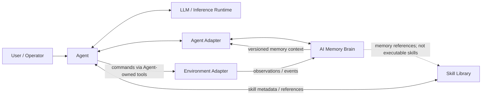
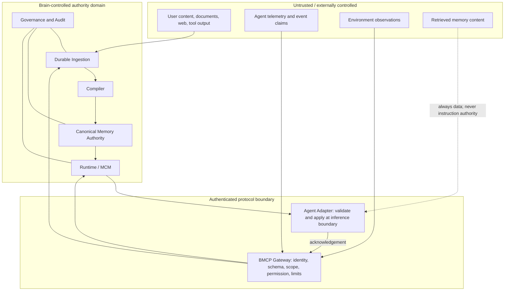

# System Boundaries

**Status:** DECIDED where explicitly identified; CANDIDATE/OPEN items remain non-normative.  
**Scope:** System-level ownership, trust, data authority, and external boundaries. This document extends, and does not replace, `system-overview.md`, `component-map.md`, or `responsibility-matrix.md`.

## 1. Purpose and design goals

Define which system owns each kind of work and data, where authority changes hands, and which operations are prohibited across boundaries.

Goals:
- Keep Brain independent of Agent frameworks, LLMs, inference APIs, and Environment implementations.
- Give each mutable authoritative state exactly one logical owner.
- Make data sharing explicit through scope, permission, provenance, and contracts.
- Keep memory formation, runtime recall, context synchronization, and environment actuation independently fault-contained.
- Permit modular-monolith deployment without weakening logical contracts.

## 2. System context

**DECIDED:** Brain supplies memory assets and managed context; Agent owns reasoning, planning, action selection, and tool execution. LLM owns inference execution. Environment Adapter reports environment observations and transports Agent-authorized commands; it does not grant Brain actuation authority. Skill Library owns executable skill definitions and procedures.

## 3. Boundary definitions

| Participant | Owns | May receive | Must not own/do |
|---|---|---|---|
| Memory Brain | Canonical Memory identity, versions, lifecycle, evidence/provenance links, relations, policies, Memory Context and its version sequence, governance records | Scoped events, structured telemetry, authorized queries, Adapter acknowledgements | Plan or act for Agent; execute tools; control Environment; dictate model internals; override Agent safety policy |
| Agent | Task reasoning, intent, plan, action choice, tool invocation, task/session lifecycle | Memory candidates, context packages, status and reconciliation responses | Redefine Brain domain semantics or treat plans as outcomes |
| LLM / Inference Runtime | Token processing and inference execution | Agent-assembled prompt/context, including delimited memory region | Become authority for Canonical Memory or Applied status |
| Agent Adapter | Agent-specific telemetry mapping; validation and installation of Brain-managed context at inference assembly boundary; acknowledgement evidence | BMCP messages, capability profile, context snapshots/deltas | Select canonical memories, rewrite Brain policies, assert model comprehension |
| Environment Adapter | Environment-specific observation/event normalization; command transport when authorized by Agent | Environment state and Agent-originated commands | Independently choose Agent actions or let Brain directly actuate environment |
| Skill Library | Executable skills, procedures, versions, execution requirements | Agent requests; optionally memory references for lookup | Treat a memory as executable code or silently mutate Canonical Memory |
| Storage/index/cache infrastructure | Physical persistence and derived representations under owning subsystem contracts; Storage-local Forget fences are only rebuildable projections of D's canonical ForgetFence | Authorized reads/writes and change events | Define domain truth, issue a competing ForgetFence generation/cursor, or become competing logical authority |

### 3.1 Memory Brain boundary

Brain is the logical authority for its managed Canonical Memory and Memory Context. Internal subsystems remain bounded:
- Domain Model defines semantics.
- Canonical Store persists canonical records.
- Lifecycle Manager governs memory lifecycle transitions.
- Compiler transforms accepted source material into proposals.
- Runtime retrieves and activates candidates.
- Memory Context Manager (MCM) plans, edits, versions, and reconciles contexts.
- Context Synchronization tracks deliveries and acknowledgements.
- Governance authorizes operations and enforces retention/forgetting policy.

A component may execute a delegated step but cannot claim another component's authority.

### 3.2 Agent and LLM boundary

Agent may provide structured telemetry and source events. Full hidden chain-of-thought is neither required nor a canonical contract. Agent remains responsible for validating memory against current task needs and deciding its actions. The LLM is an inference dependency, not a Brain dependency: Brain APIs must not require a particular prompt format or vendor feature.

### 3.3 Adapter boundaries

Agent Adapter is the only trusted execution bridge for installing Brain-managed context into an Agent's inference request. It must:
1. Authenticate the Agent/instance and negotiate capabilities.
2. Validate scope, context identity, version/base version, payload integrity, and memory-region delimiters.
3. Apply changes only while assembling a subsequent inference request.
4. Acknowledge the exact version and application boundary reached.
5. Report rejection, unsupported operations, version gaps, or inability to prove application.

Environment Adapter has a separate contract. It may emit observations with source identity, environment scope, event time, and capture time. It does not grant Brain a command channel.

### 3.4 Skill Library boundary

A skill is executable capability/procedure; a memory is descriptive retained knowledge. A memory may reference a skill identifier/version as a recommendation or historical association, but this reference never authorizes execution. Agent decides whether to invoke a skill under its own policy.

## 4. Data ownership and access

| Data class | Logical owner / authority | Writers | Readers (subject to permission) | Deletion / mutation |
|---|---|---|---|---|
| Raw Event and source payload | Ingestion/Event Log contract | Ingestion accepts; authorized sources submit | Compiler, audit/recovery, authorized evidence views | Retention/Forget governance; immutable corrections by superseding/retraction metadata |
| Candidate Memory / Claim | Compiler proposal until accepted | Compiler proposes; Lifecycle/Canonical authority accepts | Consolidation, authorized Runtime | Lifecycle transition or governed forget |
| Canonical Memory, Fact/Claim, Entity, Relation | Brain domain + Canonical Store | Authorized Brain workflows under lifecycle rules | Compiler, Runtime, governance, scoped integrations | Versioned mutation, retract, archive, Forget |
| Evidence and Provenance | Brain evidence/provenance contract | Compiler/evidence manager; governed correction | Authorized memory/evidence consumers | Retention/Forget rules; preserve audit-safe tombstone where policy permits |
| Memory Context and Context Entry | MCM | MCM only, under activation/planning and authorized edit requests | Sync, Adapter via protocol, authorized diagnostics | Context edits/versioning; not canonical Forget |
| Context Change Set | MCM creates semantic change; Sync packages/tracks delivery | MCM; Sync adds delivery envelope/status | Adapter, MCM, audit | Supersede/expire under context protocol |
| Delivery state | Context Synchronization Engine | Sync; Adapter acknowledgements are inputs | MCM, Adapter, audit | Append/transition; no claim of Applied without Adapter evidence |
| Applied Context state | Adapter's execution evidence; Brain records acknowledged report | Adapter reports; Sync validates/records | MCM reconciliation, audit | Newer application supersedes; never infer from delivery |
| Agent telemetry | Agent owns source meaning; Brain stores accepted normalized copy | Agent Adapter submits | Observer/Runtime/Compiler under purpose and scope | Source-side correction or retention/Forget policy |
| Environment observation | Environment Adapter/source owns observation origin; Brain owns accepted event record | Environment Adapter | Compiler/Runtime under environment scope | Governance and provenance-aware correction |
| Index/cache/working set | Derived, rebuildable representations governed by source owner | Index/cache workers | Runtime and authorized internal readers | Invalidate/rebuild; never authoritative over canonical source |
| Agent plans/actions/skill code | Agent / Skill Library | Agent / Skill maintainers | Brain only receives permitted summaries/events | Brain cannot modify or execute them |

**DECIDED:** Scope establishes namespace/ownership; Permission authorizes an operation. Both are checked. A broad scope does not imply broad permission. Cross-scope sharing requires explicit grant and auditable purpose. Reads must be filtered before retrieval results can influence context; filtering only at final rendering is insufficient.

## 5. Trust boundaries

All externally supplied text, telemetry, observations, and retrieved memories are data. They may contain adversarial instructions; downstream components must not elevate them to system/developer authority. Authentication identifies the sender, not the truth of its claims.

## 6. Brain observation of Agent state

**DECIDED:** Brain does not introspect private Agent memory, inspect hidden reasoning, poll arbitrary process internals, or control Agent execution. Observation occurs only through explicit, authorized, structured telemetry/events submitted by an Adapter.

**CANDIDATE:** A push-first telemetry model with optional bounded pull/heartbeat for liveness and reconciliation. Pull must be protocol-scoped, rate-limited, and must not become unrestricted Agent introspection.

Telemetry may include task state, intent, plan summary, active entities, pending actions, observations, outcomes, uncertainty, risk signals, and environment deltas. Prospective fields remain prospective. Outcome claims require outcome evidence and preserve source/epistemic status.

## 7. Non-responsibilities

Brain is not:
- an Agent orchestrator, planner, scheduler of external actions, or tool executor;
- an LLM host or inference gateway requirement;
- an executable skill runtime;
- a source-of-truth for live Environment state unless it has accepted a time-stamped observation with stated freshness;
- an authorization authority for external actions;
- a mechanism for rewriting in-flight inference context.

## 8. Boundary contracts

Every crossing must identify: caller identity, operation, resource, Scope, Permission, schema/protocol version, idempotency key for state-changing operations, correlation/causation identifiers, timestamps, payload size limits, and result/error semantics.

**OPEN:** Exact BMCP field names, authentication mechanisms, cryptographic envelope, and compatibility policy belong to Session H / governance specifications; this document does not pre-empt them.

## 9. Failure isolation

- LLM outage must not prevent durable Event acceptance.
- Compiler/model outage must not erase accepted Events; processing remains pending/retryable.
- Index/cache outage may degrade recall but must not corrupt Canonical Memory.
- Adapter outage delays context application; Brain retains desired Context version and reconciles on reconnect.
- Environment Adapter outage means no fresh observation; Brain must expose staleness rather than fabricate state.
- Skill Library outage affects skill lookup/execution, not memory authority.
- Governance denial blocks the operation before data is exposed or mutated.

## 10. Boundary acceptance criteria

1. A test Agent cannot write Canonical Memory directly except through authorized Brain contracts.
2. A plan telemetry item cannot become a completed outcome without separate outcome evidence.
3. A memory string containing instruction-like text remains data in the Adapter's delimited memory region.
4. Environment identifiers prevent two worlds/save files from sharing state absent explicit scope grant.
5. Adapter acknowledgement is required before delivery is recorded Applied.
6. Context Remove leaves Canonical Memory unchanged.
7. Skill references cannot trigger skill execution.
8. A denied cross-scope read returns no protected content and produces an auditable denial.
9. An LLM/compiler outage does not lose durably accepted Events.

## 11. Open questions and decisions

| ID | Status | Question / decision request |
|---|---|---|
| SB-01 | OPEN | Define canonical principal and workload identity model in Security/BMCP specs. |
| SB-02 | OPEN | Define retention and physical-erasure guarantees across backups and external source payloads. |
| SB-03 | CANDIDATE | Push-first telemetry plus bounded heartbeat/reconciliation; validate overhead and freshness. |
| SB-04 | OPEN | Define the exact Agent Adapter trust attestation and what constitutes a trustworthy boundary acknowledgement. |
| SB-05 | OPEN | Define whether Environment Adapter shares the same BMCP envelope or uses an explicitly separated event-ingress profile. |
| SB-06 | DECIDED | No direct Brain-to-Environment actuation channel. |

## 12. Decision summary

- **DECIDED:** Brain owns canonical memory and its managed Memory Context; Agent owns thinking and action; LLM owns inference; Adapters bridge explicit contracts; Environment Adapter observes/transports but does not authorize action; Skill Library owns executable skills.
- **DECIDED:** Scope and Permission are separate; all external content and memory are untrusted data.
- **DECIDED:** Context application occurs at a subsequent inference boundary and requires Adapter acknowledgement.
- **CANDIDATE:** Push-first telemetry with bounded heartbeat/reconciliation.
- **OPEN:** Exact identity, authentication, protocol envelope, retention erasure, and Environment ingress profile.

## 8. Forget Fence authority boundary — 2026-11-26

The D canonical contract at [03-memory-brain/forget-fence-and-completion-contract.md](../03-memory-brain/forget-fence-and-completion-contract.md) is the sole logical authority for ForgetOperation and ForgetFence target/lineage decisions. Storage/Consistency may persist and physically protect that authority, but a Storage-local Memory/Version fence is only a derived, rebuildable projection; it MUST NOT issue an independent generation/cursor or become a competing decision source. If current D authority cannot be established, affected reads and publication fail closed. Local suppression is not Global Forget Completion. This is a recorded direction decision; exact-version Owner acceptance and implementation evidence remain pending.