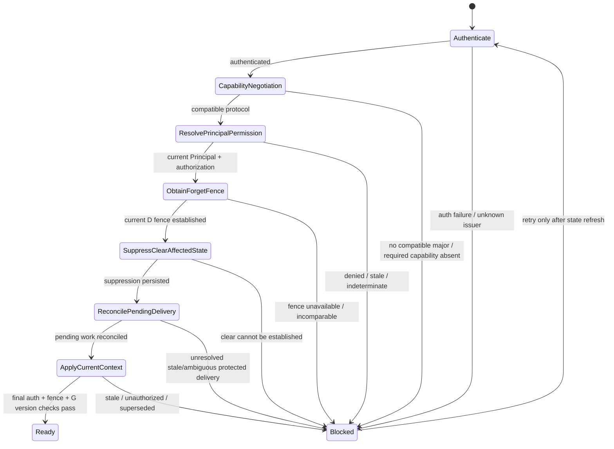

# Phase 3.5 — BMCP Identity Binding, ACK Evidence & Reconnect Alignment

- Owner: Session H — BMCP Protocol & Agent Context Adapter Principal Architect
- Status: **CANDIDATE — protocol proposal only; not cross-module approved and not a frozen wire schema**
- Branch: `session-h-bmcp-protocol`
- Base HEAD inspected: `d46961254bc50995479bd43abed0ee6fe1cdcbb6`
- Inputs: Phase 3 D/E/H/I cross-module review; B typed references; C final inference boundary attestation; I Principal/authorization and Global Forget inventory; G Context/delivery state; D canonical ForgetFence.
- Scope: H wire mapping, Adapter evidence, capability negotiation, reconnect and compatibility. No authority or semantic definitions are changed for B/C/D/G/I.

## 0. Authority and status rules

This document consolidates H's Phase 3.5 candidate interoperability proposal. It does not approve dependent types or semantics owned by B/C/D/G/I. A field marked CANDIDATE is an H encoding proposal; OPEN means its authoritative source or cross-owner mapping is not approved.

Non-negotiable boundaries:

1. Authenticated transport/security context is the only source of authenticated Principal and Issuer binding. Payload identity values are claims/selectors, never authentication evidence.
2. ActorRef and ScopeRef are typed domain references, not credentials or grants.
3. PermissionEpoch (I), ForgetFenceGeneration (D), ContextVersion (G), and CapabilityEpoch (H) are independent opaque namespaces.
4. Transport receipt, application/materialization, final request submission and execution start are separate events.
5. Adapter ACKs prove only bounded actions for one authenticated Adapter instance, runtime session, scope and managed-region/capability slice. They never establish global Forget completion.
6. Unknown, offline, unsupported, stale or unverifiable state is never success. Protected memory use fails closed when current authorization/fence cannot be established.

## 1. Envelope Identity Mapping (H1)

### 1.1 Transport-authenticated context versus payload claims

The transport security layer supplies an authenticated context outside the untrusted payload. The gateway/Adapter resolves it through I's identity and authorization services. The envelope may carry identity references for correlation and routing, but those values must be compared with—not substituted for—the authenticated context.

| Logical field | Source / authority | Wire representation proposal | Trust class / status |
|---|---|---|---|
| AuthenticatedPrincipal | Authenticated transport credential/session, resolved by I | `auth.principal_ref` in protected transport context; optional mirrored `principal_ref` in payload | **I-owned; CANDIDATE mapping.** Only transport-resolved value authenticates |
| Issuer | Credential issuer and I trust registry | `auth.issuer_ref`, audience and credential/key reference | **I-owned; CANDIDATE mapping.** Payload `issuer` is assertion only |
| AgentPrincipal | I-registered logical Agent subject | `agent_principal_ref` | **I-owned; CANDIDATE.** Must bind to authenticated principal/delegation |
| AdapterPrincipal / AdapterInstance | I-registered Adapter workload and concrete instance | `adapter_principal_ref`, `adapter_instance_ref` | **I-owned; CANDIDATE.** Instance replacement is a new target absent I-approved continuity |
| RuntimeSession | Authenticated runtime session established for Agent/Adapter | `runtime_session_ref` plus session binding in auth context | **C/C-I OPEN.** Session is ephemeral, issuer-bound, expiry/revocation checked |
| ActorRef | B stable domain actor reference; uniqueness based on `(issuer, subject_id)` in identity federation | `actor_ref` typed object/ref; no credential material | **B semantic reference; H mapping CANDIDATE.** Never bearer authority |
| ScopeRef | B typed scope identity; I resolves and authorizes | `scope_ref` typed opaque reference | **B/I joint OPEN for final wire schema.** Identifies scope, grants no permission |
| EnvironmentRef | B typed environment/world identity, where relevant to the operation | `environment_ref` typed opaque reference | **B-owned; H mapping OPEN** until exact type and operation applicability are approved |
| PermissionEpoch | I policy-domain epoch | `permission_epoch` opaque I-issued token/reference | **I-owned; CANDIDATE.** No local minting, increment, numeric comparison or reinterpretation |
| CapabilityEpoch | H Adapter instance capability revision | `capability_epoch` opaque H-issued monotonic revision scoped to Adapter instance | **H-owned; CANDIDATE wire representation** |
| ForgetFenceGeneration | D canonical Forget authority | `forget_fence_ref` / `fence_generation` opaque D-issued token | **D-owned; CANDIDATE wire representation** |
| ContextVersion | G Context authority | `context_ref` + opaque `context_version` | **G-owned; H wire mapping CANDIDATE** |

### 1.2 Identity validation rules

- Resolve Principal and Issuer from the authenticated transport context before processing a protected operation. Validate issuer, audience, credential/key status, expiry, revocation and workload/instance binding through I.
- Bind AgentPrincipal, AdapterPrincipal/Instance and RuntimeSession to the authenticated principal and authorized delegation chain. Missing, ambiguous, expired or conflicting binding is denial.
- Resolve ActorRef and ScopeRef using B's typed reference rules. I independently decides whether the authenticated Principal may act on the referenced scope/resource.
- EnvironmentRef is contextual domain identity only. It does not authenticate an Agent, establish a session or grant access.
- Payload `source`, `recipient`, `principal_ref`, `issuer`, `agent_id`, `adapter_id`, `actor_ref`, `scope_ref`, `environment_ref`, `session_id` and `producer_id` are claims/selectors. A mismatch with authenticated/registered values is rejected or quarantined under I policy; never prefer the payload.
- Reauthorize at ingress, before protected Context read/delivery, before local application and at the final inference submission boundary. A previous ALLOW or old ACK is not a perpetual lease.
- If an authoritative type or policy contract is not approved, retain the field as CANDIDATE/OPEN and do not freeze public schema or idempotency namespace serialization.

## 2. Applied ACK Evidence Schema Proposal (H2)

### 2.1 Event and state vocabulary

H preserves G's per-delivery state machine and C's inference-boundary stages as separate dimensions.

| Evidence event | Meaning | Minimum evidence | Does not prove |
|---|---|---|---|
| `DELIVERED` | Addressed Adapter endpoint accepted the transport delivery | DeliveryId, attempt, authenticated endpoint receipt | Context validation, application or inference submission |
| `APPLIED` / `MANAGED_REGION_MATERIALIZED` | Target managed region was materialized in the Adapter/runtime assembly state | ContextVersion, region identity/revision, coverage and local postcondition | Exact final request submitted |
| `FINAL_REQUEST_SUBMITTED` | Exact immutable final request, including complete managed region, crossed the runtime submission boundary | InferenceRequestId, AppliedContentDigest/profile, final-request evidence, request/session/delivery correlation | Execution started, model attention, comprehension or use |
| `EXECUTION_STARTED` | Runtime/provider reports execution began for the submitted request | InferenceRequestId and runtime lifecycle receipt | Model attention, correctness or behavior |

A G delivery may remain `Delivered` while an application event is absent or unknown. A materialization event is not silently promoted to `FINAL_REQUEST_SUBMITTED`. H may emit the final-submission attestation only when the negotiated capability tier and per-request evidence permit it. For the C-defined Full Applied claim, the final immutable request submission proof is mandatory. Tier 2/3 cannot claim Full Applied.

### 2.2 Candidate logical evidence record

The following is a logical schema, not JSON Schema or a frozen wire definition:

```text
AppliedAckEvidence {
  schema_version
  ack_id                         // immutable evidence identity
  ack_kind                       // DELIVERY | APPLICATION | FINAL_SUBMISSION | EXECUTION
  event_stage                    // DELIVERED | MANAGED_REGION_MATERIALIZED |
                                 // FINAL_REQUEST_SUBMITTED | EXECUTION_STARTED
  outcome                        // CONFIRMED | PARTIAL | BYPASSED | UNKNOWN | REJECTED
  delivery_id                    // stable logical G delivery
  delivery_attempt_id            // unique attempt
  context_ref
  target_context_version         // opaque G token
  applied_context_version?       // actual materialized version
  managed_region_id
  managed_region_revision
  coverage                       // FULL | PARTIAL | BYPASSED | UNKNOWN
  applied_content_digest?        // digest of exact managed region in final request
  digest_profile?                // canonicalization + digest algorithm/version
  inference_request_id?          // required for FINAL_REQUEST_SUBMITTED
  final_request_evidence_ref?    // verifiable runtime submission evidence
  permission_epoch               // current I token used at boundary
  forget_fence_ref               // current D token used at boundary
  capability_epoch               // H epoch used for this evidence
  adapter_principal_ref          // I-registered Principal
  adapter_instance_ref           // concrete registered instance
  authenticated_issuer_ref       // from transport-authenticated context
  agent_principal_ref
  runtime_instance_ref?
  runtime_session_ref            // C/I-bound session
  actor_ref                      // B typed reference, if operation requires it
  scope_ref                      // B typed reference
  environment_ref?               // B typed reference when applicable
  submission_observed_at?
  occurred_at
  local_monotonic_sequence
  local_clock_domain
  integrity_proof                // approved I mechanism; no raw credential
  evidence_reference
  correlation_id
  causation_id?
}
```

Requiredness is conditional on event stage and operation. For `FINAL_REQUEST_SUBMITTED`, all of the following are mandatory: ContextVersion, DeliveryId/attempt, InferenceRequestId, ManagedRegion ID/revision, Full coverage, AppliedContentDigest and digest profile, current PermissionEpoch, current ForgetFence reference, CapabilityEpoch, AdapterPrincipal/Instance, authenticated Issuer binding, Agent/runtime identity and RuntimeSession, final-request evidence and integrity proof. If any predicate is unavailable, outcome is Partial/Unknown or rejected; it is not Full Applied.

The digest covers only the declared managed region extracted from the exact final immutable request, under a versioned canonicalization profile. It must not include or log protected prompt regions, secrets or unrelated prompt content. A digest proves integrity under that profile, not authorization or truth.

### 2.3 Correlation and retry

- DeliveryId is stable across attempts; DeliveryAttemptId is unique per attempt.
- InferenceRequestId is unique per actual submitted inference invocation. A retry that creates a new invocation gets a new request ID and a new final-submission evidence record.
- AckId identifies immutable evidence. Re-transmission reuses AckId and evidence digest; transport retry attempt may differ.
- Same evidence identity + same digest is idempotent. Same identity + different digest is a conflict and security/audit event.
- A late valid attestation may be retained as historical evidence only if it proves the event occurred before supersession/expiry/fence advancement. It cannot restore a stale current delivery or context.

## 3. Forget ACK Classification and ACK-to-I Target Mapping (H3)

H emits action-specific ACKs, not a generic `DELETED` or `FORGET_COMPLETE` response.

| H ACK class | Adapter postcondition required | I per-target mapping | What it proves | What it cannot prove |
|---|---|---|---|---|
| `SUPPRESSED` | Durable local deny/suppression gate prevents target from future selection/assembly in the exact Adapter + region + scope | `Confirmed` only for a target whose required action is managed-region suppression | Future inaccessibility at the declared boundary | Buffer/cache/queue purge, past request recall, provider deletion, global completion |
| `LOCAL_BUFFER_CLEARED` | Every declared matching volatile buffer in the exact region/session is cleared or made inaccessible; postcondition verified | `Confirmed` only for exact buffer target if complete inventory matches I target | Named volatile buffer action | Persistent cache, queue, other region/session, provider copy |
| `LOCAL_CACHE_PURGED` | All matching entries in enumerated Adapter-controlled cache namespaces/partitions purged; result and watermark recorded | `Confirmed` only for fully enumerated cache target/partitions | Named Adapter cache purge | Secure media erasure, unlisted cache, provider/Brain cache |
| `QUEUED_DELIVERY_CANCELLED` | All matching locally queued/retry/persisted deliveries in declared queue namespace cancelled or durably non-replayable; scan/drain watermark recorded | `Confirmed` only for exact Adapter-local queue target | Named local queued deliveries cannot replay | Brain/G delivery ledger, already submitted requests, unrelated queues |
| `FAILED` | Action definitively failed; stage and reason durable; no postcondition asserted | `Failed` if definitive and authenticated; otherwise I may classify `Unknown` | A failure at named stage | Any successful suppression/cleanup |
| `UNKNOWN` | Outcome cannot be established: offline, timeout, crash ambiguity, missing evidence or coverage gap | `Unknown` (or Pending until evaluated) | Last verified state and ambiguity reason | Success or failure without further evidence |
| `UNSUPPORTED` | Adapter lacks the requested capability or management boundary | `Unknown` by default; `PolicyException` only by separate I approval | Capability absence at named epoch | Confirmed action or self-authorized exception |

Target evidence must bind ForgetOperationId, I TargetId and inventory seal reference, exact ScopeRef coverage, authenticated Adapter Principal/Instance and Issuer, ManagedRegion/cache/queue identity, D ForgetFence, PermissionEpoch where relevant, CapabilityEpoch, action, attempt, timestamp, integrity proof and audit correlation. H ACK alone does not create I's TargetId or decide whether that target is mandatory.

Mapping rules:

- One ACK can satisfy only the exact matching Adapter instance + runtime/session + ScopeRef + managed-region/capability slice and required action.
- Missing identity, epoch, coverage inventory, action postcondition or integrity proof means I must not mark the target Confirmed.
- `FAILED`, `UNKNOWN` and `UNSUPPORTED` remain distinct. Offline is Unknown/Pending, never success.
- `UNSUPPORTED` is never Confirmed. I may independently approve a narrowly scoped, time-bounded PolicyException; H cannot authorize or infer it.
- A later positive ACK does not erase prior failure evidence. I evaluates the current attempt chain and may confirm only when the exact required action is proven.
- A newly discovered region/partition/instance or late derivative invalidates closed-world inventory assumptions and is handled by I's Reopened/reseal policy.

## 4. Reconnect State Machine (H4)

Reconnect is a fail-closed gate. The following order is normative for H; no cached protected Context is applied before completion.



Normative sequence:

1. **Authenticate** transport; validate issuer, audience, credential/key validity, Adapter instance and authenticated session.
2. **Capability Negotiation**; select mutually supported protocol/schema and capability set; establish current CapabilityEpoch.
3. **Resolve Current Principal / Permission**; bind Adapter, Agent/runtime, ActorRef, ScopeRef and RuntimeSession; obtain current I authorization and PermissionEpoch.
4. **Obtain Current ForgetFence** from D for every relevant target/lineage/scope. Treat it as opaque; do not compare it numerically with PermissionEpoch.
5. **Suppress/Clear Affected State**; persist suppression gate first, then clear supported buffers/caches and cancel local queued deliveries. Record per-action evidence. If full clearing is unsupported, protected state remains inaccessible and target remains Unknown/Unsupported.
6. **Reconcile Pending Delivery** with G using DeliveryId/attempt and current Context target/version. Cancel/supersede stale/expired deliveries; reconcile duplicate, late and unknown ACKs. Never replay a historical payload merely because it remains queued.
7. **Apply Only Current Authorized Context**; fetch/validate current G Snapshot/Delta, check exact base/target, expiry, scope, current I authorization/PermissionEpoch, D ForgetFence, CapabilityEpoch and ManagedRegion immediately before apply and again at final submission.

If any authoritative state cannot be obtained or validated, transition to Blocked for protected memory. Agent non-memory operation may continue only under Agent policy; that does not authorize cached Memory use. An old ACK is historical evidence and cannot override a newer fence, permission epoch, capability epoch, ContextVersion or G supersession.

## 5. Capability Negotiation Matrix (H5)

Capability negotiation advertises evidence-producing abilities, not just feature names. An advertised capability is not proof of conformance; H requires test evidence for the declared tier and each capability epoch.

| Capability family | Tier 1 — Final-request observable | Tier 2 — Managed-region observable | Tier 3 — Transport/basic |
|---|---|---|---|
| Authenticated transport + issuer binding | Required | Required | Required |
| Protocol/schema negotiation | Required | Required | Required |
| Principal/Actor/Scope/session binding | Required | Required | Required for protected operations |
| Current PermissionEpoch + ForgetFence checks | Required at apply and final submit | Required at apply hook; final submit not observable | Required before protected delivery/read; no Applied claim |
| Managed-region isolation | Required and verifiable | Required at local boundary | Not required if no application; must not claim application |
| Snapshot/Delta validation and atomic apply | Required | Required | May transport only; no application claim |
| Final immutable request visibility | Required | Not available | Not available |
| Runtime submission evidence + InferenceRequestId | Required for Full Applied | Not available as trusted proof | Not available |
| AppliedContentDigest of exact submitted managed region | Required for Full Applied | Local digest only; cannot prove final request | Not available |
| Full Applied claim | Allowed per request only if every C proof predicate passes | **Forbidden** | **Forbidden** |
| Partial/Bypassed/Unknown application result | Required when full proof predicates fail | Allowed as observable | Unknown/Not observable |
| Forget ACK coverage | Action-specific evidence for declared region/buffers/caches/queues | Only exact supported local action/coverage | Unsupported/Unknown unless it can perform and prove a specific action |
| Durable ACK journal / dedup | Required for claims that survive restart | Required for any ACK it emits | Required for durable receipt/ACK semantics claimed |
| Reconnect suppression and pending-delivery reconciliation | Required | Required for any managed state retained | Required before protected delivery resumes |

Downgrade rules:

- If final request visibility, submission evidence, request correlation or digest coverage is lost, Tier 1 Full Applied is immediately disabled for affected requests; report Partial/Unknown and renegotiate a new CapabilityEpoch if the declared profile changed.
- Tier 2 cannot be described as Tier 1 by configuration flag or self-report. It cannot emit Full Applied.
- Tier 3 may report transport receipt/rejection/unknown only. It cannot imply materialization, final submission or execution.
- Capability loss never widens authorization or managed-region scope. Unsupported Forget actions remain Unknown until I decides an exception.
- CapabilityEpoch changes invalidate future reliance on old capability claims; historical attestations remain evaluated against the epoch that produced them.
- Capability tier is a conformance ceiling, not a quality ranking.

## 6. Compatibility Matrix (H6)

| Condition | Required receiver behavior | Required sender behavior |
|---|---|---|
| Same major, supported minor | Process negotiated common semantics; optional additions only | Send only negotiated fields/capabilities |
| Newer minor adds optional field | Ignore/preserve safely if unknown; do not change core meaning | Do not rely on optional field unless negotiated |
| Major mismatch | Reject state-changing traffic with VERSION_UNSUPPORTED; no silent downgrade | Re-negotiate; no security/Forget weakening fallback |
| Missing required field | Reject ENVELOPE_INVALID | Correct schema; do not synthesize identity |
| Missing conditional field when condition applies | Reject | Supply authoritative reference or do not send operation |
| Unknown optional extension | Preserve or ignore; namespace required; cannot shadow core fields | Use registered/reverse-DNS namespace |
| Unknown required field or message type | Reject REQUIRED_FIELD_UNSUPPORTED / MESSAGE_TYPE_UNSUPPORTED | Negotiate support or use compatible operation |
| Unknown non-security enum | Retain raw value where safe; return ENUM_UNSUPPORTED or extension handling | Do not assume receiver mapped it |
| Unknown security/identity/authorization/Forget/delivery-critical enum | Fail closed; do not apply | Upgrade/renegotiate; never rely on permissive default |
| Duplicate ACK, same AckId + same canonical digest | Idempotently return prior result; no duplicate side effect | Reuse AckId/evidence digest |
| Duplicate ACK, same AckId + different digest | Reject conflict, audit; do not overwrite evidence | Treat as integrity/idempotency defect |
| Out-of-order ACK / stale ContextVersion | Preserve as historical if verifiable; do not move current state backward or resurrect delivery | Reconcile against G current state before retry |
| Late ACK after fence/permission/capability supersession | Historical only if event ordering is proven; current target remains superseded/blocked | Query current authoritative state; never replay stale content |
| Old Adapter lacking new required identity/fence/ACK binding | Quarantine/block protected Context and Forget completion; no implicit success | Upgrade or operate only in explicitly approved non-memory/basic mode |
| Offline / timeout / lost ACK | Unknown/Pending; reconcile by stable IDs; no success inference | Retry with same idempotency/evidence identity after fresh auth/fence |
| Unsupported action/capability | UNSUPPORTED → I Unknown unless I separately approves PolicyException | Do not claim partial support as complete |
| Protocol-compatible but payload schema unsupported | Reject payload operation; preserve transport connection if safe | Negotiate schema or send supported payload |

Core compatibility invariants:

- Major changes are required for removal/renaming or semantic reinterpretation of core fields/enums. Minor adds optional fields/types/capabilities only. Patch changes do not alter wire semantics.
- Protocol version and payload schema version are independent.
- Unknown extension fields cannot override core fields. Unknown security-critical values never default permissively.
- ContextVersion, PermissionEpoch, ForgetFenceGeneration and CapabilityEpoch are opaque, typed, non-interchangeable values. H never compares across namespaces.
- G delivery states remain Prepared, Delivered, Applied, Rejected, Expired, Superseded and Unknown. H ACK events refine evidence; they do not mutate G's authority or bypass G reconciliation.
- Terminal delivery outcomes are immutable history. Corrections are new linked evidence, not edits to prior ACKs.
- Old Adapter support does not waive I's target inventory or D's fence. A legacy target that cannot prove required action remains Unknown/Unsupported.

## 7. OPEN items and cross-owner handoff

| ID | OPEN item | Owner(s) | H treatment until resolved |
|---|---|---|---|
| H35-OPEN-01 | Final ActorRef/ScopeRef wire type IDs, namespace and serialization profile | B + H | Opaque candidate references only; no schema freeze |
| H35-OPEN-02 | Principal/Issuer/delegation, session binding and PermissionEpoch partition/currentness API | I + H | Authenticated transport binding mandatory; payload claims never trusted |
| H35-OPEN-03 | EnvironmentRef exact type and required operations | B + C + H | Optional candidate only; no identity/authorization inference |
| H35-OPEN-04 | D ForgetFence typed token, target applicability and validation/currentness API | D + H | Opaque reference; fail closed if unavailable |
| H35-OPEN-05 | G ContextVersion/delivery reconciliation and ACK vocabulary mapping | G + H | Preserve G state machine; no local reinterpretation |
| H35-OPEN-06 | C final-request evidence profile, digest canonicalization and runtime submission hook | C + H | Full Applied only with C-required proof; otherwise Partial/Unknown |
| H35-OPEN-07 | I target inventory TargetId/seal and exact evidence acceptance predicates | I + H | ACK target slice explicit; H does not mint TargetId or close global state |
| H35-OPEN-08 | Capability conformance fixtures and runtime evidence per Adapter framework | H + Testing + Agent owners | Capability declaration is not conformance evidence |
| H35-OPEN-09 | Cross-module approval and Contract Registry update | A + B + C + D + G + H + I | Proposal remains CANDIDATE |

## 8. Conformance cases required before freeze

1. Payload ActorRef/ScopeRef/Principal/Issuer contradict authenticated transport binding → reject/quarantine.
2. Credential valid but PermissionEpoch stale or currentness unavailable → deny protected operation.
3. PermissionEpoch current but D ForgetFence stale/unavailable → suppress/block affected target.
4. Delivered receipt without managed-region application → remain Delivered, not Applied.
5. Managed-region materialized but final request changed/discarded → no Full Applied.
6. Final request submitted with complete region and valid evidence → Full Applied eligible only for Tier 1.
7. Same delivery retried into a new inference invocation → new InferenceRequestId and distinct submission evidence.
8. Duplicate ACK with same digest → idempotent; same AckId with different digest → conflict.
9. Old ACK arrives after newer ContextVersion/fence/permission/capability epoch → historical only; no state rollback.
10. SUPPRESSED does not imply cache purge; LOCAL_BUFFER_CLEARED does not imply persistent cache purge.
11. LOCAL_CACHE_PURGED and QUEUED_DELIVERY_CANCELLED omit one declared partition → I target remains Unknown.
12. UNSUPPORTED or offline Adapter → I target Unknown/Pending, never Confirmed.
13. Reconnect executes exact seven-step order; no old queued payload is applied before current authorization/fence and G reconciliation.
14. Adapter instance replacement cannot reuse old instance ACK or coverage inventory.
15. Unknown security-critical enum or required field → fail closed.
16. Protocol major mismatch → no silent downgrade and no weakened Forget/authorization behavior.

These are design acceptance cases; no runtime conformance or fault-injection tests are claimed as executed.

## 9. HEAD and approval statement

- H branch base inspected: `d46961254bc50995479bd43abed0ee6fe1cdcbb6`.
- Source authority branches inspected: B `ab19afbf92f67fe0a7679e9aa3a35b015fed89f4`; C `067b51b6d2e51d15c9fe0959cecd1ee135beac9b`; D `30dbffdc7d47af0888ecf7b42cfa686d2ec0c9d6`; G `3d2c065be863bc1d349faaeece6f6eaa0047abae`; I `4c7c5f953b166bc512064f6de3b7d18a742d0449`.
- Cross-module review baseline read: `reviews/integration/phase-3-defghi-cross-module-contract-review.md` at main `8a6414158c9c056c1638222534e1993d1bbc99d2`.
- Approval: **CANDIDATE ONLY.** This document does not claim B/C/D/G/I approval, Contract Registry approval, wire-schema freeze, implementation conformance or global Forget completion.
