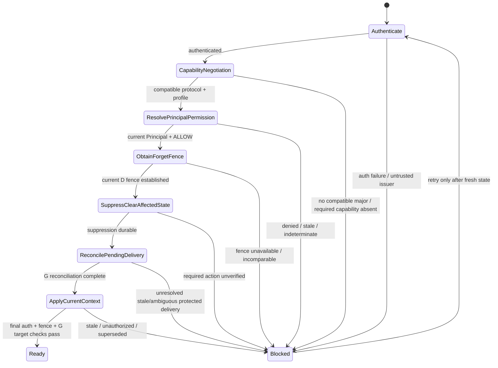

# Phase 3.5 — BMCP Identity Binding, Applied ACK Evidence & Reconnect Alignment

- Owner: Session H — BMCP Protocol & Agent Context Adapter Principal Architect
- Status: **CANDIDATE — H proposal only; not cross-module approved; not a frozen wire schema**
- Branch: `session-h-bmcp-protocol`
- Reprocessed HEAD: `a830628ec0f15a960277412c67c2197565ca1dc4`
- Review baseline: `reviews/integration/phase-3-defghi-cross-module-contract-review.md` on `main` @ `8a6414158c9c056c1638222534e1993d1bbc99d2`
- Scope: H wire mapping, Adapter evidence/ACK, capability negotiation, reconnect and compatibility. No authority or semantic definitions are changed for B/C/D/G/I.
- Evidence posture: static document reconciliation only. No runtime conformance, security test, fault-injection, implementation or global Forget completion is claimed.

## 0. Authority, source baselines and decision discipline

### 0.1 Source branch heads read

| Owner | Branch | HEAD read | Relevant authority consumed |
|---|---|---|---|
| B | `session-b-domain-model-phase3` | `66adf6bdcf5ec69a146fe75afe20ce3b85af8448` | Typed Reference Registry; Scope and Permission Model |
| C | `session-c-agent-integration-2026-11-16` | `35de58ddc93c5f1e554596cdfc430cd6c392d355` | Phase 3.5 Agent Identity, Applied Attestation and Untrusted Memory Conformance |
| D | `session-d-memory-brain-2026-11-16` | `da8e5882d0b238d765d00b2225b79eea45a483b1` | ForgetFence and operation-level producer/publication gate semantics |
| G | `session-g-memory-context` | `3d2c065be863bc1d349faaeece6f6eaa0047abae` | Context Versioning and Change Sets; Context Reconciliation |
| I | `session-i-security-governance-2026-11-16` | `5591ad3620ec3f5d74194bd79556dcf3e25bea07` | Principal/Actor/Authorization; Forget/Retention/Backup/Erasure policy |
| H | `session-h-bmcp-protocol` | `a830628ec0f15a960277412c67c2197565ca1dc4` | Envelope/versioning; Adapter capability/attestation; Context delivery/ACK; Forget/reconnect; Adapter Forget ACK |

The cross-module review is now present on `main` and was read. Its disposition is **CONDITIONAL PASS FOR CONTINUED INTEGRATION; NOT READY FOR CONTRACT FREEZE OR IMPLEMENTATION SIGN-OFF**.

### 0.2 Authority boundaries

- **B** owns typed-reference meaning and stable reference rules. A Ref is neither a credential nor a permission.
- **C** owns Agent telemetry semantics, final immutable request boundary meaning, Applied proof predicates, managed-region isolation and claim ceilings.
- **D** owns canonical ForgetOperation/ForgetFence identity, generation and applicability/currentness semantics.
- **G** owns Context identity/version, immutable target, ChangeSet, delivery intent/state, expiry and supersession.
- **I** owns Principal/Issuer trust, authentication assertions, delegation, authorization, PermissionEpoch, target inventory, per-target state, PolicyException and Global Forget Completion.
- **H** owns BMCP wire representation, protocol negotiation, Adapter SDK behavior, local action evidence, ACK transport and reconnect sequencing.

H maps and transports owner-defined semantics. H MUST NOT mint, reinterpret or approve another module's types, policies, target states or completion criteria.

### 0.3 Non-negotiable invariants

1. Only authenticated transport/security context, resolved and validated under I policy, can establish authenticated Principal/Issuer binding. Payload identity is an untrusted claim/selector, never authentication evidence.
2. ActorRef and ScopeRef are typed references, not credentials, bearer tokens, grants or PolicyDecisions.
3. PermissionEpoch (I), ForgetFenceGeneration (D), ContextVersion (G), CapabilityEpoch (H), and G Delivery/attempt identifiers are separate namespaces. H MUST NOT compare or convert unrelated tokens.
4. Transport receipt, managed-region materialization, final request submission and execution start are distinct evidence stages.
5. Full Applied is eligible only under C's final immutable request proof predicates and G's exact Context/Delivery checks. Tier 2/3 cannot claim Full Applied.
6. Adapter Forget ACKs are bounded to the exact registered Adapter instance, runtime/session, Scope, Managed Region, capability epoch, action and target evidence. They never establish global Forget completion.
7. Unknown, offline, unsupported, stale, conflicting or unverifiable state is never success. Protected Memory use fails closed when required current authority/fence/Context state cannot be established.
8. Candidate wire names below are proposals only. Exact type IDs, canonical encoding and owner acceptance remain OPEN unless explicitly marked otherwise by the owning module.

## 1. Envelope Identity Mapping (H1)

### 1.1 Authenticated transport context versus payload claims

Authentication occurs outside the untrusted BMCP payload. H obtains the peer/session authentication result from the transport/security integration; I validates issuer trust, Principal, credential/key status, audience, validity, revocation and delegation. H may carry opaque references to that verified context for correlation, but a payload mirror cannot authenticate itself.

| Logical identity/reference | Authority and source | Candidate H mapping | Trust and status |
|---|---|---|---|
| Authenticated Principal | I owns Principal registration/trust; transport verifier authenticates credential/session | Protected transport context `auth.principal_ref`; optional payload mirror `principal_ref` | I-owned. Only verifier-resolved transport value is authenticated; payload mirror is a claim |
| Issuer | I trust registry + credential verifier | Protected `auth.issuer_ref`, `auth.audience`, `auth.credential_ref` | I-owned. Payload `issuer` is assertion only |
| AuthenticationContextRef | Verifier/I security service | Protected `auth.authentication_context_ref` | I-owned semantic reference; H transports opaque reference; exact wire type OPEN |
| Agent Principal | I Principal registry; Agent identity must bind to Principal | `agent_principal_ref` | I-owned; distinct from B AgentRef and Agent-supplied `agent_id`; candidate mapping |
| AgentRef | B typed domain registry; I binds it to authenticated Principal | `agent_ref` | B-owned typed reference; candidate encoding; not a credential |
| Adapter Principal | I Principal registry and trust policy | `adapter_principal_ref` | I-owned; must match authenticated Adapter workload/credential |
| AdapterRef / Adapter Instance | B defines AdapterRef meaning; H owns Adapter registration/capability identity; I owns trust/revocation | `adapter_ref`, `adapter_instance_ref` | Distinguish stable Adapter application from concrete instance. Replacement is a new target unless I explicitly approves continuity |
| ProducerRef / ProducerIdentity | B ProducerRef semantics; I owns ProducerIdentity registration/trust; C supplies producer assertion | `producer_ref` plus protected authenticated binding reference | Payload `producer_id` is a claim only; never infer ProducerIdentity from a string |
| Runtime Instance | I/H authenticated workload binding; C requires concrete runtime identity | `runtime_instance_ref` | Candidate opaque reference; exact type/issuer binding OPEN |
| Runtime Session | H/I authenticated session lifecycle; C defines session-bound proof requirements | `runtime_session_ref` | Short-lived, issuer-bound and revocable; session renewal does not renew old permission/delivery/context |
| ActorRef | B owns typed attribution reference; I defines security assertions; H binds it to authenticated subject | `actor_ref` typed object/reference | B semantic shape DECIDED; H wire serialization OPEN. Must be verifier-produced/resolved; never self-authenticating |
| ScopeRef | B owns typed ownership/applicability reference; I/Governance owns authoritative registry and authorization | `scope_refs[]` with explicit role where multiple scopes apply | B semantics DECIDED; wire encoding OPEN. Scope identifies boundary; grants no access |
| EnvironmentRef | Authoritative Environment registry; B typed EnvironmentRef contract ownership remains OPEN unless expressly adopted; C requires exact registry-backed identity when applicable | Optional `environment_ref` | Candidate/OPEN. No display label, URL, world name or coordinates as identity; no cross-environment inference |
| PermissionEpoch | I policy-domain epoch | `permission_epoch` opaque token + I validation/currentness reference | I-owned; partitioning/currentness API OPEN. No local minting, increment, numeric comparison or cross-domain ordering |
| ForgetFenceGeneration | D canonical Forget authority | `forget_operation_ref` + `forget_fence_ref` / generation token | D-owned; H stores and asks D/I validation path; no local ordering interpretation |
| ContextVersion | G Context authority | `context_ref` + `target_context_version` | G-owned opaque immutable version; G defines per-Context sequence; H does not infer order from token syntax |
| DeliveryId / AttemptId | G delivery authority | `delivery_id`, `delivery_attempt_id` | G-owned stable logical delivery + unique attempt; H transports and correlates |
| CapabilityEpoch | H Adapter capability registry | `capability_epoch` | H-owned opaque epoch scoped to Adapter instance; changes when proof/capability coverage changes |

### 1.2 ActorRef semantic components and trust binding

B's ActorRef is an attribution reference with semantic components including:

- `principal_ref: PrincipalRef`;
- `issuer_ref: IssuerRef`;
- `authentication_context_ref: AuthenticationContextRef`;
- optional `agent_ref: AgentRef`, `adapter_ref: AdapterRef`, `producer_ref: ProducerRef`;
- optional `delegation_chain_ref` and `acting_for_ref`;
- authenticated time and authentication-strength/profile reference where required.

This is B's logical semantic shape, not a wire schema. H MUST preserve discriminator, issuer/namespace and typed-reference boundaries. H MUST NOT flatten these into one untyped string or convert PrincipalRef to ActorRef without verifier-issued operation binding.

### 1.3 Required validation order

1. Authenticate transport and validate issuer, audience, credential/key status, expiry and revocation.
2. Resolve authenticated Principal and concrete Adapter instance from the protected transport/workload context.
3. Resolve Agent Principal, Runtime Instance and Runtime Session; validate explicit assignment/delegation/continuity under I.
4. Compare every payload identity assertion (`source`, `recipient`, `principal_ref`, `issuer`, `agent_id`, `agent_ref`, `adapter_id`, `adapter_ref`, `producer_id`, `actor_ref`, `scope_ref`, `environment_ref`, `session_id`) with the authenticated and registered binding. Mismatch => reject/quarantine and audit; never prefer payload.
5. Resolve ActorRef, ScopeRef and EnvironmentRef with B/I authoritative registries; validate type, issuer, namespace, scope role, lifecycle and environment binding.
6. Obtain I authorization for exact action/resource/purpose/audience/scope. Missing, ambiguous or indeterminate required scope is DENY/INDETERMINATE, never wildcard.
7. Recheck current PermissionEpoch at the final protected apply/disclosure/submission boundary.

No identity or authorization may be inferred from a valid protocol signature alone. Message integrity proves integrity under a profile, not identity policy or permission.

## 2. Applied ACK Evidence Schema Proposal (H2)

### 2.1 Evidence stages and G state separation

The H evidence event vocabulary refines—but does not replace—G's per-delivery lifecycle.

| Evidence stage | Meaning | Minimum evidence | Does not prove |
|---|---|---|---|
| `DELIVERED` | Addressed Adapter transport endpoint accepted the delivery | DeliveryId, attempt, authenticated endpoint receipt | Context validation, managed-region application or inference submission |
| `MANAGED_REGION_MATERIALIZED` | Exact target region was materialized locally at the Adapter boundary | ContextVersion, region ID/revision, coverage and verified local postcondition | Final immutable request submission |
| `FINAL_REQUEST_SUBMITTED` | Exact final immutable request, with complete target managed region, crossed C's observable runtime/provider handoff boundary | InferenceRequestId, FinalRequestBoundaryId, AppliedContentDigest/profile, final submission evidence, delivery/session/context correlation | Execution started, model attention, comprehension or use |
| `EXECUTION_STARTED` | Runtime/provider lifecycle evidence reports execution began for the identified request | InferenceRequestId and authenticated runtime lifecycle receipt | Model attention, comprehension, correctness or use |

G's state remains Prepared, Delivered, Applied, Rejected, Expired, Superseded or Unknown. H evidence refines G's acceptance decision; H MUST NOT unilaterally mutate G's authoritative state. In particular:

- Prepared is not Delivered.
- Delivered means transport receipt only.
- Local materialization is not final submission.
- G may accept Applied only for a valid C Full Applied proof satisfying the exact G target/delivery conditions.
- Partial, Bypassed and Unknown are not Full Applied and MUST NOT be silently promoted.
- Execution Started is a later runtime lifecycle event, not an Applied synonym.

### 2.2 Candidate logical evidence record (not frozen schema)

```text
AppliedAckEvidence {
  schema_version
  ack_id
  ack_kind                       // DELIVERY | APPLICATION | FINAL_SUBMISSION | EXECUTION
  event_stage                    // DELIVERED | MANAGED_REGION_MATERIALIZED |
                                 // FINAL_REQUEST_SUBMITTED | EXECUTION_STARTED
  outcome                        // CONFIRMED | PARTIAL | BYPASSED | UNKNOWN | REJECTED
  delivery_id                    // G logical delivery
  delivery_attempt_id            // unique delivery attempt
  context_ref
  target_context_version         // G opaque immutable target
  applied_context_version?       // actual materialized version
  managed_region_id
  managed_region_revision
  managed_region_inventory_ref
  coverage                       // FULL | PARTIAL | BYPASSED | UNKNOWN
  applied_content_digest?
  digest_profile?                // canonicalization + algorithm + version
  inference_request_id?          // required for FINAL_REQUEST_SUBMITTED
  final_request_boundary_id?     // required for C Full Applied
  final_request_evidence_ref?    // verifiable runtime/provider handoff proof
  protected_region_integrity_ref?// proves protected regions were not altered
  permission_epoch               // current I token at relevant boundary
  authorization_decision_ref?   // I decision for exact action/scope/audience
  forget_operation_ref
  forget_fence_ref               // current applicable D token
  capability_epoch               // H epoch used for this evidence
  adapter_principal_ref
  adapter_ref
  adapter_instance_ref
  authenticated_issuer_ref       // from protected transport context
  agent_principal_ref
  agent_ref?
  runtime_instance_ref
  runtime_session_ref
  actor_ref?
  scope_ref
  environment_ref?               // only where operation is environment-dependent
  occurred_at
  submission_observed_at?
  local_monotonic_sequence
  local_clock_domain
  anti_replay_nonce_or_sequence
  integrity_proof                // I-approved mechanism; no raw credential
  evidence_digest
  evidence_reference
  correlation_id
  causation_id?
}
```

Requiredness is conditional on operation and event stage. For C Full Applied / `FINAL_REQUEST_SUBMITTED`, the same integrity-protected proof MUST bind:

- authenticated Agent Principal/Agent instance and Adapter Principal/Adapter instance;
- Runtime Instance and Runtime Session;
- InferenceRequestId assigned to the actual final submission;
- G Context ID + exact immutable ContextVersion;
- G DeliveryId + attempt ID;
- Managed Region ID/revision + complete declared coverage inventory;
- H CapabilityEpoch used at submission;
- I PermissionEpoch + authorization decision current at submission;
- D ForgetOperation/FenceGeneration applicable to the delivered lineage and scope;
- exact AppliedContentDigest + versioned digest/canonicalization profile;
- FinalRequestBoundaryId + runtime/provider handoff evidence + submission timestamp;
- protected-region integrity evidence (System/Developer/User/Agent-policy/tool-authorization regions unchanged);
- attestation/evidence ID, schema/profile version, anti-replay nonce/sequence and integrity/signature reference.

If any predicate is absent, stale, unverifiable or mismatched, Full is forbidden. The strongest truthful result is Partial, Bypassed, Rejected, Superseded/Expired or Unknown as applicable. A pre-submit hook, intermediate middleware representation, prompt template, mutable buffer, local cache or transport receipt is not C's final boundary.

The digest covers only the declared Managed Region extracted from the exact final immutable request under the agreed versioned profile. It MUST NOT include unrelated prompt/user content, secrets or protected regions. A digest is not anonymization, authorization, truth or proof of model attention.

### 2.3 Correlation, idempotency and late evidence

- DeliveryId is stable across attempts; DeliveryAttemptId is unique per attempt.
- InferenceRequestId is unique per actual submitted inference invocation. A retry creating a new invocation gets a new request ID and new final-submission evidence.
- AckId identifies immutable evidence. Retransmission reuses AckId and evidence digest; transport retry may have its own attempt.
- Same evidence identity + same digest is idempotent. Same identity + different digest is a conflict and security/audit event.
- G's terminal delivery history is immutable. Corrections are new linked evidence, not edits.
- Late evidence may be retained as historical only when it proves the event occurred before expiry/supersession/fence/permission invalidation. It cannot restore current delivery/context or move G's current state backward.
- If event ordering cannot be established, preserve Unknown.

## 3. Forget ACK Classification and ACK-to-I Target Mapping (H3)

H emits action-specific ACKs. There is no generic `DELETED`, `CLEARED_ALL` or `FORGET_COMPLETE` Adapter response.

| H ACK class | Adapter-local postcondition | Candidate I per-target mapping | What it proves | What it cannot prove |
|---|---|---|---|---|
| `SUPPRESSED` | Durable local deny/suppression gate prevents future selection/materialization of the covered target in this Adapter + Managed Region + Scope | `Confirmed` only if I target requires suppression/inaccessibility | Future inaccessibility at exact declared boundary | Buffer/cache/queue purge, past request recall, provider deletion, global completion |
| `LOCAL_BUFFER_CLEARED` | All matching volatile buffers in declared region/session inventory cleared or rendered inaccessible; postcondition verified | `Confirmed` only for exact buffer target when complete inventory matches | Named volatile-buffer action | Persistent cache, other sessions/regions, provider copies |
| `LOCAL_CACHE_PURGED` | All matching entries in enumerated Adapter-controlled cache namespaces/partitions purged; result + watermark recorded | `Confirmed` only for fully enumerated matching cache target/partitions | Named local cache purge | Secure media erasure, undeclared stores, Brain/provider caches |
| `QUEUED_DELIVERY_CANCELLED` | All matching locally queued/retry/persisted deliveries in declared queue namespace cancelled or durably non-replayable; scan/drain watermark recorded | `Confirmed` only for exact Adapter-local queue target | Named local queued deliveries cannot replay | G/Brain delivery ledger, remote queues, already submitted requests |
| `FAILED` | Action definitively failed; stage and reason durable; no success postcondition asserted | I may map to `Failed` only when failure is definitive/authenticated; otherwise `Unknown` | Failure at named stage | Any successful suppression/cleanup |
| `UNKNOWN` | Outcome cannot be established (offline, timeout, crash ambiguity, missing evidence or coverage gap) | `Unknown` or `Pending` pending I evaluation | Last verified state + ambiguity reason | Success or definitive failure |
| `UNSUPPORTED` | Adapter lacks requested capability or management boundary at this CapabilityEpoch | `Unknown`; only I may independently approve a scoped `PolicyException` | Capability absence at named epoch | Confirmed action or self-authorized exception |

### 3.1 I target-state and inventory binding

I's per-target states are `Pending`, `Confirmed`, `Failed`, `Unknown` and `PolicyException`. H reports evidence; I alone decides the target's current state, whether an action is required, whether evidence is acceptable, and whether an exception is approved.

For a target-satisfaction candidate, evidence binds at minimum:

- I-issued Forget TargetId and sealed target-inventory reference/version;
- ForgetOperationId and applicable D ForgetFence token;
- exact target action and postcondition;
- authenticated Adapter Principal/AdapterRef/concrete instance and Issuer;
- Agent/runtime/session binding where relevant;
- B-typed ScopeRef coverage;
- Managed Region/cache/queue namespace + region revision;
- capability set + CapabilityEpoch;
- PermissionEpoch where relevant;
- attempt, event time, monotonic sequence/clock domain, evidence digest/integrity proof and audit correlation;
- action-specific coverage inventory and purge/cancel watermark when applicable.

H MUST NOT mint I TargetId, seal I inventory, decide mandatory target classes or close I's global completion vector. A single ACK satisfies at most the exact matching Adapter instance + runtime/session + Scope + region + capability slice + required action.

### 3.2 Mapping invariants

- Missing identity, TargetId/inventory seal, required epoch, complete coverage, action postcondition or integrity proof means I MUST NOT mark the target Confirmed.
- `FAILED`, `UNKNOWN` and `UNSUPPORTED` remain distinct. Offline/timeout/crash ambiguity is Unknown/Pending, never success.
- `UNSUPPORTED` is never Confirmed. I may independently approve a narrowly scoped, time-bounded PolicyException with rationale, approver, review/expiry and compensating controls.
- A later positive ACK does not erase prior failure evidence; I evaluates the current attempt chain.
- A newly discovered Adapter instance, region, partition, queue, producer/recipient class or late derivative can reopen inventory and invalidate prior closed-world assumptions under I policy.
- I's producer-domain registration epoch (inventory of producer/recipient classes) is distinct from D's per-work-item ProducerRegistrationSequence/high-water barrier. H carries both references when required; it MUST NOT substitute one for the other.

## 4. Reconnect State Machine (H4)

Reconnect is a fail-closed gate. No cached protected Context is applied before the seven ordered stages below complete.



Normative sequence:

1. **Authenticate.** Authenticate transport; validate Issuer, audience, credential/key validity, revocation, Adapter instance and session. Resolve authenticated Principal from protected transport context, never from payload.
2. **Capability Negotiation.** Negotiate protocol major/minor, payload schema, message families, ACK semantics, evidence profile and supported capability set. Establish current H CapabilityEpoch for this Adapter instance.
3. **Resolve Current Principal / Permission.** Bind Adapter, Agent/runtime, ActorRef, ScopeRef and RuntimeSession; resolve I Principal/Issuer/delegation; obtain current authorization decision and PermissionEpoch for the exact action/resource/purpose/audience/scope.
4. **Obtain Current ForgetFence.** Obtain D's current applicable ForgetOperation/Fence for every relevant target/lineage/scope. Treat token as opaque and validate only through D/I-owned operation; never compare it numerically with PermissionEpoch.
5. **Suppress/Clear Affected State.** Persist suppression gate first; then perform supported volatile-buffer clear, cache purge and local queue cancellation as separate actions. Record per-action evidence. If a required action is unsupported or cannot be verified, retain I target as Unknown/Unsupported and keep affected protected Memory inaccessible unless I independently approves an exception.
6. **Reconcile Pending Delivery.** Query G's current Context target and delivery ledger; reconcile DeliveryId/attempt, expiry, supersession, duplicates, late ACKs and unknown outcomes. Cancel/supersede stale queued payloads. If Delta base is not exact current Adapter version or a gap exists, request current Snapshot. Never replay historical payload merely because it remains queued.
7. **Apply Only Current Authorized Context.** Fetch/validate only current G Snapshot/Delta; check exact base/target, scope, expiry, supersession, current I authorization/PermissionEpoch, current D ForgetFence, H CapabilityEpoch and Managed Region immediately before apply and again at final submit. Emit Applied evidence only at the C-declared tier/boundary.

If required authority/currentness or G reconciliation cannot be established, transition to Blocked for protected Memory. Non-memory Agent operation may continue only under Agent policy; that does not authorize cached Memory. Offline, unsupported or unreachable targets remain Unknown/Pending unless I explicitly records a PolicyException.

### 4.1 Stale ACK and reconnect rules

- Old ACKs remain immutable historical evidence; they cannot override a newer PermissionEpoch, ForgetFence, CapabilityEpoch, ContextVersion, delivery supersession or target inventory seal.
- A late ACK can be retained as historical only if trusted event time/sequence proves it preceded the superseding state.
- If ordering is incomparable, preserve Unknown and reconcile with the owning authority.
- Reconnect does not extend message expiry, permission lease, delegation, delivery TTL or capability evidence.
- A replaced Adapter instance is a new target; it cannot inherit old instance ACKs or coverage inventory without explicit I-approved continuity.

## 5. Capability Negotiation Matrix (H5)

Capability negotiation declares what the Adapter can do and prove. A declaration is not conformance evidence. H's CapabilityEpoch scopes the declaration to a concrete Adapter instance and capability profile.

| Capability | Tier 1 — Final-request observable | Tier 2 — Managed-region observable | Tier 3 — Transport/basic |
|---|---|---|---|
| Authenticated transport and I Principal/Issuer binding | Required | Required | Required for protected operations |
| Protocol/schema negotiation and canonical integrity profile | Required | Required | Required |
| Typed Principal/Actor/Scope/session binding | Required | Required | Required for protected operations |
| Current I PermissionEpoch and D ForgetFence checks | At apply and final submit | At apply; no final-submit proof | Before protected delivery/read; no application claim |
| Managed-region isolation | Required, verifiable and protected-region integrity proven | Required for any insertion | No managed insertion claim |
| Snapshot/Delta validation and atomic application | Required when advertised | Required when advertised | Transport only |
| Exact final immutable request visibility | Required | Not available | Not available |
| Actual runtime/provider submission evidence + InferenceRequestId | Required for Full | Not available as trusted proof | Not available |
| FinalRequestBoundaryId + protected-region integrity evidence | Required for Full | Not available as final-request proof | Not available |
| AppliedContentDigest of exact submitted Managed Region | Required for Full | Local digest only; cannot prove final request | Not available |
| Full Applied | Allowed per request only if every C/G/I/D predicate passes | **Forbidden** | **Forbidden** |
| Partial/Bypassed/Unknown | Required where Full predicates fail | Allowed as observed | No Applied claim; transport status only |
| Forget suppression / buffer clear / cache purge / queue cancel | Declare exact action + complete inventory coverage and evidence | Same, limited to supported local actions | Unsupported/Unknown unless specifically implemented and proven |
| Durable ACK journal / deduplication | Required for evidence surviving restart | Required for any durable ACK emitted | Required for durable receipt semantics claimed |
| Reconnect suppression and delivery reconciliation | Required | Required for retained managed state | Required before protected delivery resumes |
| Model attention/comprehension/use | Never claim | Never claim | Never claim |

Tier is a conformance ceiling, not vendor label or quality ranking. A Tier 1 Adapter may report Partial, Bypassed or Unknown on an individual request.

### 5.1 Downgrade and epoch rules

- If final-request visibility, actual submission evidence, request correlation, region coverage or protected-region integrity is lost, Full Applied is disabled immediately for affected requests.
- If declared capabilities/profile changes, issue a new CapabilityEpoch and renegotiate before new protected operations. A changed binary, runtime hook, middleware, region boundary, cache/queue inventory or evidence key binding may require a new epoch.
- Tier 2 cannot be configured or self-labelled as Tier 1; a local buffer digest is not final-request proof.
- Tier 3 may report transport receipt, rejection, expiry or Unknown only; it cannot imply materialization, final submission or execution.
- Capability loss never widens authorization or target coverage. Unsupported Forget actions remain Unknown unless I separately authorizes an exception.
- Historical evidence is evaluated against the epoch that produced it; a newer epoch cannot retroactively strengthen old evidence.

## 6. Compatibility Matrix (H6)

| Condition | Receiver behavior | Sender behavior |
|---|---|---|
| Same major, supported minor | Process negotiated common semantics; optional additions only | Send only negotiated fields/capabilities |
| Newer minor adds optional field/type | Ignore or preserve safely if unknown; core meaning unchanged | Do not rely on optional field unless negotiated |
| Major mismatch | Reject state-changing traffic with `VERSION_UNSUPPORTED`; no silent downgrade | Re-negotiate; no weaker auth/Forget fallback |
| Patch version difference | Accept only if negotiated semantics unchanged | No wire-semantic change in patch |
| Protocol version supported, payload schema unsupported | Reject that payload operation; preserve connection if safe | Negotiate supported schema or use supported operation |
| Missing required field | Reject `ENVELOPE_INVALID` | Correct schema; never synthesize identity |
| Missing conditional field when condition applies | Reject operation | Supply authoritative reference or do not send |
| Unknown optional namespaced extension | Preserve or ignore; cannot shadow core fields | Use registered/reverse-DNS namespace |
| Unknown required field/message type | Reject `REQUIRED_FIELD_UNSUPPORTED` / `MESSAGE_TYPE_UNSUPPORTED` | Negotiate support or use compatible operation |
| Unknown non-security enum | Preserve raw value where safe; explicit `ENUM_UNSUPPORTED`/extension path | Never assume receiver mapped it |
| Unknown identity/auth/security/Forget/delivery-critical enum | Fail closed; no apply or target confirmation | Upgrade/renegotiate |
| Duplicate ACK, same AckId + same canonical evidence digest | Idempotently return prior result; no duplicate side effect | Reuse AckId and evidence digest |
| Duplicate ACK, same AckId + different digest | Reject conflict, audit; never overwrite immutable evidence | Treat as integrity/idempotency defect |
| Out-of-order ACK / stale ContextVersion | Preserve historical evidence if verifiable; do not roll current state backward | Reconcile with G current target before retry |
| Late ACK after fence/permission/capability supersession | Historical only if ordering proven; current target remains superseded/blocked | Query current authorities; never replay stale content |
| Old Adapter missing new identity/fence/ACK binding | Block/quarantine protected Context and Forget target satisfaction; no implicit success | Upgrade or use only explicitly approved non-memory/basic mode |
| Offline / timeout / lost ACK | Unknown/Pending; reconcile by stable IDs; never infer success | Retry/reconcile after fresh auth/fence; preserve idempotency |
| Unsupported action/capability | I target Unknown unless I separately approves PolicyException | Do not claim partial support as complete |
| Same AckId, stale capability/instance | Retain historical evidence only; no current target satisfaction | Re-negotiate under current instance/epoch |

Core compatibility invariants:

- Major changes are required for removal/renaming or semantic reinterpretation of core fields/enums. Minor adds optional fields/types/capabilities only. Patch does not alter wire semantics.
- Protocol version and payload schema version are independent.
- Unknown extensions cannot override core fields. Unknown security-critical values never default permissively.
- ContextVersion, PermissionEpoch, ForgetFenceGeneration and CapabilityEpoch are opaque, typed and non-interchangeable.
- G delivery states remain G-owned. H evidence refines acceptance; it does not redefine delivery lifecycle or bypass G reconciliation.
- Terminal delivery outcomes are immutable history. Corrections are new linked evidence.
- Legacy Adapter compatibility does not waive I target inventory, D fence, C final-request proof or G version checks.

## 7. OPEN items and cross-owner handoff

| ID | OPEN item | Owner(s) | H treatment until resolved |
|---|---|---|---|
| H35-OPEN-01 | Exact ActorRef/ScopeRef/PrincipalRef/AgentRef/AdapterRef/ProducerRef type IDs, namespace and canonical serialization profile | B + H (+ I trust binding) | Preserve discriminators/issuer/namespace as opaque typed refs; no public schema freeze |
| H35-OPEN-02 | Principal/Issuer/delegation, Runtime Session binding, PermissionEpoch partition/currentness API and authorization decision verification | I + H | Authenticated transport binding mandatory; payload claims never trusted; fail closed on indeterminate |
| H35-OPEN-03 | EnvironmentRef exact type owner, registry and operation applicability | B/Governance + C + H | Optional candidate only where applicable; require authoritative registry resolution; no label inference |
| H35-OPEN-04 | D ForgetFence typed token, target applicability and currentness/validation API | D + H (+ I policy) | Opaque token; fail closed if currentness cannot be established |
| H35-OPEN-05 | G ContextVersion/Delivery/attempt wire mapping, per-session Adapter ledger and reconciliation semantics | G + H | Preserve G immutable version and delivery state; no local reinterpretation |
| H35-OPEN-06 | C FinalRequestBoundaryId, final immutable request evidence profile, digest canonicalization and runtime/provider submission hook | C + H + Runtime | Full Applied only with every C predicate; otherwise Partial/Bypassed/Unknown |
| H35-OPEN-07 | I TargetId, sealed inventory reference, exact target evidence acceptance and producer-domain inventory epoch | I + H | ACK cannot mint target or seal inventory; map only exact target slice |
| H35-OPEN-08 | Capability conformance fixtures and runtime evidence per Adapter framework | H + Testing + Agent/Runtime owners | Capability declaration is not conformance evidence |
| H35-OPEN-09 | Cross-module approval and Contract Registry update | A + B + C + D + G + H + I | This remains CANDIDATE until owners approve; no schema freeze |
| H35-OPEN-10 | Reconnect handling when one clear action is Unsupported but suppression is supported, including exact I exception policy | I + G + H | Keep affected target Unknown/Unsupported; protected content remains inaccessible; H cannot waive required target |

### 7.1 Review findings retained as external blockers

- **CR-P0-02 / INT-P0-02:** typed identity/Scope/permission binding remains OPEN; H's encoding is candidate.
- **CR-P1-05:** H-to-I ACK target mapping is now explicit as an H proposal, but I approval and evidence acceptance remain OPEN.
- **CR-P1-01 / INT-P0-03:** D/E/Storage atomic producer admission/fence/publication implementation remains outside H ownership and OPEN. H does not claim Forget end-to-end closure.
- **CR-P1-02:** A/E typed cursor coordination remains external; H continues to treat all cursor/epoch namespaces as opaque and owner-controlled.
- **CR-P0-01:** B Fact/Claim ADR remains ADR-BLOCKED; no H field promotes candidate Claim semantics.

## 8. Conformance cases required before freeze

These are design acceptance cases only; NOT RUN unless separately evidenced by an implementation test report.

1. Payload Principal/Issuer/ActorRef/AgentRef/AdapterRef/ProducerRef/ScopeRef/EnvironmentRef contradicts authenticated/registered binding → reject/quarantine.
2. Valid credential but stale/indeterminate PermissionEpoch → deny protected operation.
3. Permission current but D ForgetFence stale/unavailable/incomparable → suppress/block affected target.
4. Delivered receipt without materialization → remain Delivered, not Applied.
5. Managed Region materialized but request later mutated/discarded → no Full Applied.
6. Actual final immutable request submitted with complete region, C boundary ID, request ID, digest, protected-region proof and current I/D/G/H binding → Full Applied eligible only for Tier 1 and G acceptance.
7. Retry creates a new inference invocation → new InferenceRequestId and new immutable final-submission evidence.
8. Duplicate ACK same ID/same digest → idempotent; same ID/different digest → conflict.
9. Old ACK after newer ContextVersion/fence/permission/capability epoch/target inventory seal → historical only; no rollback or target closure.
10. SUPPRESSED does not imply buffer/cache/queue purge; LOCAL_BUFFER_CLEARED does not imply persistent cache purge.
11. LOCAL_CACHE_PURGED or QUEUED_DELIVERY_CANCELLED omits one declared partition/queue shard → I target remains Unknown.
12. UNSUPPORTED or offline Adapter → I target Unknown/Pending, never Confirmed without separate I PolicyException.
13. Reconnect follows the seven ordered stages; no old queued payload applied before fresh auth, capability, permission, fence, suppression and G reconciliation.
14. Adapter instance replacement cannot reuse old instance ACK or coverage inventory.
15. Unknown security-critical enum or required field → fail closed.
16. Protocol major mismatch → no silent downgrade or weakened authorization/Forget semantics.
17. Tier 2/3 attempts Full Applied → reject as conformance failure.
18. Same Context but different Adapter sessions → per-session Applied/clear evidence remains distinct; no scalar applied_version shortcut.
19. I producer-domain inventory epoch is not substituted for D work-item registration high-water, or vice versa.
20. Unsupported local purge with supported suppression → suppression gate persists; target remains Unknown for purge unless I approves scoped exception.

## 9. HEAD, source evidence and approval statement

- H branch HEAD before this reprocessing: `a830628ec0f15a960277412c67c2197565ca1dc4`.
- Review document read: `reviews/integration/phase-3-defghi-cross-module-contract-review.md` on main @ `8a6414158c9c056c1638222534e1993d1bbc99d2`.
- Source branch heads read are recorded in §0.1.
- Supporting H artifacts read: `message-envelope-and-versioning.md`, `adapter-capability-and-applied-attestation.md`, `context-delivery-and-acknowledgement.md`, `forget-revocation-and-reconnect.md`, `adapter-forget-ack-and-target-binding.md`, `protocol-conformance-matrix.md`.
- Approval: **CANDIDATE ONLY.** This proposal does not claim B/C/D/G/I approval, Contract Registry approval, wire-schema freeze, implementation conformance, security certification, physical erasure or Global Forget Completion.
