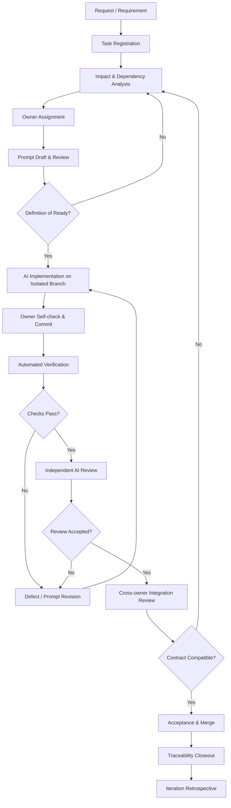

# AI Development Iteration Lifecycle
# AI 开发迭代生命周期

**Document ID:** AI-PROC-001  
**Version:** 1.0  
**Status:** PROPOSED  
**Parent standard:** AI-STD-001

## 1. Operating model / 运行模型

The project runs as a controlled, evidence-producing loop. The loop is not “ask AI to code, then ask AI if it is correct.” It separates specification, implementation, verification, review and acceptance.

项目采用可审计、可复现的工程迭代闭环，而不是“让 AI 写代码，再让 AI 自己说正确”。

## 2. Iteration stages / 迭代阶段

### Stage 0 — Intake and registration

Create a Work Item before assigning implementation. Record the user/system need, expected outcome, why now, constraints, priority, sponsor and candidate Owner.

Do not prematurely prescribe implementation details when the requirement is still unclear. Distinguish requirement, assumption, design proposal and decision.

### Stage 1 — Impact and dependency analysis

The accountable Owner maps:

- affected modules, APIs, schemas, data stores and runtime flows;
- upstream contracts and downstream consumers;
- state machines and invariants affected;
- security, privacy, scope, retention and deletion implications;
- concurrency, ordering, retry, idempotency and recovery implications;
- migration, backward compatibility and rollback;
- tests and observability required.

Cross-module work is split into Owner-owned tasks with one integration parent. The parent defines shared contract questions and sequencing; it does not authorize one Owner to edit another Owner's design.

### Stage 2 — Prompt drafting and review

The prompt author translates the approved task into a complete, bounded, testable instruction. The prompt reviewer checks:

- source-of-truth references and exact base SHAs;
- authority and file boundaries;
- missing assumptions and ambiguous language;
- measurable acceptance criteria;
- failure-path and negative tests;
- deliverable/report format;
- stop conditions.

Store the prompt before implementation. Freeze the prompt version used for the run. Prompt reviewer is not automatically the implementation reviewer.

### Stage 3 — Readiness gate

READY requires all Definition of Ready conditions from AI-STD-001. A dependency may be marked “assumption” only when the task is safe under that assumption and the assumption owner is identified.

If an upstream contract is OPEN and the task depends on it, either:
- resolve the contract first;
- implement only a clearly isolated non-dependent slice; or
- remain BLOCKED.

Do not silently invent a temporary contract and allow it to become normative.

### Stage 4 — AI implementation

The implementing AI must:

1. read the exact referenced versions;
2. restate scope and invariants in its work log;
3. inspect existing code and tests before changing them;
4. make the smallest coherent change;
5. add or update tests alongside behavior;
6. update documentation, examples and migrations as needed;
7. for architecture-significant changes, update Chinese and English counterparts in the same change set and verify semantic parity;
8. run local checks;
9. report deviations, unknowns and unrun checks;
10. commit to its assigned branch;
11. verify branch HEAD and read back changed files.

The AI must stop and request a decision when it discovers a conflict outside its authority, an unsafe invariant, an unanticipated data migration, or an acceptance criterion that cannot be tested.

### Stage 5 — Automated verification

CI should run deterministic checks on every PR. Required checks are selected by task class and risk.

Minimum implementation gate:
- formatting and lint;
- compile/build and type checks;
- unit tests;
- relevant integration/contract tests;
- regression tests for changed behavior;
- dependency/security scans where available.

R2/R3 additionally require relevant concurrency/fault/security tests. Test reports identify the exact commit. A test run on a different commit is not evidence for the submitted commit unless the difference is proven irrelevant and recorded.

### Stage 6 — Independent AI review

The reviewer receives:
- the approved prompt and version;
- task record and acceptance criteria;
- base and implementation SHAs;
- diff and test evidence;
- relevant architecture contracts.

The reviewer independently checks the implementation; it must not merely summarize the author's report. It should actively search for counterexamples, missing negative tests, race windows, scope leaks, stale-state behavior, compatibility breaks and hidden assumptions.

Review findings are recorded before the author changes code. The author responds to every finding. A finding can be closed only with a code/test/documentation reference or an explicit authorized risk acceptance.

### Stage 7 — Cross-owner integration review

For changes affecting another module, each affected Owner reviews only its contract boundary and evidence. The Integration Architect reconciles conflicts and updates the Contract Registry.

Integration review MUST distinguish:
- local Owner approval;
- bilateral contract agreement;
- multi-module agreement;
- implementation evidence;
- system conformance evidence.

No one level implies the next.

### Stage 8 — Acceptance, merge and closeout

Before merge:
- required checks pass on the candidate commit;
- required reviewers approve;
- blocker/P0/P1 findings are closed or explicitly governed;
- prompt, work item, implementation and evidence links are complete;
- release/migration/rollback plan exists where needed.

After merge, record target branch, merge commit, CI run and any deployment status. Close the Work Item only after traceability is complete.

## 3. Multi-owner coordination patterns / 多 Owner 协作模式

### Pattern A — Sequential dependency

Use when downstream design depends on an upstream decision.

Example: B domain semantics → D canonical model → E compiler mapping → F indexing → G context activation.

Each stage publishes a versioned artifact and explicit consumer guidance. Downstream work records the exact upstream SHA.

### Pattern B — Parallel bounded work

Use when owners can work independently against an agreed interface.

Example: C Agent-side evidence requirements and H BMCP wire mapping can proceed in parallel only after the shared semantic questions are listed. Each records assumptions; A reconciles mismatches before integration.

### Pattern C — Joint contract task

Use when a boundary cannot be designed unilaterally.

Create one parent work item and child tasks per Owner. Each Owner writes its own side of the contract. A joint contract review resolves field ownership, sequencing, failure semantics and conformance tests. Do not ask one session to impersonate all Owners and treat that as independent approval.

### Pattern D — Cross-cutting specialist

Storage/Consistency, Testing, Security and Performance specialists may review multiple modules. Their findings do not transfer domain ownership. The affected Owner remains responsible for adopting changes in its own files.

## 4. Cadence and batch size / 节奏与批次

Recommended iteration size:
- one coherent user outcome;
- one accountable Owner per implementation task;
- a small number of affected contracts;
- tests that can run in a reasonable CI cycle;
- independently reviewable diff.

Avoid a single prompt asking an AI to redesign multiple modules, implement them all, test them all and approve the result.

At iteration close, run a short retrospective. Track:
- lead time and active time;
- prompt clarification/revision count;
- review findings by severity;
- defects found after merge;
- tests added and tests not run;
- rework caused by stale dependencies;
- cross-owner contract conflicts;
- documentation drift.

Use these metrics to improve throughput without trading away correctness.

## 5. Suggested release gates / 发布门禁

| Gate | Required evidence |
|---|---|
| G0 Task valid | Work Item ID, sponsor, Owner, objective |
| G1 Contract ready | dependency map, decisions, prompt approved |
| G2 Implementation complete | branch, commit, diff, self-check |
| G3 Verification passed | CI/test evidence on candidate SHA |
| G4 Independent review | review report, findings disposition |
| G5 Integration accepted | affected Owner approvals, contract registry |
| G6 Merge authorized | acceptance record, merge SHA |
| G7 Release ready | migration/rollback, release checks, operational evidence |

A task may be accepted at a lower gate for a limited purpose (for example, an architecture proposal) only when the record clearly says what it is accepted for and what remains unapproved.

## 6. Recovery and failed iteration handling / 失败迭代处理

If a run fails:
- preserve prompt, branch, commits, logs and findings;
- classify failure as requirement ambiguity, prompt defect, implementation defect, test defect, environment issue or contract conflict;
- create a new prompt version if instructions materially change;
- avoid force-pushing away evidence;
- revert or isolate unsafe changes;
- reopen downstream tasks if their base contract changed;
- record lessons in the retrospective.

A failed iteration is useful evidence. Concealing it destroys the learning loop.

## 7. Initial adoption / 初始采用

Apply this process to new work immediately. For in-flight Phase 3 work, create retrospective Work Item records where practical; mark missing prompt versions or test evidence as NOT RECORDED rather than fabricating them. Existing review reports and commit SHAs remain valid historical evidence within their original scope.

## 8. GitHub carrier and closeout checklist / GitHub 载体与结项清单

The task carrier is part of the delivery, not optional administration.

### Intake
- [ ] Reuse or create the owning GitHub Issue; record its URL and Work Item ID.
- [ ] Link the intended PR (existing preferred) and dependencies before implementation.
- [ ] Record Owner, session/prompt version and hash, branch/base SHA, scope, risk and acceptance criteria.

### In progress
- [ ] Update the Issue/PR when material decisions, commits, changed paths, test results, blockers or handoffs occur.
- [ ] Keep source pins and tested Head SHAs exact; distinguish unrun, failed and passed checks.
- [ ] Link related work rather than creating duplicate carriers.

### Closeout
- [ ] Publish the complete closeout record from AI-STD-001 §13.
- [ ] Link prompt, manifest, implementation, test, review and decision artifacts.
- [ ] Disclose same-author reviews and delegated role simulations; do not represent them as independent Owner approval.
- [ ] Record exact merge target and merge SHA only when actually merged; include post-merge verification.
- [ ] Update `14-ai-development/work-items/INDEX.md`.
- [ ] For blocked/no-change work, record the blocker, accountable resolver and objective exit condition.

The Integration Owner checks the index for orphan sessions, missing closeouts, stale SHAs and unlinked PRs at each integration checkpoint. This traceability check does not replace technical review, Owner authority or merge gates.

工作载体是交付物的一部分，不是可选的行政手续。

### 接收登记
- [ ] 复用或创建归属 GitHub Issue，记录 URL 和 Work Item ID。
- [ ] 在实现前关联目标 PR（优先复用现有 PR）及依赖。
- [ ] 记录 Owner、会话/提示词版本与哈希、分支/Base SHA、范围、风险和验收标准。

### 执行期间
- [ ] 发生重要决策、Commit、变更路径、测试结果、阻塞或交接时更新 Issue/PR。
- [ ] 保持来源 Pin 和测试 Head SHA 精确；区分未运行、失败和通过。
- [ ] 关联相关工作，不创建重复载体。

### 结项
- [ ] 发布 AI-STD-001 §13 要求的完整 Closeout。
- [ ] 关联提示词、Manifest、实现、测试、审查和决策工件。
- [ ] 披露同作者审查和委派角色模拟，不得冒充独立 Owner 批准。
- [ ] 仅在确实合并后记录准确目标分支和 Merge SHA，并补充合并后验证。
- [ ] 更新 `14-ai-development/work-items/INDEX.md`。
- [ ] 对受阻/无变更工作，记录阻塞、负责解决者和客观退出条件。

Integration Owner 在每个集成检查点核对索引中的孤立会话、缺失 Closeout、过期 SHA 和未关联 PR。本追溯检查不替代技术审查、Owner 权限或合并门禁。
