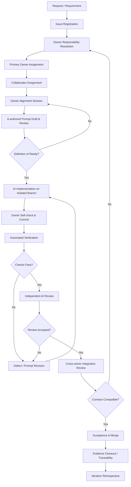

# AI Development Iteration Lifecycle
# AI 开发迭代生命周期

**Document ID:** AI-PROC-001  
**Version:** 1.0 + proposed §2.1 amendment  
**Status:** PROPOSED  
**Parent standard:** AI-STD-001

## 1. Operating model / 运行模型

The project runs as a controlled, evidence-producing loop. The loop is not “ask AI to code, then ask AI if it is correct.” It separates specification, implementation, verification, review and acceptance.

项目采用可审计、可复现的工程迭代闭环，而不是“让 AI 写代码，再让 AI 自己说正确”。

## 2. Iteration stages / 迭代阶段

## 2.1 — Owner Responsibility Resolution and Alignment Session
## Owner 责任解析与对齐会话

**Status: ACTIVE — development-baseline operational scope only (A-OWNER-INTEGRATION-R46-2026-11-20). Sub-sections 2.1.3.1–2.1.7.3 also ACTIVE.**

**状态：ACTIVE——仅限开发基线运行范围（A-OWNER-INTEGRATION-R46-2026-11-20）。子条款 2.1.3.1–2.1.7.3 同时 ACTIVE。**

### 2.1.1 Purpose / 目的

**EN**

Every registered GitHub Issue or lifecycle Work Item MUST be connected to an explicit responsibility and execution chain before substantive implementation begins:

`Issue Registration → Responsibility Domain → Primary Owner → Collaborating Owners → Alignment Session → A-authored Prompt → Definition of Ready → Execution → Verification → Acceptance`

This requirement establishes a repeatable mechanism for converting registered work into properly owned, evidence-producing execution.

The Integration Architect (Owner A) coordinates decomposition, responsibility resolution, session routing, prompt authoring, dependency ordering, and cross-owner integration.

This mechanism does not transfer domain authority to Owner A.

**中文**

每个已登记的 GitHub Issue 或生命周期 Work Item，在开始实质性实现之前，MUST 建立明确的责任和执行链：

`Issue Registration → Responsibility Domain → Primary Owner → Collaborating Owners → Alignment Session → A-authored Prompt → Definition of Ready → Execution → Verification → Acceptance`

本要求建立从任务登记到具备明确责任、产生可审计证据的执行机制。

Integration Architect（Owner A）负责任务分解、责任解析、会话路由、提示词编写、依赖排序及跨 Owner 整合。

本机制不得将领域决策权转移给 Owner A。

### 2.1.2 Issue Registration / Issue 登记

**EN**

Every work item MUST have an identifiable registration carrier.

For GitHub-backed work, the existing Issue SHOULD be the primary responsibility and evidence reference.

Before routing, the coordinator or authorized intake process MUST collect:

1. Issue number and URL.
2. Title, body, labels and current state.
3. Existing assignees and explicit responsibility declarations.
4. Related Issues, PRs and existing decisions.
5. Referenced artifact paths and exact available revisions.
6. Existing blockers, findings and historical dispositions.

An existing Issue MUST NOT be silently replaced by a newly created carrier.

During an active quota freeze, no new Issue or PR may be created. Work MUST reuse authorized existing carriers.

**中文**

每个工作项 MUST 具有可识别的登记载体。

对于基于 GitHub 的工作，现有 Issue SHOULD 作为主要责任和证据索引。

在责任路由之前，协调方或获授权的接收流程 MUST 收集：

1. Issue 编号和 URL。
2. 标题、正文、标签和当前状态。
3. 已有 assignee 和明确责任声明。
4. 关联 Issue、PR 和既有决议。
5. 引用工件路径及可获得的准确版本。
6. 已有阻塞、Finding 和历史处置记录。

MUST NOT 静默使用新建载体替代现有 Issue。

配额冻结 ACTIVE 时，禁止新建 Issue 或 PR。工作 MUST 复用获准使用的既有载体。

### 2.1.3 Owner Responsibility Resolution / Owner 责任解析

**EN**

Owner A MUST resolve each Issue into:

- one proposed Primary Accountable Owner;
- zero or more Collaborating Owners;
- one or more responsibility domains;
- an explicit responsibility rationale;
- upstream and downstream dependencies;
- the applicable decision and acceptance authorities.

The mapping MUST be based on authoritative evidence, including current Owner charters, adopted contracts, explicit assignments and existing decisions.

The following identities MUST remain distinct:

1. GitHub assignee;
2. Primary Accountable Owner;
3. Collaborating Owner;
4. Implementing session;
5. Independent Reviewer;
6. Acceptance Authority;
7. Integration Architect.

A GitHub assignee does not automatically become the domain decision authority.

A collaborating Owner does not automatically become the Primary Owner.

The Integration Architect does not automatically become the approver of every affected domain.

**中文**

Owner A MUST 将每个 Issue 解析为：

- 一个建议的主责 Accountable Owner；
- 零个或多个协同 Owner；
- 一个或多个责任领域；
- 明确的归属依据；
- 上游和下游依赖；
- 适用的决策权威和验收权威。

责任映射 MUST 依据权威证据，包括现行 Owner Charter、已采纳契约、明确责任指派和既有决议。

以下身份 MUST 保持区分：

1. GitHub assignee；
2. 主责 Accountable Owner；
3. 协同 Owner；
4. 实现会话；
5. 独立 Reviewer；
6. Acceptance Authority；
7. Integration Architect。

GitHub assignee 不自动成为领域决策权威。

协同 Owner 不自动成为主责 Owner。

Integration Architect 不自动成为所有受影响领域的批准者。

### 2.1.4 ORPHAN Responsibility Queue / ORPHAN 责任队列

**EN**

When no valid Primary Owner can be established from authoritative evidence, the work item MUST be classified as `ORPHAN`.

ORPHAN is an explicit unresolved responsibility state, not an assignment to Owner A.

Owner A MUST:

1. Register the item in the ORPHAN Responsibility Queue.
2. Identify candidate responsibility domains and candidate Owners.
3. Record the evidence supporting each candidate.
4. Identify the missing authority or missing assignment.
5. Propose a bounded routing and resolution action.
6. Identify work that can proceed independently.
7. Keep authority-dependent work BLOCKED or HOLD.

The queue MUST retain:

- Issue ID and URL;
- candidate Primary Owner;
- candidate Collaborators;
- responsibility rationale;
- missing authority;
- dependency impact;
- next routing action;
- resolution evidence;
- current status.

ORPHAN items MUST NOT be silently assigned to A, automatically accepted, or treated as approved for implementation.

If a historical Owner role is SUPERSEDED or HISTORICAL, its previous prompt MUST NOT be automatically reactivated.

A new session may use the historical artifact as evidence, but current authority MUST be established independently.

**中文**

当无法依据权威证据确定有效主责 Owner 时，工作项 MUST 标记为 `ORPHAN`。

ORPHAN 是明确的责任未决状态，不代表自动分配给 Owner A。

Owner A MUST：

1. 将工作项登记到 ORPHAN Responsibility Queue。
2. 识别候选责任领域和候选 Owner。
3. 记录每个候选项的证据依据。
4. 识别缺失的权威或责任指派。
5. 提出有边界的路由和解决动作。
6. 识别可以独立推进的工作。
7. 使依赖未决权威的工作保持 BLOCKED 或 HOLD。

队列 MUST 保留：

- Issue ID 和 URL；
- 候选主责 Owner；
- 候选协同 Owner；
- 责任归属依据；
- 缺失的权威；
- 依赖影响；
- 下一步路由动作；
- 解决证据；
- 当前状态。

ORPHAN 工作项 MUST NOT 被静默分配给 A、自动接受或视为已经获得实现批准。

历史 Owner 角色已经 SUPERSEDED 或 HISTORICAL 时，不得自动恢复其旧 Prompt。

新会话可以将历史工件作为证据，但当前权威必须独立确认。

### 2.1.5 Owner Alignment Session / Owner 对齐会话

**EN**

After responsibility resolution, Owner A MUST initiate or route an alignment session for the responsible domain.

The session MUST be bound to:

1. An explicit session identity.
2. An explicit Issue binding list.
3. One Primary Owner and its Collaborators.
4. Exact source artifacts and available revisions.
5. An A-authored, bounded execution prompt.
6. Defined outputs and stop conditions.

The alignment session MUST establish:

- current Issue scope and state;
- actual responsibility and authority boundaries;
- existing decisions and their exact sources;
- DECIDED, CANDIDATE, OPEN, BLOCKED and TO_VALIDATE items;
- upstream and downstream dependencies;
- implementation and verification evidence;
- next actions and accountable parties;
- objective acceptance and closure conditions.

The session MUST NOT impersonate another Owner or sign on behalf of another Owner.

A role-playing session, simulated approval, or AI-generated acceptance statement MUST NOT be treated as an independent Owner decision.

**中文**

完成责任解析后，Owner A MUST 为对应责任领域启动或路由对齐会话。

会话 MUST 绑定：

1. 明确的会话身份。
2. 明确的 Issue 列表。
3. 一个主责 Owner 及其协同 Owner。
4. 准确的来源工件及可获得版本。
5. 一份由 A 自产、有边界的执行提示词。
6. 明确的交付物和停止条件。

对齐会话 MUST 确定：

- Issue 当前范围和状态；
- 实际责任和权威边界；
- 既有决议及其准确来源；
- DECIDED、CANDIDATE、OPEN、BLOCKED 和 TO_VALIDATE 事项；
- 上下游依赖；
- 实现和验证证据；
- 下一步动作及责任主体；
- 客观验收和关闭条件。

会话 MUST NOT 冒充其他 Owner 或代替其他 Owner 签署。

角色扮演会话、模拟批准或 AI 生成的接受声明 MUST NOT 被视为独立 Owner 决议。

### 2.1.6 Session Aggregation / 会话聚合

**EN**

Owner A SHOULD group related Issues by responsibility domain instead of launching one independent session per Issue.

A normal alignment batch SHOULD contain three to six L2 sessions when compatible with authority boundaries and dependency structure.

Grouping MUST NOT:

- merge independent decision authorities;
- erase Issue-level responsibility;
- merge separate acceptance criteria;
- convert one Issue's approval into another Issue's approval;
- discard historical evidence or unresolved findings.

Each Issue MUST retain its own responsibility mapping, decision status, evidence and closure conditions.

**中文**

Owner A SHOULD 按责任领域聚合相关 Issue，而不是每个 Issue 都启动独立会话。

在符合权威边界和依赖结构的情况下，一个常规对齐批次 SHOULD 包含三至六场 L2 会话。

聚合 MUST NOT：

- 合并独立决策权威；
- 抹去 Issue 级责任；
- 合并不同验收条件；
- 将一个 Issue 的批准转化为另一个 Issue 的批准；
- 丢弃历史证据或未解决 Finding。

每个 Issue MUST 保留自己的责任映射、决策状态、证据和关闭条件。

### 2.1.7 Prompt Draft and Definition of Ready / 提示词编写与 DoR

**EN**

The A-authored prompt MUST be prepared after responsibility and alignment requirements are established.

It MUST contain:

- identity and authority boundaries;
- bound Issue list;
- exact source and version requirements;
- scope and out-of-scope;
- deliverables;
- acceptance criteria;
- dependencies;
- stop conditions;
- evidence and registration obligations.

The prompt MUST be versioned and its provenance retained.

Definition of Ready MUST NOT be satisfied merely because a prompt exists.

DoR requires:

1. An identifiable work item.
2. A resolved or explicitly bounded Primary Owner.
3. Explicit Collaborators.
4. Known dependency status.
5. Authorized implementation scope.
6. Testable acceptance criteria.
7. Sufficient source evidence.
8. No unresolved prerequisite that makes the proposed execution unsafe.

When a prerequisite is unresolved, independent work may proceed only within an explicitly isolated scope.

**中文**

责任和对齐要求确定后，MUST 由 A 编写执行提示词。

提示词 MUST 包含：

- 身份和权威边界；
- 绑定 Issue 清单；
- 准确来源和版本要求；
- 范围及非目标；
- 交付物；
- 验收条件；
- 依赖；
- 停止条件；
- 证据和登记义务。

提示词 MUST 版本化并保留出处。

不能仅因为存在提示词，就认为 Definition of Ready 已满足。

DoR 必须满足：

1. 工作项可识别。
2. 主责 Owner 已确定或其未决边界已明确限定。
3. 协同 Owner 明确。
4. 依赖状态明确。
5. 实现范围获得授权。
6. 验收条件可测试。
7. 来源证据充分。
8. 不存在会使拟议执行不安全的未解决前置条件。

当前置条件未解决时，只有在明确隔离的范围内，才允许独立工作继续。

### 2.1.3.1 — Responsibility Mapping Evidence / 责任映射证据

**Status: ACTIVE (A-OWNER-INTEGRATION-R46-2026-11-20)**

**EN**

Owner A MUST record the evidence supporting each proposed Primary Accountable Owner and Collaborating Owner.

The record MUST distinguish:

- Explicit current assignment.
- Adopted Owner charter or contract.
- Existing attributable Owner decision.
- Historical responsibility evidence.
- A-proposed responsibility mapping.
- Unresolved or contradictory responsibility evidence.

A recommendation MUST NOT be represented as an established assignment without its supporting authority.

**中文**

Owner A MUST 记录每个建议主责 Owner 和协同 Owner 的证据依据。

必须区分：

- 当前明确指派。
- 已采纳的 Owner Charter 或契约。
- 已存在且可归属的 Owner 决议。
- 历史责任证据。
- A 提出的责任映射。
- 未解决或相互矛盾的责任证据。

没有相应权威依据时，不得将建议归属描述为已经正式指派。

### 2.1.5.1 — Consolidated Owner Session / 合并 Owner 会话

**Status: ACTIVE (A-OWNER-INTEGRATION-R46-2026-11-20)**

**EN**

Multiple Owner responsibility lanes MAY be hosted in one ChatGPT conversation when the project authorization permits consolidated session execution.

The conversation MUST:

1. Identify each Owner role explicitly.
2. Maintain separate responsibility and decision records.
3. Preserve the Primary Owner for each Issue and Stage.
4. Preserve each Owner's domain authority boundaries.
5. Record exact source revisions and evidence.
6. Avoid claiming independent session identity or independent review merely because the conversation changes roles.
7. Identify consolidated session rulings as such rather than fabricating independent signatures.

A consolidated session MUST NOT merge independent acceptance criteria or silently transfer domain ownership to A.

**中文**

在项目授权允许的情况下，多个 Owner 责任泳道 MAY 由同一个 ChatGPT 对话承载。

该对话 MUST：

1. 明确识别每个 Owner 角色。
2. 保留各自独立的责任记录和决策记录。
3. 保留每个 Issue 和 Stage 的主责 Owner。
4. 保留各领域的决策权边界。
5. 记录准确来源版本和证据。
6. 不得因为对话切换角色，就声称产生了独立会话身份或独立审查。
7. 将合并会话作出的裁决明确标记为合并会话裁决，不得补造独立签名。

合并会话 MUST NOT 合并不同验收标准，也不得静默将领域责任转移给 A。

### 2.1.6.1 — Alignment Batch Boundary / 对齐批次边界

**Status: ACTIVE (A-OWNER-INTEGRATION-R46-2026-11-20)**

**EN**

A normal alignment batch SHOULD contain three to six logical L2 Owner work sessions.

These sessions MAY be executed within one shared conversation.

Every Issue MUST retain:

- Its own Primary Accountable Owner.
- Its own Collaborating Owners.
- Its own responsibility rationale.
- Its own dependency status.
- Its own acceptance conditions.
- Its own unresolved findings.

Batch completion means routing and reconciliation are complete. It does not imply that all Issues are accepted or closed.

**中文**

常规对齐批次 SHOULD 包含三至六个逻辑 L2 Owner 工作会话。

这些会话 MAY 在同一个共享对话中执行。

每个 Issue MUST 保留自己的：

- Primary Accountable Owner。
- Collaborating Owners。
- 责任归属依据。
- 依赖状态。
- 验收条件。
- 未解决 Finding。

批次完成只表示责任路由和整合工作完成，不代表所有 Issue 已验收或关闭。

### 2.1.7.1 — Cross-domain Stage Decomposition / 跨域 Stage 拆分

**Status: ACTIVE (A-OWNER-INTEGRATION-R46-2026-11-20)**

**EN**

When one Issue spans multiple responsibility domains, Owner A MUST decompose the work into explicitly ordered Owner-owned Stages.

Each Stage MUST specify:

1. Stage identifier.
2. Primary Accountable Owner.
3. Collaborating Owners.
4. Exact input artifacts and revisions.
5. Decision or implementation scope.
6. Required output and evidence.
7. Upstream prerequisites.
8. Downstream consumers.
9. Acceptance authority.
10. Stop conditions.

The integration parent remains the traceability carrier.

A Stage decision applies only to its stated scope and exact revision.

Downstream Stages MUST NOT assume that upstream proposals are accepted unless the required evidence exists.

**中文**

当一个 Issue 涉及多个责任领域时，Owner A MUST 将工作拆分为具有明确顺序的 Owner-owned Stage。

每个 Stage MUST 明确：

1. Stage 编号。
2. 主责 Accountable Owner。
3. 协同 Owner。
4. 精确输入工件及版本。
5. 决策或实现范围。
6. 必需交付物和证据。
7. 上游前置条件。
8. 下游消费者。
9. 验收权威。
10. 停止条件。

集成父项继续作为可追溯性载体。

Stage 决议只适用于其声明的范围和精确版本。

下游 Stage MUST NOT 在缺乏所需证据时假定上游提案已经获得接受。

### 2.1.7.2 — Quota Freeze and ORPHAN Routing / 配额冻结与 ORPHAN 路由

**Status: ACTIVE (A-OWNER-INTEGRATION-R46-2026-11-20)**

**EN**

During an active quota freeze:

- New Issues, PRs and branches MUST NOT be created.
- Existing authorized carriers MUST be reused.
- ORPHAN responsibility MUST remain explicitly unresolved.
- Owner A MUST NOT automatically absorb an ORPHAN item.
- Independent work MAY proceed within an authorized, isolated scope.
- Authority-dependent work MUST remain BLOCKED or HOLD.
- Required evidence and proposed routing MUST be recorded in an authorized existing carrier.

A quota freeze does not suspend responsibility resolution or dependency analysis.

**中文**

配额冻结 ACTIVE 时：

- MUST NOT 新建 Issue、PR 或分支。
- MUST 复用已有获授权载体。
- ORPHAN 责任 MUST 明确保留为未解决。
- Owner A MUST NOT 自动接管 ORPHAN。
- 在授权且隔离的范围内，独立工作 MAY 继续。
- 依赖未决权威的工作 MUST 保持 BLOCKED 或 HOLD。
- 所需证据和建议路由 MUST 记录在获授权的既有载体中。

配额冻结不暂停责任解析和依赖分析。

### 2.1.7.3 — Unified Progress Classification / 统一推进分类

**Status: ACTIVE (A-OWNER-INTEGRATION-R46-2026-11-20)**

**EN**

Every routed Issue MUST have one current progress classification:

- READY
- ORPHAN
- BLOCKED
- DEFERRED

The classification applies to the next bounded action and MUST NOT be interpreted as implementation, verification or acceptance status.

**中文**

每个已路由 Issue MUST 有一个当前推进分类：

- READY
- ORPHAN
- BLOCKED
- DEFERRED

该分类仅适用于下一项有边界的工作，不得解释为实现、验证或验收状态。

### 2.1.8 Execution and Independent Work / 执行与独立工作

**EN**

After DoR, the implementing session may execute only within its authorized scope.

A MUST maintain the cross-owner dependency order and prevent downstream work from assuming unapproved upstream contracts.

The lifecycle MUST distinguish:

- DECIDED: an authorized decision exists;
- IMPLEMENTED: a real implementation exists at an exact revision;
- VERIFIED: verification evidence applies to that exact implementation;
- ACCEPTED: the authorized acceptance authority has accepted the defined deliverable.

These states MUST NOT be inferred from one another.

Reference-model tests MUST NOT substitute for production physical-capability evidence.

CI PASS MUST NOT substitute for independent Owner approval.

A session completion MUST NOT automatically close an Issue.

**中文**

DoR 满足后，实现会话只能在获授权范围内执行。

A MUST 维护跨 Owner 依赖顺序，防止下游工作假定上游未批准契约已经成立。

生命周期 MUST 区分：

- DECIDED：存在合法权威作出的决议；
- IMPLEMENTED：在准确版本上存在真实实现；
- VERIFIED：验证证据适用于该准确实现版本；
- ACCEPTED：获授权的验收主体已经接受明确交付物。

这些状态 MUST NOT 相互推导。

Reference Model 测试 MUST NOT 替代生产物理能力证据。

CI PASS MUST NOT 替代独立 Owner 批准。

会话完成 MUST NOT 自动关闭 Issue。

### 2.1.9 Cross-owner Integration / 跨 Owner 整合

**EN**

Owner A is accountable for integration coordination, not for replacing domain authorities.

A MUST:

1. Reconcile dependency ordering.
2. Identify contradictory contracts.
3. Record exact source revisions.
4. Distinguish local Owner acceptance from bilateral or multi-owner agreement.
5. Identify missing participants and missing proofs.
6. Route unresolved decisions to their legitimate authorities.
7. Preserve all blocking findings until objective closure evidence exists.

Shared vocabulary does not imply shared state authority.

Local Owner acceptance does not imply shared Schema Freeze.

A design decision does not imply physical implementation or production conformance.

**中文**

Owner A 对整合协调负责，不得替代领域权威。

A MUST：

1. 协调依赖顺序。
2. 识别契约冲突。
3. 记录准确来源版本。
4. 区分局部 Owner 接受、双边协议和多方协议。
5. 识别缺失参与者和缺失证明。
6. 将未决事项路由给合法权威。
7. 在客观关闭证据出现前保留所有阻塞 Finding。

共享词汇不意味着共享状态权威。

局部 Owner 接受不意味着共享 Schema Freeze。

设计决议不意味着物理实现或生产符合性。

### 2.1.10 Evidence Recovery and Session Closeout / 证据回收与会话关闭

**EN**

Every alignment session MUST produce a complete, independently traceable closeout.

The collection process MUST preserve the original session evidence rather than relying solely on a shortened conversation summary or a partial final-message fetch.

Where an authorized raw conversation mapping is available:

1. L0 MUST retrieve the complete raw conversation mapping.
2. L0 MUST identify the first complete authoritative assistant response for each deliverable.
3. Supplemental GET results MUST be checked for truncation, tail-only retrieval and overlap.
4. Overlapping or duplicate content MUST be deduplicated without rewriting substantive conclusions.
5. The canonical receipt MUST preserve the complete source response.
6. Raw source and normalized receipt MUST remain distinguishable.
7. The conversation identifier, account/session identity, retrieval time, raw length, receipt path and integrity checksum MUST be recorded.

A partial tail response MUST NOT replace a complete earlier response.

When a deliverable is too large for one reliable transfer, L0 MAY use ordered batch delivery or session continuation.

Batch continuation MUST preserve:

- the original session identity;
- the original binding scope;
- prompt provenance;
- message ordering;
- exact source boundaries;
- the distinction between completed and pending supplements.

A later batch MUST be appended as a supplement, not silently merged into an earlier final receipt.

**中文**

每场对齐会话 MUST 产生完整且可独立追溯的 Closeout。

证据回收 MUST 保留原始会话证据，不得仅依赖缩短后的会话摘要或部分末条消息 GET。

存在获授权的 raw conversation mapping 时：

1. L0 MUST 获取完整 raw conversation mapping。
2. L0 MUST 为每项交付物识别第一条完整、权威的 Assistant 回复。
3. 补充 GET 结果 MUST 检查截断、仅返回尾部和内容重叠。
4. 对重叠或重复内容 MUST 去重，但不得改写实质性结论。
5. Canonical Receipt MUST 保留完整源回复。
6. 原始来源和规范化回执 MUST 保持可区分。
7. MUST 记录会话 ID、账号/会话身份、回收时间、原始长度、回执路径和完整性校验值。

部分尾部回复 MUST NOT 替代之前的完整回复。

当交付物过大，无法一次可靠转发时，L0 MAY 采用有序批量供给或会话续投。

批量续投 MUST 保留：

- 原始会话身份；
- 原始绑定范围；
- Prompt 出处；
- 消息顺序；
- 准确来源边界；
- 已完成与待补充内容的区分。

后续批次 MUST 作为补充记录追加，不得静默合并进此前的最终回执。

### 2.1.11 Decision Registration and No-Proxy-Signature Rule / 决策登记与禁止代签

**EN**

Alignment is not approval.

A session that only investigates, reconciles or recommends MUST NOT invent a Decision_ID or claim an Owner signature.

When no authorized decision has been made, the decision identifier MUST remain `NOT_CREATED`.

The six-session alignment batch of 2026-11-19 contains 23 decision sub-items for which no independent Owner decision was created.

All such items MUST remain `Decision_ID: NOT_CREATED`.

This is a positive evidence-integrity requirement, not a documentation omission.

A Decision_ID may be created only when an authorized decision is explicitly made and its complete evidence is recorded.

Every decision record MUST include:

- Decision_ID;
- Decision status;
- Delta_Scope;
- Decision authority;
- Relevant_Artifacts;
- full Commit SHA;
- full Blob SHA;
- Evidence;
- Unresolved_Findings;
- affected Issues;
- implementation and verification status.

Unknown values MUST remain `NOT_RECORDED`, `NOT_CREATED`, `OPEN` or `TO_VALIDATE` as applicable.

**中文**

对齐不等于批准。

仅执行调查、整合或建议的会话 MUST NOT 补造 Decision_ID 或声称获得 Owner 签署。

尚无合法权威决策时，决策编号 MUST 保持 `NOT_CREATED`。

2026-11-19 六场对齐批次中，有 23 个决策子项没有产生独立 Owner 决议。

所有这些事项 MUST 保持：

`Decision_ID: NOT_CREATED`

这是证据完整性要求，不是文档遗漏。

只有在合法权威明确作出决策并记录完整证据后，才能创建 Decision_ID。

每份决策记录 MUST 包含：

- Decision_ID；
- 决策状态；
- Delta_Scope；
- 决策权威；
- Relevant_Artifacts；
- 完整 Commit SHA；
- 完整 Blob SHA；
- Evidence；
- Unresolved_Findings；
- 受影响 Issue；
- 实现和验证状态。

未知值 MUST 根据实际情况保留为 `NOT_RECORDED`、`NOT_CREATED`、`OPEN` 或 `TO_VALIDATE`。

### 2.1.12 Scheduling, Authority and Stop Conditions / 调度、权威与停止条件

**EN**

Responsibility discovery and session launch SHOULD be event-driven where supported.

Where periodic scheduling is required, the interval MUST be one hour (`PT1H`).

Daily or multi-day scheduling MUST NOT replace the one-hour routing cadence.

L0 is responsible for mechanical session launch, input delivery, evidence retrieval, file operations and authorized GitHub carrier updates.

L0 MUST NOT become an undisclosed technical author or decision authority.

Owner A coordinates and integrates.

Domain Owners decide within their authorized domains.

Independent Reviewers review.

The authorized Acceptance Authority accepts.

This workflow introduces no human waiting point into the development lifecycle.

Unresolved authority MUST remain explicitly OPEN or BLOCKED. Independent work MUST continue where safe and independent of the unresolved decision.

A session MUST stop or isolate the affected work when:

- source authority cannot be verified;
- exact source revisions are missing;
- a required decision authority is unknown;
- upstream contracts conflict;
- evidence is insufficient for the requested conclusion;
- execution would cross its authorized scope;
- a security or production safety invariant cannot be demonstrated.

A stop condition does not authorize fabrication, proxy approval or silent scope expansion.

**中文**

责任发现和会话启动在能力允许时 SHOULD 采用事件触发。

需要周期性调度时，间隔 MUST 为一小时（`PT1H`）。

不得以日级或多日级调度替代一小时责任路由节奏。

L0 负责机械性会话启动、输入转发、证据回收、文件操作和获授权的 GitHub 载体更新。

L0 MUST NOT 成为未披露的技术作者或决策权威。

Owner A 负责统筹和整合。

领域 Owner 在其获授权领域内作出决定。

独立 Reviewer 负责审查。

获授权的 Acceptance Authority 负责验收。

本工作流不在开发生命周期中新增人类等待停点。

未解决的权威问题 MUST 明确保持 OPEN 或 BLOCKED。在安全且不依赖该未决事项的范围内，独立工作 MUST 继续推进。

出现以下情况时，会话 MUST 停止或隔离受影响工作：

- 来源权威无法验证；
- 缺少准确来源版本；
- 必需决策权威未知；
- 上游契约冲突；
- 证据不足以支持所请求结论；
- 执行将越过授权范围；
- 无法证明安全或生产安全不变量。

### Stage 0 — Intake and registration

Create a Work Item before assigning implementation. Record the user/system need, expected outcome, why now, constraints, priority, sponsor and candidate Owner.

Do not prematurely prescribe implementation details when the requirement is still unclear. Distinguish requirement, assumption, design proposal and decision.

### Stage 1 — Impact and dependency analysis

The accountable Owner maps:

- affected modules, APIs, schemas, data stores and runtime flows;
- upstream contracts and downstream consumers;
- state machines and invariants affected;
- security, privacy, scope, retention and deletion implications;
- concurrency, ordering, retry, idempotency and recovery implications;
- migration, backward compatibility and rollback;
- tests and observability required.

Cross-module work is split into Owner-owned tasks with one integration parent. The parent defines shared contract questions and sequencing; it does not authorize one Owner to edit another Owner's design.

### Stage 2 — Prompt drafting and review

The prompt author translates the approved task into a complete, bounded, testable instruction. The prompt reviewer checks:

- source-of-truth references and exact base SHAs;
- authority and file boundaries;
- missing assumptions and ambiguous language;
- measurable acceptance criteria;
- failure-path and negative tests;
- deliverable/report format;
- stop conditions.

Store the prompt before implementation. Freeze the prompt version used for the run. Prompt reviewer is not automatically the implementation reviewer.

### Stage 3 — Readiness gate

READY requires all Definition of Ready conditions from AI-STD-001. A dependency may be marked “assumption” only when the task is safe under that assumption and the assumption owner is identified.

If an upstream contract is OPEN and the task depends on it, either:
- resolve the contract first;
- implement only a clearly isolated non-dependent slice; or
- remain BLOCKED.

Do not silently invent a temporary contract and allow it to become normative.

### Stage 4 — AI implementation

The implementing AI must:

1. read the exact referenced versions;
2. restate scope and invariants in its work log;
3. inspect existing code and tests before changing them;
4. make the smallest coherent change;
5. add or update tests alongside behavior;
6. update documentation, examples and migrations as needed;
7. run local checks;
8. report deviations, unknowns and unrun checks;
9. commit to its assigned branch;
10. verify branch HEAD and read back changed files.

The AI must stop and request a decision when it discovers a conflict outside its authority, an unsafe invariant, an unanticipated data migration, or an acceptance criterion that cannot be tested.

### Stage 5 — Automated verification

CI should run deterministic checks on every PR. Required checks are selected by task class and risk.

Minimum implementation gate:
- formatting and lint;
- compile/build and type checks;
- unit tests;
- relevant integration/contract tests;
- regression tests for changed behavior;
- dependency/security scans where available.

R2/R3 additionally require relevant concurrency/fault/security tests. Test reports identify the exact commit. A test run on a different commit is not evidence for the submitted commit unless the difference is proven irrelevant and recorded.

### Stage 6 — Independent AI review

The reviewer receives:
- the approved prompt and version;
- task record and acceptance criteria;
- base and implementation SHAs;
- diff and test evidence;
- relevant architecture contracts.

The reviewer independently checks the implementation; it must not merely summarize the author's report. It should actively search for counterexamples, missing negative tests, race windows, scope leaks, stale-state behavior, compatibility breaks and hidden assumptions.

Review findings are recorded before the author changes code. The author responds to every finding. A finding can be closed only with a code/test/documentation reference or an explicit authorized risk acceptance.

### Stage 7 — Cross-owner integration review

For changes affecting another module, each affected Owner reviews only its contract boundary and evidence. The Integration Architect reconciles conflicts and updates the Contract Registry.

Integration review MUST distinguish:
- local Owner approval;
- bilateral contract agreement;
- multi-module agreement;
- implementation evidence;
- system conformance evidence.

No one level implies the next.

### Stage 8 — Acceptance, merge and closeout

Before merge:
- required checks pass on the candidate commit;
- required reviewers approve;
- blocker/P0/P1 findings are closed or explicitly governed;
- prompt, work item, implementation and evidence links are complete;
- release/migration/rollback plan exists where needed.

After merge, record target branch, merge commit, CI run and any deployment status. Close the Work Item only after traceability is complete.

## 3. Multi-owner coordination patterns / 多 Owner 协作模式

### Pattern A — Sequential dependency

Use when downstream design depends on an upstream decision.

Example: B domain semantics → D canonical model → E compiler mapping → F indexing → G context activation.

Each stage publishes a versioned artifact and explicit consumer guidance. Downstream work records the exact upstream SHA.

### Pattern B — Parallel bounded work

Use when owners can work independently against an agreed interface.

Example: C Agent-side evidence requirements and H BMCP wire mapping can proceed in parallel only after the shared semantic questions are listed. Each records assumptions; A reconciles mismatches before integration.

### Pattern C — Joint contract task

Use when a boundary cannot be designed unilaterally.

Create one parent work item and child tasks per Owner. Each Owner writes its own side of the contract. A joint contract review resolves field ownership, sequencing, failure semantics and conformance tests. Do not ask one session to impersonate all Owners and treat that as independent approval.

### Pattern D — Cross-cutting specialist

Storage/Consistency, Testing, Security and Performance specialists may review multiple modules. Their findings do not transfer domain ownership. The affected Owner remains responsible for adopting changes in its own files.

## 4. Cadence and batch size / 节奏与批次

Recommended iteration size:
- one coherent user outcome;
- one accountable Owner per implementation task;
- a small number of affected contracts;
- tests that can run in a reasonable CI cycle;
- independently reviewable diff.

Avoid a single prompt asking an AI to redesign multiple modules, implement them all, test them all and approve the result.

At iteration close, run a short retrospective. Track:
- lead time and active time;
- prompt clarification/revision count;
- review findings by severity;
- defects found after merge;
- tests added and tests not run;
- rework caused by stale dependencies;
- cross-owner contract conflicts;
- documentation drift.

Use these metrics to improve throughput without trading away correctness.

## 5. Suggested release gates / 发布门禁

| Gate | Required evidence |
|---|---|
| G0 Task valid | Work Item ID, sponsor, Owner, objective |
| G1 Contract ready | dependency map, decisions, prompt approved |
| G2 Implementation complete | branch, commit, diff, self-check |
| G3 Verification passed | CI/test evidence on candidate SHA |
| G4 Independent review | review report, findings disposition |
| G5 Integration accepted | affected Owner approvals, contract registry |
| G6 Merge authorized | acceptance record, merge SHA |
| G7 Release ready | migration/rollback, release checks, operational evidence |

A task may be accepted at a lower gate for a limited purpose (for example, an architecture proposal) only when the record clearly says what it is accepted for and what remains unapproved.

## 6. Recovery and failed iteration handling / 失败迭代处理

If a run fails:
- preserve prompt, branch, commits, logs and findings;
- classify failure as requirement ambiguity, prompt defect, implementation defect, test defect, environment issue or contract conflict;
- create a new prompt version if instructions materially change;
- avoid force-pushing away evidence;
- revert or isolate unsafe changes;
- reopen downstream tasks if their base contract changed;
- record lessons in the retrospective.

A failed iteration is useful evidence. Concealing it destroys the learning loop.

## 7. Initial adoption / 初始采用

Apply this process to new work immediately. For in-flight Phase 3 work, create retrospective Work Item records where practical; mark missing prompt versions or test evidence as NOT RECORDED rather than fabricating them. Existing review reports and commit SHAs remain valid historical evidence within their original scope.
