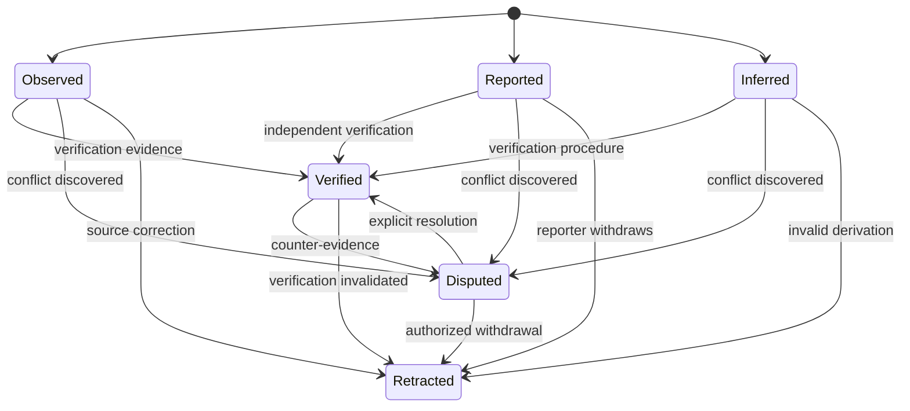

---
document_metadata:
  domain: domain-model
  role: design-specification
  lifecycle:
    approval:
      decision_status: Draft
      approver: null
      decision_date: null
      approved_version: null
      approval_scope:
        type: Full-document
      approval_applicability: Not-Applicable-To-Current-Version
      evidence_reference:
        - "14-ai-development/work-items/AID-2026-200/evidence.md"
      revocation: null
    evidence_verification:
      verification_status: Unverified
      last_verified_date: "2026-11-27"
      last_verification_note: "GOV-DOC-002 classification of a mirror that carried no front-matter: records domain, role, status and the canonical source path only (basis, the document's own statement: Status: Core distinctions DECIDED). Claims no canonical authority and does not verify semantic parity with the source. Pre-metadata content blob: 17c09d546a0b7d3eec910f3f59d3494af6ce34e5."
    usage_status: Active
    modification_status: Modified
    supersession:
      supersedes: []
      supersession_reason: null
      effective_date: null
    archival:
      archived_date: null
      archival_reason: null
      archival_reference: null
  authority:
    canonical_status: Non-Canonical
    canonical_conflict_status: None
    normative_status: Normative
  bilingual_counterpart:
    source: "02-domain-model/epistemic-and-temporal-semantics.md"
    en: null
    zh-CN: "docs/zh-CN/02-domain-model/epistemic-and-temporal-semantics.md"
---
# Epistemic and Temporal Semantics

- Document ID: DOMAIN-EPISTEMIC-TEMPORAL-001
- Version: 1.0
- Source: [Normative source specification](../../../02-domain-model/epistemic-and-temporal-semantics.md)
- Source revision: 9da4341d9a15b1d3185570c70c0afe887abc7204
- Chinese counterpart: [认知与时间语义](../../zh-CN/02-domain-model/epistemic-and-temporal-semantics.md)
- Status: Core distinctions DECIDED; calibration and uncertain-time representation partly OPEN
- Owner: Memory Domain Model (MB-01)

## 1. Purpose and boundary

Brain must retain assertions without overstating certainty and distinguish when an event happened from when Brain learned or recorded it. This document defines semantic fields and transition constraints, not model calibration, verification algorithms, or query ranking.

## 2. Epistemic status

**DECIDED:** Epistemic Status answers “what is the basis and standing of this proposition?” It is independent of Memory lifecycle.

| Status | Meaning | Minimum basis |
|---|---|---|
| Observed | Directly captured observation of a state or occurrence | Observer/sensor/Adapter identity, scope, observation time or explicit unknown |
| Reported | A source asserts the proposition; Brain has not independently verified it | Identified reporting source and source Evidence |
| Inferred | Derived from premises by a declared process | Parent Claims/Evidence, method reference, derivation time |
| Verified | Passed a declared verification procedure or authoritative attestation | Verification method, verifier/source, Evidence, verification time |
| Disputed | Materially incompatible Claims or Evidence positions remain unresolved | Conflict record or references to incompatible positions |
| Retracted | Prior assertion withdrawn by authorized source/process or invalidated | Reason, actor/authority, time, preserved prior assertion |

This is not a linear confidence ladder. Observed can be disputed; Reported can later be Verified; Inferred can be retracted. Verified does not mean eternally true.

Transitions are append-only status revisions/events. **OPEN:** whether reinstatement is allowed. Candidate rule: create a new Claim linked by correction/reinstatement semantics rather than mutate a retracted Claim.

## 3. Intent, plan, prediction, and outcome

**DECIDED:** Intent, plan, goal, prediction, pending action, and hypothetical are prospective/modal statements. They cannot be promoted to completed Events or Verified Claims without outcome Evidence.

- planned: desired future action; execution not implied.
- pending: submitted/awaiting result; outcome unknown.
- predicted: forecast, not observation.
- attempted: action attempted; success not implied.
- outcome: captured result; interpretation still requires evidence.
- observed: captured observation; observer reliability remains separately qualified.

An Agent saying “I will save the world” supports a reported intent/plan, not an Event that the world was saved.

## 4. Confidence, Relevance, Trust, Evidence Strength

| Dimension | Question | Semantics |
|---|---|---|
| Confidence | How strongly does a declared method estimate this Claim is supported? | Claim-level, method- and calibration-qualified |
| Relevance | How useful is this asset for a task now? | Query/context-dependent Runtime estimate |
| Trust | How reliable is a source/actor/channel in a declared domain? | Governance/source assessment |
| Evidence Strength | How directly/materially does a specific Evidence item support or refute a Claim? | Assessment on Claim-Evidence relationship |

Rules:
1. Confidence is not truth and is meaningless without method, scale, and calibration context.
2. Relevance must not change epistemic status.
3. Source Trust does not automatically transfer to every Claim from that source.
4. Evidence Strength is specific to a Claim-Evidence link, not global to Evidence.
5. Copies of one source are not independent corroboration.
6. Missing/uncalibrated confidence remains null/unknown, not invented.

**CANDIDATE:** confidence record = value, scale, method_ref, calibration_population, assessed_at. Evidence assessment = claim_ref, evidence_ref, role, strength, method_ref. Numeric ranges and aggregation formulas remain OPEN.

## 5. Temporal model

The minimum axes are:
- **Event Time:** when the represented occurrence happened.
- **Recorded At:** when Brain durably recorded the information.
- **Valid Time:** interval during which a Claim or Relation is asserted to hold.

Do not substitute one for another.

### Event Time
May be unknown, approximate, or source-reported. Retain source timezone/precision where relevant and normalize separately. An inferred time must carry method and uncertainty.

### Recorded At
Assigned by Brain at durable acceptance; immutable. Replay preserves original Recorded At and adds replay metadata.

### Valid Time
Qualifies when a proposition holds. Default interval is half-open [from, to):
- both known: finite interval;
- only from: open-ended;
- only to: start unknown;
- neither: unknown/not specified, not “all time”.

Point-in-time assertions need explicit point semantics; do not invent duration.

**CANDIDATE:** retain canonical version commit time as a fourth operational/transaction-time axis for queries such as “what did Brain believe at T?”. This differs from Event Time and Valid Time.

## 6. Bitemporal history and uncertain time

**DECIDED:** Preserve valid-time history and record-time history separately. A newer report must not erase the historical validity of an older claim.

Example: information recorded on 2026-04-01 says a device has been in Room A since 2026-03-10. Event/effective time is 2026-03-10, Recorded At is 2026-04-01, and Valid Time begins 2026-03-10.

**OPEN:** representation of “early May”, “around 3pm”, or “last winter”. Candidate TimeValue contains lower_bound, upper_bound, precision, timezone, certainty, and source_text. Preserve source phrase and avoid false precision.

## 7. Conflict and temporal coexistence

Apparently contradictory Claims may both be valid if subject, predicate, scope, environment, modality, or Valid Time differs. Conflict detection compares canonical subject, predicate/polarity, object value, scope/environment, overlapping Valid Time, epistemic status/Evidence, and modality.

Only semantically incompatible claims in compatible scopes and overlapping time windows are conflict candidates. Same Agent in two different Environment Scopes is not a conflict by default.

## 8. Inputs, outputs, workflow

Inputs: source Events/Evidence, candidate Claims, time expressions, scopes, method/actor metadata. Outputs: normalized time values, epistemic qualification, validation issues, and explicit uncertainty.

Workflow:
1. Preserve source time expression and attribution.
2. Normalize only what evidence supports.
3. Assign Recorded At on durable acceptance.
4. Derive Event Time with provenance and uncertainty.
5. Assign Valid Time only when assertion supports it.
6. Assign epistemic status from evidence/process, not similarity.
7. Distinguish temporal coexistence from genuine conflict.
8. Emit qualified Claim and provenance.

## 9. State, concurrency, and recovery

Epistemic changes are append-only revisions/events. Concurrent verification, retraction, and dispute operations require expected Claim/version; stale operations are rejected. Replay is deterministic for source-derived times. Model-assisted inference retains model/method version and input digest.

If time parsing fails, preserve source text and mark normalized time unknown. If Evidence is unavailable, do not fabricate verification. Failure to assess confidence does not block storing a Reported Claim.

## 10. Security and performance

Time metadata can expose routines and location patterns; apply scope and permission rules. Temporal indexes must be scope-filtered before return.

**TO_VALIDATE:** Measure temporal query latency, conflict detection cost, normalization errors on approximate/relative/timezone-bearing expressions, false-conflict and missed-conflict rates separately.

## 11. Acceptance tests

- Reported intent never becomes an outcome through ingestion alone.
- Verified requires method and Evidence.
- Disputed preserves incompatible positions.
- Retraction preserves historical assertion and authority/reason.
- Event Time and Recorded At may differ and remain queryable.
- Valid Time changes preserve history.
- Unknown time is not timeless validity.
- Different Environment Scopes do not conflict by default.
- Relevance updates do not change epistemic status.
- Confidence without method/scale is rejected or marked uncalibrated.

## 12. Open decisions and interfaces

- **OPEN:** fuzzy-time representation and Claim reinstatement.
- **CANDIDATE:** bitemporal query contract: valid at T, known by T2.
- **TO_VALIDATE:** confidence calibration, Evidence Strength rubric, source Trust maintenance.
- Compiler supplies modality, source type, derivation method, and time provenance.
- Lifecycle Manager preserves immutable Claim history.
- Runtime treats Relevance as task-dependent, not canonical truth.
