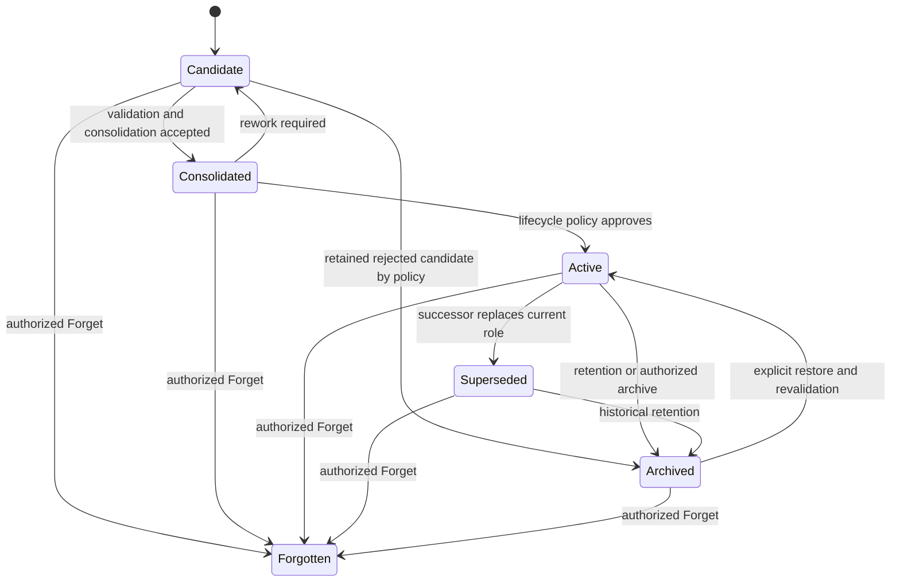

---
document_metadata:
  domain: domain-model
  role: design-specification
  lifecycle:
    approval:
      decision_status: Draft
      approver: null
      decision_date: null
      approved_version: null
      approval_scope:
        type: Full-document
      approval_applicability: Not-Applicable-To-Current-Version
      evidence_reference:
        - "14-ai-development/work-items/AID-2026-193/evidence.md"
      revocation: null
    evidence_verification:
      verification_status: Unverified
      last_verified_date: "2026-11-27"
      last_verification_note: "GOV-DOC-002 classification of a mirror that carried no front-matter: records domain, role, status and the canonical source path only (basis, the document's own statement: Status: State vocabulary and separation DECIDED). Claims no canonical authority and does not verify semantic parity with the source. Pre-metadata content blob: 532e74e99f2a6640f5fd6461f3935a08553586ec."
    usage_status: Active
    modification_status: Modified
    supersession:
      supersedes: []
      supersession_reason: null
      effective_date: null
    archival:
      archived_date: null
      archival_reason: null
      archival_reference: null
  authority:
    canonical_status: Non-Canonical
    canonical_conflict_status: None
    normative_status: Normative
  bilingual_counterpart:
    source: "02-domain-model/lifecycle-model.md"
    en: null
    zh-CN: "docs/zh-CN/02-domain-model/lifecycle-model.md"
---
# Memory Lifecycle Model

- Document ID: DOMAIN-LIFECYCLE-001
- Version: 1.0
- Source: [Normative source specification](../../../02-domain-model/lifecycle-model.md)
- Source revision: 462a1e92f79540fa44a90772314e9db1d487abfb
- Chinese counterpart: [记忆生命周期模型](../../zh-CN/02-domain-model/lifecycle-model.md)
- Status: State vocabulary and separation DECIDED; policy thresholds and selected transitions OPEN
- Owner: Domain Model defines semantics; Memory Lifecycle Manager executes canonical transitions

## 1. Purpose and boundaries

Defines lifecycle semantics of canonical Memory assets and relation to Claim epistemic status, Memory Version history, Entity/Relation status, and Forget governance. Domain Model defines valid states; Lifecycle Manager owns policy/execution/authorization/audit; Canonical Store owns persistence/version mechanics; Compiler proposes candidates but cannot bypass lifecycle policy.

## 2. Lifecycle is not epistemic status

Lifecycle answers “what management stage is this asset in?” Epistemic status answers “what is the basis/standing of this assertion?” They are independent.

Examples: Active Memory can contain a Disputed Claim; Archived Memory can contain a Verified Claim; Candidate can contain Reported or Inferred Claims. Superseded remains historical. Forget is governed retention action, not a synonym for archive.

## 3. Memory lifecycle states

| State | Meaning | Default Runtime eligibility |
|---|---|---|
| Candidate | Proposed asset awaiting validation/consolidation/policy decision | No; authorized review/compiler only |
| Consolidated | Passed structural consolidation and duplicate/conflict checks; not necessarily generally active | Explicit policy only |
| Active | Accepted for normal retrieval/activation in scope | Yes, subject to scope, epistemic, and policy filters |
| Superseded | Replaced by successor for current use; retained as history | Excluded from default current retrieval |
| Archived | Retained but inactive under current policy | Excluded from default activation; authorized historical access |
| Forgotten | Governed Forget committed; content access denied and deletion/de-identification tracked | No; permissible tombstone only |

State does not imply truth, relevance, or trust.

Forgotten is terminal for content identity. If information is supplied again later, create a new Memory identity and provenance; do not resurrect forgotten content.

**OPEN:** Whether rejected candidates need a separate terminal state or Candidate→Archived suffices. Do not silently add Rejected.

## 4. Transition conditions

### Candidate → Consolidated
Requires schema validation, scope resolution, provenance completeness or explicit unavailable reason, Entity/Relation checks, duplicate assessment, conflict detection, and lifecycle decision. Does not imply all Claims are Verified.

### Consolidated → Active
Requires policy approval, authorization, required source/evidence references, no blocking governance issue, and explicit activation eligibility. Confidence or relevance alone cannot cause transition.

### Active → Superseded
Requires successor reference and replacement reason. Historical version and validity remain queryable subject to policy.

### Active/Superseded → Archived
Requires policy or authorized operation, reason, actor, and retention class. Archive neither deletes nor retracts Claims.

### Any non-Forgotten → Forgotten
Requires valid Forget trigger, authorization, dependency discovery, propagation plan, and durable governance record. Ordinary content access is denied at the defined governance barrier; physical erasure may complete asynchronously and is tracked separately.

### Archived → Active
Requires explicit restore authorization, revalidation of scope/evidence/currentness, and new version or lifecycle event. No silent reactivation.

## 5. Claim epistemic lifecycle

Claim epistemic status is separately Observed, Reported, Inferred, Verified, Disputed, or Retracted. Changes are evidence-qualified and auditable. Retraction does not erase Claim; it preserves assertion and records withdrawal. Correction creates a new Claim or successor revision with explicit semantics.

A Memory may aggregate Claims in different states. Runtime may exclude/qualify disputed or retracted claims without mutating lifecycle.

## 6. Entity and Relation lifecycle

Entity identity status (provisional, resolved, merged, split, retired) is not Memory lifecycle. Merge/split requires redirects, identity evidence, reference migration, and audit lineage.

Relation state (proposed, active, superseded, retracted) is distinct. A Relation may have bounded Valid Time while its record lifecycle remains active.

## 7. Memory Versioning

Each committed change creates immutable Memory Version with stable Memory ID, monotonic version number, parent version, change reason/actor, immutable Claim snapshots, provenance references, and content digest.

Current-version pointer advances atomically. Lifecycle transitions affecting canonical semantics are represented in version/history or append-only lifecycle event linked to version. Exact storage is Canonical Store-owned.

Concurrent updates require expected current version. A race winner commits; stale writer receives conflict and rereads/reconciles. No last-write-wins overwrite of conflicting Claims.

## 8. Forget workflow

1. Authenticate actor and authorize target scope/resource.
2. Resolve dependency graph: versions, Claims, Evidence, provenance, derived Memories, Relations, indexes, caches, working sets, contexts, backups.
3. Apply immediate access-denial/tombstone barrier.
4. Schedule deletion/redaction/de-identification under policy.
5. Invalidate projections and context entries where applicable.
6. Reconcile replicas/backups under declared guarantees.
7. Record completion evidence and residual exceptions.
8. Verify ordinary queries cannot retrieve forgotten content.

Context Remove only removes a Context Entry and never invokes this workflow.

**OPEN:** Backup expiry and cryptographic-erasure guarantees belong to Retention/Recovery specifications.

## 9. Inputs, outputs, and collaboration

Inputs: lifecycle command, Memory ID/current version, actor, scope, reason, policy reference, expected state/version, idempotency key.

Outputs: accepted/rejected transition, lifecycle event/version reference, current state, Forget job reference, structured error. Errors include NOT_FOUND, SCOPE_MISMATCH, PERMISSION_DENIED, INVALID_TRANSITION, STALE_VERSION, MISSING_SUCCESSOR, PROVENANCE_INCOMPLETE, FORGET_IN_PROGRESS, ALREADY_FORGOTTEN.

Compiler submits Candidate proposals. Store persists accepted versions. Runtime consumes lifecycle-filtered views. MCM reconciles references to Superseded/Archived/Forgotten assets. Governance owns Forget authorization/propagation.

## 10. Concurrency, idempotency, recovery

Lifecycle commands are idempotent within actor + operation + target + key. Same key/same parameters returns prior result; same key/different parameters rejects.

Transition and version/event publication are transactional or use replayable outbox. Crash after commit but before notification causes replay. Failed Forget stage leaves access denial active and retries; workflow cannot report completion prematurely.

## 11. Security, performance, acceptance

Transitions require both Scope and Permission. Agent telemetry may propose lifecycle signals but cannot authorize archive/retract/forget. Cross-scope actions require explicit governance. Audit must not duplicate forgotten content beyond permitted metadata.

Measure transition latency, conflict rate, dependency graph size, Forget propagation lag, retries, and query-denial barrier time.

Acceptance:
- Invalid transitions reject deterministically.
- Each transition records actor, reason, time, prior/new state, version.
- Superseded assets retain history and successor link.
- Archived excluded from default activation but policy-readable.
- Forget blocks ordinary access promptly and propagates to derivatives.
- Failed Forget is retryable and cannot report completion.
- Duplicate commands are idempotent.
- Concurrent changes cannot silently overwrite.
- Context Remove leaves canonical lifecycle unchanged.

## 12. Open decisions and interfaces

- **OPEN:** Terminal state for rejected candidates.
- **OPEN:** Consolidated as persisted stage or transient evaluation.
- **OPEN:** Archived restore requirements.
- **OPEN:** Physical deletion and backup expiry guarantees.
- **TO_VALIDATE:** Dependency traversal and Forget propagation capacity.
- Compiler confirms candidate handoff.
- Store confirms atomic lifecycle/version/current-pointer semantics.
- Governance confirms Forget workflow/completion proof.
- Runtime/MCM confirms behavior for Superseded, Archived, Forgotten references.
