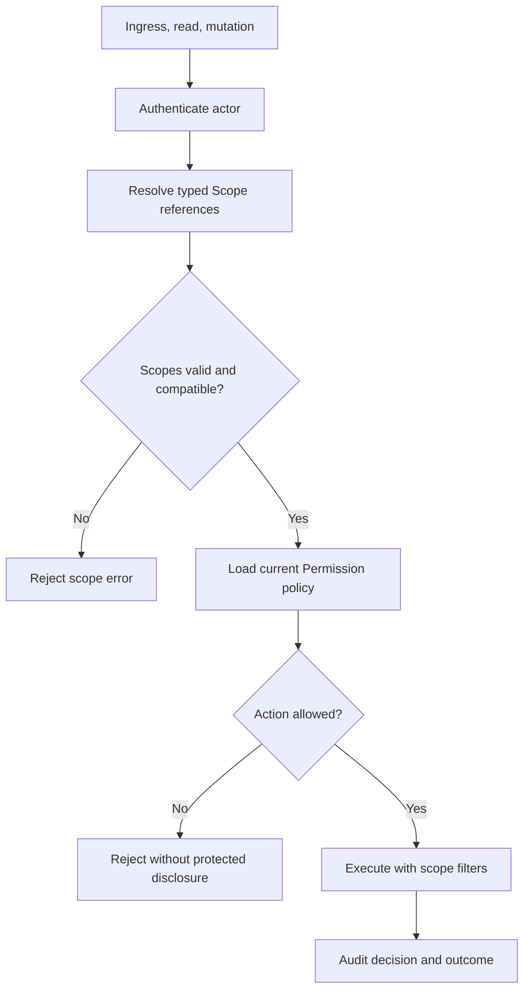

---
document_metadata:
  domain: domain-model
  role: design-specification
  lifecycle:
    approval:
      decision_status: Draft
      approver: null
      decision_date: null
      approved_version: null
      approval_scope:
        type: Full-document
      approval_applicability: Not-Applicable-To-Current-Version
      evidence_reference:
        - "14-ai-development/work-items/AID-2026-200/evidence.md"
      revocation: null
    evidence_verification:
      verification_status: Unverified
      last_verified_date: "2026-11-27"
      last_verification_note: "GOV-DOC-002 classification of a mirror that carried no front-matter: records domain, role, status and the canonical source path only (basis, the document's own statement: Status: Separation and isolation DECIDED). Claims no canonical authority and does not verify semantic parity with the source. Pre-metadata content blob: 4ae2b40d11aba5db1ce7009ebe8198f75bfc9741."
    usage_status: Active
    modification_status: Modified
    supersession:
      supersedes: []
      supersession_reason: null
      effective_date: null
    archival:
      archived_date: null
      archival_reason: null
      archival_reference: null
  authority:
    canonical_status: Non-Canonical
    canonical_conflict_status: None
    normative_status: Normative
  bilingual_counterpart:
    source: "02-domain-model/scope-and-permission-model.md"
    en: null
    zh-CN: "docs/zh-CN/02-domain-model/scope-and-permission-model.md"
---
# Scope and Permission Model

- Document ID: DOMAIN-SCOPE-PERMISSION-001
- Version: 1.0
- Source: [Normative source specification](../../../02-domain-model/scope-and-permission-model.md)
- Source revision: 713d6d06157bfa7d4a72ac696513e0ece6ff23bd
- Chinese counterpart: [Scope 与 Permission 模型](../../zh-CN/02-domain-model/scope-and-permission-model.md)
- Status: Separation and isolation DECIDED; policy language and inheritance edge cases OPEN
- Owner: Domain Model defines semantics; Scope, Permission & Governance Engine enforces them

## 1. Purpose

Scope defines the namespace and applicability boundary in which an asset belongs. Permission defines which actor may perform which operation on that resource. They are independent: knowing an object's scope does not grant access, and role membership does not change scope.

The model prevents mixing across users, projects, Agents, Agent instances, tasks, sessions, and environments such as distinct game worlds or save files.

## 2. Responsibilities

Domain Model defines scope kinds, object binding, composition semantics, and reference constraints. Governance owns policy evaluation, grants, revocation, audit, and retention. Every subsystem enforces authorization at its boundary.

This document does not define identity provider, ACL storage engine, cryptographic protocol, or deployment topology. Agents cannot define Brain policy.

## 3. Scope dimensions

| Scope kind | Meaning | Typical lifetime |
|---|---|---|
| User Scope | Data belonging to/controlled by a user principal | Long-lived |
| Project Scope | Shared project/workspace namespace | Project lifetime |
| Agent Scope | Logical Agent identity and permitted memory namespace | Long-lived |
| Agent Instance Scope | One running/deployed instance | Instance lifetime |
| Task Scope | Bounded task or objective | Task lifetime |
| Session Scope | One interaction/runtime session | Session lifetime |
| Environment Scope | World, tenant, simulation, save file, device fleet, external state domain | Environment lifetime |
| System Scope | Brain-owned operational metadata | System lifetime |

Not every object needs every dimension. It must bind all dimensions necessary to disambiguate ownership and meaning. Environment-specific claims/events explicitly include Environment Scope.

## 4. Scope object model

A typed Scope reference includes:
- scope_id: stable opaque identifier;
- scope_kind: registered scope kind;
- owner_ref: principal or parent scope;
- parent_scope_id: optional parent;
- namespace_key: opaque stable discriminator;
- status: active, suspended, closed, revoked;
- created_at and optional closed_at;
- policy_ref: governance policy selector.

Agent Scope specializes this with agent_id, optional agent_instance_id, owner scope, and policy. Environment Scope binds environment_kind, environment_identity, tenant/project parent, optional environment version, and status.

Display names, task titles, Agent labels, and world names are never safe unique namespace keys.

## 5. Scope composition

**DECIDED:** An object may carry multiple scope references. Composition is not a free-form union that grants access. Every scope must be resolved and validated; effective scope is interpreted under declared policy.

**CANDIDATE default rules:**
1. Ownership scope is singular or represented by explicit shared ownership.
2. Additional scopes narrow applicability or qualify context (Agent, task, session, environment).
3. Read requires authorization for ownership scope and satisfaction of mandatory applicability constraints.
4. Adding a scope cannot broaden visibility unless an explicit share/grant exists.
5. Environment Scope is mandatory where facts can differ by world, tenant, simulation, save, or environment version.
6. Child task/session cannot outlive or escape owning parent.
7. Closing a scope blocks new ordinary writes except authorized archival/reconciliation.

### Example: same Agent, separate worlds

Agent builder-agent operates in world-alpha and world-beta. “Base coordinates are (10, 20)” must carry the corresponding Environment Scope. A query in world-beta cannot retrieve world-alpha's claim merely because Agent identity matches.

### Shared Memory

Cross-Agent/user sharing is explicit and requires source-owner authorization, recipient scope, declared operations/purpose, optional expiry/revocation, audit, and independent Evidence/source access checks. Sharing a summary does not automatically share original Evidence payload.

## 6. Permission model

Permission is an authorization decision over actor, action, resource, scope, context, and policy version.

Canonical action vocabulary should include:
- event.ingest / event.read
- memory.propose / memory.read / memory.update / memory.consolidate / memory.activate / memory.archive / memory.retract_claim / memory.forget
- entity.resolve / relation.manage
- evidence.read / provenance.read
- context.read / context.edit / context.sync
- scope.share / scope.manage
- audit.read

**CANDIDATE:** combine role/attribute rules with explicit grants and deny overrides. Exact policy language is OPEN. Default deny applies to ungranted operations.

Check permission:
1. At ingress before accepting scoped data.
2. At canonical read before returning content.
3. At each Evidence/source dereference.
4. Before mutation and lifecycle transitions.
5. Before activation/context delivery.
6. During export, sharing, Forget, and audit.
7. On async worker execution, re-checking current authorization.

Prior authorization of a queued item does not guarantee permission when it executes.

## 7. Scope vs Permission examples

| Situation | Scope | Permission |
|---|---|---|
| Agent asks for own Memory | In scope | Still needs memory.read |
| User can read project but not restricted source | Memory may be in project | Evidence dereference denied |
| Agent has read in world A | World A only | No world B access |
| User revokes sharing | Scope link remains historical | Future access denied |
| Adapter receives Context Change Set | Context is Agent/Task scoped | Delivery capability/permission still required |
| Forget targets another user's asset | Target scope resolved | Denied absent governance authority |

## 8. Inputs and outputs

Authorization input: authenticated actor, action, typed resource, effective scopes, purpose/context, policy version, grants/denies.

Output: allow/deny, decision ID, reason code, obligations (redaction, read-only, expiry), decision time. Denial must not disclose protected existence/content beyond policy.

Domain validation separately returns unresolved scope, incompatible parent, missing environment scope, forbidden cross-scope reference, or invalid scope status. Authorization may deny a semantically valid object.

## 9. Scope resolution workflow

Every asynchronous operation repeats authorization at execution. Scope resolution and permission evaluation must not collapse into an implicit tenant-ID check.

## 10. Data ownership and consistency

User owns user-originated information under applicable policy. Project owner/admin governs shared project assets. Agent supplies telemetry and may have scoped access but does not own Brain semantics. Brain owns canonical identity, version history, lifecycle metadata, and managed Context authority. Environment Adapter supplies observations but not retention policy. Evidence source may have stricter policy than derived Memory.

Canonical assets store ownership/applicability scope. Grants are separately managed/versioned by Governance. Revocation affects future operations and triggers context/index/cache reconciliation; it does not rewrite historical ownership.

## 11. Concurrency, idempotency, failure

Scope/grant mutations are versioned. Operations include policy/grant version in decision context. Long-running jobs re-check before irreversible stages. If policy changes mid-operation, worker pauses/fails closed and records resumable state.

Idempotency keys are scoped by actor, operation, resource, and relevant scope. Permission service failure must fail closed for protected reads/writes. **OPEN:** whether bounded cached decisions can be used and what revocation guarantees they require.

## 12. Security and isolation constraints

- Default deny.
- Never infer scope from display strings or model-generated text.
- No implicit cross-user/environment joins.
- Apply scope filters before ranking, aggregation, and result counts that could leak data.
- Authorize Evidence and Provenance references independently.
- Agent-provided scope claims are untrusted until authenticated/resolved by Adapter/Gateway.
- Memory content cannot modify policy or grant itself access.
- Logs/metrics avoid protected content and identifiers.
- Revocation/Forget invalidates relevant contexts, working sets, caches, and projections.

## 13. Performance and acceptance

Measure authorization latency p50/p95/p99, scope resolution cost, policy cache hit/miss, revocation propagation lag, and adversarial leakage tests. Unauthorized disclosure target is zero; performance cannot be gained by omitting filters.

Acceptance:
- Same Agent across two Environment Scopes cannot cross-read environment claims.
- Permission denial blocks otherwise valid in-scope operation.
- Permission in one scope does not authorize another.
- Evidence access is checked independently from Memory access.
- Revoked grants block future reads and trigger context reconciliation.
- Async workers re-check permission.
- Ambiguous scope is rejected, not guessed.
- Scope composition cannot broaden access implicitly.
- Scope closure blocks ordinary writes.
- Policy service failure follows fail-closed behavior.

## 14. Open decisions and interfaces

- **OPEN:** Formal scope algebra for parent/child and multi-owner scopes.
- **OPEN:** Policy language and role/attribute model.
- **OPEN:** Cached authorization semantics and revocation SLA.
- **CANDIDATE:** Default-deny with explicit sharing grants and policy obligations.
- Governance defines grant lifecycle, revocation, audit, retention.
- BMCP/Adapter defines authenticated actor and scope claims; Agent labels are not trusted identity.
- Compiler attaches source/environment scopes to Event/Evidence/Claim proposals.
- Runtime/MCM enforces scope filtering before activation and context delivery.
