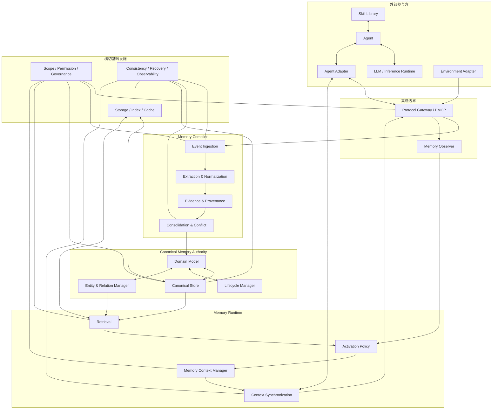

---
document_metadata:
  domain: architecture
  role: design-specification
  lifecycle:
    approval:
      decision_status: Draft
      approver: null
      decision_date: null
      approved_version: null
      approval_scope:
        type: Full-document
      approval_applicability: Not-Applicable-To-Current-Version
      evidence_reference:
        - "14-ai-development/work-items/AID-2026-193/evidence.md"
      revocation: null
    evidence_verification:
      verification_status: Unverified
      last_verified_date: "2026-11-27"
      last_verification_note: "为原本无 front-matter 的镜像补 GOV-DOC-002 分类：仅记录 domain、role、状态与规范源路径（依据正文自述：Status: DECIDED for authority and primary collaboration）；不主张规范权威，也不证明与源语义对等。补元数据前正文 blob：db9529555336ce3a5d56aa777f3a859aa3123a47。"
    usage_status: Active
    modification_status: Modified
    supersession:
      supersedes: []
      supersession_reason: null
      effective_date: null
    archival:
      archived_date: null
      archival_reason: null
      archival_reference: null
  authority:
    canonical_status: Non-Canonical
    canonical_conflict_status: None
    normative_status: Normative
  bilingual_counterpart:
    source: "01-system-architecture/component-interactions.md"
    en: "docs/en/01-system-architecture/component-interactions.md"
    zh-CN: null
---
# 组件交互

- 文档 ID：SYS-INTERACTIONS-001
- 版本：1.0
- 源规范：[规范性原文](../../../01-system-architecture/component-interactions.md)
- 源版本： b782472896068329ba2f4bcc293afe15b92496a7
- 对应英文：[Component Interactions](../../en/01-system-architecture/component-interactions.md)
- 状态：权威归属和主要协作为 DECIDED；编排模式和调用拓扑为 CANDIDATE；委托给 Session H 的协议细节为 OPEN

**范围：** 定义系统层面的组件间契约、输入/输出、执行顺序、所有权和故障行为。

## 1. 交互模型

组件通过明确契约交互，而不是共享未文档化状态。逻辑交互可以是进程内调用、持久化消息、流或协议请求；本文不规定部署拓扑。

规则：
- 主要 Owner 定义语义并拥有权威状态。
- 支持组件可以校验、转换、传输或缓存，但不能形成竞争性权威。
- 每个外部边界都必须检查身份、Scope、Permission、Schema 和资源限制。
- 异步任务必须具有持久化的关联和重试语义。
- 改变状态的重试必须具备幂等性。
- Context Version 变更由 MCM 串行化；Sync 只跟踪投递。
- 确认语义必须明确，不得夸大实际观察到的内容。

## 2. 完整逻辑组件关系

该图表示逻辑依赖，不代表必须使用同步调用。Governance 和 Consistency 是横切策略/服务，不是统一的中央瓶颈；每个边界都必须执行适用的本地契约。

## 3. 组件输入/输出矩阵

| 组件 | 输入 | 输出 | 拥有的权威状态 | 禁止事项 |
|---|---|---|---|---|
| Protocol Gateway / BMCP | 已认证消息、能力配置、协议版本 | 已校验的规范化请求、协议错误、协商后的能力 | 若有定义，则拥有协议 Session/协商状态 | 判断语义真伪或拥有记忆 |
| Event Ingestion | 已授权事件信封、Scope、来源、幂等键 | 持久化 Receipt、Event 引用、处理状态 | 接收/幂等记录和入口状态 | 为等待 LLM 编译而延迟可靠接收 |
| Memory Observer | 结构化遥测、流序号、新鲜度 | 规范化任务/环境信号和观察事件 | 仅 Observer Cursor/派生状态 | 检查 Agent 私有内部状态，或从计划推断结果 |
| Extraction & Normalization | 已接收 Event/来源引用 | Candidate Memory/Claim 提案及提取元数据 | 处理检查点，不是 Canonical Truth | 绕过 Canonical Lifecycle |
| Evidence & Provenance | 候选命题、来源片段/引用、派生步骤 | Evidence 链接、Provenance 图/记录 | Brain 契约下的 Evidence/Provenance 记录 | 编造没有依据的 Evidence |
| Consolidation & Conflict | 候选命题、Canonical 候选、Evidence | 巩固提案、ConflictSet、解决方案提案 | Work Item 状态；除非明确委托，否则不拥有最终 Canonical 权威 | 静默覆盖冲突命题 |
| Domain Model | 类型化对象操作和元数据 | 校验规则、规范语义表示 | 领域定义和语义约束 | 拥有物理持久化 |
| Canonical Store | 已授权 Canonical 读写事务 | 持久化版本、提交结果、Canonical 查询结果 | 持久化 Canonical 记录及版本 | 脱离 Domain/Lifecycle 规则独立决定认知真伪 |
| Lifecycle Manager | Candidate、状态转换请求、Evidence、Policy | 接受/延迟/拒绝/转换决策 | Lifecycle 状态和转换历史 | 静默抹除 Provenance/Conflict 历史 |
| Entity & Relation Manager | Entity 提及、身份 Evidence、关系提案 | Entity 解析和类型化关系结果 | Entity 身份和关系历史 | 未经可追踪决策合并身份 |
| Retrieval Engine | 有 Scope 的查询、过滤器、任务信号、授权索引 | 带 Evidence/新鲜度元数据的排序候选 | 查询执行状态和可丢弃工作状态 | 激活 Context 或暴露未授权候选 |
| Activation Policy | 遥测、检索候选、风险/新鲜度 | 激活提案及理由 | Policy/配置版本；不拥有 Context 权威 | 修改 Canonical Memory |
| MCM | 激活提案、明确编辑请求、当前 Context Version、预算 | 新 Context Version、ChangeSet、协调结果 | Memory Context 和唯一版本序列 | 将 Remove 当作 Forget，或接受并行权威 |
| Context Synchronization | ChangeSet/Snapshot、Adapter 能力和确认 | Delivery、状态转换、协调请求 | Delivery 尝试/状态，不拥有 Context 语义 | 创建语义 Context Version |
| Governance | Principal、Action、Resource、Scope、Policy | Allow/Deny、义务、审计事件 | Policy 和 Governance/Audit 状态 | 把 Scope 本身当成 Permission |
| Storage/Index/Cache | Canonical 变更流、查询、失效请求 | 持久化字节、索引/缓存结果和版本标记 | 仅物理表示；索引/缓存属于派生数据 | 声称拥有 Canonical Truth |
| Consistency/Recovery/Observability | Commit 标记、事件/变更流、检查点、指标 | Replay/Reconciliation、修复、Trace/健康状态 | 恢复检查点和遥测记录 | 在修复期间改变领域语义 |

## 4. 主要交互契约

### 4.1 Gateway → Ingestion

**输入：** 已认证来源、Event Payload/引用、Scope、Schema Version、Idempotency Key、来源时间戳、Provenance 元数据。  
**输出：** 带稳定 Event ID 的持久化 Receipt，或明确拒绝。  
**保证 — DECIDED：** 只有当 Event 与可恢复的编译意图在同一原子接收边界（或具备等效崩溃安全语义的协议）中均已持久化后，才返回 `Accepted`。重复重试返回原始 Receipt，不会创建额外 Event 或意图。这不表示工作已经分发或完成编译。

**有界实现证据：** PR #246 commit `fcdecf0a4e638c8b3c9ac0e4623f97c98ed21291`；exact-head Rust run `44261068522` SUCCESS；GOV-DOC-001 run `44261068531` SUCCESS；合并后 Main Rust run `44261208110` SUCCESS。证据范围仅为 SQLite Event Store 意图账本及启动回填。  
**故障：** Schema/Permission 无效时拒绝；Storage 不可用时返回可重试的不可用/背压，不得虚假 Accepted。

### 4.2 Ingestion → Compiler

**输入：** 持久化 Event 引用和不可变来源元数据。  
**输出：** 处理 Work Item 和阶段状态。  
**保证：** 只有阶段处理幂等时，才允许 At-least-once 分发。  
**故障：** Compiler 故障使任务保持 Pending；Replay 从持久化状态恢复。

### 4.3 Compiler → Canonical Authority

**输入：** 候选对象提案、命题、Evidence/Provenance 引用、来源认知状态、时间元数据和 Scope。  
**输出：** Canonical ID/Version 和 Lifecycle 决策，或带原因的 Deferred/Rejected 结果。  
**保证：** Compiler 负责提案；Canonical/Lifecycle 权威负责接受并拥有 Canonical Version。  
**故障：** 保留冲突，不得盲目覆盖；Candidate 必须可追踪。

### 4.4 Canonical Authority → Retrieval / Indexes

**输入：** 带 Version/Generation 的已提交 Canonical 变更事件。  
**输出：** Index/Cache 更新和可见的索引代数。  
**保证：** Canonical Store 始终是权威；次级结构暴露自身索引代数并且可重建。  
**故障：** 根据 Canonical 变更历史重试/重建；当 Generation 落后于所需 Fence 时拒绝陈旧候选。

### 4.5 Observer → Activation / Retrieval

**输入：** 规范遥测字段、流身份/序号、时间戳、不确定性、任务/环境 Scope。  
**输出：** 任务状态增量、新鲜度评估、Recall 触发/提案。  
**保证：** 遥测标明来源；前瞻状态不是结果证据。  
**故障：** 标记序号缺口/乱序更新；陈旧状态不得静默覆盖更新观察。

### 4.6 Retrieval → Activation

**输入：** 有 Scope 的查询和检索约束。  
**输出：** 包含 Canonical 引用、相关性信号、Evidence、有效性/新鲜度和 Permission 过滤结果的候选。  
**保证：** Retrieval 只提供候选，不决定最终 Context 成员。  
**故障：** 明确返回 Partial/Degraded/Timeout；Permission 失败不得泄露片段。

### 4.7 Activation → MCM

**输入：** 激活提案、原因代码、目标 Context、候选引用、紧急程度/过期提示。  
**输出：** 已提交 Context Version，或 No-op/Deferred 结果。  
**保证：** MCM 执行预算、Scope、去重和版本规则，并拥有 Context 序列。  
**故障：** Base Version 过期时必须明确重新规划/重基或拒绝；不得静默采用 Last-write-wins。

### 4.8 MCM → Sync → Adapter

**输入：** 不可变 ChangeSet，包含 Context ID、Base/Target Version、操作或 Snapshot、过期时间和能力约束。  
**输出：** Delivery 状态和 Adapter 确认。  
**保证：** Sync 拥有传输状态；Adapter 报告 Received/Accepted/Rejected/Applied。Applied 必须指明准确 Target Version 和边界 Receipt。  
**故障：** 对同一 Delivery 幂等重试；版本链缺失时触发 Full Snapshot/Reconciliation。

### 4.9 所有交互中的 Governance

每项操作都检查 Principal、Action、Resource、Scope、Permission、Purpose，以及适用的 Retention/Consent 义务。执行操作的组件必须在自己的边界落实检查结果；如果权威或 Scope 可能发生变化，仅依赖远端先前检查并不充分。

## 5. 同步与异步交互矩阵

| 交互 | 默认方式 | 原因 |
|---|---|---|
| 身份认证/Schema/Permission 校验 | 在边界同步执行 | 不允许未授权操作继续 |
| Event 可靠接收 | 同步返回持久化 Receipt | 调用方需要真实的接收结果 |
| 语义编译 | 异步 | 模型延迟/故障不得阻塞接收 |
| Canonical Lifecycle 决策 | 内部事务/工作流；相对 Ingress 可以异步 | 保留 Canonical Policy 和 Evidence |
| Index/Cache 传播 | 异步 | 派生且可重建 |
| 明确的 Runtime Recall | 有界同步请求/响应 | Agent 需要及时获得候选 |
| 后台主动 Recall | 异步候选 | 避免阻塞 Agent 任务循环 |
| Context Version 提交 | MCM 原子操作 | 保持唯一权威序列 |
| Context Delivery | 异步 | Adapter 可能离线 |
| Applied 确认 | Adapter 在边界应用后报告；异步传送 | 证明必须发生在实际应用之后 |
| Forget 传播 | 持久化分阶段工作流 | 多目标清理和恢复 |

## 6. 并发与事务边界

- Ingestion 按 Idempotency Scope 和 Key 去重。
- Compiler 阶段输出必须幂等，并关联不可变 Event/来源引用。
- Canonical 修改使用 Version 前置条件或等价并发控制；冲突必须显式处理。
- Context 修改按 Context 串行执行，或针对 Base Version 使用 Compare-and-swap。
- 单个 Context ID 只有一条权威版本序列，由 MCM 拥有。
- Delivery 重试不得增加 Context Version。
- 对同一 Context Session，Adapter Applied 报告必须单调；过期 ACK 不得回滚已应用版本。
- Forget 必须先创建持久化 Governance Job/Fence，再进行异步派生物清理。
- 跨组件多记录工作流使用持久化状态机/Outbox 或等价可恢复协议；不得假设所有组件之间存在分布式 ACID 事务。

## 7. 错误与结果分类

系统级结果应区分：
- `Rejected`：请求无效、未授权、不受支持或被策略拒绝。
- `RetryableUnavailable`：依赖、存储或传输暂时不可用。
- `AcceptedPending`：已可靠接收，但异步工作尚未完成。
- `Partial`：读取/Recall 已完成，但存在明确缺项或依赖降级。
- `Conflict`：Base/Version/语义冲突，需要协调。
- `Expired`：操作/Delivery 已失效。
- `Superseded`：更新的目标版本已取代当前工作。
- `Applied`：准确 Context Version 已在约定 Adapter 边界应用；不代表模型理解。

准确的错误代码和消息信封由 BMCP 规范定义。

## 8. 可观测性与关联

每个跨边界工作流应携带 Correlation/Causation ID、Actor/Principal、Scope 引用、Event/Context/Memory 引用、幂等身份、Version/Generation、阶段、尝试次数和时间戳。日志不得无差别复制敏感来源 Payload。指标应暴露队列等待时间、阶段延迟、重试、版本滞后、陈旧索引拒绝、拒绝操作和协调结果。

## 9. 故障隔离

| 组件故障 | 隔离行为 |
|---|---|
| Gateway 故障 | 外部操作不可用；Canonical 数据不变 |
| Ingestion 故障 | 只有可靠接收完成后才允许返回 Accepted Receipt |
| Compiler 故障 | 已接收 Event 排队；Canonical 不受破坏 |
| Canonical Store 故障 | 停止 Canonical 修改；不得虚报成功 |
| Index/cache 故障 | Recall 降级或安全绕过索引；Canonical 仍正确 |
| Retrieval 故障 | 明确 Timeout/Partial；不得推断发生了 Context 修改 |
| Activation 故障 | Agent 可以在没有主动更新时继续；状态必须明确 |
| MCM 故障 | 不生成新 Context Version；最后提交版本仍是权威 |
| Sync 故障 | Delivery 保持 Pending；目标版本继续持久化 |
| Adapter 故障 | 不产生 Applied ACK；稍后重试/协调 |
| Governance 故障 | 受保护操作 Fail-closed |
| Observability 故障 | 只有在仍能满足审计义务时核心数据路径才可继续；否则受治理写入 Fail-closed |

## 10. 其他会话需要确认的接口问题

| Owner | 需要确认的问题 |
|---|---|
| B — Domain Model | Canonical ID、Event/Memory/Claim 区分、时间和认知字段、Provenance 引用 |
| C — Agent Integration | 最小遥测、新鲜度/序列语义、Agent Instance 和 Environment 身份 |
| D — Memory Brain | Candidate 接受、Canonical 版本管理、Lifecycle 转换契约、冲突语义 |
| E — Memory Compiler | 阶段输出、幂等性、重新编译语义、原始来源保留 |
| F — Memory Runtime | Recall 请求/结果、激活原因、新鲜度和降级结果语义 |
| G — Memory Context | Context ID/Version 权威、ChangeSet 操作、Base Version 冲突/协调 |
| H — BMCP / Adapter | 消息信封、认证、能力协商、ACK 状态名称、错误代码、兼容性 |
| I — Infrastructure | 可靠接收、Outbox、索引代数、删除传播、Replay 和备份保证 |

## 11. 验收测试

1. 组件试图修改其他组件权威状态时，其写入必须被拒绝。
2. 重复提交 Event 应返回相同 Event Receipt。
3. Compiler 故障后 Event 仍持久化且保持 Pending。
4. Compiler 提案不能绕过 Lifecycle 决策。
5. Retrieval 结果不能自动修改 Context。
6. Activation 提案不能修改 Canonical Memory。
7. 两个针对相同 Base 的并发 Context 编辑不得静默覆盖。
8. 重复 Delivery 不得增加 Context Version。
9. 没有准确 Context/Version 和边界 Receipt 时，不可能产生 Adapter Applied。
10. 旧 ACK 不得回退当前 Delivery/Application 状态。
11. 未授权的跨 Scope Retrieval 不得返回受保护候选详情。
12. Index/cache 丢失后可通过 Canonical 变更历史修复。
13. Forget 重试必须单调且可审计。
14. Environment 和 Skill Library 接口不得成为隐藏的 Brain 环境执行通道。

## 12. 开放决策

- **OPEN：** 规范协议消息和错误 Schema（Session H）。
- **OPEN：** Principal 身份、认证、密钥轮换和审计脱敏细节（Session I）。
- **CANDIDATE：** 使用 Durable Outbox 发布 Event 和 Canonical 变更；并与等价可恢复机制比较。
- **TO_VALIDATE：** 各 Adapter 等级下，高影响 Recall 是否需要同步的 Agent 侧 Preflight。
- **OPEN：** Observability 子系统故障期间，跨组件审计可用性的要求。

## 13. 决策摘要

- **DECIDED：** 组件所有权遵循责任矩阵；不存在共享的可变权威。
- **DECIDED：** Ingestion Receipt、Compiler 完成、Canonical 接受、索引可见、Context Delivery 和 Applied 是不同里程碑。
- **DECIDED：** Retrieval 返回候选；Activation 提出建议；MCM 提交 Context；Sync 负责投递；Adapter 应用并确认。
- **DECIDED：** 所有外部和跨子系统调用都应携带明确的 Scope、Permission、Version、Correlation 和适用的 Idempotency 语义。
- **OPEN：** 准确协议、身份和存储机制由指定会话负责。
