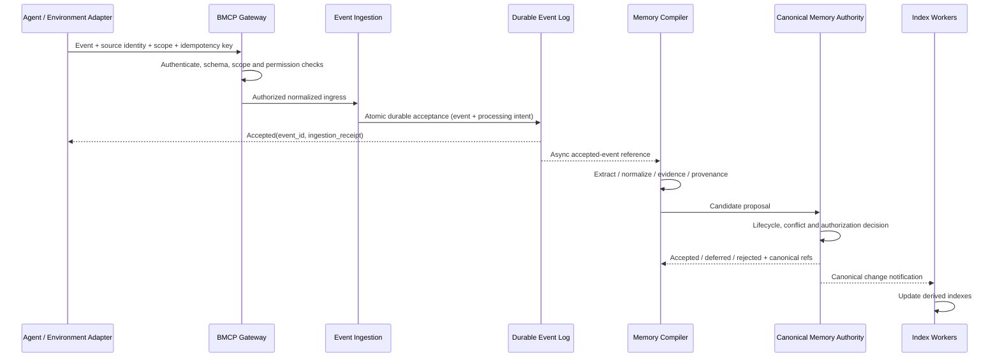
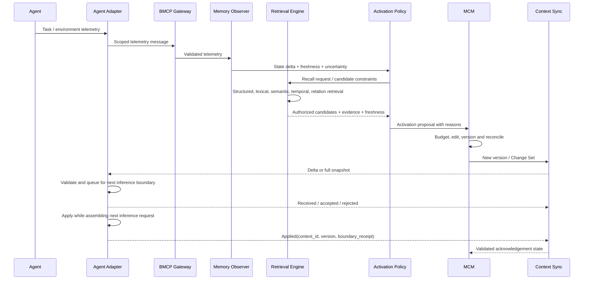
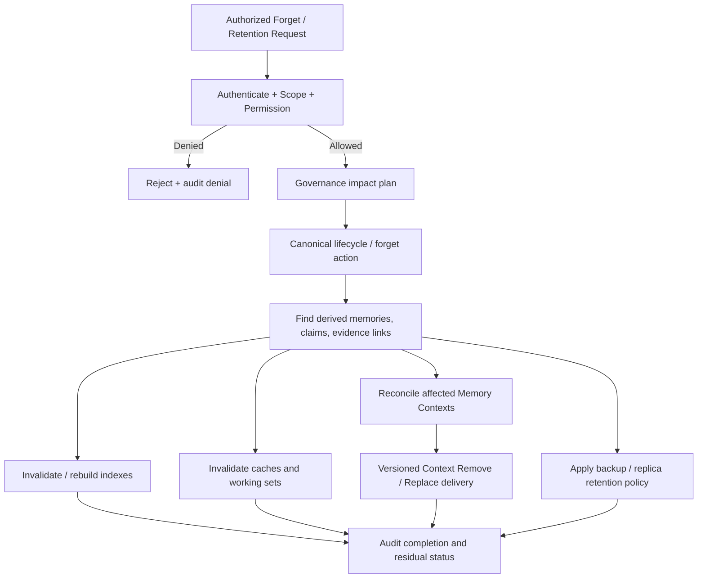

# 系统数据流

- 文档 ID：SYS-DATA-FLOWS-001
- 版本：1.0
- 源规范：[规范性原文](../../../01-system-architecture/data-flows.md)
- 源版本：24bc5867749d234238e6d75aadd4119f359de9f8
- 对应英文：[System Data Flows](../../en/01-system-architecture/data-flows.md)
- 状态：所有权和语义边界为 DECIDED；调度/传输选择为 CANDIDATE；量化目标为 TO_VALIDATE

**范围：** 描述端到端逻辑数据路径。内部提取、检索、生命周期和 BMCP 算法由各子系统规范定义。

## 1. 设计规则

1. Event 可靠接收与语义编译相互独立。
2. Event Ingestion 和 Runtime Recall 具有不同的延迟、可靠性和授权特征。
3. Canonical Memory 只能通过 Brain 拥有的 Lifecycle/Canonical 流程修改。
4. Memory Context 变更由 MCM 拥有，并且必须带版本。
5. Delivery 与 Application 是不同阶段；Applied 必须有 Adapter 确认。
6. 不假设可以修改正在执行的推理；更新在下一次推理上下文组装边界生效。
7. 每条数据流都携带 Scope、Permission 上下文、来源/关联信息；状态变更必须使用幂等语义。
8. 异步工作必须可观测、可重试且可安全重放；下游阶段不可用不能导致已接收来源数据丢失。

## 2. Event Ingestion 与 Runtime Recall

**DECIDED：** 两者是逻辑上不同的通道，即使首期部署共享进程、传输或存储引擎，也不能混淆其语义。

| 维度 | Event Ingestion 通道 | Runtime Recall 通道 |
|---|---|---|
| 目的 | 接收来源发生/观察，以便可靠处理 | 回答有 Scope 的记忆查询或激活请求 |
| 典型调用方 | Agent Adapter、Environment Adapter、授权导入/来源 | Agent Adapter / Runtime 集成 |
| 延迟契约 | 可靠接收；语义处理可以延后 | 有界交互响应 |
| 持久性 | Accepted Event 必须能承受 Compiler/模型/索引故障 | 查询以读取为主；派生缓存可丢弃 |
| 处理流程 | Validate → Authorize → Deduplicate → Persist → Enqueue Compile | Authenticate → Authorize → Route Retrieval → Filter/Rank → Return Candidates |
| 故障策略 | 持久化提交前不得确认 Accepted；幂等重试 | 返回明确 Timeout/Degraded/Partial；不得编造结果 |
| 顺序 | 声明时保证每个来源/流内顺序；不假设全局顺序 | 每个请求声明查询 Snapshot/Version 语义 |
| 背压 | 队列限制、接收控制、持久化积压 | 并发/延迟预算、候选数量/图扩展上限 |
| 副作用 | 创建不可变来源 Event 和处理任务 | 仅仅读取不得修改 Canonical Memory |

**CANDIDATE：** 使用独立逻辑 API Endpoint 和队列类别；只有负载和故障测试完成后，才决定是否进行物理隔离。

## 3. 记忆形成流程

### 3.1 输入契约

最少逻辑字段：
- 来源 Principal 和来源类型；
- 明确的 Scope，包括相关 Agent/Session/Environment 维度；
- Event Payload 或持久化来源引用；
- 已知时提供事件发生时间，Recorded At 由 Brain 赋值；
- Schema Version 和 Idempotency Key；
- 可用时提供 Provenance 元数据及 Correlation/Causation ID。

可选字段包括来源置信度/质量、内容类型、Locale、来源保留约束和结构化观察元数据。精确 Wire Schema 由 BMCP/Domain 规范定义。

### 3.2 接收语义

**DECIDED：** `Accepted` 表示 Event 及其处理意图已经持久化，不代表 Memory 已创建、验证、索引或激活。

**DECIDED（逻辑接收契约）：** `Accepted` 要求在确认之前，Event 与可恢复的编译意图记录都已持久化。Event 和编译意图必须共享同一个原子持久化接收边界，或采用崩溃语义等效的协议；重复重试返回原始 Receipt，不创建重复 Event 或意图。这不代表工作已分发、Worker 已租约/交付、Compiler 已执行或 Canonical Memory 已创建。

**IMPLEMENTED / 有界证据：** PR #246 合并 commit `fcdecf0a4e638c8b3c9ac0e4623f97c98ed21291`；PR exact-head Rust Workspace Tests run `44261068522` SUCCESS，GOV-DOC-001 run `44261068531` SUCCESS，合并后 Main Rust Workspace Tests run `44261208110` SUCCESS。已验证实现仅为 SQLite Event Store 编译意图账本和启动回填；这些证据不证明 Dispatcher/Worker 执行、Payload 字节托管/哈希校验、多进程/生产拓扑或生产就绪。

### 3.3 异步编译

Compiler 默认异步工作，可以包括确定性校验、模型辅助提取、实体解析、证据关联、巩固和 Canonical 提案。每个阶段都记录状态和可重试性。模型不可用或阶段失败时，已接收的原始输入仍必须可恢复。

Compiler 提案不会自动成为 Canonical Truth。Lifecycle/Canonical 权威可以接受、延迟、拒绝或要求补充证据。Intent/Plan 遥测仍是前瞻信息，除非有 Outcome Event 支持，否则不能成为已完成结果。

## 4. Runtime Recall 与 Activation 流程

### 4.1 Telemetry 到 Context 的语义

Telemetry 是关于 Agent 所报告状态的证据，不是 Brain 对 Agent 的直接内省。Brain 可以更新任务/环境模型并评估记忆需求，但不能仅凭 Plan 或 Pending Action 字段推断意图中的动作已经发生。

**CANDIDATE：** 普通任务进展期间异步预激活；对声明的高影响/高风险状态转换进行同步 Preflight Recall。阈值和触发类别仍需验证，本文不固定评分权重。

### 4.2 Context ChangeSet 投递

MCM 拥有期望的 Context Version 和语义变更。Sync 拥有 Delivery 尝试和 Delivery 生命周期。Delivery Envelope 标识 Context、Base Version、Target Version、Protocol Version，以及 Delta 或 Full Snapshot。

Adapter 的处理阶段必须区分：
- **Received：** 传输 Payload 已到达。
- **Accepted：** Adapter 已校验，并能够应用或排队。
- **Applied：** Adapter 已在约定的推理上下文组装边界，将准确指定的版本安装到 Brain 管理区域。
- **Rejected / Expired / Superseded：** 明确表示未应用的结果。

Applied 只是协议层证据；不能证明模型关注、理解或遵循了该记忆。

### 4.3 重连、离线与版本不匹配

重连时，Adapter 报告最后已知的 Applied Context/Version 和支持能力。Brain 将其与 MCM 的权威期望版本比较：
- 如果相同，恢复增量同步。
- 如果落后，但 Delta 链仍保留且兼容，则发送连续 Delta。
- 如果存在缺口、Base 未知、Schema 不兼容或历史已压缩，则发送完整 Snapshot。
- 如果 Adapter 报告未来版本或冲突的 Context 身份，停止增量应用并显式协调。
- 如果旧 Delivery 已不再是当前目标，则标记为 Superseded 并发送当前状态。

**DECIDED：** 版本缺口绝不能静默推进 Applied。**OPEN：** Delta 历史的精确保留期限和 Full Snapshot 回退阈值。

## 5. Forget / Retention 数据流

### 5.1 语义

- Context Remove 只从特定 Memory Context 中移除 Context Entry，不修改 Canonical Memory。
- Forget 是针对权威资产及适用派生物的受治理操作。
- Forget 必须识别 Scope 内的 Provenance 后代、Evidence、索引、缓存、工作集、Context Entry、副本和备份。
- 无法立即物理擦除时，系统必须记录待擦除状态、访问抑制、截止时间和残留位置；不得过早声称已完全删除。
- 审计记录不得保留 Forget 原本要删除的敏感 Payload；精确墓碑/最小元数据策略仍由 Governance 设计，当前为 OPEN。

### 5.2 顺序与故障窗口

**CANDIDATE：** 首先授权并持久化记录 Forget Job/Fence；随后阻止对目标数据的新读取/激活；再修改 Canonical 状态并枚举派生物；然后失效/重建次级表示；协调 Context；最后执行备份/副本策略，只有所有必需目标报告成功后才标记完成。

如果在安装 Fence 后、派生物清理前崩溃，任务必须可恢复。如果 Canonical 修改成功但索引失效尚未完成时崩溃，读取方不得暴露陈旧数据：读取方必须检查 Generation/Fence，或拒绝陈旧索引结果。精确事务机制由 Consistency/Storage 规范定义。

## 6. 同步类别

| 数据流 | 默认模式 | 必需保证 | 是否允许最终一致 |
|---|---|---|---|
| Event 可靠接收 | 持久化提交后同步确认 | 不虚报 Accepted；幂等重试 | 否 |
| Event → Compiler 调度 | 异步 | Pending 工作可恢复；At-least-once 分发需幂等处理 | 是 |
| Compiler → Canonical 提案 | 异步 | 保留 Provenance；由 Lifecycle 权威决策 | 是 |
| Canonical → Index/Cache | 异步 | 带版本的变更流；可检测陈旧结果；可重建 | 是 |
| Runtime Recall | 明确查询采用同步请求/响应 | Scope/Permission 正确；有界 Deadline；明确降级结果 | 响应本身不允许 |
| Telemetry → Observer | 通常异步流；同步 Preflight 为候选 | 按声明的流/序列有序；可检测陈旧信号 | 是，明确 Preflight 契约除外 |
| Activation → MCM | 内部调用/事务边界 | 唯一权威 Context 序列 | MCM 提交期间不允许 |
| MCM → Adapter Delivery | 异步 | Delivery 状态持久化；幂等重试；顺序/版本校验 | 是 |
| Adapter Applied ACK | 边界应用后异步报告 | 准确 Context/Version/Boundary 证据 | 报告可以延迟；状态不得推断 |
| Forget 传播 | 持久化工作流，分阶段异步执行 | 声称完成前先实现访问抑制/Fence；残留可审计 | 按声明策略，物理清理可以最终完成 |

## 7. 数据流标识符和 Envelope 元数据

**CANDIDATE：** 跨数据流的通用元数据：
- `request_id`、`correlation_id`、`causation_id`；
- `principal_id`、`scope_ref`、`permission_context`；
- `schema_version`、`occurred_at`、`recorded_at`；
- 状态变更 Ingress/Command 使用 `idempotency_key`；
- 适用时使用 `source_ref`、`event_id`、`memory_ref`、`context_id`；
- 适用时使用 `base_version`、`target_version`、`delivery_id`；
- 必要时包含 Deadline/Expiry 和 Payload Digest。

精确命名和 Wire Type 由 Domain Model 和 BMCP 规范决定。

## 8. 背压、重试与幂等性

- 如果无法保证持久化容量，Ingestion 必须在 Accepted 之前拒绝或延迟；不得把仅存在于易失缓存中的数据报告为 Accepted。
- 已接收 Event 从持久化 Work Record 重试；重试复用稳定幂等身份。
- 模型辅助阶段使用有界重试、分类错误和 Dead-letter/Quarantine 状态；已接收原始数据按策略保留。
- Recall 使用 Deadline、候选数量上限、图深度限制和明确 Partial/Degraded 状态。
- Context Delivery 重试不得创建新的语义版本；重复确认必须幂等。
- Forget Job 可恢复且单调：重试不得撤销已完成目标的状态。

精确重试计划、队列容量和超时值为 **TO_VALIDATE**。

## 9. 故障与恢复场景

| 故障 | 必需行为 |
|---|---|
| Ingestion 期间 LLM 不可用 | Event 仍可 Accepted；Compilation 保持 Pending |
| Compiler 提取后崩溃 | 从持久化阶段检查点恢复，或幂等重放 |
| Canonical 写入成功、Index 更新失败 | Canonical 仍是权威；Index 追赶/重建；可检测陈旧 Index Version |
| Recall 超过 Deadline | 明确 Timeout/Partial 响应；不得绕过 Permission |
| Agent 离线 | 保留期望 Context Version；不得虚报 Applied |
| Adapter 使用旧版本重启 | Delta 连续时重放，否则发送 Snapshot |
| Adapter 声称未知的未来版本 | Quarantine/Reconciliation；不得盲目覆盖 |
| Forget Worker 崩溃 | 从持久化 Job 和逐目标完成记录恢复 |
| Cache 失效失败 | Generation Fence 阻止将陈旧缓存内容作为当前内容返回 |
| Environment Event 延迟 | 保留 Event Time 和 Recorded Time；暴露新鲜度 |

## 10. 性能测量点

分别测量：
- Event 可靠接收延迟和拒绝率；
- Compile 队列等待时间、阶段耗时、重试次数和达到 Canonical 的时间；
- Recall 端到端及分阶段延迟、Timeout/Partial 率和候选数量；
- 从 Telemetry 到 Context Plan 的延迟；
- Context ChangeSet 从创建到投递，以及从投递到 Applied 的延迟；
- 重连协调耗时和 Snapshot 频率；
- Forget 到访问抑制的耗时，以及到策略完成的耗时。

在工作负载、硬件、数据规模和 Adapter 等级明确前，不固定数值 SLO。

## 11. 验收场景

1. 使用相同 Idempotency Key 提交同一 Event 两次；只产生一个持久化 Event，并返回稳定 Receipt。
2. Event Accepted 后关闭 LLM；Event 仍可供后续处理查询，并最终完成编译。
3. 提交 Plan 但不提交 Outcome；不得声称存在已完成结果记忆。
4. 使 Index Worker 不可用；Canonical 读取仍正确，Index 能够追赶。
5. Context 更新期间断开 Adapter；期望版本仍持久化，Applied 保持不变。
6. 使用连续 Base 重连；接收有序 Delta 链并确认目标版本。
7. 缺少 Delta 时重连；接收 Full Snapshot，不得静默跳过。
8. 重复发送 Applied ACK；状态不得回退，也不得重复产生副作用。
9. 移除 Context Entry；Canonical Memory 保持不变。
10. 在 Forget 每个阶段注入崩溃；Job 必须恢复，并且在必需派生物仍存在时不得报告完成。
11. 尝试未授权 Recall/Forget；不得泄露受保护数据或产生副作用。
12. 提交陈旧 Environment Observation；新鲜度/有效时间处理必须防止其静默覆盖较新状态。

## 12. 开放问题

| ID | 状态 | 问题 |
|---|---|---|
| DF-01 | OPEN | 定义每个来源的精确事件顺序保证，以及乱序观察的处理行为。 |
| DF-02 | CANDIDATE | 物理隔离 Ingress 和 Recall 队列；通过竞争/故障测试验证。 |
| DF-03 | OPEN | 定义 Delta 保留窗口和 Snapshot 压缩策略。 |
| DF-04 | OPEN | 定义离线副本和不可变备份的 Forget 完成语义。 |
| DF-05 | TO_VALIDATE | 为接收、Recall、Sync 和 Forget 制定 p50/p95/p99 预算。 |
| DF-06 | OPEN | 定义哪些风险类别要求同步 Preflight Recall。 |

## 13. 决策摘要

- **DECIDED：** Event Ingestion 和 Runtime Recall 是具有不同保证的逻辑独立通道。
- **DECIDED：** 可靠接收先于异步编译；Accepted 不等于 Compiled/Canonical/Active。
- **DECIDED：** Recall 有界且以读取为主；Activation/MCM 拥有 Context 选择和版本管理。
- **DECIDED：** Context Delivery 与 Applied 不同；版本缺口必须协调/发送 Full Snapshot。
- **DECIDED：** Forget 是受治理的多目标工作流；Context Remove 不等于 Forget。
- **CANDIDATE：** 基于 Outbox 的事件调度、Push-first 遥测、异步 Context Delivery 和 Generation Fence 次级索引。
