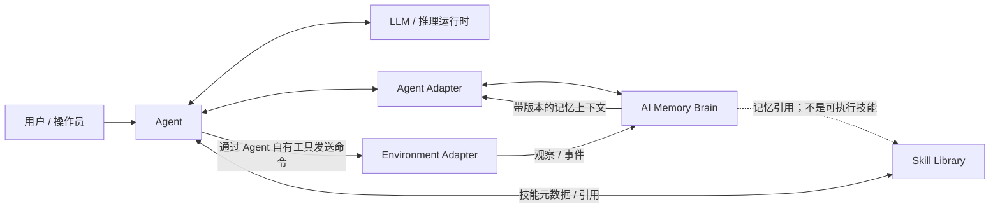
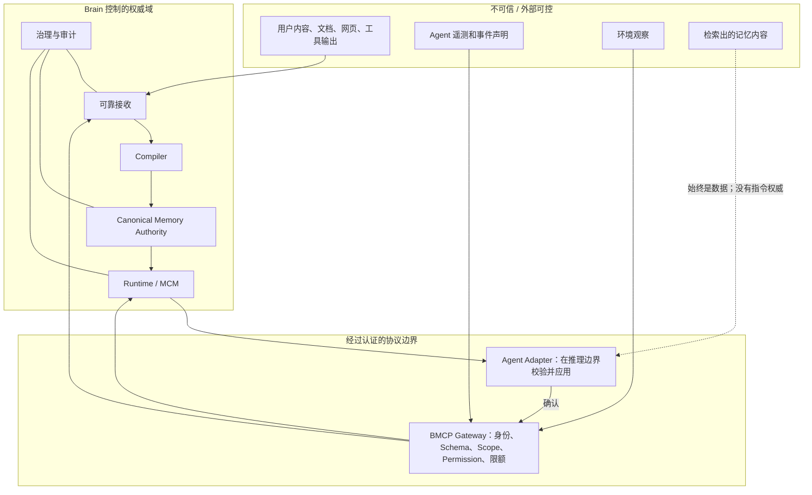

---
document_metadata:
  domain: architecture
  role: design-specification
  lifecycle:
    approval:
      decision_status: Draft
      approver: null
      decision_date: null
      evidence_reference: []
    evidence_verification:
      verification_status: Unverified
      last_verification_note: "Owner-authorized classification direction for AID-2026-11-26-GOV-DOC-01; not a formal approval record. Pre-metadata content blob: c5260ad379be269a4aff7a105cdfcff1b84d6940. Approval remains Draft; evidence verification remains Unverified."
    usage_status: Active
    modification_status: Modified
  authority:
    canonical_status: Non-Canonical
    canonical_scope: "System boundaries and authority"
    canonical_scope_id: architecture/system-boundaries
    canonical_scope_keywords:
      - authority
      - trust-boundary
      - ownership
      - forget
    canonical_conflict_status: None
    normative_status: Normative
  bilingual_counterpart:
    source: "01-system-architecture/system-boundaries.md"
    en: "docs/en/01-system-architecture/system-boundaries.md"
    zh-CN: null
---
# 系统边界

- 文档 ID：SYS-BOUNDARIES-001
- 版本：1.0
- 源规范：[规范性原文](../../../01-system-architecture/system-boundaries.md)
- 源版本：ad9ea5ce00e74dba89d325601677270a50f30926
- 对应英文：[System Boundaries](../../en/01-system-architecture/system-boundaries.md)
- 状态：明确标记的部分为 DECIDED；CANDIDATE/OPEN 项仍不具规范约束力

**范围：** 定义系统级所有权、信任、数据权威和外部边界。本文扩展而不取代 system-overview.md、component-map.md 和 responsibility-matrix.md。

## 1. 目的与设计目标

明确每类工作和数据由哪个系统负责、权威在何处转移，以及跨越边界时禁止执行哪些操作。

目标：
- 使 Brain 独立于 Agent 框架、LLM、推理 API 和 Environment 实现。
- 每份可变的权威状态都只有一个逻辑 Owner。
- 通过 Scope、Permission、Provenance 和契约明确数据共享。
- 使记忆形成、运行时 Recall、上下文同步和环境执行具备独立故障隔离能力。
- 允许采用模块化单体部署，同时不削弱逻辑契约。

## 2. 系统上下文

**DECIDED：** Brain 提供记忆资产和受管上下文；Agent 负责推理、规划、行动选择和工具执行；LLM 负责推理执行。Environment Adapter 报告环境观察并传输由 Agent 授权的命令，但不会赋予 Brain 环境操控权。Skill Library 拥有可执行技能定义和流程。

## 3. 边界定义

| 参与方 | 拥有的职责/状态 | 可以接收 | 不得拥有/执行 |
|---|---|---|---|
| Memory Brain | Canonical Memory 身份、版本、生命周期、证据/来源链、关系、策略、Memory Context 及其版本序列、治理记录 | 有 Scope 的事件、结构化遥测、授权查询、Adapter 确认 | 替 Agent 规划或行动；执行工具；控制 Environment；规定模型内部机制；覆盖 Agent 安全策略 |
| Agent | 任务推理、意图、计划、行动选择、工具调用、任务/会话生命周期 | 记忆候选、上下文包、状态和协调响应 | 重新定义 Brain 领域语义，或把计划当成结果 |
| LLM / Inference Runtime | Token 处理和推理执行 | Agent 组装的 Prompt/上下文，包括明确分隔的记忆区域 | 成为 Canonical Memory 或 Applied 状态的权威 |
| Agent Adapter | Agent 专属遥测映射；在推理上下文组装边界校验并安装 Brain 管理的上下文；生成确认凭据 | BMCP 消息、能力配置、上下文快照/增量 | 选择权威记忆、改写 Brain 策略、声称模型已理解 |
| Environment Adapter | 环境专属观察/事件规范化；在 Agent 授权时传输命令 | 环境状态和 Agent 发起的命令 | 独立选择 Agent 行动，或允许 Brain 直接操控环境 |
| Skill Library | 可执行技能、流程、版本和执行要求 | Agent 请求；可选的记忆查询引用 | 将记忆当成可执行代码，或静默修改 Canonical Memory |
| Storage/index/cache 基础设施 | 在所属子系统契约下提供物理持久化和派生表示；Storage 本地 Forget Fence 仅为 D 规范 ForgetFence 的可重建投影 | 已授权读写和变更事件 | 定义领域真相、签发竞争性的 ForgetFence Generation/Cursor，或成为竞争性的逻辑权威 |

### 3.1 Memory Brain 边界

Brain 是其管理的 Canonical Memory 和 Memory Context 的逻辑权威。内部子系统职责必须保持边界：
- Domain Model 定义语义。
- Canonical Store 持久化权威记录。
- Lifecycle Manager 管理记忆生命周期转换。
- Compiler 将已接收的来源材料转换为提案。
- Runtime 检索并激活候选。
- Memory Context Manager（MCM）规划、编辑、版本化并协调上下文。
- Context Synchronization 跟踪投递和确认。
- Owner I 拥有全局授权、Retention/Legal Hold、外部副本策略、全局 Forget 目标清单和全局完成标准。
- Owner D 拥有 Canonical Memory 身份/生命周期、Forget Fence 与 Canonical Forget 机制，以及 D 域完成判定。
- Global Forget Completion 必须由 D 与每一位相关执行 Owner 基于所有这些 Owner 接受的完成证据契约联合判定。D 或 I 均不得单方面宣称完成。该契约仍待 Owner 接受；本方向决策不构成接受证据。

组件可以执行委托步骤，但不得宣称拥有其他组件的权威。

### 3.2 Agent 与 LLM 边界

Agent 可以提供结构化遥测和源事件。系统不要求完整的隐藏思维链（Chain of Thought），它也不是规范契约。Agent 仍负责判断记忆是否适合当前任务，并决定采取什么行动。LLM 是推理依赖，而不是 Brain 的架构依赖：Brain API 不得要求特定 Prompt 格式或供应商专属功能。

### 3.3 Adapter 边界

Agent Adapter 是将 Brain 管理的上下文安装到 Agent 推理请求中的唯一可信执行桥梁。它必须：
1. 对 Agent/Instance 进行身份认证并协商能力。
2. 校验 Scope、Context 身份、Version/Base Version、Payload 完整性和记忆区域分隔符。
3. 仅在组装后续推理请求时应用变更。
4. 对实际到达的准确版本和应用边界进行确认。
5. 报告拒绝、不支持的操作、版本缺口或无法证明已应用的情况。

Environment Adapter 遵循独立契约。它可以提交带有来源身份、Environment Scope、事件时间和采集时间的观察，但不能因此赋予 Brain 命令通道。

### 3.4 Skill Library 边界

Skill 是可执行能力/流程；Memory 是描述性、持久化的知识。记忆可以将某个 Skill ID/Version 作为建议或历史关联，但该引用绝不授权执行。是否调用 Skill，仍由 Agent 根据自身策略决定。

## 4. 数据所有权与访问

| 数据类别 | 逻辑 Owner / 权威 | 写入方 | 读取方（受 Permission 约束） | 删除/修改 |
|---|---|---|---|---|
| Raw Event 和来源 Payload | Ingestion/Event Log 契约 | Ingestion 接收；授权来源提交 | Compiler、审计/恢复、授权证据视图 | Retention/Forget 治理；不可变修正通过 superseding/retraction 元数据表达 |
| Candidate Memory / Claim | 被接受前由 Compiler 提案 | Compiler 提案；Lifecycle/Canonical 权威接受 | Consolidation、授权 Runtime | 生命周期转换或受治理 Forget |
| Canonical Memory、Fact/Claim、Entity、Relation | Brain Domain + Canonical Store | 按生命周期规则执行的授权 Brain 流程 | Compiler、Runtime、Governance、有 Scope 的集成方 | 带版本修改、撤回、归档、Forget |
| Evidence 和 Provenance | Brain 证据/来源链契约 | Compiler/证据管理器；受治理修正 | 授权记忆/证据消费者 | Retention/Forget 规则；策略允许时保留不含敏感内容的审计墓碑 |
| Memory Context 和 Context Entry | MCM | 仅 MCM，在激活/规划及授权编辑请求下写入 | Sync、通过协议访问的 Adapter、授权诊断工具 | 上下文编辑/版本管理；不是 Canonical Forget |
| Context Change Set | MCM 创建语义变更；Sync 打包并跟踪投递 | MCM；Sync 添加投递信封/状态 | Adapter、MCM、审计 | 按上下文协议 Supersede/Expire |
| Delivery 状态 | Context Synchronization Engine | Sync；Adapter 确认作为输入 | MCM、Adapter、审计 | 追加/状态转换；没有 Adapter 证据不得声称 Applied |
| Applied Context 状态 | Adapter 执行证据；Brain 记录已确认报告 | Adapter 报告；Sync 校验/记录 | MCM 协调、审计 | 更新的应用状态可 Supersede；绝不能从 Delivery 推断 |
| Agent Telemetry | Agent 拥有来源含义；Brain 保存已接收的规范化副本 | Agent Adapter 提交 | Observer/Runtime/Compiler 按目的和 Scope 使用 | 来源端修正或 Retention/Forget 策略 |
| Environment Observation | Environment Adapter/来源拥有观察起源；Brain 拥有已接收事件记录 | Environment Adapter | Compiler/Runtime 按 Environment Scope 使用 | Governance 和保留来源链的修正 |
| Index/cache/working set | 由来源 Owner 管理的派生、可重建表示 | Index/cache Worker | Runtime 和授权内部读取方 | 失效/重建；永远不高于 Canonical Source 的权威 |
| Agent plans/actions/skill code | Agent / Skill Library | Agent / Skill 维护者 | Brain 只能接收允许的摘要/事件 | Brain 不得修改或执行 |

**DECIDED：** Scope 确立命名空间/所有权；Permission 授权具体操作。两者都必须检查。Scope 范围广不代表 Permission 也广。跨 Scope 共享需要明确授权和可审计的目的。读取结果必须在影响上下文之前完成过滤；仅在最终渲染阶段过滤是不够的。

## 5. 信任边界

所有外部提供的文本、遥测、观察和检索记忆都属于数据。它们可能包含对抗性指令；下游组件不得将其提升为 System/Developer 权威。身份认证只能确认发送者身份，不能证明其声明真实。

## 6. Brain 对 Agent 状态的观察

**DECIDED：** Brain 不得内省 Agent 私有记忆、检查隐藏推理、轮询任意进程内部状态或控制 Agent 执行。观察只能通过 Adapter 提交的、明确授权的结构化遥测/事件进行。

**CANDIDATE：** 采用 Push-first 遥测模型，并可选用有界 Pull/Heartbeat 完成存活检测和状态协调。Pull 必须受协议范围约束并限速，不能演变成不受限制的 Agent 内省。

遥测可以包含 Task State、Intent、Plan Summary、Active Entities、Pending Actions、Observations、Outcomes、Uncertainty、Risk Signals 和 Environment Deltas。前瞻性字段仍然是前瞻性信息。结果声明必须有结果证据，并保留来源和认知状态。

## 7. 非职责

Brain 不是：
- Agent 编排器、规划器、外部行动调度器或工具执行器；
- 必须承担 LLM Host 或推理网关职责的系统；
- 可执行 Skill Runtime；
- 实时 Environment 状态的事实来源，除非它已接收带时间戳且注明新鲜度的观察；
- 外部动作的授权机构；
- 改写正在执行的推理上下文的机制。

## 8. 边界契约

每次跨边界交互必须标明：调用方身份、操作、资源、Scope、Permission、Schema/协议版本、状态变更操作的 Idempotency Key、Correlation/Causation ID、时间戳、Payload 大小限制以及结果/错误语义。

**OPEN：** BMCP 的精确字段名、认证机制、密码学信封和兼容性策略由 Session H / Governance 规范定义；本文不预先裁决这些细节。

## 9. 故障隔离

- LLM 故障不得阻止 Event 可靠接收。
- Compiler/模型故障不得丢失已接收 Event；处理应保持 Pending/可重试。
- Index/cache 故障可以降低 Recall 能力，但不得损坏 Canonical Memory。
- Adapter 故障会延迟上下文应用；Brain 保留期望的 Context Version，并在重连后协调。
- Environment Adapter 故障意味着没有新鲜观察；Brain 必须暴露数据过期状态，不能伪造环境状态。
- Skill Library 故障影响 Skill 查询/执行，不影响记忆权威。
- Governance 拒绝时，必须在数据暴露或修改之前阻止操作。

## 10. 边界验收标准

1. 测试 Agent 除通过授权 Brain 契约外，不能直接写入 Canonical Memory。
2. 仅有计划遥测时，没有独立结果证据就不能生成已完成结果。
3. 包含指令式文本的记忆字符串，在 Adapter 明确分隔的记忆区域中仍然只是数据。
4. 没有明确 Scope 授权时，Environment 标识必须阻止两个世界/存档共享状态。
5. Delivery 被记录为 Applied 之前，必须有 Adapter 确认。
6. Context Remove 不得改变 Canonical Memory。
7. Skill 引用不得触发 Skill 执行。
8. 被拒绝的跨 Scope 读取不得返回受保护内容，并产生可审计的拒绝记录。
9. LLM/Compiler 故障不得导致已可靠接收的 Event 丢失。

## 11. 开放问题与决议

| ID | 状态 | 问题 / 决策请求 |
|---|---|---|
| SB-01 | OPEN | 在 Security/BMCP 规范中定义规范 Principal 和 Workload Identity 模型。 |
| SB-02 | OPEN | 定义跨备份和外部来源 Payload 的保留及物理擦除保证。 |
| SB-03 | CANDIDATE | Push-first 遥测加有界 Heartbeat/协调；验证开销和新鲜度。 |
| SB-04 | OPEN | 定义精确的 Agent Adapter 信任证明，以及什么证据足以构成可信的边界确认。 |
| SB-05 | OPEN | 定义 Environment Adapter 是否使用相同 BMCP Envelope，还是采用明确分离的 Event Ingress Profile。 |
| SB-06 | DECIDED | 不建立 Brain 直连 Environment 的执行通道。 |

## 12. 决策摘要

- **DECIDED：** Brain 拥有 Canonical Memory 和其管理的 Memory Context；Agent 负责思考和行动；LLM 负责推理；Adapter 桥接明确契约；Environment Adapter 负责观察/传输但不授权行动；Skill Library 拥有可执行技能。
- **DECIDED：** Scope 与 Permission 分离；所有外部内容和记忆都是不可信数据。
- **DECIDED：** 上下文在后续推理边界应用，并且必须有 Adapter 确认。
- **CANDIDATE：** Push-first 遥测加有界 Heartbeat/协调。
- **OPEN：** 精确身份、认证、协议 Envelope、保留/擦除和 Environment Ingress Profile。

## 13. 治理操作权威追溯登记表

下表将三类权威明确分开：策略权威负责授权规则或例外；规范状态权威负责记录逻辑状态转换；物理执行者负责在相关存储、备份或外部接收方执行实际操作。某一列中的角色不意味着同时拥有其他列的角色。

| 操作 | 策略/授权权威 | 规范状态权威 | 物理执行者 | 最低完成证据/边界 |
|---|---|---|---|---|
| 授权与撤销 | Owner I | Owner I 负责授权/PermissionEpoch 状态 | 每个受影响子系统在其访问边界执行 | 版本化授权或撤销记录，以及每个受影响边界的执行证据；仅有策略记录不等于已执行 |
| Retention 与 Legal Hold | Owner I | Owner I 负责策略/保留记录；适用时 Owner D 负责对应 Memory 生命周期状态 | 每个持有受影响数据的数据保管方/存储 Owner | 明确的保留/Legal Hold 决策及每个保管方的确认；D 不因此成为策略权威 |
| 逻辑 Forget 抑制/围栏 | Owner I 按策略授权 | Owner D 负责 Canonical Memory 状态、Forget Fence 和 D 域完成判定 | D 及每个相关下游子系统对其拥有的投影执行抑制 | Canonical Fence/状态 Receipt 加各执行者的抑制证据；Forgotten 状态不构成物理擦除证明 |
| Canonical 或派生数据的物理擦除 | Owner I 负责授权和全局策略 | Owner D 记录 Canonical Forget 状态；每个存储 Owner 记录自身删除状态 | 实际持有每份副本的 Storage/Index/Cache 操作者 | 每个存储的删除 Receipt 及副本/缓存证据；D 的 Canonical 状态本身不能证明物理擦除 |
| 备份到期/删除 | Owner I 制定保留策略 | 具体 Backup Catalog 对备份对象状态具有权威性；本高层文档尚未分配负责该 Catalog 的 Owner | 每个 Backup Service 的操作者 | 来自 Backup Service 的到期/删除证据；备份 Owner 和保证仍是明确的详细设计缺口（SB-02） |
| 外部接收方删除 | Owner I 拥有外部副本策略和全局目标清单 | 每个接收方对自身删除/合规状态负责；D 只记录源 Canonical Forget 状态 | 每个外部接收方或其授权操作者 | 接收方特定的认证完成证据；D Fence 或本地删除 Receipt 不能替代接收方完成证明 |
| Global Forget Completion 判定 | Owner I 负责全局策略和评估协调；不得因此产生单方完成权 | D 与每个相关执行 Owner 按所有受影响 Owner 接受的契约提供联合证据 | 每个相关存储、子系统和外部接收方执行者 | 所有目标清单条目完成核对，并按联合契约接受证据；D 和 I 均不得单方面宣称完成 |

**追溯规则。** 每项新增或发生实质变化的治理操作都 MUST 独立填写上述三类权威。若某个角色尚未分配，必须记录为 `NOT_ASSIGNED` 并保持操作开放；不得从策略 Owner 或实际执行某一步的组件推断缺失角色。本表是文档层基线，不是自动检查。自动完整性和镜像一致性检查由 AID-2026-081 / Issue #1237 单独跟踪，本 PR 不声称该检查已经存在。

## 8. Forget Fence 权威边界——2026-11-26

D 的规范契约 [03-memory-brain/forget-fence-and-completion-contract.md](../03-memory-brain/forget-fence-and-completion-contract.md) 是 ForgetOperation 及 ForgetFence Target/Lineage 决策的唯一逻辑权威。Storage/Consistency 可以持久化并从物理层保护该权威，但 Storage 本地 Memory/Version Fence 只能是派生、可重建的投影；MUST NOT 签发独立 Generation/Cursor，也不得成为竞争性的决策源。无法建立当前 D 权威状态时，受影响读取和发布必须 Fail-closed。本地抑制不等于 Global Forget Completion。本段记录方向决策；精确版本 Owner 验收和实现证据仍待完成。
