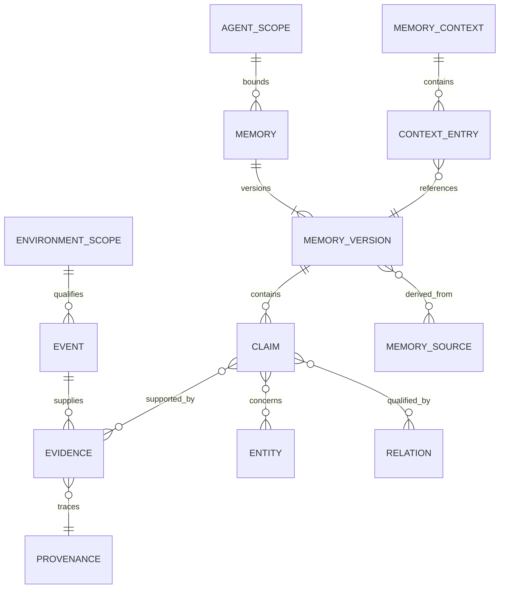
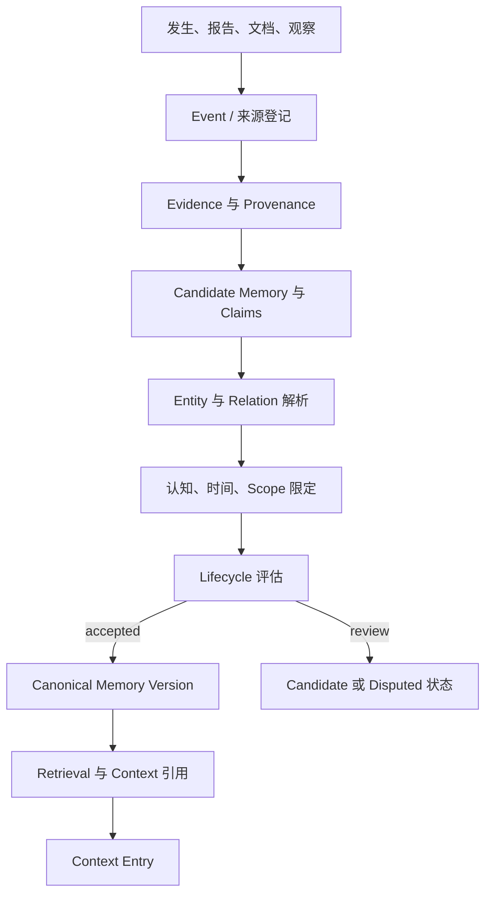

# 规范领域模型总览

- 文档 ID：DOMAIN-MODEL-001
- 版本：1.0
- 源规范：[规范性原文](../../../02-domain-model/domain-model-overview.md)
- 源版本：4d1debc0ec19b3917f9e76d04bb66da4df4cd346
- 对应英文：[Canonical Domain Model Overview](../../en/02-domain-model/domain-model-overview.md)
- 状态：DECIDED（已决议基线）；提案均有明确标记
- Owner：Memory Domain Model（MB-01）

**范围：** 定义逻辑语义，不定义存储 DDL、Wire 编码、部署拓扑或提取算法。

## 1. 定位与目标

Domain Model 定义 AI Memory Brain 管理的各类资产的含义、身份、不变量和关系。它是 Compiler、Canonical Store、Lifecycle Manager、Entity/Relationship Manager、Runtime、Context Manager、Governance 和 Adapter 共同遵循的语义契约。

**DECIDED**
- Event、Memory、Claim、Entity、Relation、Evidence、Provenance、Memory Version、Memory Source、Memory Context、Context Entry、Agent Scope 和 Environment Scope 是不同概念。
- Memory 是可寻址、被保留的知识资产，不保证其内容一定为真。
- 一个 Memory 可以包含多个 Claim；每个 Claim 都有自己的认知和时间限定。
- 派生资产必须保留来源和派生血缘，但受保留与隐私治理约束。
- Epistemic Status、Lifecycle State、Temporal Qualification、Confidence、Relevance、Trust 和 Evidence Strength 相互独立。
- Canonical Memory 与 Memory Context 具有不同的所有权和修改规则。

## 2. 职责与非职责

Domain Model 拥有规范对象定义、标识符语义、字段约束、基数、认知/时间解释、类型化关系语义、Scope 绑定规则以及跨对象不变量。

它不负责接收持久性、LLM 提取、Embedding、排序算法、Canonical 持久化机制、生命周期策略执行、物理擦除、运行时激活决策、上下文预算分配、Agent 规划或工具执行。

## 3. 规范对象关系图

该图是概念模型。如果多对多关系边本身具有角色、时间、Scope 或 Evidence，则必须使用显式关联记录。Context Entry 引用 Canonical Version 或受治理的呈现形式；它不是第二份 Canonical Memory。

## 4. 对象语义与所有权

| 对象 | 含义 | 主要权威 |
|---|---|---|
| Event | Brain 捕获的、有时间范围的发生、观察、报告或状态转换 | Event Ingestion |
| Memory | 从来源派生并保留、可寻址的知识资产 | Canonical Memory Authority |
| Claim | 关于实体、事件或状态，带有认知/时间限定的命题 | Domain 语义；由 Canonical Version 保存 |
| Entity | 具有身份的指代对象，而不是一次文本提及 | Entity & Relationship Manager |
| Relation | 具有类型、端点、Scope 和可选有效区间的关联 | Entity & Relationship Manager |
| Evidence | 支持、反驳或限定 Claim 的来源材料/观察 | Evidence & Provenance Manager |
| Provenance | 来源和派生血缘 | Evidence & Provenance Manager |
| Memory Version | Memory 的不可变历史快照 | Canonical Store/版本权威 |
| Memory Source | 派生资产到输入来源的类型化链接 | Evidence & Provenance Manager |
| Memory Context | 有 Scope、有版本、面向任务的记忆资产选择集合 | Memory Context Manager |
| Context Entry | Context 内的一条引用/呈现 | Memory Context Manager |
| Agent Scope | 标识 Agent 所有分区的命名空间 | Governance |
| Environment Scope | 世界、租户、项目环境、存档或模拟的命名空间 | Governance |

## 5. Event、Memory 与 Claim 的边界

Event 记录系统捕获或收到的内容，不一定代表客观上真实发生的事情。系统保留一个可寻址的解释或知识资产时，形成 Memory。Claim 是 Memory 包含或关联的命题。

**DECIDED：** 一个 Event 可以生成零个、一个或多个 Candidate Memory；多个 Event 可以共同形成一个 Memory；一个 Memory 可以包含一个或多个 Claim。Event 与 Memory 绝不是同义对象。

**DECIDED：** Claim 是规范命题对象。在当前阶段，“Fact”是对 Claim 的限定性解释，不是独立对象类型。Verified Claim 可以被描述为“已验证事实”，但必须保留认知、时间、Scope 和 Evidence 元数据。

**OPEN：** 未来的 Attestation 领域是否需要独立且不可变的 Fact 对象。没有具体用例和所有权语义前，不得新增该对象。

## 6. 输入与输出契约

输入包括已捕获的 Event Envelope、来源引用、Candidate Memory/Claim 提案、Entity/Relation 提案、Evidence/Provenance 记录、Scope 描述符、授权决策以及生命周期/治理命令。每个状态变更输入都必须携带 Actor、已解析 Scope、Schema Version、稳定 ID，以及在可重试时使用的 Idempotency Key。

输出包括已校验的类型化对象、标识符、关系引用、带版本的语义快照、结构化校验错误，以及明确的冲突/不可用记录。Schema 合法不等于内容真实。

## 7. 领域不变量

1. Event 不是 Memory；Evidence 不是 Claim。
2. Claim 是命题，不是其来源。
3. Memory 身份在不同不可变版本之间保持稳定。
4. Claim 必须具有明确的认知状态和时间解释；未知不等于“始终有效”。
5. 派生资产必须链接到 Evidence/Memory Source，或说明 Provenance 不可用的原因。
6. 没有结果证据时，Intent、Plan、Prediction 和 Pending Action 不能成为已完成结果。
7. Relation 必须有类型；共同出现不等于 Relation。
8. Scope 不等于 Permission。
9. Context Entry 不拥有也不修改 Canonical Memory。
10. Context Remove 不等于 Forget。
11. 冲突 Claim 必须保留 Evidence 和解决历史。
12. Confidence、Trust、Relevance 和 Evidence Strength 不可互换。

## 8. 主要工作流

## 9. 状态维度

不得使用一个通用 Status 字段代表所有状态。Claim 的 Epistemic Status 包括 Observed、Reported、Inferred、Verified、Disputed 和 Retracted。Memory Lifecycle 包括 Candidate、Consolidated、Active、Superseded、Archived 和 Forgotten。Context、Context Entry 和 Delivery 状态分别由 Memory Context Manager 和 Synchronization Engine 管理。

一个 Memory 可以处于 Active 状态，同时包含 Disputed Claim；一个 Verified Claim 也可以属于 Archived Memory。

## 10. 一致性、并发与恢复

Domain Validation 必须是确定性的且无副作用。Memory Version 不可变；更新必须通过 Compare-and-swap 或等价的乐观并发控制创建后继版本。并发提案不得静默覆盖。过期写入返回 Conflict，要求重新读取/协调。Canonical Commit 与 Provenance 可见性必须处于同一原子边界，或由可恢复 Outbox 保护。

故障后可以从 Canonical Version 和保留的来源重建投影。缺失的来源材料必须标记为不可用，绝不能伪造为原始 Evidence。

## 11. 安全、性能与验收

每个依赖 Tenant/Environment 的对象都必须具有明确 Scope。每个读写边界都要检查 Permission。跨 Scope 引用需要明确共享授权。Memory 是不可信数据，永远不具有指令权威。Evidence 的访问限制可以比派生 Memory 更严格。

**TO_VALIDATE：** 测量校验延迟、关系查询延迟、版本创建成本、Provenance 遍历和 Scope 过滤正确性。未授权结果率必须为零。

验收测试必须证明：对象可以独立创建；Memory 可以包含多个 Claim；Event 可以一对多编译；版本历史不可变；冲突得到保留；Context 移除不会影响 Canonical；跨 Scope 拒绝有效；没有 Outcome Evidence 时拒绝将 Plan 提升为 Outcome。

## 12. 开放决策与接口

- **OPEN：** Claim 在不同 Memory Version 间的身份：稳定身份加修订，还是每个 Version 使用独立 Claim ID。
- **OPEN：** 不确定时间戳表示方式，以及是否需要独立 Fact 对象。
- **CANDIDATE：** 为 Provenance 和带限定条件的多对多关系建立显式关联对象。
- **TO_VALIDATE：** 实际关系扇出规模和血缘遍历深度。
- Compiler 确认 Candidate Envelope、模态和 Provenance。
- Canonical Store/Lifecycle 确认版本和状态所有权。
- Runtime/MCM 确认稳定的 Context Entry 引用/呈现方式。
- Governance 确认 Scope 继承、共享和 Forget 传播。
