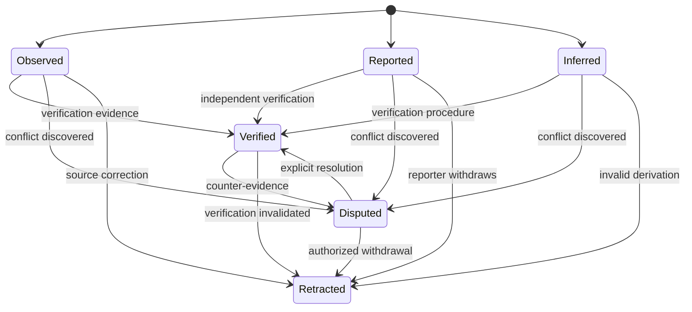

---
document_metadata:
  domain: domain-model
  role: design-specification
  lifecycle:
    approval:
      decision_status: Draft
      approver: null
      decision_date: null
      approved_version: null
      approval_scope:
        type: Full-document
      approval_applicability: Not-Applicable-To-Current-Version
      evidence_reference:
        - "14-ai-development/work-items/AID-2026-193/evidence.md"
      revocation: null
    evidence_verification:
      verification_status: Unverified
      last_verified_date: "2026-11-27"
      last_verification_note: "为原本无 front-matter 的镜像补 GOV-DOC-002 分类：仅记录 domain、role、状态与规范源路径（依据正文自述：Status: Core distinctions DECIDED）；不主张规范权威，也不证明与源语义对等。补元数据前正文 blob：0d90727ffdf1800463e8089135f8d0de2a96f48d。"
    usage_status: Active
    modification_status: Modified
    supersession:
      supersedes: []
      supersession_reason: null
      effective_date: null
    archival:
      archived_date: null
      archival_reason: null
      archival_reference: null
  authority:
    canonical_status: Non-Canonical
    canonical_conflict_status: None
    normative_status: Normative
  bilingual_counterpart:
    source: "02-domain-model/epistemic-and-temporal-semantics.md"
    en: "docs/en/02-domain-model/epistemic-and-temporal-semantics.md"
    zh-CN: null
---
# 认知与时间语义

- 文档 ID：DOMAIN-EPISTEMIC-TEMPORAL-001
- 版本：1.0
- 源规范：[规范性原文](../../../02-domain-model/epistemic-and-temporal-semantics.md)
- 源版本： cf548814fb0591b41e4c852cc65adb7d60f2e7bf
- 对应英文：[Epistemic and Temporal Semantics](../../en/02-domain-model/epistemic-and-temporal-semantics.md)
- 状态：核心概念区分为 DECIDED；校准和不确定时间表示部分为 OPEN
- Owner：Memory Domain Model（MB-01）

## 1. 目的与边界

Brain 必须保留各种声明，同时避免夸大其确定性，并区分事件发生时间与 Brain 获知或记录该信息的时间。本文定义语义字段和状态转换约束，不定义模型校准、验证算法或查询排序。

## 2. Epistemic Status（认知状态）

**DECIDED：** Epistemic Status 回答“该命题基于什么、处于什么认知地位？”它独立于 Memory Lifecycle。

| 状态 | 含义 | 最低依据 |
|---|---|---|
| Observed | 对状态或事件的直接捕获观察 | Observer/Sensor/Adapter 身份、Scope、观察时间或明确未知 |
| Reported | 某来源作出命题声明；Brain 尚未独立验证 | 可识别的报告来源及来源 Evidence |
| Inferred | 通过声明的过程从前提推导而来 | 父级 Claim/Evidence、方法引用、派生时间 |
| Verified | 通过声明的验证程序或权威 Attestation | 验证方法、验证者/来源、Evidence、验证时间 |
| Disputed | 仍存在实质不兼容的 Claim 或 Evidence 立场，尚未解决 | Conflict 记录或不兼容立场引用 |
| Retracted | 经授权来源/流程撤回先前声明，或该声明被判定无效 | 原因、Actor/Authority、时间、保留的原始声明 |

这不是线性的置信度等级。Observed 也可能进入 Disputed；Reported 以后可以被 Verified；Inferred 可以被 Retracted。Verified 不意味着永远真实。

状态转换以追加方式记录修订/事件。**OPEN：** 是否允许恢复已撤回命题。候选规则：创建具有 Correction/Reinstatement 语义的新 Claim 并关联原 Claim，而不是修改 Retracted Claim 本身。

## 3. Intent、Plan、Prediction 与 Outcome

**DECIDED：** Intent、Plan、Goal、Prediction、Pending Action 和 Hypothetical 都是面向未来或带模态限定的陈述。没有 Outcome Evidence 时，不得将其提升为已完成 Event 或 Verified Claim。

- planned：期望执行的未来动作；不代表已经执行。
- pending：已提交/等待结果；Outcome 未知。
- predicted：预测，不是观察。
- attempted：已尝试动作；不代表成功。
- outcome：已捕获的结果；解释仍需要 Evidence。
- observed：已捕获的观察；观察者可靠性仍需单独限定。

Agent 说“我将拯救这个世界”，只能支持一条 Reported Intent/Plan，不能证明世界已经获救。

## 4. Confidence、Relevance、Trust、Evidence Strength

| 维度 | 回答的问题 | 语义 |
|---|---|---|
| Confidence | 声明的方法在多大程度上估计该 Claim 得到支持？ | Claim 级别，受方法和校准约束 |
| Relevance | 该资产现在对某项任务有多大用处？ | 依赖 Query/Context 的 Runtime 估计 |
| Trust | 某来源/Actor/通道在声明领域内有多可靠？ | Governance/来源评估 |
| Evidence Strength | 某项具体 Evidence 对 Claim 的支持/反驳有多直接、实质？ | 针对 Claim-Evidence 关系的评估 |

规则：
1. Confidence 不等于真理；没有方法、量表和校准上下文时没有明确意义。
2. Relevance 不得改变 Epistemic Status。
3. 来源 Trust 不会自动转移给该来源产生的每个 Claim。
4. Evidence Strength 只针对特定 Claim-Evidence 链接，不是 Evidence 的全局属性。
5. 同一来源的多个副本不构成独立佐证。
6. 缺失/未校准的 Confidence 保持 null/unknown，不得编造。

**CANDIDATE：** Confidence 记录 = value、scale、method_ref、calibration_population、assessed_at。Evidence Assessment = claim_ref、evidence_ref、role、strength、method_ref。数值范围和聚合公式仍为 OPEN。

## 5. 时间模型

最少包含三个时间轴：
- **Event Time：** 被描述事件实际发生的时间。
- **Recorded At：** Brain 持久化记录该信息的时间。
- **Valid Time：** Claim 或 Relation 声称成立的时间区间。

三者不得相互替代。

### Event Time

可能未知、近似，或由来源报告。相关时保留来源时区/精度，并单独规范化。推断出的时间必须带有方法和不确定性。

### Recorded At

由 Brain 在持久化接受成功提交时赋值，不可变。Replay 保留原 Recorded At，并添加重放元数据。

### Valid Time

限定命题成立的时间。默认区间为左闭右开 [from, to)：
- 起止均已知：有限区间；
- 只有 from：开放结束区间；
- 只有 to：起点未知；
- 两者都没有：未知/未指定，不代表“始终有效”。

时间点断言必须明确采用点语义，不得编造持续时间。

**CANDIDATE：** 将 Canonical Version 提交时间作为第四个操作/事务时间轴，用于回答“Brain 在时间 T 认为事实是什么？”它不同于 Event Time 和 Valid Time。

## 6. 双时态历史与不确定时间

**DECIDED：** 分别保留 Valid Time 历史和 Recorded Time 历史。新报告不得抹去旧 Claim 的历史有效性。

示例：2026-04-01 记录的信息称某设备自 2026-03-10 起一直位于 Room A。Event/Effective Time 是 2026-03-10，Recorded At 是 2026-04-01，Valid Time 从 2026-03-10 开始。

**OPEN：** “五月初”“下午三点左右”“去年冬天”等表达的表示方式。候选 TimeValue 包含 lower_bound、upper_bound、precision、timezone、certainty 和 source_text。必须保留来源原话，避免制造虚假的精确度。

## 7. 冲突与时间共存

如果 Subject、Predicate、Scope、Environment、Modality 或 Valid Time 不同，看似矛盾的 Claim 可能同时成立。冲突检测比较 Canonical Subject、Predicate/Polarity、Object Value、Scope/Environment、重叠 Valid Time、Epistemic Status/Evidence 和 Modality。

只有在语义不兼容、Scope 兼容且有效时间重叠的 Claim 才是冲突候选。相同 Agent 在两个不同 Environment Scope 中的状态默认不构成冲突。

## 8. 输入、输出与工作流

输入：来源 Event/Evidence、Candidate Claim、时间表达式、Scope、方法/Actor 元数据。输出：规范化时间值、认知限定、校验问题和明确的不确定性。

工作流：
1. 保留来源时间表达和归属。
2. 只规范化 Evidence 能支持的内容。
3. 在持久化接受成功提交时赋值 Recorded At。
4. 在保留来源链和不确定性的前提下推导 Event Time。
5. 只有声明本身支持时才赋值 Valid Time。
6. 根据 Evidence/处理过程分配 Epistemic Status，而不是根据相似度。
7. 区分时间共存与真实冲突。
8. 输出带限定的 Claim 和 Provenance。

## 9. 状态、并发与恢复

Epistemic 变更采用追加修订/事件。并发的验证、撤回和争议操作必须携带期望 Claim/Version；过期操作应拒绝。来源时间派生的 Replay 必须确定性。模型辅助推断必须保留模型/方法版本和输入 Digest。

时间解析失败时，保留来源文本并将规范化时间标记为 Unknown。Evidence 不可用时不得伪造验证。无法评估 Confidence 不应阻止保存 Reported Claim。

## 10. 安全与性能

时间元数据可能暴露作息和位置模式；必须应用 Scope 和 Permission 规则。时间索引在返回前必须进行 Scope 过滤。

**TO_VALIDATE：** 分别测量时间查询延迟、冲突检测成本、近似/相对/带时区表达的规范化错误率、误判冲突率和漏判冲突率。

## 11. 验收测试

- 仅通过接收流程，Reported Intent 永远不会变成 Outcome。
- Verified 必须具备方法和 Evidence。
- Disputed 必须保留不兼容立场。
- Retraction 必须保留历史声明及授权/原因。
- Event Time 与 Recorded At 可以不同，且都可查询。
- Valid Time 变化必须保留历史。
- 未知时间不代表无限期有效。
- 不同 Environment Scope 默认不构成冲突。
- 更新 Relevance 不得改变 Epistemic Status。
- 缺少方法/量表的 Confidence 必须拒绝或标记为未校准。

## 12. 开放决策与接口

- **OPEN：** 模糊时间表示和 Claim 恢复机制。
- **CANDIDATE：** 双时态查询契约：在 T 时有效，并且在 T2 时已知。
- **TO_VALIDATE：** Confidence 校准、Evidence Strength 评估规则、来源 Trust 维护。
- Compiler 提供 Modality、来源类型、派生方法和时间来源链。
- Lifecycle Manager 保留不可变 Claim 历史。
- Runtime 将 Relevance 视为任务相关属性，而不是 Canonical Truth。
