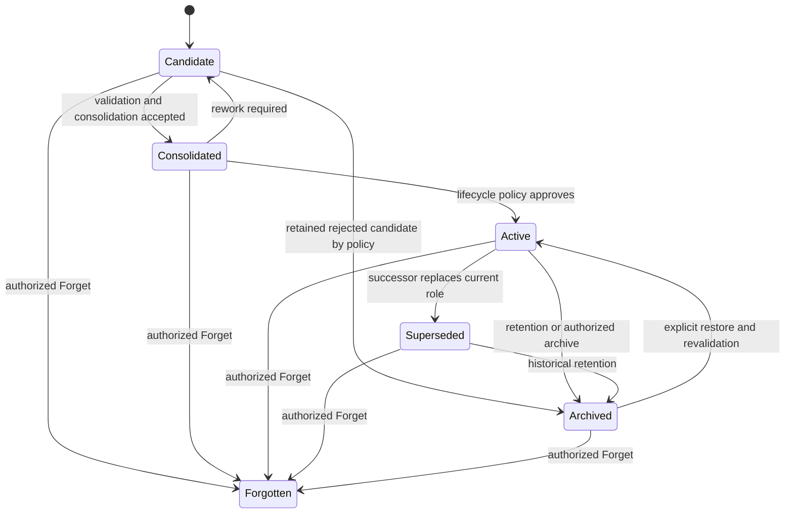

---
document_metadata:
  domain: domain-model
  role: design-specification
  lifecycle:
    approval:
      decision_status: Draft
      approver: null
      decision_date: null
      approved_version: null
      approval_scope:
        type: Full-document
      approval_applicability: Not-Applicable-To-Current-Version
      evidence_reference:
        - "14-ai-development/work-items/AID-2026-193/evidence.md"
      revocation: null
    evidence_verification:
      verification_status: Unverified
      last_verified_date: "2026-11-27"
      last_verification_note: "为原本无 front-matter 的镜像补 GOV-DOC-002 分类：仅记录 domain、role、状态与规范源路径（依据正文自述：Status: State vocabulary and separation DECIDED）；不主张规范权威，也不证明与源语义对等。补元数据前正文 blob：8c4b44727957efac94e16f68451f9a50ab98393d。"
    usage_status: Active
    modification_status: Modified
    supersession:
      supersedes: []
      supersession_reason: null
      effective_date: null
    archival:
      archived_date: null
      archival_reason: null
      archival_reference: null
  authority:
    canonical_status: Non-Canonical
    canonical_conflict_status: None
    normative_status: Normative
  bilingual_counterpart:
    source: "02-domain-model/lifecycle-model.md"
    en: "docs/en/02-domain-model/lifecycle-model.md"
    zh-CN: null
---
# 记忆生命周期模型

- 文档 ID：DOMAIN-LIFECYCLE-001
- 版本：1.0
- 源规范：[规范性原文](../../../02-domain-model/lifecycle-model.md)
- 源版本： 462a1e92f79540fa44a90772314e9db1d487abfb
- 对应英文：[Memory Lifecycle Model](../../en/02-domain-model/lifecycle-model.md)
- 状态：状态词汇及其区分为 DECIDED；策略阈值和部分转换为 OPEN
- Owner：Domain Model 定义生命周期语义；D 负责 Canonical Memory/Forget 语义及 Fence 顺序；I 负责授权与跨系统治理策略；Memory Lifecycle Manager 仅执行已获授权的 Canonical 状态转换

## 1. 目的与边界

本文定义 Canonical Memory 资产的生命周期语义，以及它与 Claim Epistemic Status、Memory Version 历史、Entity/Relation 状态和 Forget Governance 的关系。Domain Model 定义有效状态；D 负责 Canonical Memory/Forget 语义及 Fence 顺序；I 负责授权、保留/法律保全策略、跨系统 Inventory/Evidence 接受策略及跨系统治理评估；Lifecycle Manager 仅执行已获授权的状态转换并记录本地执行/审计证据；Canonical Store 负责持久化/版本机制；Compiler 负责提出 Candidate，但不能绕过 Lifecycle Policy。

## 2. Lifecycle 不等于 Epistemic Status

Lifecycle 回答“该资产处于什么管理阶段？”Epistemic Status 回答“该声明基于什么、处于什么认知地位？”两者相互独立。

例如：Active Memory 可以包含 Disputed Claim；Archived Memory 可以包含 Verified Claim；Candidate 可以包含 Reported 或 Inferred Claim。Superseded 仍保留历史。Forget 是受治理的保留/删除操作，不是 Archive 的同义词。

## 3. Memory 生命周期状态

| 状态 | 含义 | Runtime 默认资格 |
|---|---|---|
| Candidate | 等待校验、巩固或策略决策的提议资产 | 否；仅授权审查/Compiler 可访问 |
| Consolidated | 已通过结构巩固、重复/冲突检查；但不一定已经普遍激活 | 仅由明确策略决定 |
| Active | 已接受，可在其 Scope 内正常检索/激活 | 是，但仍受 Scope、认知状态和策略过滤 |
| Superseded | 当前用途已被后继资产取代；仍保留历史 | 默认当前检索排除 |
| Archived | 按当前策略保留但不活跃 | 默认激活排除；允许授权历史访问 |
| Forgotten | 受治理 Forget 已提交；内容访问被拒绝，删除/去标识化进度被跟踪 | 否；仅允许保留符合政策的 Tombstone |

状态不代表真实性、相关性或可信度。

Forgotten 对内容身份而言是终态。如果以后再次提供相同信息，必须创建新的 Memory Identity 和 Provenance，不得复活已遗忘内容。

**OPEN：** 被拒绝的 Candidate 是否需要独立终态，还是 Candidate→Archived 已足够。不得静默新增 Rejected 状态。

## 4. 状态转换条件

### Candidate → Consolidated

需要 Schema 校验、Scope 解析、Provenance 完整或明确记录不可用原因、Entity/Relation 检查、重复评估、冲突检测和 Lifecycle 决策。这不意味着所有 Claim 都已 Verified。

### Consolidated → Active

需要策略批准、授权、所需来源/Evidence 引用、不存在阻塞性 Governance 问题，以及明确的激活资格。仅凭 Confidence 或 Relevance 不得触发转换。

### Active → Superseded

必须提供后继引用和替代原因。历史 Version 和有效时间仍应在策略允许范围内可查询。

### Active/Superseded → Archived

需要策略或授权操作、原因、Actor 和 Retention Class。Archive 不会删除或撤回 Claim。

### 任意非 Forgotten 状态 → Forgotten

需要有效 Forget 触发、授权、依赖发现、传播计划和持久化 Governance 记录。在定义的治理屏障处拒绝普通内容访问；物理擦除可以异步完成，并单独跟踪。

### Archived → Active

需要明确的恢复授权、重新验证 Scope/Evidence/当前有效性，以及新的 Version 或 Lifecycle Event。禁止静默重新激活。

## 5. Claim 认知生命周期

Claim Epistemic Status 独立使用 Observed、Reported、Inferred、Verified、Disputed 或 Retracted。状态变化必须以 Evidence 为依据并可审计。Retraction 不删除 Claim，而是保留原声明并记录撤回。Correction 应创建新 Claim 或后继修订，并明确其语义。

一个 Memory 可以聚合不同状态的 Claim。Runtime 可以排除或限定 Disputed/Retracted Claim，而不修改 Memory Lifecycle。

## 6. Entity 与 Relation 生命周期

Entity 身份状态（provisional、resolved、merged、split、retired）不属于 Memory Lifecycle。Merge/Split 必须保留 Redirect、身份 Evidence、引用迁移和审计血缘。

Relation 状态（proposed、active、superseded、retracted）也独立存在。Relation 可以具有有限 Valid Time，同时其记录 Lifecycle 仍为 Active。

## 7. Memory Versioning

每次已提交变更都创建不可变 Memory Version，包含稳定 Memory ID、单调版本号、父版本、变更原因/Actor、不可变 Claim Snapshot、Provenance 引用和 Content Digest。

当前版本指针必须原子推进。影响 Canonical 语义的 Lifecycle 转换，应记录在 Version/History 中，或记录为关联版本的追加式 Lifecycle Event。精确存储机制由 Canonical Store 负责。

并发更新必须携带期望的 Current Version。竞争胜者提交；过期写入方收到 Conflict 并重新读取/协调。禁止以 Last-write-wins 覆盖冲突 Claim。

## 8. Forget 工作流

1. 对 Actor 进行认证，并授权目标 Scope/Resource。
2. 解析依赖图：Version、Claim、Evidence、Provenance、派生 Memory、Relation、Index、Cache、Working Set、Context 和 Backup。
3. 应用即时访问拒绝/Tombstone 屏障。
4. 按策略安排删除、脱敏或去标识化。
5. 在适用时使投影和 Context Entry 失效。
6. 按声明保证协调副本/备份。
7. 记录完成证据和残余例外。
8. 验证普通查询无法检索已遗忘内容。

Context Remove 只移除 Context Entry，绝不会调用上述 Forget 工作流。

**OPEN：** 备份过期和密码学擦除保证由 Retention/Recovery 规范定义。

## 9. 输入、输出与协作

输入：Lifecycle Command、Memory ID/Current Version、Actor、Scope、Reason、Policy Reference、Expected State/Version、Idempotency Key。

输出：接受/拒绝的状态转换、Lifecycle Event/Version 引用、当前状态、Forget Job 引用和结构化错误。错误包括 NOT_FOUND、SCOPE_MISMATCH、PERMISSION_DENIED、INVALID_TRANSITION、STALE_VERSION、MISSING_SUCCESSOR、PROVENANCE_INCOMPLETE、FORGET_IN_PROGRESS、ALREADY_FORGOTTEN。

Compiler 提交 Candidate 提案。Store 持久化已接受版本。Runtime 消费经过 Lifecycle 过滤的视图。MCM 协调指向 Superseded/Archived/Forgotten 资产的引用。Governance 拥有 Forget 授权和传播职责。

## 10. 并发、幂等与恢复

Lifecycle Command 在 Actor + Operation + Target + Key 范围内必须幂等。相同 Key/参数返回先前结果；相同 Key 配不同参数则拒绝。

状态转换与 Version/Event 发布必须使用事务或可重放 Outbox。提交后、通知前崩溃时通过 Replay 恢复。Forget 阶段失败后访问拒绝必须继续生效并可重试；工作流不得过早报告完成。

## 11. 安全、性能与验收

状态转换同时需要 Scope 和 Permission。Agent Telemetry 可以提出 Lifecycle 信号，但不能授权 Archive/Retract/Forget。跨 Scope 操作需要明确 Governance 授权。审计不得超出允许元数据范围重复保留已遗忘内容。

测量状态转换延迟、冲突率、依赖图规模、Forget 传播滞后、重试次数和查询拒绝屏障时间。

验收：
- 无效转换必须确定性拒绝。
- 每次转换都记录 Actor、Reason、Time、前后状态和 Version。
- Superseded 资产保留历史和后继链接。
- Archived 默认不参与激活，但可按策略读取。
- Forget 及时阻止普通访问，并传播到派生物。
- 失败的 Forget 可重试，且不能报告完成。
- 重复命令具备幂等性。
- 并发变更不能静默覆盖。
- Context Remove 不改变 Canonical Lifecycle。

## 12. 开放决策与接口

- **OPEN：** 被拒绝 Candidate 的终态。
- **OPEN：** Consolidated 是持久化阶段还是临时评估结果。
- **OPEN：** Archived 恢复要求。
- **OPEN：** 物理删除和备份过期保证。
- **TO_VALIDATE：** 依赖遍历和 Forget 传播容量。
- Compiler 确认 Candidate 交接契约。
- Store 确认 Lifecycle/Version/Current Pointer 的原子语义。
- Governance 确认 Forget 工作流和完成证明。
- Runtime/MCM 确认 Superseded、Archived、Forgotten 引用的处理行为。

## 13. Forget 合同对齐提案——待 D/I 批准

双语联合合同提案已记录于 `14-ai-development/work-items/AID-2026-001/forget-lifecycle-joined-contract-proposal-v1.md`。该引用属于提案；只有 D 与 I 对完全相同的版本/SHA 作出批准后，方可成为规范性修订。

拟澄清事项：

- `Forgotten` 对 Canonical Memory 身份而言是终态，表示持久化 Suppression/Fence 决策已经线性化。
- `Forgotten` 不代表物理擦除、备份到期、外部接收方合规或 Global Forget 已完成。
- Forget Operation 是独立状态机。Memory 可以已经处于 `Forgotten`，而其操作仍处于 `InventorySealed` 或 `CleanupInProgress`。
- `SuppressionCommitted` 是规范线性化事件：Tombstone、ForgetFence Generation 与 Operation/Outbox 记录必须一并持久化提交。此后不得通过取消或回滚移除 Fence 或恢复普通访问。
- D 负责 Canonical Memory/Forget 语义、Fence 顺序及 D 域完成谓词。I 负责授权、保留/法律保全策略、跨系统 Inventory/Evidence 接受策略及跨系统治理评估；I 不得改写 D 的状态或谓词。执行方仅负责其本地动作与证据。
- 清理失败或未完成时，Suppression 必须持续生效并可恢复；不得重新开放该 Memory 身份。

**状态：** PROPOSED / D-I APPROVAL PENDING / R3 TESTS NOT RUN。
