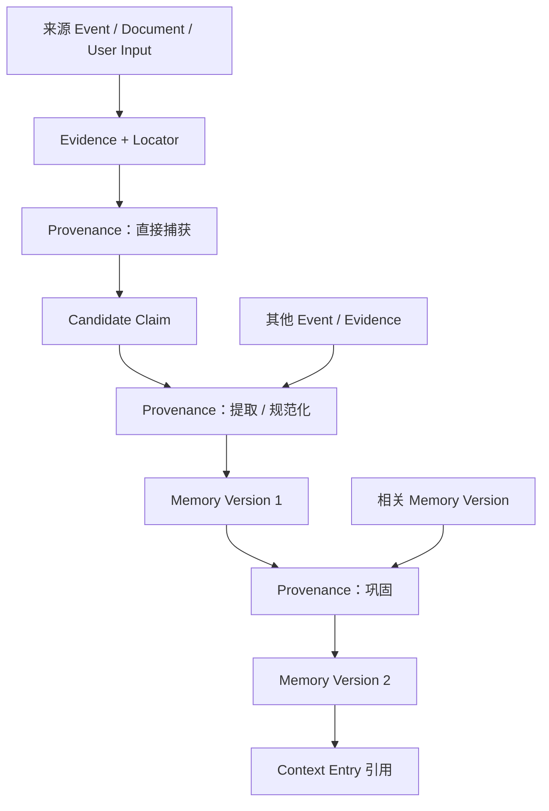

# 关系与来源链模型

- 文档 ID：DOMAIN-REL-PROV-001
- 版本：1.0
- 源规范：[规范性原文](../../../02-domain-model/relationships-and-provenance.md)
- 源版本：a674e21756cdbf8c07683083bfdcb58a33f48a20
- 对应英文：[Relationships and Provenance Model](../../en/02-domain-model/relationships-and-provenance.md)
- 状态：核心语义为 DECIDED；图表示和血缘压缩为 CANDIDATE/OPEN
- Owner：Memory Domain Model；Evidence & Provenance 和 Entity/Relationship Manager 负责执行契约

## 1. 目的与边界

本文定义类型化关联，并说明被保留的声明来自哪里。它支持检查、质疑、重新推导、修正和治理，同时避免将来源材料与派生解释混为一谈。

Domain Model 拥有语义、基数和不变量。Entity & Relationship Manager 负责身份解析和关系一致性。Evidence & Provenance Manager 负责记录定位信息和来源链。Compiler 提出链接；Canonical Store 持久化不可变版本；Governance 控制可见性和 Forget 传播。

本文不负责实体解析算法、图引擎选型、Trust 评分、提取模型、排序或物理删除。

## 2. Relation 模型

Relation 是类型化领域引用之间的类型化边。它不是文本共同出现、Embedding 相似度或没有语义限定的链接。

必须定义的语义：
- relation_type：受控且带版本的词汇。
- subject_ref/object_ref：依据关系定义校验的类型化引用。
- directionality：有向、对称或逆向成对。
- qualifiers：结构化角色、模态、环境和来源元数据。
- valid_time：关系成立的可选时间区间。
- epistemic_status：关系的认知状态。
- evidence_refs：支持/反驳/限定引用。
- scope_refs：适用范围和可见范围。
- lifecycle_state：proposed、active、superseded、retracted。

每个词汇条目都定义稳定的 Type ID/Version、允许的端点类型、逆向/对称语义、自环策略、唯一性约束、必需限定条件、时间语义和 Scope 兼容性。

**DECIDED：** Relation 可以具有时间属性。缺少时间区间不代表永远有效。逆向边必须遵循规范 Relation 定义。

**CANDIDATE：** 仅存储一条规范有向边，并在查询时推导逆向遍历；除非审计/领域语义要求显式逆向记录。

## 3. Relation 基数与生命周期

Relation 通常是多对多。唯一性取决于 Relation Type、Scope 和有效时间重叠情况。端点可以是 Entity、Claim、Event、Memory 或其他已声明对象类型。

- proposed：已提取/提供，但尚未接受为 Active Canonical Relation。
- active：在声明的 Scope 和有效时间内已接受。
- superseded：被后继关系取代；旧关系仍保留历史。
- retracted：由授权主体以明确原因撤回；Evidence/History 仍保留。

更新应创建不可变修订或后继边。时间重叠的变更必须显式处理冲突。

## 4. Evidence 模型

Evidence 是用于支持、反驳或限定 Claim/Relation 的来源材料或观察。它包含：
- 稳定的 evidence_id 和 evidence_kind；
- 类型化 source_ref；
- 可选 locator（消息 ID/片段、文档页码、JSON Path、媒体时间范围、环境 Tick/Frame、工具结果路径）；
- 可选的保留摘录/内容引用；
- observed_at 和 recorded_at；
- 收集者身份和可选完整性 Digest；
- evidential_role：supports、refutes、qualifies、context_only；
- Scope 引用和可用状态。

一条 Evidence 可以支持多个 Claim；一个 Claim 可以关联多条 Evidence。这是多对多关系。如果不同 Claim 对应的角色/强度不同，应使用显式评估/链接记录。

**DECIDED：** Evidence 不是 Truth Score。指向可变外部 URL 的 Locator 不保证构成持久证据。如果禁止保留来源，或来源不可用，应保留允许的元数据并准确标记可用状态。

## 5. Provenance 模型

Provenance 是 Memory、Memory Version、Claim、Relation 或 Evidence 的可追踪来源和派生历史。它回答：
- 哪些来源输入和准确版本参与了形成？
- 使用了来源中的哪些部分？
- 执行了什么转换/推断？
- 由哪个组件/方法/模型/规则版本执行？
- 何时派生？
- 哪些既有派生资产作为输入？
- 哪些内容不可用或已脱敏，原因是什么？

Context Entry 是呈现/引用，不是新的 Canonical 派生。如果压缩过程改写呈现文本，必须链接到实际使用的准确 Canonical Version 和来源链。

### Memory Source

一种类型化 Provenance 边，包含 memory_source_id、类型化 source_ref（尽可能带版本）、source_role（primary、supporting、contradicting、context）、可选 locator、Scope 和创建时间。

### Derivation Record

Provenance 包含 target_ref、source edges、derivation_kind、method/component version、derived_at、input digests、parent provenance refs，以及在信息不完整时的 unavailable_reason。派生类型包括 direct_capture、extraction、normalization、summarization、consolidation、inference、human_correction、verification 和 migration。Method Identity 只描述过程，不证明正确性。

## 5A. Claim/Fact 谱系与引用

ClaimRevision 是下游治理对象所引用的精确不可变断言状态。

FactRevision MUST 引用精确 ClaimRevisionRef，以及相关 EvidenceRef 和 ProvenanceRef。

FactRevision 与 ClaimRevision 之间的关系是明确的受治理引用，不是隐式的当前 Head 关系。

Forget 依赖发现 MUST 遍历这些引用及其已登记的派生对象。

历史谱系不构成读取已遗忘内容的授权。

## 6. Evidence Strength 与独立性

Evidence Strength 相对于特定 Claim 和角色进行评估。它可能取决于直接程度、完整性、时间接近程度、佐证、矛盾和来源独立性。它不同于来源 Trust 和 Claim Confidence。

同一来源的多个副本不构成独立佐证。Provenance 暴露共同祖先；重复派生物不得夸大支持力度。

**TO_VALIDATE：** Evidence Strength 评估规则和独立性评估。没有任何数值公式具备规范效力。

## 7. 输入/输出契约与工作流

输入：类型化 Relation 提案、来源对象/Locator、Claim-Evidence 链接、派生元数据、Scope、Actor/Method 身份。

输出：已校验的类型化边、Provenance 节点、血缘遍历结果、完整性/不可用状态和结构化错误。

工作流：
1. 解析来源身份和版本。
2. 校验来源访问 Scope。
3. 创建 Evidence 引用和 Locator，不修改来源本身。
4. 以明确角色将 Evidence 关联到 Claim/Relation。
5. 记录派生方法和输入 Digest。
6. 将 Candidate/Canonical 对象与 Provenance 边一起提交。
7. 发布变更事件，供 Index/Reconciliation 使用。
8. 每次转换都增加来源链；绝不改写既有 Provenance。

## 8. 一致性、并发与恢复

Provenance 边必须与目标 Version 原子提交，或通过 Transactional Outbox 发布。必需来源链缺失时，目标不能标记为成功派生。Replay 时如果外部来源无法获取，保留来源引用并标记不可用；不得伪造摘录内容。

并发 Relation 编辑使用期望 Version/Parent。过期写入必须拒绝。Entity Merge/Split 和 Relation Merge/Split 都创建显式迁移记录。投影可从 Canonical 记录和 Provenance 事件重建。

## 9. Forget 与 Retention

Forget 可以删除/去标识化来源 Payload、摘录、Provenance 元数据、派生 Memory、Relation、Index、Cache、Context 和 Backup。关系图用于发现依赖，但不得仅为了证明删除而继续保留被禁止的个人内容。

**DECIDED：** 血缘元数据与删除审计元数据必须和来源内容分开治理。需要擦除时，只能保留不能重建已遗忘内容且被策略允许的 Tombstone 元数据。

## 10. 安全、性能与验收

允许访问 Memory 不自动代表允许访问 Evidence 来源。每条来源边都必须独立授权。跨 Scope 血缘访问需要明确共享授权。Locator 可能暴露私有消息 ID、路径或环境坐标，必须受到保护。Evidence 文本是不可信数据，永远没有指令权威。

测量不同深度/扇出下的血缘遍历延迟、按类型/Scope 的关系查询、Locator 解析、重复祖先识别和 Forget 依赖完整性。

验收：
- 每个派生 Memory/Claim 都能追溯到来源，或说明不可用原因。
- Evidence 能够明确地区分对不同 Claim 的支持/反驳。
- 强制执行 Relation 端点/类型校验。
- 保留 Relation 时间和 Scope。
- 共同来源链防止把复制来源误算为独立佐证。
- 多代巩固仍可追溯。
- 来源不可用状态明确。
- 不得披露未授权的来源链/来源引用。
- Forget 依赖发现覆盖已登记的派生物/投影。

## 11. 开放决策与接口

- **OPEN：** Relation 词汇治理和扩展兼容性。
- **CANDIDATE：** 规范边加查询时推导逆向遍历。
- **OPEN：** Provenance 必须是 DAG，还是允许有限环。
- **TO_VALIDATE：** Evidence 评估规则和血缘压缩阈值。
- Entity Manager 确认 Merge/Split 引用迁移。
- Compiler 输出来源 Version/Locator 和 Method/Input Digest。
- Store 保证目标 Version 与 Provenance 可见性。
- Governance 定义删除/Tombstone 限制。
