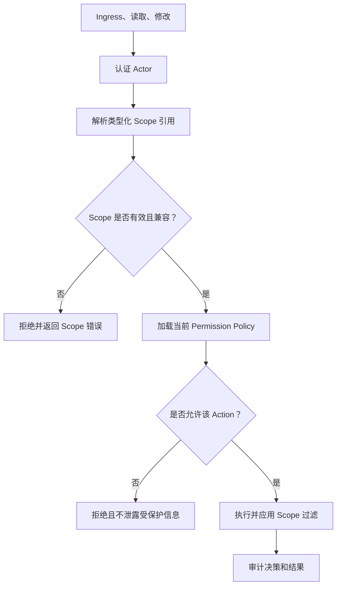

---
document_metadata:
  domain: domain-model
  role: design-specification
  lifecycle:
    approval:
      decision_status: Draft
      approver: null
      decision_date: null
      approved_version: null
      approval_scope:
        type: Full-document
      approval_applicability: Not-Applicable-To-Current-Version
      evidence_reference:
        - "14-ai-development/work-items/AID-2026-193/evidence.md"
      revocation: null
    evidence_verification:
      verification_status: Unverified
      last_verified_date: "2026-11-27"
      last_verification_note: "为原本无 front-matter 的镜像补 GOV-DOC-002 分类：仅记录 domain、role、状态与规范源路径（依据正文自述：Status: Separation and isolation DECIDED）；不主张规范权威，也不证明与源语义对等。补元数据前正文 blob：dff51599324a0edbca2bee52d4d9f9b6ffa117c2。"
    usage_status: Active
    modification_status: Modified
    supersession:
      supersedes: []
      supersession_reason: null
      effective_date: null
    archival:
      archived_date: null
      archival_reason: null
      archival_reference: null
  authority:
    canonical_status: Non-Canonical
    canonical_conflict_status: None
    normative_status: Normative
  bilingual_counterpart:
    source: "02-domain-model/scope-and-permission-model.md"
    en: "docs/en/02-domain-model/scope-and-permission-model.md"
    zh-CN: null
---
# Scope 与 Permission 模型

- 文档 ID：DOMAIN-SCOPE-PERMISSION-001
- 版本：1.0
- 源规范：[规范性原文](../../../02-domain-model/scope-and-permission-model.md)
- 源版本： d620e3e273ea3c752d045789d82a3ec6d0e461ec
- 对应英文：[Scope and Permission Model](../../en/02-domain-model/scope-and-permission-model.md)
- 状态：两者分离及隔离原则为 DECIDED；策略语言和继承边界情况为 OPEN
- Owner：Domain Model 定义语义；Scope、Permission & Governance Engine 负责执行

## 1. 目的

Scope 定义资产所属的命名空间和适用范围边界。Permission 定义哪个 Actor 可以对该资源执行什么操作。两者相互独立：知道对象属于哪个 Scope 不代表获得访问权，角色成员身份也不会改变 Scope。

该模型防止 User、Project、Agent、Agent Instance、Task、Session，以及不同游戏世界或存档等 Environment 之间的数据混用。

## 2. 职责

Domain Model 定义 Scope 类型、对象绑定、组合语义和引用约束。Governance 拥有策略评估、授权、撤销、审计和保留。每个子系统都必须在自己的边界执行授权。

本文不定义身份提供方、ACL 存储引擎、密码学协议或部署拓扑。Agent 无权定义 Brain Policy。

## 3. Scope 维度

| Scope 类型 | 含义 | 典型生命周期 |
|---|---|---|
| User Scope | 属于某个用户主体或由其控制的数据 | 长期 |
| Project Scope | 共享项目/工作区命名空间 | 项目生命周期 |
| Agent Scope | 逻辑 Agent 身份及允许使用的记忆命名空间 | 长期 |
| Agent Instance Scope | 一个运行中/已部署实例 | 实例生命周期 |
| Task Scope | 有边界的任务或目标 | 任务生命周期 |
| Session Scope | 一次交互/运行时会话 | 会话生命周期 |
| Environment Scope | 世界、租户、模拟、存档、设备群或外部状态域 | 环境生命周期 |
| System Scope | Brain 拥有的运维元数据 | 系统生命周期 |

并非每个对象都需要所有维度，但必须绑定足以区分所有权和语义的维度。依赖环境的 Claim/Event 必须明确包含 Environment Scope。

## 4. Scope 对象模型

类型化 Scope 引用包含：
- scope_id：稳定不透明标识符；
- scope_kind：已注册的 Scope 类型；
- owner_ref：Principal 或父 Scope；
- parent_scope_id：可选父级；
- namespace_key：稳定不透明区分符；
- status：active、suspended、closed、revoked；
- created_at 和可选 closed_at；
- policy_ref：Governance 策略选择器。

Agent Scope 在此基础上增加 agent_id、可选 agent_instance_id、Owner Scope 和 Policy。Environment Scope 绑定 environment_kind、environment_identity、Tenant/Project Parent、可选 Environment Version 和 Status。

Display Name、Task Title、Agent Label 和 World Name 永远不能作为安全的唯一 Namespace Key。

## 5. Scope 组合

**DECIDED：** 一个对象可以携带多个 Scope 引用。组合不是可以自由联合并自动授予访问权。每个 Scope 都必须解析和校验；Effective Scope 必须根据声明策略解释。

**CANDIDATE 默认规则：**
1. 所有权 Scope 必须唯一，或通过明确的共享所有权表达。
2. 附加 Scope 用于收窄适用范围或限定上下文（Agent、Task、Session、Environment）。
3. 读取需要获得所有权 Scope 的授权，并满足强制适用条件。
4. 添加 Scope 不得扩大可见性，除非存在明确 Share/Grant。
5. 当事实可能因 World、Tenant、Simulation、Save 或 Environment Version 而不同时，Environment Scope 必须存在。
6. 子 Task/Session 不得超出其父级生命周期或范围。
7. Scope 关闭后阻止新的普通写入，授权归档/协调除外。

### 示例：同一个 Agent，不同世界

Agent builder-agent 在 world-alpha 和 world-beta 中运行。“基地坐标是 (10, 20)”必须带有对应 Environment Scope。即使 Agent 身份相同，在 world-beta 中的查询也不能检索 world-alpha 的 Claim。

### 共享 Memory

跨 Agent/User 共享必须显式执行，并需要来源 Owner 授权、接收方 Scope、声明操作/目的、可选过期/撤销、审计，以及独立的 Evidence/来源访问检查。共享摘要不自动意味着共享原始 Evidence Payload。

## 6. Permission 模型

Permission 是针对 Actor、Action、Resource、Scope、Context 和 Policy Version 的授权决策。

规范 Action 词汇应包括：
- event.ingest / event.read
- memory.propose / memory.read / memory.update / memory.consolidate / memory.activate / memory.archive / memory.retract_claim / memory.forget
- entity.resolve / relation.manage
- evidence.read / provenance.read
- context.read / context.edit / context.sync
- scope.share / scope.manage
- audit.read

**CANDIDATE：** 将 Role/Attribute 规则与显式 Grant、Deny Override 结合。精确策略语言仍为 OPEN。未获授权的操作默认拒绝。

必须在以下时点检查 Permission：
1. Ingress 接收有 Scope 的数据之前。
2. 返回内容之前的 Canonical Read。
3. 每次 Evidence/Source 解引用。
4. 修改和 Lifecycle Transition 之前。
5. Activation/Context Delivery 之前。
6. Export、Share、Forget 和 Audit 期间。
7. 异步 Worker 执行时，重新检查当前授权。

排队任务先前获得授权，不代表它执行时仍然有权限。

## 7. Scope 与 Permission 示例

| 情况 | Scope | Permission |
|---|---|---|
| Agent 查询自己的 Memory | 属于其 Scope | 仍需要 memory.read |
| User 可读 Project，但不能读受限来源 | Memory 可能属于 Project | Evidence 解引用被拒绝 |
| Agent 在 world A 中具有读取权限 | 仅限 world A | 不代表可访问 world B |
| User 撤销共享 | Scope 链接仍保留历史 | 未来访问被拒绝 |
| Adapter 收到 Context ChangeSet | Context 属于 Agent/Task Scope | 仍需要 Delivery 能力/权限 |
| Forget 指向另一 User 的资产 | 目标 Scope 已解析 | 缺少 Governance 权限时拒绝 |

## 8. 输入与输出

授权输入：已认证 Actor、Action、类型化 Resource、Effective Scopes、Purpose/Context、Policy Version、Grants/Denies。

输出：Allow/Deny、Decision ID、Reason Code、义务（脱敏、只读、过期时间）和决策时间。拒绝不得超出策略允许范围泄露受保护对象是否存在或其内容。

Domain Validation 另行返回 Scope 未解析、父级不兼容、缺少 Environment Scope、禁止跨 Scope 引用或 Scope 状态无效等结果。语义合法的对象仍可能被授权系统拒绝。

## 9. Scope 解析工作流

每个异步操作在实际执行时都必须重新授权。Scope 解析和 Permission 评估不得简化为隐式 Tenant ID 检查。

## 10. 数据所有权与一致性

User 根据适用策略拥有用户来源信息。Project Owner/Admin 管理共享项目资产。Agent 提供遥测并可能具有有 Scope 的访问权，但不拥有 Brain 语义。Brain 拥有 Canonical Identity、版本历史、Lifecycle 元数据和受管 Context 权威。Environment Adapter 提供观察，但不拥有保留策略。Evidence 来源的策略可以比派生 Memory 更严格。

Canonical 资产保存所有权/适用范围。Grant 由 Governance 单独管理并带版本。撤销影响未来操作，并触发 Context/Index/Cache 协调；它不会重写历史所有权。

## 11. 并发、幂等与故障

Scope/Grant 修改必须带版本。操作的决策上下文包含 Policy/Grant Version。长时间运行任务在不可逆阶段前重新检查。如果操作期间策略变化，Worker 必须暂停或 Fail-closed，并记录可恢复状态。

Idempotency Key 的范围由 Actor、Operation、Resource 和相关 Scope 确定。Permission Service 故障时，受保护读写必须 Fail-closed。**OPEN：** 是否允许使用有界缓存决策，以及其必须满足什么撤销保证。

## 12. 安全与隔离约束

- 默认拒绝。
- 永远不要从 Display String 或模型生成文本推断 Scope。
- 不允许隐式跨 User/Environment Join。
- 在排序、聚合和可能泄露数据的结果计数之前应用 Scope 过滤。
- 独立授权 Evidence 和 Provenance 引用。
- Agent 提供的 Scope 声明在 Adapter/Gateway 认证并解析之前均不可信。
- Memory 内容不能修改 Policy 或自行授予访问权。
- 日志/指标不得包含受保护内容和标识符。
- 撤销/Forget 必须使相关 Context、Working Set、Cache 和投影失效。

## 13. 性能与验收

测量授权 p50/p95/p99 延迟、Scope 解析成本、Policy Cache 命中/未命中、撤销传播延迟和对抗性泄漏测试。未授权披露目标为零；不得通过省略过滤来换取性能。

验收：
- 同一个 Agent 在两个 Environment Scope 之间不能跨环境读取 Claim。
- Permission 拒绝必须阻止 Scope 内本来语义合法的操作。
- 一个 Scope 的 Permission 不授权另一个 Scope。
- Evidence 访问必须独立于 Memory 访问进行检查。
- 被撤销的 Grant 阻止未来读取并触发 Context 协调。
- 异步 Worker 重新检查 Permission。
- Scope 有歧义时拒绝，不猜测。
- Scope 组合不能隐式扩大访问权。
- Scope 关闭后阻止普通写入。
- Policy Service 故障必须遵循 Fail-closed。

## 14. 开放决策与接口

- **OPEN：** 父子 Scope 和多 Owner Scope 的正式 Scope Algebra。
- **OPEN：** Policy Language 和 Role/Attribute 模型。
- **OPEN：** 缓存授权语义和撤销 SLA。
- **CANDIDATE：** 默认拒绝，结合显式共享 Grant 和 Policy Obligation。
- Governance 定义 Grant Lifecycle、撤销、审计和保留。
- BMCP/Adapter 定义已认证 Actor 和 Scope 声明；Agent Label 不是可信身份。
- Compiler 将来源/环境 Scope 附加到 Event/Evidence/Claim 提案。
- Runtime/MCM 在 Activation 和 Context Delivery 前执行 Scope 过滤。
