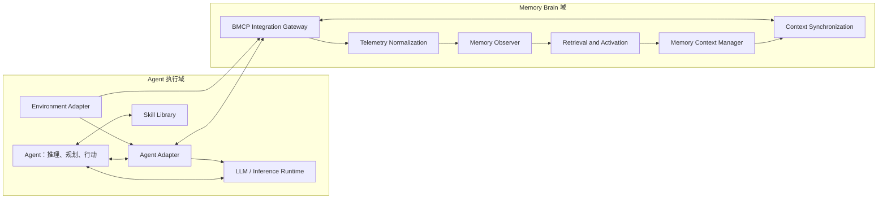

---
document_metadata:
  domain: agent-integration
  role: design-specification
  lifecycle:
    approval:
      decision_status: Draft
      approver: null
      decision_date: null
      approved_version: null
      approval_scope:
        type: Full-document
        included_sections: []
        included_assets: []
      approval_applicability: Not-Applicable-To-Current-Version
      evidence_reference:
        - "PR #430 comments 7061007191, 7061333647 and 7061563540"
        - "Issue #449 comment 7061011800"
        - "Issue #449 comment 7060351480"
        - "PR #428 comments 7060190878 and 7060264372"
        - "Issue #429 comments 7060243632 and 7060259541"
        - "PR #452 merge commit 48a03f694684f7a62bc5b337dc758c98e3cc0e5b"
        - "PR #487 merge commit 18b1c574433a6f3f600a9d2947b690084727aa75"
      revocation: null
    evidence_verification:
      verification_status: Unverified
      last_verified_date: null
      last_verification_note: "独立的 13 节交接材料已恢复为非规范输入；本文仅反映与当前 Owner 决议一致的架构级内容。PR #487 仅增加有限的内存 Reference Delivery；精确 C-H operation mapping 仍为 OPEN，Runtime 未获授权。"
    usage_status: Active
    modification_status: Modified
    supersession:
      supersedes: []
      supersession_reason: null
      effective_date: null
    archival:
      archived_date: null
      archival_reason: null
      archival_reference: null
  authority:
    canonical_status: Non-Canonical
    canonical_scope: "Agent Integration architecture and C-owned Agent-facing semantics"
    canonical_scope_id: null
    canonical_scope_keywords:
      - agent-integration
      - MCP
      - BMCP
      - Agent Adapter
      - inference-boundary
    canonical_conflict_status: None
    canonical_conflict_resolution: null
    normative_status: Normative
  bilingual_counterpart:
    source: "07-agent-integration/agent-integration-overview.md"
---
# Agent Integration 架构总览

- 文档 ID：AI-INT-ARCH-OVERVIEW-001
- 状态：基线与家族级路由已 DECIDED；精确 C-H Operation Registry 为 OPEN / DEPENDENCY_NOT_FROZEN；Runtime NOT AUTHORIZED
- Owner：C — Agent Integration；家族级路由决议见 Issue #449 comment 7060351480
- 范围：逻辑接入边界。BMCP Wire 规范和具体 Adapter 架构归 H 负责。
- 规范性英文源：[Agent Integration Architecture Overview](../../../07-agent-integration/agent-integration-overview.md)

## 1. 目的

定义独立于模型和 Agent 的 Memory Brain 如何与不同类型的 Agent 协作。接入必须保留 Brain 对 Memory 的权威，同时将推理、规划、行动选择、工具执行和安全策略留给 Agent。

目标：
- 标准化结构化 Telemetry，不要求私有推理轨迹。
- 支持 Agent 发起的 Active Recall 和 Brain 发起的 Context 更新。
- 仅在明确的 Inference Assembly Boundary 应用 Context。
- 明确 Capability、Delivery、Acceptance 和 Application 保证。
- 将 Agent 专属协议置于 Adapter 之后。
- 保留 Scope、Permission、Provenance 和 Trust 边界。

## 2. 系统边界

### 权威归属

**DECIDED — Brain 拥有：**
- Canonical Memory 语义、身份、生命周期、Provenance 和 Governance。
- Memory 选择与激活策略。
- 每个受管 Memory Context 的权威版本序列。
- Brain 资源的 Scope 与 Permission 决策。

**DECIDED — Agent 拥有：**
- 推理、规划、任务分解、行动选择和工具调用。
- Agent 原生任务状态和私有执行结构。
- Agent 安全策略及外部行动授权。
- 是否以及如何使用返回的 Memory。

**DECIDED — Agent Adapter 拥有：**
- 将 Agent 原生信号映射为 Brain 定义的 Telemetry。
- Capability 声明和 Boundary Validation。
- 接收并校验 Context Change。
- 仅在 Inference Assembly Boundary 的明确受管区域应用 Brain Context。
- 如实确认 Receipt、Acceptance、Application、Rejection 和 Reconciliation。

Adapter 不拥有 Canonical Memory、Activation Policy 或权威 Context Version。

**DECIDED — Environment Adapter 拥有：**
- 将环境专属观察和状态变化转换为带来源标识的规范信号。
- 附加 Environment Identity 和 Observation Provenance。
- 报告观察结果，不把未观察状态宣称为事实。
- 不代表 Brain 操作环境。

**DECIDED — LLM/Runtime** 拥有 Inference 和 Token Processing；Brain 不控制模型内部。

**DECIDED — Skill Library** 拥有可执行 Skill 和 Procedure。Brain 可以存储引用 Skill 的经验，但不执行 Skill，也不把 Memory 转成可执行代码。

## 3. 职责矩阵

| 能力 | Brain | Agent | Agent Adapter | Environment Adapter |
|---|---|---|---|---|
| Canonical Memory 生命周期 | 主责 | — | — | — |
| 规划和行动选择 | — | 主责 | — | — |
| Telemetry 来源 | 消费 | 主责 | 映射 | 提供观察 |
| Telemetry 语义 | 定义 | 提供 | 映射 | 提供观察 |
| Retrieval 和 Activation | 主责 | 可请求 | 传输 | — |
| Context Version 权威 | 主责 | — | 跟踪 Applied Version | — |
| Inference Context 应用 | 定义目标 | 发起 Inference | 执行 | — |
| Environment Observation | 消费 | 可解释 | 传输 | 主责 |
| Environment Actuation | — | 主责 | 可暴露 Agent API | — |
| Skill Execution | — | 主责 | 可选映射 | — |

支持某项能力不代表取得该能力的权威。

## 4. 接入模式

**DECIDED：** 三种模式可以并存。

1. **Telemetry Ingress：** Agent/Adapter 提交结构化 Task、Intent、Observation、Outcome、Uncertainty、Risk 和 Environment Signal。
2. **Active Recall：** Agent 针对 Task、Entity、Environment 或 Question 请求受 Scope 限制的 Memory。
3. **Context Synchronization：** Brain 发布有版本的 Snapshot 或 Change；Adapter 在未来 Inference Boundary 应用并确认结果。

Telemetry Ingress 和 Runtime Recall 的延迟与持久性目标不同。它们可以共用 Gateway，但不能被强制塞入同一同步处理路径。**CANDIDATE：** 使用共同 Identity/Scope Envelope 的独立逻辑 Lane/Priority Class；物理隔离需要证据。

## 5. 规范接入 Envelope

最终 BMCP Message Shape 归 Session H。C 逻辑 Envelope 包含：

| 字段 | 语义 | 要求 |
|---|---|---|
| `telemetry_id` | 稳定提交标识 | 必需 |
| `schema_version` | 规范 Schema 版本 | 必需 |
| `producer_id` | 声明的 Producer/Adapter 引用；属于数据，不是认证证明 | 依契约；绝不能充当认证凭据 |
| `agent_instance_id` | Agent Instance | Context/Session 操作必需 |
| `scope` | 所有权命名空间 | 必需 |
| `signal_type` | 规范 Signal Category | 必需 |
| `occurred_at / observed_at` | 来源时间 | 已知时提供 |
| `recorded_at` | Brain 接受时间 | Brain 分配 |
| `payload` | 类型化 Signal Body | 必需 |
| `source_kind` | Agent、Environment、User、Tool、External | 必需 |
| `correlation_id` | H 所有的 Workflow Correlation；不同于 C 的 AgentRequestId/AgentTurnId | 依 H 契约；C-H 精确交叉映射 OPEN |
| `idempotency_key` | 不得把该历史逻辑标签当成已冻结 Wire 字段；状态变更重放使用 Owner-scoped Idempotency Identity 和 Canonical Payload Digest | 语义 DECIDED；字段/Schema OPEN |
| `provenance` | 来源与转换历史 | 派生 Claim 必需 |

未知扩展字段必须使用命名空间且视为不透明数据，不能覆盖规范字段。

本表是 C 逻辑 Envelope 描述，不是 BMCP Wire Schema。H 拥有 BMCP Message Envelope 和 Wire Identifier。H 的 `message_id`、`correlation_id`、`causation_id` 是不同协议身份。C 不定义核心 `request_id`；`AgentAttemptId` 既不是 H Transport Attempt Identity，也不是 Idempotency Key。C/H 身份之间没有冻结字段级转换。

## 6. 信任边界

Telemetry 和 Memory 是数据，不是指令。Agent 提供的 trusted、verified、high priority 或 system instruction 等标签不产生权威。Payload 中的 Principal、Producer、Agent、Actor 和 Scope 声明不能自我认证；Authenticated Principal Provenance 来自 I Trust Integration，H 绑定已认证 Transport Sender/Audience。Adapter 只能向 Brain-managed Region 插入 Memory，不能覆盖 System/Developer Instruction、用户输入、Tool Definition 或 Agent Security Policy。

## 7. 核心工作流

### Telemetry
1. 通过 I Trust Integration 获取 Authenticated Principal 并解析 C Agent/Session Context；不得根据 Payload Claim 认证。
2. 将原生字段映射为规范 Signal Type，并附加已授权的 Scope/Environment 引用。
3. 校验 Schema、当前 Permission、时间戳、大小，以及 Owner-scoped Idempotency Identity 和 Canonical Payload Digest。
4. 持久化接受或拒绝。
5. 返回 Ingestion Receipt。Accepted 不代表语义编译完成或创建了 Memory。
6. 异步处理下游流程并保留 Provenance。

### Active Recall
1. Agent 通过 F-owned Retrieval/Query Interface 提交带 Scope 的 Query、Task 和 Environment Context。
2. 执行 I Authorization 和 D Lifecycle/ForgetFence 检查；Brain 解析 Scope。
3. F-owned Runtime 检索候选项并执行 Activation/Visibility Policy。
4. Brain 返回符合条件的 Memory Data 和允许披露的 Evidence Reference。
5. Agent 决定是否以及如何使用结果。

### 主动 Context 更新
1. Brain 观察已授权 Telemetry/Trigger。
2. Activation Policy 请求 Context Planning。
3. Context Manager 基于权威 Base 创建 Versioned Change。
4. Synchronization 执行 Delivery。
5. Adapter 校验 Scope、Version、Budget、Capability、当前 PermissionEpoch、当前 ForgetFence 和 Managed-Region Boundary。
6. Adapter 分别报告 Receipt 与 Acceptance；两者都不是 G Applied。
7. 在下一次 Inference Assembly Boundary，Adapter 发出 H 定义的 Evidence；只有 G 能评估并提交 Applied。
8. Offline/Stale Adapter 必须先处理当前 Governance Fence，再重放 Context，随后通过 Delta 或 Full Snapshot Reconcile。

## 8. 状态与权威

| 状态 | 权威 |
|---|---|
| Canonical Memory | Brain |
| Telemetry Acceptance | Brain |
| Activation Decision | Brain |
| Memory Context Version | Brain Context Manager |
| Delivery State | Brain Synchronization Subsystem |
| Local Applied Version | Adapter，作为 Attestation 报告给 Brain |
| Inference Execution | Agent/Runtime |

Applied Context 是确认记录，不是第二份 Canonical Context。

## 9. 可靠性、一致性与降级

- Durable-Acceptance Receipt 表示接受的 Telemetry 在声明的 Durability Contract 下可跨重启保留。
- 相同 Scope Idempotency Identity 的重复重试只能创建一个逻辑 Accepted Event。
- Context Version 由 Brain 权威排序。
- 未知 Base Version 和 Version Gap 必须拒绝或 Reconcile，不能猜测。
- Dispatch 后 Timeout 或响应丢失必须标记 UNKNOWN 并等待 Reconciliation；缺少 ACK/Evidence 绝不是正面证明。
- Cancellation 不能证明 Rollback。
- 默认情况下 Brain 故障不应停止 Agent 推理或环境控制。
- Adapter Offline 时不能产生新的 Applied Claim；Brain 跟踪待处理 Delivery，稍后 Reconcile。
- 缺失或模糊的 Environment Identity 会导致环境专属 Signal 被拒绝或隔离。
- Permission Revocation 会停止后续访问并触发受治理 Reconciliation；它本身不等于 Forget。

## 10. 安全与隔离

每个操作都必须 Authentication 和 Authorization。Scope 不等于 Permission。I 拥有 Authenticated Principal、Authorization、PermissionEpoch 和 Global Forget Policy；D 拥有 Canonical Identity/Lifecycle 和 ForgetFence。受保护操作以及重放结果披露前必须重新验证当前权威；过期或未知状态 Fail Closed。User、Project、Agent、Agent Instance、Task、Session 和 Environment 隔离必须明确。Environment ID 用于区分 World、Save File、Tenant 和 Simulation。返回 Agent 的 Memory 是不可信数据，不能授权 Tool 或覆盖 Agent Policy。

## 11. 性能与可观测性

测量 Telemetry Acceptance Latency/Durability、Duplicate Suppression、Recall p50/p95/p99、Context Generation-to-Delivery 和 Acceptance-to-Applied Latency、Applied-Version Lag、Reconciliation Rate、Rejection/Error Rate，以及受控比较下的 Agent Task Outcome。

**TO_VALIDATE：** SLO 数值、Payload Budget、Telemetry Cadence、Activation Threshold 和 Local Buffering Window。不得假设性能提升倍数。

## 12. 验收标准

1. 更换 Agent Framework 或 LLM 不改变 Canonical Brain Semantics。
2. Planning、Tool Execution 和 External Action Policy 始终归 Agent。
3. Telemetry 可以独立于 Model-assisted Compilation 被持久接受。
4. 仅提交 Intent/Plan/Pending Action 不能被视为 Completed Outcome。
5. Received、Accepted 和 Applied 必须分别可观察。
6. Applied 必须标识 Adapter、Agent Instance、Context Session、Version 和 Boundary Correlation。
7. Brain 不能覆盖受保护的 Instruction/User/Policy Region。
8. 无效跨 Scope 或未授权操作必须 Fail Closed。
9. Tier 3 可以使用 Telemetry 和 Recall，但不得虚报 Proactive Sync 保证。
10. Brain Integration Outage 期间 Agent 应继续主要任务，具体受 Agent Policy 约束。

## 13. 跨模块接口

| 合作模块 | 需要确认的内容 |
|---|---|
| Session B — Domain Model | Scope Tuple、Epistemic/Time Semantics、Event 和 Provenance Identity |
| Session E — Compiler | Telemetry-to-Event Mapping 和 Durable Ingress |
| Session F — Runtime | Recall Query Context、Activation Trigger、Risk/Freshness Signal |
| Session G — Context | Context/Session Identity、Version、ChangeSet 和 Applied Record |
| Session H — BMCP/Adapter | Wire Envelope、Message/Correlation/Causation Identity、Capability Negotiation、ACK、Validator、Retry、Error；精确 C-H Operation Registry 仍 OPEN |
| Session I — Governance | Authenticated Principal Provenance、Authorization、PermissionEpoch、Attestor Policy、Audit、Retention/Global Forget 和 Offline Replay |

## 14. 开放决策

- **OPEN：** 使用一个通用类型化 Telemetry Envelope，还是少量 Message Family。
- **OPEN：** Environment Adapter 直接 Ingress，还是经 Agent Adapter Relay。
- **CANDIDATE：** 分离逻辑 Ingress Lane 和 Recall Lane。
- **TO_VALIDATE：** Event 专属 Payload/Frequency Limit。
- **OPEN / DEPENDENCY_NOT_FROZEN：** 精确 C-H Operation ID、字段名称/类型/必填性、Schema、MCP Tool/Resource 名称和逐家族 Request/Response Mapping。
- **OPEN：** Offline Retention 和 Local Adapter Cache Policy（I 负责）；Reconnect 必须先处理 I/D Governance Fence，再重放 Context。
- **OPEN：** Partial Context Application。安全默认值为 Reject，除非明确规定 Partial Semantics 和逐 Entry Result。

## 15. 决议摘要

- **DECIDED：** Brain 拥有 Memory 和 Managed Context 权威；Agent 拥有 Reasoning/Action；Adapter 在 Inference Boundary 映射并应用。
- **DECIDED：** Environment Adapter 报告 Observation，不执行 Action。
- **DECIDED：** Telemetry Acceptance 不等于 Compilation。
- **DECIDED：** Applied 不证明模型理解。
- **DECIDED：** Memory 始终是不可信数据。
- **DECIDED：** MCP 是 Agent Host ↔ C 北向 Tool/Resource 接口；BMCP 是 C Agent Adapter ↔ Brain 协议，经 H 接入。
- **DECIDED：** C 保留 AgentRequestId、AgentAttemptId、AgentTurnId、AgentSessionId；H 拥有 message_id、correlation_id、causation_id；不发明核心 request_id。
- **OPEN / DEPENDENCY_NOT_FROZEN：** 精确 C-H Operation Registry 和字段级映射仍等待 H 版本化工件及受影响 D/I/E/G Consumer Acceptance。

## 16. MCP 北向边界与 BMCP 家族路由

### 16.1 协议边界

- **MCP：** Agent Host ↔ C 北向 Tool/Resource 接口，负责 MCP Server Lifecycle、Method Dispatch、Tool/Resource 暴露、MCP Request/Result 和 MCP Error。
- **BMCP（Brain Memory Context Protocol）：** C Agent Adapter ↔ Memory Brain 协议边界，由 H 负责 Transport/Serialization。它承载 Memory Control 和 Context Delivery 语义，不是 MCP Method Namespace。
- C MCP Server 是面向 Agent 的 Adapter/Gateway，不是 BMCP 本身，也不是并行的 Canonical Brain API。MCP 成功、HTTP 2xx、Queue Acceptance 或 Transport ACK 均不代表 BMCP Business Success、E Acceptance 或 G Applied。
- MCP Tool/Resource 名称、Input/Output Schema、Prompts（如有）和 Backend Operation ID 仍 OPEN，必须等待相关 C/H 与 Owner Domain Contract 固定并被接受。本文不定义占位 Tool/Wire Field。

### 16.2 九个 BMCP 逻辑家族的 C 路由处置

| BMCP 逻辑家族 | 相对 C Adapter 的方向 | C/MCP 路由处置 | 权威/依赖状态 |
|---|---|---|---|
| Telemetry | Agent/Adapter → Brain | 只有 H 注册精确 Operation 且 I/C Identity/Authorization Binding 被接受后，才可暴露 C-owned Agent Tool | H Operation 与 I Authorization OPEN |
| Event Ingress | Producer/Agent → Brain | 只能经 H 注册的 Ingress 和 E Durable Receipt/Idempotency Contract；MCP Result 本身不是 E Accepted | H/E Consumer Mapping OPEN |
| Context Snapshot | Brain → Adapter | G-owned ContextVersion Snapshot 入站交付；不是通用 MCP Request/Response | G/H Delivery Mapping OPEN |
| Context Delta | Brain → Adapter | G-owned、具有精确 Base/Target Version 的 ChangeSet 入站交付；不是通用 MCP Request/Response | G/H Delivery Mapping OPEN |
| Delivery | Brain → Adapter | H/G Delivery Lifecycle 进入 C；C 校验并只在声明的 Inference Boundary 应用 Brain-managed Region | H/G/C 联合契约未冻结 |
| Acknowledgement | Adapter → Brain | C 只能发出 H 定义的 Evidence；Transport ACK 不是 MCP Success，也不是 G Applied | H Wire/ACK 和 G Acceptance OPEN |
| Capability Negotiation | 双向 | H-owned Protocol Negotiation；C 不得发明 MCP Tool 或本地替代机制 | H 所有；精确版本化协商契约 OPEN |
| Forget / Revocation | Brain/I → Adapter，含授权控制请求 | C 消费并执行 D/I Owner-issued Control；不得有 C-local Forget。Agent-facing Control Request 必须使用 I/D 授权操作 | D/I 权威已决；精确 Operation Mapping OPEN |
| Administrative Governance | I/Control Plane → Adapter/Gateway | 仅 Control Plane；没有明确 I Policy/H Operation Registration 时，不暴露为普通 Agent Tool | I/H Control-Plane Mapping OPEN |

**Recall/Search 归 F 所有，不是 BMCP 家族。** C 不得发明 BMCP Search Operation。未来 MCP Memory Search Tool 必须有单独固定的 F-owned Query API 和 I/D Authorization Path；在这些接口存在并被接受前，该能力不可用或应返回 Dependency-not-ready。

### 16.3 暴露与校验规则

1. 仅暴露后端权威和当前授权均可用的 Allowlisted C Operation。
2. Dispatch 前校验 MCP Method、Tool/Resource Identity、类型化参数、Size/Budget、Scope Reference、Capability 和 Request Context。
3. 不允许调用方提供的 Principal、Producer、Agent、Actor 或 Scope Claim 建立身份或权威。
4. 默认不把 Administrative Governance 或 Forget 暴露为普通 Agent Tool。
5. 不得把通用 Search Tool 暴露为 BMCP Operation；Recall 归 F 所有。
6. 精确 H Operation 或 Owner Domain Contract 缺失时，返回类型化 Dependency-not-ready/Unsupported；不得序列化自创 BMCP Message。

## 17. Agent 身份、协议 Correlation 与 Authenticated Principal

| 身份 | Owner | 含义与边界 |
|---|---|---|
| `AgentRequestId` | C | C 侧逻辑 Agent Request Identity，由 C 保留 |
| `AgentAttemptId` | C | C 侧 Agent Invocation Attempt Identity；不是 H Transport Attempt，也不是 Idempotency Key |
| `AgentTurnId` | C | Agent Turn Identity，由 C 保留 |
| `AgentSessionId` | C | Agent Session Identity，由 C 保留 |
| `message_id` | H | 单个 BMCP Protocol Message 的唯一身份 |
| `correlation_id` | H | Workflow Correlation Identity |
| `causation_id` | H | 直接因果前序 Message Identity |
| Operation Idempotency Identity | Operation Owner，经 H Contract 承载 | 绑定 Canonical Payload Digest 的 Owner-scoped Identity；不同于 Message/Correlation/Causation |

C 保留四个 Agent Identifier；H 拥有三个 Protocol Identifier。不得发明核心 `request_id`。C/H Identity 之间没有一对一字段转换或已冻结的序列化 Crosswalk。本地 Trace Association 不得冒充 H Wire Contract。H Message Identity、Workflow Correlation、Immediate Causation 和 Operation Idempotency 是不同概念。

Authenticated Principal 来自 I Trust Integration。H 绑定已认证 Transport Sender/Audience，但该绑定本身不授予 Brain Resource Permission。Payload Principal/Producer/Agent/Actor/Scope 仅是 Claim 或 Reference，不能自我认证。I 拥有 Authorization 和当前 `PermissionEpoch`；D 拥有 Canonical Identity/Lifecycle 及 `ForgetFence` Generation/Ordering。这些 Epoch/Fence 是不同的不透明权威命名空间，不能比较或替代。

## 18. Request Lifecycle、Idempotency、Outcome 与 Error

### 18.1 Replay 与 Idempotency

状态变更/可重试操作必须使用由 Operation Owner 管理、绑定 Canonical Payload Digest 的 Scoped Idempotency Identity：

- 相同 Owner-scoped Identity + 相同 Canonical Digest：返回原始 Operation Result/Receipt，不产生第二次逻辑效果。
- 相同 Identity + 不同 Digest：Conflict，不得覆盖原始结果。
- `AgentAttemptId`、H `message_id`、`correlation_id` 和 `causation_id` 均不能替代该 Identity。
- H 的逻辑决议选择 RFC 8785 JCS 作为 JSON Canonicalization 基础；精确字段 Schema、Integrity Field Boundary、Signature Suite 和逐操作 Encoding 仍 OPEN，直到版本化 H/I 工件被接受。

### 18.2 不可互相升级的结果

1. **MCP Tool Result：** C 返回给 Agent Host 的结果。
2. **BMCP Business Response：** 依 H Protocol Contract 承载的 Owner Domain Operation Result。
3. **H Transport ACK：** 仅协议/传输证据。
4. **E Accepted Receipt：** E Contract 下的 Durable Event Custody Receipt。
5. **G Applied Evidence/Record：** G 判断所有逐请求 Context Application Predicate 均通过的记录。
6. **Forget ACK：** Adapter 实际执行 Forget/Clear/Suppression 的证据。
7. **Global Forget Completion：** I 根据 D/I 权属 Evidence 和 Policy 做出的全局治理评估。

任何层都不得把 MCP Result、BMCP Response、Transport ACK、E Receipt 或 Forget ACK 升级为 G Applied 或 Global Forget Completion。Delivered 不等于 Applied；Applied 不证明模型注意、理解或遵循。

### 18.3 Timeout、Cancellation 和 Error Mapping

- 已确定发生在 Dispatch 前且没有副作用的失败，可以按调用方策略重试。
- Dispatch 后 Timeout 或响应丢失必须标记 `UNKNOWN` 并等待 Reconciliation。缺少 ACK/Evidence 绝不是正面证明。
- Cancellation 不能证明 Rollback。前一次状态变更结果未知时，不得使用新的 Idempotency Identity 重试。
- 重试前使用 Operation Owner Identity/Result 做 Reconcile。相同 Identity/相同 Digest 是 Replay；相同 Identity/不同 Digest 是 Conflict。
- 必须保留 Authentication、Authorization/Stale-authority、Validation/Unsupported-version、Integrity、Conflict、Unknown/Transient 和 Owner-domain Failure 的区别。错误详情必须脱敏，不能泄露受保护 Payload 或跨 Scope 存在性。
- 精确 MCP Error Code 和 H Wire Enum/Retry Flag 仍 OPEN；映射不得把不同 Owner Domain Outcome 折叠为通用 Success 或通用 Retry。

## 19. 安全、Capability Tier 与 Reconnect 顺序

### 19.1 安全与权威

- I 提供 Authenticated Principal Provenance，并拥有 Authorization、`PermissionEpoch`、Attestor Policy、Revocation 和 Global Forget Evaluation。
- D 拥有 Canonical Identity、Lifecycle、Lineage 和 `ForgetFence` Generation/Ordering。C 在受保护操作及披露 Replay Result 前重新验证 I/D 权威。
- 权威过期、缺失或未知时 Fail Closed。缓存 ALLOW、Session State、Lease、Receipt 或 Transport ACK 都不是可复用授权。
- Telemetry 和 Retrieval Memory 是不可信数据，不是指令。保留 Prompt-injection 边界；不要求私有 Chain-of-Thought。Memory 不能授权 Tool，也不能覆盖 Agent Safety Policy。
- 并发时隔离逐请求 Identity、Scope 和 Trace Context；请求不得继承其他请求的 Principal、Scope、PermissionEpoch 或 ForgetFence。

### 19.2 Capability Tier 与有限 Reference Model

Tier 1 要求可观察最终请求的 Inference-Boundary Evidence；Tier 2 仅限 Middleware-Controlled Path；Tier 3 支持 Telemetry/Active Recall，MUST NOT 声称 Full Applied。Capability Tier 不授予 Permission。

PR #452（GAP-03：Agent Integration Tier Enforcement Reference Model）已合并，Merge Commit 为 `48a03f694684f7a62bc5b337dc758c98e3cc0e5b`。其有限 Rust Reference Model 提供 Tier-to-Operation Authorization，以及类型化 Protected-Region/Frozen-Request Rejection。它不是生产 Agent Adapter、MCP Server、BMCP Negotiation/Transport、Telemetry Pipeline、Provider Integration，也不证明实际 Inference Boundary Application。Version-Gap Reconciliation 仍在该最小模型范围之外。

PR #487 已于 Merge Commit `18b1c574433a6f3f600a9d2947b690084727aa75` 合并，为确定性 Rust Reference Model 增加 `ContextDeliveryAdapter` / `InMemoryContextDeliveryAdapter`：按 Session 保存 Snapshot、检查精确后继 Version、支持 Clear/Reset、断连时拒绝 Apply，并在 Reconnect 时报告最后一次成功应用的内存版本。crate README 报告共 8 个 Unit Test（原有 4 个 Tier/Boundary 测试，加 4 个 Delivery Lifecycle 测试）。这仅是有限的进程内存 Reference Behavior：不包含真实 Transport、逐 Runtime Agent 集成、持久化 Delivery Ledger/Session State、自动 Retry/Redelivery、生产 Reconciliation/Attestation、真实 Inference、Provider Integration、BMCP Negotiation 或生产 Telemetry。后继版本检查不等于 Snapshot/Delta Reconciliation，也不关闭 C-H Operation Registry 或 Consumer Mapping。

### 19.3 Offline/Reconnect 与 Context Delivery

Reconnect 时，先处理当前 I Authorization/PermissionEpoch 和 D ForgetFence/Revocation Control，再重放或应用缓存 Context。随后认证 Adapter/Session，重新验证 Capability 和当前 ContextVersion。仅当精确 Base 已知时才使用支持的 Delta；否则请求 Full Snapshot。Governance Fence 之前绝不能重放旧 Context。Partial Delivery/Application 必须按已接受的 Owner Contract 报告为 Partial/Rejected，不得升级为 Full Applied。

## 20. 架构验收矩阵——没有 Runtime PASS

| 场景 | 责任 Owner | 架构预期 | 状态/证据边界 |
|---|---|---|---|
| MCP Dispatch、Allowlist、参数校验 | C | 只暴露已注册的类型化 C Operation；非法/未知 Method Fail Closed | 边界已描述；Runtime NOT RUN |
| MCP-to-BMCP 家族路由 | C/H | 仅使用 §16 九个 H 逻辑家族和 C 处置；不发明 Search 家族 | 家族方向 DECIDED；精确 Operation Mapping OPEN / DEPENDENCY_NOT_FROZEN |
| Message/Correlation/Causation Identity | C/H | C Agent ID 与 H Protocol ID 保持不同命名空间 | 逻辑区分 DECIDED；精确 Crosswalk/Schema OPEN |
| Telemetry Event Ingress Receipt | C/H/E | E Durable Acceptance Receipt 与 MCP Result/H Transport ACK 不同 | E Contract Candidate；跨 Owner Acceptance OPEN |
| Snapshot/Delta/Delivery 与 Applied | C/G/H | G 拥有 Context Version/ChangeSet 和 Applied Decision；C 仅应用受管区域；H 传输 Evidence | PR #487 仅覆盖精确后继版本的内存 Snapshot Apply/Clear/Reconnect；不包含 Delta Recovery 或生产实现；C/G/H Freeze BLOCKED |
| PermissionEpoch 与 Authenticated Principal | C/I/H | Principal 来自 I Trust；受保护操作重新验证当前 I 权威 | 权威边界 DECIDED；可调用集成 NOT RUN |
| ForgetFence 与 Revocation | C/D/I/H | 消费 D Fence/Lifecycle 和 I Global Policy；C 不得替代 | 权威边界 DECIDED；精确 Operation Mapping OPEN |
| Replay/Idempotency/Digest Conflict | C/H/E 和 Operation Owner | 相同 Identity/Digest Replay；相同 Identity/不同 Digest Conflict | 逻辑语义 DECIDED；逐家族 Schema OPEN |
| Timeout/Lost Response/Cancellation | C/H/E/G | Dispatch 后未知为 UNKNOWN；重试前 Reconcile；Cancellation 不等于 Rollback | 架构已描述；Runtime NOT RUN |
| Offline/Reconnect/Partial Delivery | C/D/G/H/I | 先处理 Governance Fence，再做 Version/Capability Reconcile；不重放旧 Context | 架构已描述；跨 Owner Conformance NOT RUN |
| Protected Region/Prompt Injection | C | 仅写 Brain-managed Region；Untrusted Memory 仍为 Data；不要求 CoT | 源边界 DECIDED；PR #452 Tier/Boundary 与 PR #487 内存交付均仅为有限 Reference Model |
| Runtime Startup/Transport/ACK/Validator/Concurrency | C/H 与工程 Owner | 需要获授权 Runtime Repository 和冻结契约 | PLANNED_NOT_RUN / NOT AUTHORIZED |

所有 Runtime 验收项均为 `PLANNED_NOT_RUN / NOT AUTHORIZED`。本文不是 Runtime 实现或生产 Conformance 证据。

## 21. 决议登记与精确源文件 Pin

### 21.1 决议登记

| 项目 | 状态 | 证据/限制 |
|---|---|---|
| MCP 北向与 BMCP 边界 | DECIDED | Issue #449 comment 7060351480；MCP 是 C Agent Host 接口，BMCP 是经 H 的 C Adapter ↔ Brain |
| 九家族路由处置 | 家族级 DECIDED | Issue #449 comment 7060351480；Operation ID/字段/Tool 名称仍 OPEN |
| C Agent Identity 与 H Protocol Identity | 不同 Owner，DECIDED | PR #430 comment 7061007191 和 Issue #449 comment 7061011800；没有核心 `request_id` |
| H Logical Identity、JCS、ACK/Replay 和 Validator 原则 | 仅逻辑层 DECIDED | PR #428 comments 7060190878、7060264372；精确 Schema/Registry/Crypto/Transport 仍 OPEN |
| D Canonical Identity/Lifecycle/ForgetFence 边界 | 语义边界 DECIDED | Issue #429 comment 7060243632；不冻结 Schema/API/Wire |
| I Principal/Authorization/PermissionEpoch/Global Forget 边界 | 语义边界 DECIDED | Issue #429 comment 7060259541；没有精确跨 Owner Wire/API 冻结 |
| E Durable Event Receipt/Idempotency | CANDIDATE 实现接口 | Current main Event Store Contract；未证明 C/E Consumer Acceptance |
| G ContextVersion/Applied/Forget Reconciliation | G 语义决议已记录；跨 Owner Freeze BLOCKED | 当前 main G Source Pin 如下；实现和 C/G/H 接受未验证 |
| PR #452 Capability Tier Reference Model | 已合并，仅有限 Reference Model | Merge Commit `48a03f694684f7a62bc5b337dc758c98e3cc0e5b`；不是 MCP/BMCP/Runtime 证明 |
| PR #487 内存 Context Delivery Reference Model | 已合并，仅有限进程内存行为 | Merge Commit `18b1c574433a6f3f600a9d2947b690084727aa75`；8 个 Unit Test；不证明 Transport/持久化/生产 Runtime |
| Issue #7 Implementation Binding | DEFERRED_TO_ENGINEERING_PHASE | 未授权 Runtime 实现 |

### 21.2 Current Main 的 C 源文件与 Reader Guide Pin

本次 rebase/验证批次开始时的 live main：`5a1964fa77f6dff024c8cef9e4e6a43f3bd051af`。

| 路径 | Blob SHA |
|---|---|
| `07-agent-integration/agent-integration-overview.md` | `073ff4ddf71fbcaf959107bb06ab724bfa48e63b` |
| `07-agent-integration/adapter-capability-tiers.md` | `60bce314c36313a14dffe476a6f2a5cf7aa03b37` |
| `07-agent-integration/inference-boundary-model.md` | `e2d5cb6abd9ec40da6e3680531de5944fc8b14df` |
| `07-agent-integration/telemetry-model.md` | `9bb4a77e4bd79caaf3e1faeaf77c6b42858998f0` |
| `docs/en/07-agent-integration/agent-integration-guide.md` | `c4e076887634a9e8e46df076efb0f4b70d816e0a` |
| `docs/zh-CN/07-agent-integration/agent-integration-guide.md` | `b68f90f70ccf0c79bc8063e70b9a084b605ba9bf` |

额外的非规范翻译与实现参考 Pin：
- Capability Tier 中文阅读翻译：`07-agent-integration/adapter-capability-tiers.zh-CN.md`，Blob `85a77163d1761a38074678983ad8d89ccf25d040`；仅为翻译，不是第二规范源。
- PR #487 Reference Model README：`crates/agent-integration/README.md`，Blob `ee68705248f80972232ebf28a4713554f377908e`。
- PR #487 确定性 Reference Model 实现：`crates/agent-integration/src/lib.rs`，Blob `125ebfb382a43c8e7ea79b547f86eaa7b611e202`。这些仅是有限内存 Reference Evidence，不是生产 Adapter/Runtime 证明。

四份根目录文档仍是 C-owned 规范源基线。Guide Pair 仅作解释，不替代或重复规范源。

### 21.3 Current Main 的 H/G/E Source Pin 与证据上限

| Owner/路径 | Current Blob SHA | 状态/限制 |
|---|---|---|
| H `08-bmcp-protocol/protocol-index.md` | `a5b64941cdc783b385348de1b22e0eaace2c003d` | Index 已登记 RecoveryJoin 1.0.2 工件；这仅证明工件存在，不代表 D Proof Adoption、生产 Conformance 或完整 C-H Operation Registry |
| H `08-bmcp-protocol/schemas/bmcp.recovery-join-1.0.2.schema.json` | `bbac8742401249230c629e858d033a09cd8f3acb` | RecoveryJoin 1.0.2 Schema/Validator/Fixture 已存在；不代表 D Proof Adoption、生产 Conformance 或 C-H Operation Registry 冻结 |
| H `08-bmcp-protocol/owner-snapshot-namespace-and-fence-currentness-contract.md` | `d83cde77e98db2e74cf6827d874b0babb4157304` | Version 1.3.0 CANDIDATE |
| H `08-bmcp-protocol/phase-3.8.25-h-applied-delivery-evidence-hardening-addendum.md` | `afa294bc42a8488e4569e6a8bdf5437c7a90e247` | Candidate Remediation；Exact CI 和 H/I/D Owner Acceptance Pending |
| H `08-bmcp-protocol/phase-3.8.26-h-applied-delivery-evidence-csubmitoutcome-join-addendum.md` | `7b73491c765091728af6f5306b9efd502cf7f30a` | 已增加 Resolver Reference/Test；真实 C Ledger Resolver 和 C/G Acceptance OPEN |
| H `08-bmcp-protocol/schemas/bmcp.applied-delivery-evidence-1.0.0.schema.json` | `2ce8776ca5ee5e014b234dc3eb34a7cb7961e608` | 单一版本化 Evidence Schema；不是完整 Family Operation Registry |
| G `06-memory-context/README.md` | `684490d1c4e2c3aeb0236a9083abf9a144f2744c` | Candidate Architecture；不是冻结的跨 Owner Contract |
| G `06-memory-context/context-versioning.md` | `1bfe7f1891e1f9da1ff7508f4e25a11bbf7f649b` | ContextVersion/ChangeSet 语义；Encoding/Serialization Candidate |
| G `06-memory-context/phase-3.6-applied-forget-reconciliation-contract.md` | `aa3afa73d8a76cc6f025839c52bfbff6a983046a` | G 语义决议已记录；C/G/H Freeze Blocked；实现未验证 |
| G `06-memory-context/phase-3.8.22-g-applied-persistence-idempotency-crash-restore-contract.md` | `833815e37ac8d7505d93a0a115421dafe3eb08ad` | G-owned Normative Design Draft；需要跨 Owner Acceptance |
| E `04-memory-compiler/phase-1-event-store-contract.md` | `17b14591d76160a7c125903b41e7dae014c3c5df` | DECIDED Semantics / CANDIDATE Implementation Seam；不是 C/E MCP Acceptance 证明 |

D/I 精确语义决议分别固定于 Issue #429 comments 7060243632、7060259541。H Logical Decision 和 Scope Clarification 固定于 PR #428 comments 7060190878、7060264372。这些决议不冻结 C-H Operation Registry、精确字段 Schema、Transport 或 Runtime。

PR #453 是 Open Draft BMCP Architecture Review PR，不能替代 H 版本化规范 Wire/Operation 工件。PR #430 是另一个独立 Open Draft Architecture Proposal；本文不把它的三份拷贝结构认定为 Canonical。
### 21.4 历史 13 节交接材料（仅作为输入）

此前单独报告的 13 节材料已从本地 Git 对象库恢复，并在不改写原 commit 的情况下恢复到分支 `recovery/agent-integration-13-section-source-b5658b0`。GitHub 现已将该恢复分支解析到 commit `b5658b088fade8a15dc78ca9dbde19d2f6753564`。三个源文件 Blob 精确如下：

| 路径 | Blob SHA |
|---|---|
| `07-agent-integration/agent-integration-architecture-completion.md` | `6c74f09e587017f5e17b1d5ae4589bb724133050` |
| `docs/en/07-agent-integration/agent-integration-architecture-completion.md` | `66ea3514c43f8829f3c9c5d7673c1e3ba03b6590` |
| `docs/zh-CN/07-agent-integration/agent-integration-architecture-completion.md` | `306046a2d47f54219bb2963c232c27767cad372a` |

恢复状态：RECOVERED / CURRENTLY RETRIEVABLE。PR #430 comment 7061563540 设定的“精确 commit 与三个 Blob 均可读取”条件现已满足；原 commit 未签名，不声称有签名验证。恢复的材料仅是输入，不是新的规范文档。它与 PR #430 中的三份工作副本不同：两者 Blob ID 不同；PR #430 的三份副本继续保持 Non-Canonical / Informative。已将恢复材料的架构级内容与本文及 PR #430 工作副本对照；被当前决议接受的边界与工作流内容已体现在 §§1–4、6–8、16–20 及决议/来源登记中。恢复材料的未来 Runtime 生命周期和验收计划（§§5、9）明确不作为实现或验收声明，仍为 `PLANNED_NOT_RUN / NOT AUTHORIZED`。较早的 Owner 决策请求（§10）不覆盖当前 Owner 决议。没有将整份材料提升或合并为第二个权威来源。
