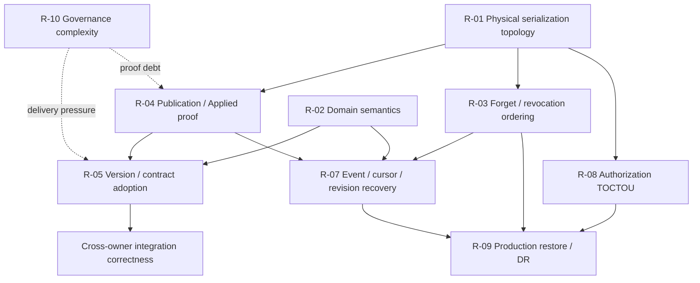

# R — Principal System-wide Architecture Risk Assessment

- Assessment ID: SYS-RISK-001
- Review date: 2026-11-17
- Repository: `oahcom/AiMemoryBrainArchitecture`
- Main baseline: `b372b62c640a2b656e54b6db62a4ee67d7d8c001`
- Review branch: `review/session-1-system-wide-risk-2026-11-17`
- Status: **PRELIMINARY SYSTEM-WIDE RISK ASSESSMENT — NOT AN ARCHITECTURE APPROVAL**
- Scope: A–I, Storage, cross-owner protocols, governance and production-operability implications.
- Evidence rule: Owner branch artifacts are candidate evidence only; branch existence is not approval, adoption, implementation or proof.
- Language: English; paired Chinese document: [SYS-RISK-001.zh-CN.md](SYS-RISK-001.zh-CN.md).

## 1. Executive disposition

**Disposition: NOT PROVEN / FREEZE NOT READY.** The logical decomposition is plausible, but the architecture is not yet demonstrated to preserve its invariants across the complete write, publish, recall, revoke/forget, recovery and restore paths. The highest systemic risk is not a single missing module: it is the absence of a selected physical serialization substrate and a single, exact, cross-owner state/authority model that can be shown to preserve safety under concurrency, partial failure, retries and recovery.

This assessment distinguishes:
- **VERIFIED** — directly established by the cited repository artifact or API state.
- **PARTIALLY VERIFIED** — a portion is evidenced, but the end-to-end claim is not.
- **NOT PROVEN** — no sufficient proof artifact was identified in the reviewed evidence.
- **BLOCKED** — a required upstream decision or evidence is explicitly unresolved.

A document, schema, candidate manifest, static test vector or CI result is not by itself proof of runtime behavior. No Rust implementation, database transaction, concurrency stress test, crash-injection test, security penetration test, restore drill or production benchmark was executed for this assessment.

### 1.1 System-wide conclusion

| Area | Assessment | Why |
|---|---|---|
| Logical responsibility decomposition | PARTIALLY VERIFIED | A's consolidation describes coherent separation of canonical memory, projections/context, provider side effects, authorization, wire contracts and storage. |
| Domain truth and epistemic semantics | BLOCKED | B Fact/Claim ADR remains ADR-BLOCKED; downstream typed semantics cannot be treated as fully settled. |
| Physical atomicity/serialization | BLOCKED | Storage topology ADR explicitly has no selected topology. |
| Exact protocol/schema compatibility | PARTIALLY VERIFIED | Newer candidate artifacts exist, but prior evidence shows mismatched version bindings; current branch heads moved and require fresh full bundle revalidation. |
| Forget/revocation and restore safety | NOT PROVEN | Contracts and gates exist; end-to-end no-resurrection proof across replicas, derivatives, caches, backups and replay was not established. |
| Applied/publication terminal truth | NOT PROVEN | Candidate outcome/participant contracts do not yet establish one complete authoritative proof chain across all owners. |
| Identity/scope/authorization composition | PARTIALLY VERIFIED | I owns relevant policy and enforcement contracts; system-wide non-bypass and TOCTOU closure were not demonstrated end-to-end. |
| Production operability/DR | NOT PROVEN | No selected topology, deployment/operations model, recovery objectives, tested restore or operational evidence was established. |

## 2. Review baseline and evidence limitations

### 2.1 Main baseline

Main HEAD at review start: `b372b62c640a2b656e54b6db62a4ee67d7d8c001`.

A separate review branch was created from that main commit:
`review/session-1-system-wide-risk-2026-11-17`.

The branch creation does not alter main, merge any Owner branch, approve an ADR, close a gate or authorize implementation.

### 2.2 Owner branch snapshot read during this assessment

| Owner | Branch | HEAD read |
|---|---|---|
| A | `session-a-integration-2026-11-16` | `d72dbac6e0f739cd00ac986176b78ec5cd385d88` |
| B | `session-b-domain-model-phase3` | `0df144ae25c2039c9934395fc88b2d17080eb119` |
| C | `session-c-agent-integration-2026-11-16` | `f3251081c49e697fe4739a252e27f59e2ecd0a8f` |
| D | `session-d-memory-brain-2026-11-16` | `97e68fbd225bdf0ac71860c01077481afc162d50` |
| E | `session-e-memory-compiler-2026-11-16` | `fdb4f67a83083d995930b88f93975b5ee36080f3` |
| F | `session-f-memory-runtime` | `8d5ef89ce9b1ff1471ffd1a03fe4f289addb0af3` |
| G | `session-g-memory-context` | `f9ca0ddc36e17f74041506f17039f0202d13042e` |
| H | `session-h-bmcp-protocol` | `f809be092a6c04db7982cc1bdbdd9c88787a4286` |
| I | `session-i-security-governance-2026-11-16` | `28df608b075e619563c6367a8a1c171185c1faaf` |
| Storage | `session-storage-consistency-forget-atomicity-2026-11-16` | `17be31915b06d98d7f822e6e5270b8cde39eb0bb` |

These are snapshot identifiers, not claims that every artifact in each branch was reviewed exhaustively. In particular, a moving branch must be re-pinned before a final freeze decision. The earlier Phase 2 evidence ledger on A's branch records an older snapshot; its own warning says changed Blobs require a new review. Therefore Phase 2 is useful historical evidence, not a substitute for this live snapshot.

### 2.3 Primary source artifacts

- A, `reviews/architecture-feasibility/phase-2-system-wide-consolidation.md` and `phase-2-exact-evidence-ledger.md` (A branch; exact Blobs recorded in that ledger).
- A, `reviews/architecture-feasibility/phase-2-contradiction-register.md` (A branch; ARC-01 onward).
- B, `02-domain-model/ADR-001-fact-claim-semantics.md` (B branch; confirm exact path/blob against the current branch before using as a normative binding).
- C, `07-agent-integration/phase-3.8.12-c-final-review-h-unified-1.2.13-csubmitoutcome-1.0.1-mapping.md` and associated validator review (C branch).
- D, `03-memory-brain/phase-3.8-d-publication-participant-and-terminal-contract.md` (D branch).
- E, `04-memory-compiler/phase-3.8-e-publication-orchestration-retry-recovery-contract.md` (E branch).
- F, `05-memory-runtime/phase-3.7-f-local-lifecycle-producer-derivative-queue-recall-context-restore.md` (F branch).
- G, `06-memory-context/phase-3.7-g-local-lifecycle-producer-derivative-queue-recall-context-restore.md` (G branch).
- H, `08-bmcp-protocol/phase-3.8.9-h-exact-mapping-unified-1.2.13-c-submit-outcome-1.0.1.md` (H branch).
- I, `09-security-governance/phase-3.8.9-i-p0-allowlists-unified-1.2.13-recoveryjoin-1.0.2.md` (I branch).
- Storage, `reviews/storage-consistency/phase-3.8.2-storage-serialization-topology-adr.md`, `phase-3.8-storage-visibility-participant-and-atomic-outcome-contract.md`, and `phase-3.6.15-storage-v3.2.5-protocol-bundle-exact-version-manifest.md` (Storage branch).

**Evidence limitation:** the exact B/D/E/F/G/H/I/Storage artifact paths above were located in their respective branch trees; the full contents of every cited artifact were not all re-read line-by-line in this pass. The assessment therefore treats specific claims as BLOCKED or NOT PROVEN where a full normative readback or exact binding is missing. This limitation is intentional and must not be hidden by confidence language.

## 3. Risk rating method

Probability is qualitative and based on (a) whether the root cause is explicitly unresolved, (b) the number of independent components whose behavior must align, and (c) whether a deterministic proof or enforcement point exists. Impact is based on the consequence for canonical truth, confidentiality, integrity, availability or recoverability.

- **Critical:** can invalidate a core system invariant or permit irreversible/cross-scope corruption; blocks architecture freeze.
- **High:** likely to create severe integration, security, recovery or production failure; blocks the affected gate.
- **Medium:** material but bounded risk with a credible containment path.
- **Low:** limited impact and no current evidence of systemic propagation.

Probability bands: High = root cause is explicit or many unsynchronized dependencies; Medium = plausible and partially constrained; Low = evidence indicates strong control but residual edge cases remain. Severity is not a numeric multiplication and is not inferred from document length.

## 4. System-wide Risk Register

| ID | Risk / root cause | Affected components | Probability / impact / level | Trigger and failure consequence | Required mitigation / architecture decision | Owner | Verification evidence and residual risk | Blocking gate |
|---|---|---|---|---|---|---|---|---|
| R-01 | **No selected physical serialization authority.** Logical visibility/atomic outcome is specified without a selected physical serialization topology. | D, I, Storage, E, F, G | High / Catastrophic / **Critical** | Concurrent publish vs forget/revoke, crash between writes, stale read or retry. Can expose partially committed state, publish after revocation, or produce conflicting terminal outcomes. | Select and approve one topology (e.g. a single serializable authority domain or a durable linearizable coordinator); define linearization point, lock/hold ownership, atomic write set, isolation, read authority, timeout and recovery semantics. Reject process-local mutex/check-then-write as substitutes. | Storage (physical topology), D (canonical publication/fence), I (revocation policy), A (integration gate) | Current Storage topology ADR is explicitly ADR-BLOCKED / no topology selected in A's contradiction register. Need selected ADR plus executable deterministic reference model and adversarial interleaving proofs. Residual risk: real DB/cluster behavior remains L4. | **BLOCKS architecture freeze and implementation of final visibility/forget path.** |
| R-02 | **Canonical semantic truth is not fully closed.** Fact/Claim distinction and evidence/temporal semantics remain subject to unresolved domain decision. | B, D, E, F, G, C | Medium–High / Catastrophic / **Critical** | Conflicting claims, source retraction, temporal correction, uncertain inference or identity merge. Wrong assertion can become canonical, contaminate retrieval/context and be difficult to retract. | B must decide normative Fact/Claim/Evidence/Confidence/valid-time/recorded-time semantics, provenance, correction and contradiction rules; downstream owners must explicitly adopt the exact decision. | B (domain authority), D/E/F/G (adoption), A (cross-owner verification) | Phase 2 contradiction register marks Fact/Claim ADR blocked; current B branch contains domain artifacts but no verified final ADR decision was established here. Residual risk: ontology evolution and migration. | **BLOCKS canonical schema freeze and semantic conformance.** |
| R-03 | **Forget/revocation lacks end-to-end no-resurrection proof.** Multiple lifecycle, derivative, cache, restore and backup paths must honor one revocation/fence state. | I, D, Storage, E, F, G, H, C | Medium–High / Catastrophic / **Critical** | Forget races with publication, projection rebuild, cache refill, replay, backup restore or delayed provider result. Deleted/revoked data may reappear or remain retrievable. | Define one authoritative forget state and monotonic fence; enumerate every copy/derivative/consumer; require fail-closed checks at read, write, replay, restore and reindex; specify retention/backup crypto-erasure and proof receipts; define ordering against in-flight provider operations. | I (global policy/authorization), D (canonical fence), Storage (durable ordering), E/F/G/C/H (consumer-specific enforcement) | Contracts and participant artifacts exist, but no complete end-to-end proof across all paths was verified. Residual risk: external backups and provider retention are operationally difficult. | **BLOCKS Forget/restore security gate and production data-handling approval.** |
| R-04 | **Applied/publication/provider outcome may have split authority.** Receipt, participant intent, provider side-effect and canonical publication are distinct facts but their terminal proof chain may not be unified. | C, D, E, G, H, Storage, I | High / Severe / **High** | Timeout after provider side effect; duplicate callback; lost receipt; partial participant commit; delivery acknowledged without canonical apply. System may report false success or repeat irreversible side effects. | Specify separate state machines and authoritative evidence for provider outcome, publication, canonical commit, delivery and applied acknowledgement; bind idempotency key, attempt identity, revision, principal and causal receipt; define UNKNOWN/IN_DOUBT and reconciliation semantics. | C (provider truth), D (canonical publication), E (orchestration), G (delivery/applied), H (wire), Storage (durability) | Candidate schemas/contracts exist; exact cross-owner terminal mapping and end-to-end fault proof not established. Residual risk: provider APIs with weak idempotency guarantees. | **BLOCKS end-to-end write/apply acceptance and external side-effect workflows.** |
| R-05 | **Exact-version drift across owners.** Schema, validator, mapping, manifest and adoption can advance independently. | C, D, E, H, I, Storage, A | High / Severe / **High** | One owner validates schema N while another emits N+1; an old approval is incorrectly assumed to cover a successor. Can cause silent field loss, incompatible state interpretation or authorization bypass. | Maintain one machine-checkable release/binding manifest listing exact artifact Blob, schema revision, validator revision, owner disposition and compatibility range; require fresh owner adoption and negative/positive vectors on any Blob change. | H (wire schema), C (outcome schema), Storage (bundle manifest), each adopting Owner, A (governance) | Phase 2 exact evidence ledger documented mismatches around H 1.2.12/1.2.11 and CSubmitOutcome 1.0.1/1.0.0; newer 1.2.13/1.0.1 candidate files were located on current owner branches. A complete all-owner exact binding re-read is still required. Residual risk: coordinated rollout/skew. | **BLOCKS contract freeze and multi-owner release.** |
| R-06 | **Identity, scope, principal, actor and environment are not proven as one end-to-end security context.** Policy ownership and per-boundary enforcement may be distributed. | B, C, D, E, F, G, H, I, Storage | Medium / Catastrophic / **High** | Delegation, tenant switch, async job, replay, restore or confused-deputy path loses or substitutes principal/scope/actor/environment. Cross-user or cross-tenant data access may occur. | Define canonical identity tuple and trust transitions; cryptographically bind principal/scope/actor/environment to requests, receipts, events and derived objects; specify delegation, revocation, service identity and non-bypass enforcement at every protected boundary. | I (security authority), B (identity semantics), C/H (ingress/wire), D/E/F/G/Storage (enforcement) | I authorization artifacts and allowlists exist, but this assessment did not verify every path or adversarial confused-deputy proof. Residual risk: credential lifecycle and external identity provider compromise. | **BLOCKS security architecture acceptance and tenant-isolation claims.** |
| R-07 | **Recovery/replay/cursor/revision/manifest semantics can diverge.** Durable ordering, recovery cutoff, replay position and projection revision need one consistent model. | Storage, D, E, F, G, H, I | Medium–High / Severe / **High** | Crash after durable append but before projection; stale cursor; partial manifest; replay across forget fence; duplicate/out-of-order event. Can lose, duplicate or resurrect state. | Specify event identity and ordering scope; durable commit point; cursor monotonicity; revision/manifest binding; replay idempotency; recovery cutoff; rebuild-from-authority rules; handling of gaps and poison events. | Storage (durable log/manifest), D (canonical revision), E (compiler/replay orchestration), F/G (projections/context), H (wire) | Phase 2 identifies incomplete reference-model evidence for publication/Forget/recovery. Newer recovery-join artifacts exist, but full crash/replay model not verified. Residual risk: storage-engine and replica failure behavior. | **BLOCKS recovery correctness gate and disaster-recovery acceptance.** |
| R-08 | **Authorization and policy TOCTOU across async publication.** Authorization may be checked at admission but become invalid before publication or restore. | I, C, D, E, Storage, H | Medium–High / Severe / **High** | Revoke/permission change races with queued or in-flight work; stale authorization receipt accepted after expiry or policy epoch change. Unauthorized publication/provider action occurs. | Define policy epoch and receipt validity; serialize or atomically validate authorization against publication; specify revocation cutover and in-flight cancellation/compensation semantics; fail closed when policy authority unavailable. | I (policy), D/Storage (linearization), C/E/H (execution boundary) | Authorization receipt contracts are present in branch evidence; no complete TOCTOU interleaving proof verified. Residual risk: external side effect cannot always be compensated. | **BLOCKS revocation-sensitive publication and provider egress.** |
| R-09 | **Operational architecture and disaster recovery are under-specified relative to safety claims.** No selected physical topology or proven operational recovery model. | Storage, I, D, A; all runtime owners | Medium / Severe / **High** | Region loss, key loss, coordinator outage, partial restore, operator error, schema rollback or prolonged partition. Service may be unavailable or restore unsafe data. | After L1 topology decision, define deployment units, failure domains, RPO/RTO, key custody/rotation, backup/restore ordering, failover fencing, observability, runbooks and tested restore drills. | Storage (platform topology), I (key/security policy), A (operational gate), service owners | NOT PROVEN: no deployment architecture, tested DR drill, RPO/RTO or production evidence was established in this pass. This is a later L4 gate, not a reason to reject a coherent L1 design by itself. | **BLOCKS production deployment and operational readiness.** |
| R-10 | **Governance/contract complexity may exceed engineering value.** Many owners, phases, exact-version manifests and cross-review gates can create a second system whose maintenance cost exceeds the product. | A–I, Storage, engineering governance | Medium / High / **High** | Repeated successor manifests and local amendments without executable conformance; review queues grow; owners optimize document status over product invariants; implementation stalls or forks. | Measure governance cost and defect-prevention yield; consolidate duplicate state machines and artifacts; define a minimal normative core, machine-checkable contracts and risk-proportionate gates; establish deprecation/expiry for candidate docs. Do not weaken safety invariants to reduce paperwork. | A (governance), all Owners (contract simplification), engineering lead (delivery economics) | Phase 2 evidence ledger itself warns that branch artifacts and candidates must be re-pinned; extensive cross-owner exact binding is ongoing. Actual cost/benefit is NOT PROVEN without delivery and defect data. Residual risk: under-governance if simplification is excessive. | **Blocks sustainable delivery; does not alone invalidate core correctness.** |

## 5. Root-first ordering and answers to the required questions

### A. Ten most fundamental risks
R-01 through R-10 above are ranked by system dependency, not module ownership. R-01 through R-03 threaten the existence of a correct canonical system; R-04 through R-08 threaten cross-component correctness and security; R-09 threatens production operation; R-10 threatens long-term engineering viability.

### B. Risks that can invalidate system correctness
R-01, R-02 and R-03 are correctness-critical. R-04, R-06, R-07 and R-08 can also invalidate correctness or confidentiality under specific interleavings. Until their proof obligations close, correctness is **NOT PROVEN**.

### C. Architecture decisions without closure
1. Storage serialization topology and linearization authority.
2. B Fact/Claim and evidence/temporal semantic decision.
3. Canonical state authority and exact event/revision/cursor/manifest relationship.
4. Publication/Applied/provider outcome terminal-state and receipt authority.
5. Global Forget/revocation ordering against in-flight publication, replay, derivative rebuild and restore.
6. Identity tuple, delegation and policy-epoch semantics across async boundaries.
7. Exact version bundle adoption for H/C and all consumers.
8. Deployment/failure-domain and recovery objectives (L4; must follow L1 topology).

### D. Risks amplified by integration
R-01, R-03, R-04, R-05, R-06, R-07 and R-08 are multiplicative. Individually correct local contracts can still disagree on: which event is authoritative; whether an operation is committed; which version is validated; which principal authorized it; whether a forget fence dominates replay; and whether a timeout means failure or unknown outcome.

### E. Risks that cause expensive implementation rework
Resolve R-01/R-02/R-04/R-05/R-06/R-07 before final schema, persistence layout, queue, index, cache, receipt, provider adapter and migration implementation. Otherwise storage and service boundaries may encode incompatible assumptions and require destructive migrations or protocol redesign.

### F. Production blockers
R-01 is an architecture blocker; R-03/R-06/R-08 block safety/security claims; R-07/R-09 block recovery/operability acceptance. Real deployment evidence (database behavior, key operations, DR drills, SLOs) is L4 and cannot be replaced by design documents.

### G. Apparently safe but unproven mechanisms
- ForgetFence/deny-list/allowlist: must prove every read, write, replay, restore and derivative path checks the same authoritative fence.
- Receipt/quorum/manifest: must prove it is atomically bound to the state it claims to certify and cannot be replayed across principal, revision or epoch.
- Applied/terminal outcome: must distinguish delivery, provider side effect, canonical publication and user-visible application.
- Idempotency: must prove stable key scope and behavior under timeout after side effect.
- RecoveryJoin/cursor: must prove monotonicity, gap handling, cutoff and replay dominance.
- Encryption/crypto-erasure: must prove key hierarchy, backup copies, rotation and irrecoverability, not merely field presence.

### H. Locally correct, globally incorrect combinations
Examples to test explicitly:
1. D publishes after a local admission check while I revocation commits concurrently.
2. Storage durably records a participant but D's canonical pointer is not visible; retry sees a different terminal state.
3. H validator accepts a newer schema while C/D/I still interpret an older projection.
4. F rebuilds a derivative from an event stream after D has advanced ForgetFence.
5. G marks a context delivered/applied while canonical publication remains IN_DOUBT.
6. A restored backup contains a pre-forget snapshot and is exposed before fence replay completes.
7. A provider action succeeds but its receipt is lost; retry duplicates the external effect.

### I. Governance complexity risk
Yes. It is **High**, but currently only PARTIALLY VERIFIED. The risk is not “too many documents” by itself; it is that the governance mechanism may become a parallel control plane with manual version bookkeeping and repeated prose contracts but no executable single source of truth. Track lead time, review wait time, duplicate artifacts, superseded-document rate, conformance automation coverage and escaped cross-owner defects. Simplify process only after invariants are machine-checkable.

## 6. Critical architecture risk analysis

### 6.1 R-01 — Atomicity is a property of a selected physical authority, not a diagram
A logical final-visibility transaction is insufficient unless one physical serialization authority decides the winner for publication, forget and revocation. The ADR must specify the serialization domain and what is linearized together. A local mutex, per-process queue, optimistic check-then-write or eventually consistent replica cannot provide a global ordering across independent writers and recovery.

**Closure proof:** selected topology ADR; formal state transition/linearization model; enumerate all conflicting operations; model-check or deterministic exhaustive interleaving tests; crash points before/after every durable write; retry and recovery conformance. Production DB validation remains a separate L4 gate.

### 6.2 R-02 — Canonical memory cannot be more certain than its epistemology
If Fact, Claim, Evidence, inference, confidence, valid time and recorded time are not normatively distinct, the system can promote uncertain or superseded information into canonical truth. This contaminates every retrieval and context consumer. The domain decision must specify correction, contradiction, source withdrawal and temporal queries before schema freeze.

**Closure proof:** B decision with stable semantic definitions; examples and counterexamples; downstream adoption matrix; conformance vectors for contradictory, stale, inferred and retracted claims; migration strategy.

### 6.3 R-03 — Forget must dominate all future paths, not merely delete one row
Forget is a temporal and distributed invariant. Deleting canonical content while leaving events, caches, vector indexes, summaries, contexts, backups or in-flight work capable of recreating it is not successful forgetting. A restore must not make forgotten material visible even transiently.

**Closure proof:** complete data-copy/derivative inventory; single authoritative monotonic fence; publication/replay/restore protocol; fail-closed behavior during uncertainty; backup/key policy; adversarial tests with restore-before/after-fence, delayed queue, duplicate event and index rebuild.

### 6.4 R-04 — “Applied” must not collapse distinct facts
Provider execution, provider receipt, canonical publication, durable commit, context delivery and consumer application are different facts. A single boolean or overloaded receipt creates false-success and duplicate-side-effect risks.

**Closure proof:** owner-approved state machines; unique operation/attempt/idempotency identity; explicit UNKNOWN/IN_DOUBT and reconciliation; proof binding principal, revision, payload digest and policy epoch; fault-injection tests at every boundary.

## 7. Risk dependency graph

Dependency rule: downstream implementation cannot close an upstream architecture blocker by adding local code. For example, more retries do not resolve an undefined linearization point; more manifests do not settle domain semantics; deleting a cache does not prove restore safety.

## 8. Unresolved Architecture Decisions

| Decision ID | Decision required | Decision authority | Current status | Required closure |
|---|---|---|---|---|
| UAD-01 | Physical serialization topology and linearization point | Storage + D + I; A integration | BLOCKED | Select topology; specify transaction domain, fencing, durable coordinator if any, read consistency and recovery. |
| UAD-02 | Fact/Claim/Evidence/temporal semantics | B | BLOCKED | Approved ADR; downstream adoption; conformance cases. |
| UAD-03 | Canonical event/revision/cursor/manifest authority | D + Storage + E/F/G/H | NOT PROVEN | Normative identity, ordering, commit and replay rules. |
| UAD-04 | Provider outcome vs publication vs Applied terminal states | C + D + E + G + H + Storage | NOT PROVEN | State-machine composition and fault model. |
| UAD-05 | Forget/revocation vs in-flight publication and restore | I + D + Storage | NOT PROVEN | Linearized cutover and end-to-end no-resurrection proof. |
| UAD-06 | Principal/scope/actor/environment and delegation model | I + B + C/H | PARTIALLY VERIFIED | Exact identity context and boundary conformance. |
| UAD-07 | Exact compatible protocol/schema bundle | H + C + Storage + adopting Owners | PARTIALLY VERIFIED | Fresh exact-version manifest and owner approvals. |
| UAD-08 | Deployment, failover, backup and DR objectives | Storage + I + A | NOT PROVEN (L4) | Deployment ADR, RPO/RTO, key custody, restore drill and runbooks. |
| UAD-09 | Governance minimum viable control plane | A + all Owners | NOT PROVEN | Cost/benefit metrics and executable conformance strategy. |

R does not decide these on behalf of their owners. This assessment identifies the decision and the evidence required.

## 9. Risk closure criteria

A risk is not closed by writing a document or merging a PR. Closure requires:
1. Named authority makes the required decision; status is explicit.
2. Exact source Blob/commit and downstream adopted versions are pinned.
3. All affected owners confirm semantic compatibility; no implied adoption.
4. Positive, negative, concurrency, crash, retry and recovery cases exist where applicable.
5. Evidence is reproducible and independently read back.
6. Residual risk, scope and operational assumptions are explicit.
7. Gate owner records a separate disposition; no automatic gate closure.

### Per-risk minimum closure
- **R-01:** topology ADR + linearizability model + interleaving/crash/retry proof.
- **R-02:** B normative ADR + typed semantics + contradiction/temporal vectors + adoption.
- **R-03:** full data lineage inventory + no-resurrection proof including restore and derivatives.
- **R-04:** separated state machines + exact receipt/idempotency binding + fault-injection/reconciliation proof.
- **R-05:** machine-readable exact bundle + all-owner re-review + version skew tests.
- **R-06:** canonical identity/delegation model + every-boundary authorization matrix + confused-deputy tests.
- **R-07:** event/cursor/revision/manifest reference model + crash/replay/gap/duplicate tests.
- **R-08:** policy-epoch/receipt validity + revocation-vs-publication interleaving proof.
- **R-09:** deployment and threat model + RPO/RTO + key custody + successful restore/failover drill.
- **R-10:** governance metrics + automated conformance coverage + evidence that duplicate/manual work is declining without weakening safety.

## 10. Root-first remediation recommendations

1. **Freeze new downstream semantic commitments** that depend on unresolved B semantics or Storage topology; continue non-dependent research only.
2. **Resolve UAD-01 first:** Storage/D/I jointly select the physical serialization and visibility authority. No implementation shortcut may substitute for this decision.
3. **Resolve UAD-02:** B closes Fact/Claim and temporal/evidence semantics; downstream owners publish explicit adoption.
4. **Compose publication and security state machines:** C/D/E/G/H/I/Storage define the same operation identity, principal, policy epoch, provider outcome, canonical commit and Applied semantics.
5. **Prove Forget dominance:** enumerate canonical and derived copies, then prove write/replay/restore cannot resurrect fenced content.
6. **Reconcile exact versions:** regenerate one authoritative bundle manifest from exact Blobs and require fresh owner reviews; retire stale references explicitly.
7. **Prove recovery:** define event/cursor/revision/manifest ordering and test all crash/retry boundaries against the selected topology.
8. **Only then freeze implementation-facing contracts** and proceed to L4 deployment, performance, security operations and DR validation.
9. **Reduce governance overhead with automation:** machine-check exact references, bilingual parity, schemas, state transitions and conformance vectors; do not replace evidence with status labels.

## 11. Scope boundaries and explicit non-findings

- This assessment does not declare that the project is impossible. It declares core correctness **NOT PROVEN** at this snapshot.
- It does not claim a production data leak, data loss or provider duplicate has occurred.
- It does not claim that the presence of Rust code, tests or CI proves or disproves architecture.
- It does not approve, reject or rewrite any Owner's normative ADR.
- It does not merge Owner branches, close Issue #43, approve a freeze or authorize production deployment.
- It does not assess detailed benchmark feasibility or actual cloud/provider costs; these require a selected topology and engineering workload.

## 12. Source references

All references are branch-qualified. Re-read the exact artifact and Blob before using it for a later gate decision.

1. Main baseline: `b372b62c640a2b656e54b6db62a4ee67d7d8c001`.
2. A Phase 2 consolidation: `reviews/architecture-feasibility/phase-2-system-wide-consolidation.md`; Blob `6f5fbe13a5c12ab6cad833b2326ae595f8d047d0` on A review branch `review/arch-consol-001-system-wide-2026-11-17`.
3. A exact evidence ledger: `phase-2-exact-evidence-ledger.md`; Blob `8be676b28d32efd1f214f8644010f187eb6b3c17` on same branch.
4. A contradiction register: `phase-2-contradiction-register.md`; Blob `0fb013e7148acfc3d042dd6be310c61c9632ad3d` on same branch. ARC-01 records Storage topology ADR Blob `080433f8e13a500522bc2754da64057edb0ae9d8` as ADR-BLOCKED / no topology selected; ARC-02/03 record H/C version-binding drift.
5. B branch HEAD `0df144ae25c2039c9934395fc88b2d17080eb119`; Fact/Claim ADR must be confirmed at exact path/Blob before normative reliance.
6. C branch HEAD `f3251081c49e697fe4739a252e27f59e2ecd0a8f`; Phase 3.8.12 mapping and validator artifacts.
7. D branch HEAD `97e68fbd225bdf0ac71860c01077481afc162d50`; Phase 3.8 publication participant/terminal contract.
8. E branch HEAD `fdb4f67a83083d995930b88f93975b5ee36080f3`; Phase 3.8 publication orchestration/retry/recovery contract.
9. F branch HEAD `8d5ef89ce9b1ff1471ffd1a03fe4f289addb0af3`; Phase 3.7 lifecycle/derivative/restore artifact.
10. G branch HEAD `f9ca0ddc36e17f74041506f17039f0202d13042e`; Phase 3.7 lifecycle/context/restore artifact.
11. H branch HEAD `f809be092a6c04db7982cc1bdbdd9c88787a4286`; Unified 1.2.13 mapping artifact.
12. I branch HEAD `28df608b075e619563c6367a8a1c171185c1faaf`; authorization allowlist/RecoveryJoin artifact.
13. Storage branch HEAD `17be31915b06d98d7f822e6e5270b8cde39eb0bb`; topology ADR, visibility contract and v3.2.5 manifest.
14. Bilingual policy: `00-governance/bilingual-documentation-policy.md`; Blob `b51b054b9f1022133666542680df74dfe19de2fb` on main. It requires paired Chinese/English architecture documents and semantic parity.

---
**Final status: NOT READY FOR ARCHITECTURE FREEZE.** This is a risk assessment disposition, not a gate closure decision.

## 13. Live source refresh and risk-status correction — 2026-11-17

This section adds the exact Owner artifact readback performed in the current R session. It does not replace the risk IDs above or promote a candidate proposal into an approval decision. Owner HEADs and Blobs:

| Owner | Current branch HEAD | Exact artifact path | Blob SHA | Status directly confirmed in this read |
|---|---|---|---|---|
| B | 0df144ae25c2039c9934395fc88b2d17080eb119 | 02-domain-model/ADR-001-fact-claim-semantics.md | a1024938ff5baba069cf128c69496a44e143330c | ADR-BLOCKED; no formal governance authority, approver, date or decision; B recommendation remains Candidate |
| C | f3251081c49e697fe4739a252e27f59e2ecd0a8f | 07-agent-integration/phase-3.8.12-c-final-review-h-unified-1.2.13-csubmitoutcome-1.0.1-mapping.md | 92ed89a308ad97f6846960bb7182e0916949978e | Current C review artifact for H 1.2.13 / CSubmitOutcome 1.0.1 exists; this does not imply all consumers approved it or current CI passed |
| C | same HEAD | 07-agent-integration/phase-3.8.12-c-exact-review-h-1.2.13-c-submit-outcome-1.0.1-validator.md | c1dcc4049205b8b9315e3b284433625e9893a711 | Exact Validator review artifact exists; current branch CI and formal Owner decision remain separate evidence |
| D | 97e68fbd225bdf0ac71860c01077481afc162d50 | 03-memory-brain/phase-3.8-d-publication-participant-and-terminal-contract.md | 17e53890dd6cce9bea9eacc1be2e64b0ef55ac78 | D-role proposal; independent D Owner approval, callable API and conformance OPEN; UNKNOWN/IN_DOUBT keeps barriers open |
| E | fdb4f67a83083d995930b88f93975b5ee36080f3 | 04-memory-compiler/phase-3.8-e-publication-orchestration-retry-recovery-contract.md | 475fee41e5eea527af4edefbfe88c58c86967d0a | E-role proposal; D/I/Storage APIs and independent Owner approval OPEN; local state does not establish D ProducerWork terminality |
| F | 8d5ef89ce9b1ff1471ffd1a03fe4f289addb0af3 | 05-memory-runtime/phase-3.7-f-local-lifecycle-producer-derivative-queue-recall-context-restore.md | 29e9504c75d737c2dd200ebc3306eda555f0b0ac | F-local proposal; cross-Owner interfaces/implementation OPEN; IndexWatermark is partition-local contiguous coverage, not Forget completion proof |
| G | f9ca0ddc36e17f74041506f17039f0202d13042e | 06-memory-context/phase-3.7-g-local-lifecycle-producer-derivative-queue-recall-context-restore.md | c1de241ec69834377d9b0e24aa4770a809796d4b | G-local proposal; C/G/H delivery and cross-Owner interfaces OPEN; Transport ACK is not Applied |
| H | f809be092a6c04db7982cc1bdbdd9c88787a4286 | 08-bmcp-protocol/phase-3.8.9-h-exact-mapping-unified-1.2.13-c-submit-outcome-1.0.1.md | 32bf9b0fd42abe8b58749b858b1d5c9aef39c5fd | CURRENT SUCCESSOR MAPPING CANDIDATE; exact CI rerun required; not frozen; latest tests are not tied to a run on the exact HEAD read here |
| I | 28df608b075e619563c6367a8a1c171185c1faaf | 09-security-governance/phase-3.8.9-i-p0-allowlists-unified-1.2.13-recoveryjoin-1.0.2.md | 5c0e2049513d391dfc118f4f629a5ec95de456d6 | I-owned P0 projection candidate; production profile, trust roots, key custody, anti-rollback and complete P0 vectors remain open |
| Storage | 17be31915b06d98d7f822e6e5270b8cde39eb0bb | reviews/storage-consistency/phase-3.8.2-storage-serialization-topology-adr.md | 1ef47d4e5711c7db73a24d249adf1992be1f6aa4 | ADR-BLOCKED; candidate options only, no topology selected; T1–T8 all OPEN |
| Storage | same HEAD | reviews/storage-consistency/phase-3.8-storage-visibility-participant-and-atomic-outcome-contract.md | 175ee7b1349cfdb79a19898b311a88391ed88010 | Logical transaction proposal; physical topology, cross-Owner APIs, read-path enforcement and implementation proof OPEN |
| Storage | same HEAD | reviews/storage-consistency/phase-3.6.15-storage-v3.2.5-protocol-bundle-exact-version-manifest.md | bea90697e7a61d43bed00543d636a5cdf40cf5ca | Successor bundle published; NOT JOINTLY ACCEPTED / NOT FROZEN |
| A | 4f3181fdf9d5b7785887381fde83e33026308c31 | reviews/architecture-feasibility/phase-2-system-wide-consolidation.md | 6f5fbe13a5c12ab6cad833b2326ae595f8d047d0 | A Phase 2 historical consolidation snapshot; does not replace current Owner HEAD revalidation |
| A | same HEAD | reviews/architecture-feasibility/phase-2-exact-evidence-ledger.md | 8be676b28d32efd1f214f8644010f187eb6b3c17 | Exact evidence and historical version ledger; must be refreshed when Blobs change |
| A | same HEAD | reviews/architecture-feasibility/phase-2-contradiction-register.md | 0fb013e7148acfc3d042dd6be310c61c9632ad3d | ARC-01 through ARC-10 are integration contradiction leads, not substitutes for R's root-risk model |

### 13.1 Evidence boundaries and CI interpretation

- The current H Mapping file explicitly states **CANDIDATE / EXACT CI RE-RUN REQUIRED / NOT FROZEN**. H Recovery Cutoff CI run 44042074640 was on head `fb9a2ab8b528c2b7010d935372f76a14d6676755`, not the H HEAD read here (`f809be092a6c04db7982cc1bdbdd9c88787a4286`); it therefore does not prove the current H 1.2.13/C 1.0.1 bundle.
- H Provider Outcome CI run 44063916718 was on head `c326e561145e9558f48f199128814643d8720e45`, also not the current C branch HEAD (`f3251081c49e697fe4739a252e27f59e2ecd0a8f)); it is not exact-head end-to-end proof for the current mapping.
- Storage PostgreSQL 18.7 Prepared-XID/PITR capability run 43958775001 is bounded engine-capability evidence. It does not prove the real Canonical Authority topology, COC/JF-10/I/D integration, production read path or production deployment.
- Current D/E/F/G files explicitly distinguish local proposals from cross-Owner acceptance and implementation conformance. Role simulation is not an independent Owner signature.
- Issue #43 remains Open. This R report does not replace A's G1–G8 integration disposition or close any Owner Gate.

### 13.2 Status correction to the original risk register

The original ten risk IDs remain unchanged: R-01 physical serialization; R-02 canonical semantics; R-03 Forget/anti-resurrection; R-04 Applied/Publication/Provider Outcome; R-05 exact-version drift; R-06 Identity/Scope; R-07 Recovery/Cursor; R-08 authorization TOCTOU; R-09 production DR; R-10 governance complexity.

After this refresh:
- R-01, R-02 and R-03 remain **Critical / BLOCKED or NOT PROVEN**.
- R-04 through R-10 remain **High / NOT PROVEN or BLOCKED**; R-04's semantic boundaries are clearer, but exact-bundle adoption, cross-Owner approvals and end-to-end proof remain open.
- More candidate artifacts do not, by themselves, reduce risk. Risk can be downgraded only after exact-version adoption, authority approval and reproducible verification.
- No new evidence found in this pass is sufficient to mark any Critical/High risk CLOSED.

## 14. R-01 live source delta — 2026-11-17 / supersedes stale topology wording

A targeted live refresh of the D and Storage Owner branches changes the *L1 logical-decision* status of R-01. It does not close R-01 as a whole.

### 14.1 Exact current source pins

| Owner | Branch | Current HEAD read | Exact artifact | Blob SHA | Directly read disposition |
|---|---|---|---|---|---|
| Storage | `session-storage-consistency-forget-atomicity-2026-11-16` | `830a559bd2f4ec72608f5a51e1a0b43779f2b989` | `reviews/storage-consistency/phase-3.8.2-storage-serialization-topology-adr.md` | `bb544ba2f346bdc130d524bd5c7310d86f367988` | L1 logical Option A selected in §§8–8.7; L4 engine/deployment remains OPEN |
| Storage | same HEAD | same | `reviews/storage-consistency/phase-3.8-storage-visibility-participant-and-atomic-outcome-contract.md` | `175ee7b1349cfdb79a19898b311a88391ed88010` | Storage-role logical proposal; its §7 candidate wording is superseded for L1 only by the later ADR addendum; implementation proof remains OPEN |
| D | `session-d-memory-brain-2026-11-16` | `194c4c8d64972547cdbcf3fe64bd806c4d1d6a2f` | `03-memory-brain/phase-3.8-d-publication-participant-and-terminal-contract.md` | `17e53890dd6cce9bea9eacc1be2e64b0ef55ac78` | D-role proposal; D/Storage physical serialization authority, independent D approval, callable API and conformance remain OPEN |

### 14.2 Corrected R-01 assessment

The Storage ADR's §8 addendum selects **Option A as the normative v1 L1 logical architecture**: one logical serializable transaction domain and one durable `CanonicalAuthoritySerializationAnchor` per `BrainAuthorityRef`. Its §8.7 makes the anchor concrete: protected D admission/dependency/participant/fence transitions and Storage final visibility/NO_PUBLICATION transitions update the same anchor and append the transition record in the same transaction. The transaction commit is the linearization point. It also preserves the semantic authority split: D owns ForgetFence and participant semantics; Storage owns physical serialization and visibility; I remains the independent PolicyDomain authority; COC remains a separate quorum log.

This supersedes the ADR's earlier pre-addendum “no option selected” wording **for L1 only**. The old R-01 statement that the Storage topology ADR is wholly ADR-BLOCKED is stale and must not be repeated as the current L1 status.

However, the D artifact still labels itself a D-role proposal and explicitly leaves D/Storage physical serialization authority and independent D approval OPEN. The Storage visibility contract also remains a logical proposal with implementation proof OPEN. Therefore the Storage-side L1 selection is **VERIFIED as text in the current Storage artifact**, but cross-owner D adoption/approval is **NOT PROVEN**. It is not a jointly approved D+Storage contract and not an implemented topology.

### 14.3 R-01 status by layer

| Layer | Updated status | Reason |
|---|---|---|
| L1 logical topology choice | PARTIALLY VERIFIED | Storage's current ADR selects Option A and defines the anchor; D's current proposal has not adopted/approved the common physical serialization authority |
| Cross-owner semantic/transaction boundary | NOT PROVEN | Exact D/Storage row ownership, API, transaction boundary and independent D approval remain open |
| L3 deterministic logical/physical race proof | NOT PROVEN | Required interleavings and lost-ACK/restore cases are specified, but no exact current-head joint proof bundle was verified in this pass |
| L4 engine/deployment/conformance | BLOCKED / OPEN | Actual DB product/configuration, deployment, operator, HA/PITR, authoritative read path, old-primary fencing and physical crash/failover/restore drills remain open |

R-01 remains **Critical / OPEN** and continues to block architecture freeze and final implementation of the visibility/Forget path. The risk is narrowed: the missing item is no longer “no L1 topology proposal/choice anywhere”; it is cross-owner adoption plus L3/L4 proof and conformance. No risk downgrade or gate pass is authorized.

### 14.4 Required next closure evidence

1. D explicitly reviews and adopts/rejects the exact Storage ADR Blob `bb544ba2f346bdc130d524bd5c7310d86f367988`, including §8.7 anchor identity, protected transition list, nominal type boundaries and fail-closed behavior.
2. D and Storage publish a joint exact-version transaction/row-ownership/API contract, including the authority that owns each row and who may append each transition.
3. Demonstrate both serial orders for Fence vs ProducerWork admission, dependency registration, PublicationParticipant admission and final Visibility commit; include I REVOCATION_WON vs COMMIT_WON, serialization retry, lost ACK, primary failover, stale-primary rejoin and restore rollback.
4. Tie deterministic test results to the exact D/Storage source HEADs and schema/adapter revisions; no historical CI run substitutes.
5. Keep L4 OPEN until actual engine/configuration, authoritative read-path, HA/PITR, operator and physical fault/restore evidence are named and verified.

**No Owner approval is inferred from this R review.** This addendum is an independent risk-status correction only.

## 15. R-02 live source delta — Fact / Claim canonical semantics / 2026-11-17

### 15.1 Exact current B source pins

| Source | Current B branch HEAD | Exact path | Blob SHA | Directly observed status |
|---|---|---|---|---|
| B ADR-001 | `2faf8ec38f14dba49e7263d7a60804dae1a74ee2` | `02-domain-model/ADR-001-fact-claim-semantics.md` | `a1024938ff5baba069cf128c69496a44e143330c` | ADR-BLOCKED; no formal decision authority, approver, timestamp, approved option or approval record |
| Domain Model Overview | same HEAD | `02-domain-model/domain-model-overview.md` | `4d1debc0ec19b3917f9e76d04bb66da4df4cd346` | DECIDED baseline text says Claim is canonical proposition object and Fact is a qualified interpretation, not a separate object type at this stage |
| Architecture Invariants | same HEAD | `00-governance/architecture-invariants.md` | `66266667bdbb1cf15a2644fa98db5ecaaf3bb23b` | I-04 states Event, Memory, Fact, Entity, Relation and Evidence are distinct domain concepts |
| Design Principles | same HEAD | `00-governance/design-principles.md` | `192e6ba6e9287792a02b679dda0d391844270228` | P-04 states Event, Memory, Fact, Entity, Relation and Evidence are different objects |
| Consumer Mapping | same HEAD | `02-domain-model/fact-claim-consumer-mapping.md` | `dd45a37199c9b69ab6b68f65e051a484a04691d4` | CANDIDATE; canonical Fact/Claim portions explicitly ADR-BLOCKED |

The ADR's own “Last reviewed baseline” is `ab19afbf92f67fe0a7679e9aa3a35b015fed89f4`, not the current B HEAD. The current branch readback above controls this assessment; the embedded baseline label is stale and must not be treated as a current source pin.

### 15.2 Normative conflict and current decision state

The conflict is substantive:

- Governance I-04 and P-04 name Fact and Claim as distinct domain concepts / objects.
- The current Domain Model Overview says Claim is the canonical proposition object and “Fact” is a qualified interpretation of a Claim, not a separate object type at this stage.
- ADR-001 explicitly records this as a normative baseline conflict, not a naming-only discrepancy, and says B cannot resolve it unilaterally.
- B recommends Option A (separate Fact attestation object) as a candidate, conditional on a real independent-attestation use case and D/I agreement. It is not a decision.
- The consumer mapping keeps both branches conditional and explicitly prohibits canonical Fact/Claim identity fields from being frozen before ADR approval.

Therefore R-02 is **BLOCKED at governance decision level**, not merely underspecified. Neither Option A nor Option B is normative. The current overview wording cannot silently amend I-04/P-04, and B's Option A recommendation cannot silently approve a new canonical Fact identity.

### 15.3 Cross-owner impact

Until a formal decision is recorded:
- E must keep CandidateProposition / ExtractionIR neutral and must not assign canonical ClaimRef or FactRef.
- D must not freeze canonical Fact/Claim schema, IDs, storage or API shape.
- F/G must not assume FactRef or collapse a fact-qualified view into a stable canonical field.
- H must not freeze Fact/Claim wire fields.
- C telemetry remains source/producer observation, not Fact attestation.
- Consumer mapping remains candidate; no consumer branch artifact or implementation is evidence of governance approval.

The candidate mapping has useful safeguards (exact ClaimRevision targeting, evidence/provenance linkage, no confidence-only Fact promotion, immutable correction/retraction history and conflict preservation). These are design constraints, not a substitute for choosing the canonical object model.

### 15.4 R-02 closure criteria

1. Name the formal Architecture Governance authority and decision rights in a normative governance artifact.
2. Record a timestamped Option A or Option B decision with named authorized approver(s), rationale and accepted use cases.
3. If Option A: define Fact/FactRevision identity, exact ClaimRevisionRefs, attestor ActorRef, method/version, evidence, Scope, validity, revocation/supersession and I authorization; D owns canonical commit.
4. If Option B: formally amend I-04/P-04 and every affected baseline/terminology reference through authorized change control; define the exact ClaimRevision qualification object and historical semantics.
5. Obtain explicit B/D/E/F/G/H/I consumer mapping acceptance against exact artifact Blobs; preserve no-inference boundaries for C telemetry and extraction confidence.
6. Publish migration/compatibility and conformance vectors for creation, correction, retraction, conflict, expiry/revocation, temporal validity and as-of reads.

R-02 remains **Critical / BLOCKED** and blocks canonical schema/identity freeze. No option is selected by this R review; no governance authority is simulated or replaced.
