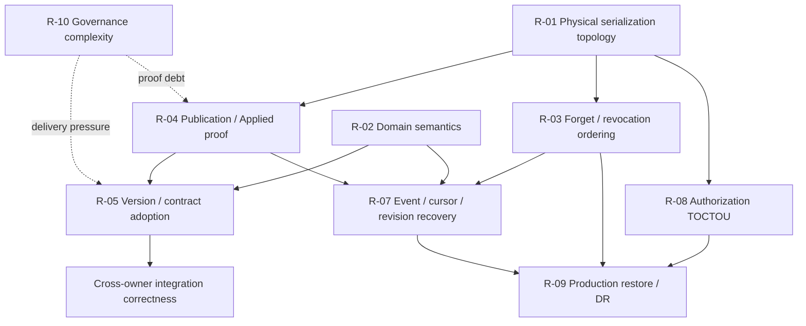

# R — Principal System-wide Architecture Risk Assessment

- Assessment ID: SYS-RISK-001
- Review date: 2026-11-17
- Repository: `oahcom/AiMemoryBrainArchitecture`
- Main baseline: `b372b62c640a2b656e54b6db62a4ee67d7d8c001`
- Review branch: `review/session-1-system-wide-risk-2026-11-17`
- Status: **PRELIMINARY SYSTEM-WIDE RISK ASSESSMENT — NOT AN ARCHITECTURE APPROVAL**
- Scope: A–I, Storage, cross-owner protocols, governance and production-operability implications.
- Evidence rule: Owner branch artifacts are candidate evidence only; branch existence is not approval, adoption, implementation or proof.
- Language: English; paired Chinese document: [SYS-RISK-001.zh-CN.md](SYS-RISK-001.zh-CN.md).
- assessor: R — Principal System-wide Architecture Risk Assessment
- assessed_version: `b372b62c640a2b656e54b6db62a4ee67d7d8c001`
- evidence_baseline: `main@b372b62c640a2b656e54b6db62a4ee67d7d8c001:reviews/architecture/SYS-RISK-001.en.md`
- signature_attached: 2026-11-27 by the AID-2026-250 rework — retrospective attachment, not a contemporaneous signature

## 1. Executive disposition

**Disposition: NOT PROVEN / FREEZE NOT READY.** The logical decomposition is plausible, but the architecture is not yet demonstrated to preserve its invariants across the complete write, publish, recall, revoke/forget, recovery and restore paths. The highest systemic risk is not a single missing module: it is the absence of a selected physical serialization substrate and a single, exact, cross-owner state/authority model that can be shown to preserve safety under concurrency, partial failure, retries and recovery.

This assessment distinguishes:
- **VERIFIED** — directly established by the cited repository artifact or API state.
- **PARTIALLY VERIFIED** — a portion is evidenced, but the end-to-end claim is not.
- **NOT PROVEN** — no sufficient proof artifact was identified in the reviewed evidence.
- **BLOCKED** — a required upstream decision or evidence is explicitly unresolved.

A document, schema, candidate manifest, static test vector or CI result is not by itself proof of runtime behavior. No Rust implementation, database transaction, concurrency stress test, crash-injection test, security penetration test, restore drill or production benchmark was executed for this assessment.

### 1.1 System-wide conclusion

| Area | Assessment | Why |
|---|---|---|
| Logical responsibility decomposition | PARTIALLY VERIFIED | A's consolidation describes coherent separation of canonical memory, projections/context, provider side effects, authorization, wire contracts and storage. |
| Domain truth and epistemic semantics | BLOCKED | B Fact/Claim ADR remains ADR-BLOCKED; downstream typed semantics cannot be treated as fully settled. |
| Physical atomicity/serialization | BLOCKED | Storage topology ADR explicitly has no selected topology. |
| Exact protocol/schema compatibility | PARTIALLY VERIFIED | Newer candidate artifacts exist, but prior evidence shows mismatched version bindings; current branch heads moved and require fresh full bundle revalidation. |
| Forget/revocation and restore safety | NOT PROVEN | Contracts and gates exist; end-to-end no-resurrection proof across replicas, derivatives, caches, backups and replay was not established. |
| Applied/publication terminal truth | NOT PROVEN | Candidate outcome/participant contracts do not yet establish one complete authoritative proof chain across all owners. |
| Identity/scope/authorization composition | PARTIALLY VERIFIED | I owns relevant policy and enforcement contracts; system-wide non-bypass and TOCTOU closure were not demonstrated end-to-end. |
| Production operability/DR | NOT PROVEN | No selected topology, deployment/operations model, recovery objectives, tested restore or operational evidence was established. |

## 2. Review baseline and evidence limitations

### 2.1 Main baseline

Main HEAD at review start: `b372b62c640a2b656e54b6db62a4ee67d7d8c001`.

A separate review branch was created from that main commit:
`review/session-1-system-wide-risk-2026-11-17`.

The branch creation does not alter main, merge any Owner branch, approve an ADR, close a gate or authorize implementation.

### 2.2 Owner branch snapshot read during this assessment

| Owner | Branch | HEAD read |
|---|---|---|
| A | `session-a-integration-2026-11-16` | `d72dbac6e0f739cd00ac986176b78ec5cd385d88` |
| B | `session-b-domain-model-phase3` | `0df144ae25c2039c9934395fc88b2d17080eb119` |
| C | `session-c-agent-integration-2026-11-16` | `f3251081c49e697fe4739a252e27f59e2ecd0a8f` |
| D | `session-d-memory-brain-2026-11-16` | `97e68fbd225bdf0ac71860c01077481afc162d50` |
| E | `session-e-memory-compiler-2026-11-16` | `fdb4f67a83083d995930b88f93975b5ee36080f3` |
| F | `session-f-memory-runtime` | `8d5ef89ce9b1ff1471ffd1a03fe4f289addb0af3` |
| G | `session-g-memory-context` | `f9ca0ddc36e17f74041506f17039f0202d13042e` |
| H | `session-h-bmcp-protocol` | `f809be092a6c04db7982cc1bdbdd9c88787a4286` |
| I | `session-i-security-governance-2026-11-16` | `28df608b075e619563c6367a8a1c171185c1faaf` |
| Storage | `session-storage-consistency-forget-atomicity-2026-11-16` | `17be31915b06d98d7f822e6e5270b8cde39eb0bb` |

These are snapshot identifiers, not claims that every artifact in each branch was reviewed exhaustively. In particular, a moving branch must be re-pinned before a final freeze decision. The earlier Phase 2 evidence ledger on A's branch records an older snapshot; its own warning says changed Blobs require a new review. Therefore Phase 2 is useful historical evidence, not a substitute for this live snapshot.

### 2.3 Primary source artifacts

- A, `reviews/architecture-feasibility/phase-2-system-wide-consolidation.md` and `phase-2-exact-evidence-ledger.md` (A branch; exact Blobs recorded in that ledger).
- A, `reviews/architecture-feasibility/phase-2-contradiction-register.md` (A branch; ARC-01 onward).
- B, `02-domain-model/ADR-001-fact-claim-semantics.md` (B branch; confirm exact path/blob against the current branch before using as a normative binding).
- C, `07-agent-integration/phase-3.8.12-c-final-review-h-unified-1.2.13-csubmitoutcome-1.0.1-mapping.md` and associated validator review (C branch).
- D, `03-memory-brain/phase-3.8-d-publication-participant-and-terminal-contract.md` (D branch).
- E, `04-memory-compiler/phase-3.8-e-publication-orchestration-retry-recovery-contract.md` (E branch).
- F, `05-memory-runtime/phase-3.7-f-local-lifecycle-producer-derivative-queue-recall-context-restore.md` (F branch).
- G, `06-memory-context/phase-3.7-g-local-lifecycle-producer-derivative-queue-recall-context-restore.md` (G branch).
- H, `08-bmcp-protocol/phase-3.8.9-h-exact-mapping-unified-1.2.13-c-submit-outcome-1.0.1.md` (H branch).
- I, `09-security-governance/phase-3.8.9-i-p0-allowlists-unified-1.2.13-recoveryjoin-1.0.2.md` (not restored on main; see AID-2026-107 §10) (I branch).
- Storage, `reviews/storage-consistency/phase-3.8.2-storage-serialization-topology-adr.md`, `phase-3.8-storage-visibility-participant-and-atomic-outcome-contract.md`, and `phase-3.6.15-storage-v3.2.5-protocol-bundle-exact-version-manifest.md` (Storage branch).

**Evidence limitation:** the exact B/D/E/F/G/H/I/Storage artifact paths above were located in their respective branch trees; the full contents of every cited artifact were not all re-read line-by-line in this pass. The assessment therefore treats specific claims as BLOCKED or NOT PROVEN where a full normative readback or exact binding is missing. This limitation is intentional and must not be hidden by confidence language.

## 3. Risk rating method

Probability is qualitative and based on (a) whether the root cause is explicitly unresolved, (b) the number of independent components whose behavior must align, and (c) whether a deterministic proof or enforcement point exists. Impact is based on the consequence for canonical truth, confidentiality, integrity, availability or recoverability.

- **Critical:** can invalidate a core system invariant or permit irreversible/cross-scope corruption; blocks architecture freeze.
- **High:** likely to create severe integration, security, recovery or production failure; blocks the affected gate.
- **Medium:** material but bounded risk with a credible containment path.
- **Low:** limited impact and no current evidence of systemic propagation.

Probability bands: High = root cause is explicit or many unsynchronized dependencies; Medium = plausible and partially constrained; Low = evidence indicates strong control but residual edge cases remain. Severity is not a numeric multiplication and is not inferred from document length.

## 4. System-wide Risk Register

| ID | Risk / root cause | Affected components | Probability / impact / level | Trigger and failure consequence | Required mitigation / architecture decision | Owner | Verification evidence and residual risk | Blocking gate |
|---|---|---|---|---|---|---|---|---|
| R-01 | **No selected physical serialization authority.** Logical visibility/atomic outcome is specified without a selected physical serialization topology. | D, I, Storage, E, F, G | High / Catastrophic / **Critical** | Concurrent publish vs forget/revoke, crash between writes, stale read or retry. Can expose partially committed state, publish after revocation, or produce conflicting terminal outcomes. | Select and approve one topology (e.g. a single serializable authority domain or a durable linearizable coordinator); define linearization point, lock/hold ownership, atomic write set, isolation, read authority, timeout and recovery semantics. Reject process-local mutex/check-then-write as substitutes. | Storage (physical topology), D (canonical publication/fence), I (revocation policy), A (integration gate) | Current Storage topology ADR is explicitly ADR-BLOCKED / no topology selected in A's contradiction register. Need selected ADR plus executable deterministic reference model and adversarial interleaving proofs. Residual risk: real DB/cluster behavior remains L4. | **BLOCKS architecture freeze and implementation of final visibility/forget path.** |
| R-02 | **Canonical semantic truth is not fully closed.** Fact/Claim distinction and evidence/temporal semantics remain subject to unresolved domain decision. | B, D, E, F, G, C | Medium–High / Catastrophic / **Critical** | Conflicting claims, source retraction, temporal correction, uncertain inference or identity merge. Wrong assertion can become canonical, contaminate retrieval/context and be difficult to retract. | B must decide normative Fact/Claim/Evidence/Confidence/valid-time/recorded-time semantics, provenance, correction and contradiction rules; downstream owners must explicitly adopt the exact decision. | B (domain authority), D/E/F/G (adoption), A (cross-owner verification) | Phase 2 contradiction register marks Fact/Claim ADR blocked; current B branch contains domain artifacts but no verified final ADR decision was established here. Residual risk: ontology evolution and migration. | **BLOCKS canonical schema freeze and semantic conformance.** |
| R-03 | **Forget/revocation lacks end-to-end no-resurrection proof.** Multiple lifecycle, derivative, cache, restore and backup paths must honor one revocation/fence state. | I, D, Storage, E, F, G, H, C | Medium–High / Catastrophic / **Critical** | Forget races with publication, projection rebuild, cache refill, replay, backup restore or delayed provider result. Deleted/revoked data may reappear or remain retrievable. | Define one authoritative forget state and monotonic fence; enumerate every copy/derivative/consumer; require fail-closed checks at read, write, replay, restore and reindex; specify retention/backup crypto-erasure and proof receipts; define ordering against in-flight provider operations. | I (global policy/authorization), D (canonical fence), Storage (durable ordering), E/F/G/C/H (consumer-specific enforcement) | Contracts and participant artifacts exist, but no complete end-to-end proof across all paths was verified. Residual risk: external backups and provider retention are operationally difficult. | **BLOCKS Forget/restore security gate and production data-handling approval.** |
| R-04 | **Applied/publication/provider outcome may have split authority.** Receipt, participant intent, provider side-effect and canonical publication are distinct facts but their terminal proof chain may not be unified. | C, D, E, G, H, Storage, I | High / Severe / **High** | Timeout after provider side effect; duplicate callback; lost receipt; partial participant commit; delivery acknowledged without canonical apply. System may report false success or repeat irreversible side effects. | Specify separate state machines and authoritative evidence for provider outcome, publication, canonical commit, delivery and applied acknowledgement; bind idempotency key, attempt identity, revision, principal and causal receipt; define UNKNOWN/IN_DOUBT and reconciliation semantics. | C (provider truth), D (canonical publication), E (orchestration), G (delivery/applied), H (wire), Storage (durability) | Candidate schemas/contracts exist; exact cross-owner terminal mapping and end-to-end fault proof not established. Residual risk: provider APIs with weak idempotency guarantees. | **BLOCKS end-to-end write/apply acceptance and external side-effect workflows.** |
| R-05 | **Exact-version drift across owners.** Schema, validator, mapping, manifest and adoption can advance independently. | C, D, E, H, I, Storage, A | High / Severe / **High** | One owner validates schema N while another emits N+1; an old approval is incorrectly assumed to cover a successor. Can cause silent field loss, incompatible state interpretation or authorization bypass. | Maintain one machine-checkable release/binding manifest listing exact artifact Blob, schema revision, validator revision, owner disposition and compatibility range; require fresh owner adoption and negative/positive vectors on any Blob change. | H (wire schema), C (outcome schema), Storage (bundle manifest), each adopting Owner, A (governance) | Phase 2 exact evidence ledger documented mismatches around H 1.2.12/1.2.11 and CSubmitOutcome 1.0.1/1.0.0; newer 1.2.13/1.0.1 candidate files were located on current owner branches. A complete all-owner exact binding re-read is still required. Residual risk: coordinated rollout/skew. | **BLOCKS contract freeze and multi-owner release.** |
| R-06 | **Identity, scope, principal, actor and environment are not proven as one end-to-end security context.** Policy ownership and per-boundary enforcement may be distributed. | B, C, D, E, F, G, H, I, Storage | Medium / Catastrophic / **High** | Delegation, tenant switch, async job, replay, restore or confused-deputy path loses or substitutes principal/scope/actor/environment. Cross-user or cross-tenant data access may occur. | Define canonical identity tuple and trust transitions; cryptographically bind principal/scope/actor/environment to requests, receipts, events and derived objects; specify delegation, revocation, service identity and non-bypass enforcement at every protected boundary. | I (security authority), B (identity semantics), C/H (ingress/wire), D/E/F/G/Storage (enforcement) | I authorization artifacts and allowlists exist, but this assessment did not verify every path or adversarial confused-deputy proof. Residual risk: credential lifecycle and external identity provider compromise. | **BLOCKS security architecture acceptance and tenant-isolation claims.** |
| R-07 | **Recovery/replay/cursor/revision/manifest semantics can diverge.** Durable ordering, recovery cutoff, replay position and projection revision need one consistent model. | Storage, D, E, F, G, H, I | Medium–High / Severe / **High** | Crash after durable append but before projection; stale cursor; partial manifest; replay across forget fence; duplicate/out-of-order event. Can lose, duplicate or resurrect state. | Specify event identity and ordering scope; durable commit point; cursor monotonicity; revision/manifest binding; replay idempotency; recovery cutoff; rebuild-from-authority rules; handling of gaps and poison events. | Storage (durable log/manifest), D (canonical revision), E (compiler/replay orchestration), F/G (projections/context), H (wire) | Phase 2 identifies incomplete reference-model evidence for publication/Forget/recovery. Newer recovery-join artifacts exist, but full crash/replay model not verified. Residual risk: storage-engine and replica failure behavior. | **BLOCKS recovery correctness gate and disaster-recovery acceptance.** |
| R-08 | **Authorization and policy TOCTOU across async publication.** Authorization may be checked at admission but become invalid before publication or restore. | I, C, D, E, Storage, H | Medium–High / Severe / **High** | Revoke/permission change races with queued or in-flight work; stale authorization receipt accepted after expiry or policy epoch change. Unauthorized publication/provider action occurs. | Define policy epoch and receipt validity; serialize or atomically validate authorization against publication; specify revocation cutover and in-flight cancellation/compensation semantics; fail closed when policy authority unavailable. | I (policy), D/Storage (linearization), C/E/H (execution boundary) | Authorization receipt contracts are present in branch evidence; no complete TOCTOU interleaving proof verified. Residual risk: external side effect cannot always be compensated. | **BLOCKS revocation-sensitive publication and provider egress.** |
| R-09 | **Operational architecture and disaster recovery are under-specified relative to safety claims.** No selected physical topology or proven operational recovery model. | Storage, I, D, A; all runtime owners | Medium / Severe / **High** | Region loss, key loss, coordinator outage, partial restore, operator error, schema rollback or prolonged partition. Service may be unavailable or restore unsafe data. | After L1 topology decision, define deployment units, failure domains, RPO/RTO, key custody/rotation, backup/restore ordering, failover fencing, observability, runbooks and tested restore drills. | Storage (platform topology), I (key/security policy), A (operational gate), service owners | NOT PROVEN: no deployment architecture, tested DR drill, RPO/RTO or production evidence was established in this pass. This is a later L4 gate, not a reason to reject a coherent L1 design by itself. | **BLOCKS production deployment and operational readiness.** |
| R-10 | **Governance/contract complexity may exceed engineering value.** Many owners, phases, exact-version manifests and cross-review gates can create a second system whose maintenance cost exceeds the product. | A–I, Storage, engineering governance | Medium / High / **High** | Repeated successor manifests and local amendments without executable conformance; review queues grow; owners optimize document status over product invariants; implementation stalls or forks. | Measure governance cost and defect-prevention yield; consolidate duplicate state machines and artifacts; define a minimal normative core, machine-checkable contracts and risk-proportionate gates; establish deprecation/expiry for candidate docs. Do not weaken safety invariants to reduce paperwork. | A (governance), all Owners (contract simplification), engineering lead (delivery economics) | Phase 2 evidence ledger itself warns that branch artifacts and candidates must be re-pinned; extensive cross-owner exact binding is ongoing. Actual cost/benefit is NOT PROVEN without delivery and defect data. Residual risk: under-governance if simplification is excessive. | **Blocks sustainable delivery; does not alone invalidate core correctness.** |

## 5. Root-first ordering and answers to the required questions

### A. Ten most fundamental risks
R-01 through R-10 above are ranked by system dependency, not module ownership. R-01 through R-03 threaten the existence of a correct canonical system; R-04 through R-08 threaten cross-component correctness and security; R-09 threatens production operation; R-10 threatens long-term engineering viability.

### B. Risks that can invalidate system correctness
R-01, R-02 and R-03 are correctness-critical. R-04, R-06, R-07 and R-08 can also invalidate correctness or confidentiality under specific interleavings. Until their proof obligations close, correctness is **NOT PROVEN**.

### C. Architecture decisions without closure
1. Storage serialization topology and linearization authority.
2. B Fact/Claim and evidence/temporal semantic decision.
3. Canonical state authority and exact event/revision/cursor/manifest relationship.
4. Publication/Applied/provider outcome terminal-state and receipt authority.
5. Global Forget/revocation ordering against in-flight publication, replay, derivative rebuild and restore.
6. Identity tuple, delegation and policy-epoch semantics across async boundaries.
7. Exact version bundle adoption for H/C and all consumers.
8. Deployment/failure-domain and recovery objectives (L4; must follow L1 topology).

### D. Risks amplified by integration
R-01, R-03, R-04, R-05, R-06, R-07 and R-08 are multiplicative. Individually correct local contracts can still disagree on: which event is authoritative; whether an operation is committed; which version is validated; which principal authorized it; whether a forget fence dominates replay; and whether a timeout means failure or unknown outcome.

### E. Risks that cause expensive implementation rework
Resolve R-01/R-02/R-04/R-05/R-06/R-07 before final schema, persistence layout, queue, index, cache, receipt, provider adapter and migration implementation. Otherwise storage and service boundaries may encode incompatible assumptions and require destructive migrations or protocol redesign.

### F. Production blockers
R-01 is an architecture blocker; R-03/R-06/R-08 block safety/security claims; R-07/R-09 block recovery/operability acceptance. Real deployment evidence (database behavior, key operations, DR drills, SLOs) is L4 and cannot be replaced by design documents.

### G. Apparently safe but unproven mechanisms
- ForgetFence/deny-list/allowlist: must prove every read, write, replay, restore and derivative path checks the same authoritative fence.
- Receipt/quorum/manifest: must prove it is atomically bound to the state it claims to certify and cannot be replayed across principal, revision or epoch.
- Applied/terminal outcome: must distinguish delivery, provider side effect, canonical publication and user-visible application.
- Idempotency: must prove stable key scope and behavior under timeout after side effect.
- RecoveryJoin/cursor: must prove monotonicity, gap handling, cutoff and replay dominance.
- Encryption/crypto-erasure: must prove key hierarchy, backup copies, rotation and irrecoverability, not merely field presence.

### H. Locally correct, globally incorrect combinations
Examples to test explicitly:
1. D publishes after a local admission check while I revocation commits concurrently.
2. Storage durably records a participant but D's canonical pointer is not visible; retry sees a different terminal state.
3. H validator accepts a newer schema while C/D/I still interpret an older projection.
4. F rebuilds a derivative from an event stream after D has advanced ForgetFence.
5. G marks a context delivered/applied while canonical publication remains IN_DOUBT.
6. A restored backup contains a pre-forget snapshot and is exposed before fence replay completes.
7. A provider action succeeds but its receipt is lost; retry duplicates the external effect.

### I. Governance complexity risk
Yes. It is **High**, but currently only PARTIALLY VERIFIED. The risk is not “too many documents” by itself; it is that the governance mechanism may become a parallel control plane with manual version bookkeeping and repeated prose contracts but no executable single source of truth. Track lead time, review wait time, duplicate artifacts, superseded-document rate, conformance automation coverage and escaped cross-owner defects. Simplify process only after invariants are machine-checkable.

## 6. Critical architecture risk analysis

### 6.1 R-01 — Atomicity is a property of a selected physical authority, not a diagram
A logical final-visibility transaction is insufficient unless one physical serialization authority decides the winner for publication, forget and revocation. The ADR must specify the serialization domain and what is linearized together. A local mutex, per-process queue, optimistic check-then-write or eventually consistent replica cannot provide a global ordering across independent writers and recovery.

**Closure proof:** selected topology ADR; formal state transition/linearization model; enumerate all conflicting operations; model-check or deterministic exhaustive interleaving tests; crash points before/after every durable write; retry and recovery conformance. Production DB validation remains a separate L4 gate.

### 6.2 R-02 — Canonical memory cannot be more certain than its epistemology
If Fact, Claim, Evidence, inference, confidence, valid time and recorded time are not normatively distinct, the system can promote uncertain or superseded information into canonical truth. This contaminates every retrieval and context consumer. The domain decision must specify correction, contradiction, source withdrawal and temporal queries before schema freeze.

**Closure proof:** B decision with stable semantic definitions; examples and counterexamples; downstream adoption matrix; conformance vectors for contradictory, stale, inferred and retracted claims; migration strategy.

### 6.3 R-03 — Forget must dominate all future paths, not merely delete one row
Forget is a temporal and distributed invariant. Deleting canonical content while leaving events, caches, vector indexes, summaries, contexts, backups or in-flight work capable of recreating it is not successful forgetting. A restore must not make forgotten material visible even transiently.

**Closure proof:** complete data-copy/derivative inventory; single authoritative monotonic fence; publication/replay/restore protocol; fail-closed behavior during uncertainty; backup/key policy; adversarial tests with restore-before/after-fence, delayed queue, duplicate event and index rebuild.

### 6.4 R-04 — “Applied” must not collapse distinct facts
Provider execution, provider receipt, canonical publication, durable commit, context delivery and consumer application are different facts. A single boolean or overloaded receipt creates false-success and duplicate-side-effect risks.

**Closure proof:** owner-approved state machines; unique operation/attempt/idempotency identity; explicit UNKNOWN/IN_DOUBT and reconciliation; proof binding principal, revision, payload digest and policy epoch; fault-injection tests at every boundary.

## 7. Risk dependency graph

Dependency rule: downstream implementation cannot close an upstream architecture blocker by adding local code. For example, more retries do not resolve an undefined linearization point; more manifests do not settle domain semantics; deleting a cache does not prove restore safety.

## 8. Unresolved Architecture Decisions

| Decision ID | Decision required | Decision authority | Current status | Required closure |
|---|---|---|---|---|
| UAD-01 | Physical serialization topology and linearization point | Storage + D + I; A integration | BLOCKED | Select topology; specify transaction domain, fencing, durable coordinator if any, read consistency and recovery. |
| UAD-02 | Fact/Claim/Evidence/temporal semantics | B | BLOCKED | Approved ADR; downstream adoption; conformance cases. |
| UAD-03 | Canonical event/revision/cursor/manifest authority | D + Storage + E/F/G/H | NOT PROVEN | Normative identity, ordering, commit and replay rules. |
| UAD-04 | Provider outcome vs publication vs Applied terminal states | C + D + E + G + H + Storage | NOT PROVEN | State-machine composition and fault model. |
| UAD-05 | Forget/revocation vs in-flight publication and restore | I + D + Storage | NOT PROVEN | Linearized cutover and end-to-end no-resurrection proof. |
| UAD-06 | Principal/scope/actor/environment and delegation model | I + B + C/H | PARTIALLY VERIFIED | Exact identity context and boundary conformance. |
| UAD-07 | Exact compatible protocol/schema bundle | H + C + Storage + adopting Owners | PARTIALLY VERIFIED | Fresh exact-version manifest and owner approvals. |
| UAD-08 | Deployment, failover, backup and DR objectives | Storage + I + A | NOT PROVEN (L4) | Deployment ADR, RPO/RTO, key custody, restore drill and runbooks. |
| UAD-09 | Governance minimum viable control plane | A + all Owners | NOT PROVEN | Cost/benefit metrics and executable conformance strategy. |

R does not decide these on behalf of their owners. This assessment identifies the decision and the evidence required.

## 9. Risk closure criteria

A risk is not closed by writing a document or merging a PR. Closure requires:
1. Named authority makes the required decision; status is explicit.
2. Exact source Blob/commit and downstream adopted versions are pinned.
3. All affected owners confirm semantic compatibility; no implied adoption.
4. Positive, negative, concurrency, crash, retry and recovery cases exist where applicable.
5. Evidence is reproducible and independently read back.
6. Residual risk, scope and operational assumptions are explicit.
7. Gate owner records a separate disposition; no automatic gate closure.

### Per-risk minimum closure
- **R-01:** topology ADR + linearizability model + interleaving/crash/retry proof.
- **R-02:** B normative ADR + typed semantics + contradiction/temporal vectors + adoption.
- **R-03:** full data lineage inventory + no-resurrection proof including restore and derivatives.
- **R-04:** separated state machines + exact receipt/idempotency binding + fault-injection/reconciliation proof.
- **R-05:** machine-readable exact bundle + all-owner re-review + version skew tests.
- **R-06:** canonical identity/delegation model + every-boundary authorization matrix + confused-deputy tests.
- **R-07:** event/cursor/revision/manifest reference model + crash/replay/gap/duplicate tests.
- **R-08:** policy-epoch/receipt validity + revocation-vs-publication interleaving proof.
- **R-09:** deployment and threat model + RPO/RTO + key custody + successful restore/failover drill.
- **R-10:** governance metrics + automated conformance coverage + evidence that duplicate/manual work is declining without weakening safety.

## 10. Root-first remediation recommendations

1. **Freeze new downstream semantic commitments** that depend on unresolved B semantics or Storage topology; continue non-dependent research only.
2. **Resolve UAD-01 first:** Storage/D/I jointly select the physical serialization and visibility authority. No implementation shortcut may substitute for this decision.
3. **Resolve UAD-02:** B closes Fact/Claim and temporal/evidence semantics; downstream owners publish explicit adoption.
4. **Compose publication and security state machines:** C/D/E/G/H/I/Storage define the same operation identity, principal, policy epoch, provider outcome, canonical commit and Applied semantics.
5. **Prove Forget dominance:** enumerate canonical and derived copies, then prove write/replay/restore cannot resurrect fenced content.
6. **Reconcile exact versions:** regenerate one authoritative bundle manifest from exact Blobs and require fresh owner reviews; retire stale references explicitly.
7. **Prove recovery:** define event/cursor/revision/manifest ordering and test all crash/retry boundaries against the selected topology.
8. **Only then freeze implementation-facing contracts** and proceed to L4 deployment, performance, security operations and DR validation.
9. **Reduce governance overhead with automation:** machine-check exact references, bilingual parity, schemas, state transitions and conformance vectors; do not replace evidence with status labels.

## 11. Scope boundaries and explicit non-findings

- This assessment does not declare that the project is impossible. It declares core correctness **NOT PROVEN** at this snapshot.
- It does not claim a production data leak, data loss or provider duplicate has occurred.
- It does not claim that the presence of Rust code, tests or CI proves or disproves architecture.
- It does not approve, reject or rewrite any Owner's normative ADR.
- It does not merge Owner branches, close Issue #43, approve a freeze or authorize production deployment.
- It does not assess detailed benchmark feasibility or actual cloud/provider costs; these require a selected topology and engineering workload.

## 12. Source references

All references are branch-qualified. Re-read the exact artifact and Blob before using it for a later gate decision.

1. Main baseline: `b372b62c640a2b656e54b6db62a4ee67d7d8c001`.
2. A Phase 2 consolidation: `reviews/architecture-feasibility/phase-2-system-wide-consolidation.md`; Blob `6f5fbe13a5c12ab6cad833b2326ae595f8d047d0` on A review branch `review/arch-consol-001-system-wide-2026-11-17`.
3. A exact evidence ledger: `phase-2-exact-evidence-ledger.md`; Blob `8be676b28d32efd1f214f8644010f187eb6b3c17` on same branch.
4. A contradiction register: `phase-2-contradiction-register.md`; Blob `0fb013e7148acfc3d042dd6be310c61c9632ad3d` on same branch. ARC-01 records Storage topology ADR Blob `080433f8e13a500522bc2754da64057edb0ae9d8` as ADR-BLOCKED / no topology selected; ARC-02/03 record H/C version-binding drift.
5. B branch HEAD `0df144ae25c2039c9934395fc88b2d17080eb119`; Fact/Claim ADR must be confirmed at exact path/Blob before normative reliance.
6. C branch HEAD `f3251081c49e697fe4739a252e27f59e2ecd0a8f`; Phase 3.8.12 mapping and validator artifacts.
7. D branch HEAD `97e68fbd225bdf0ac71860c01077481afc162d50`; Phase 3.8 publication participant/terminal contract.
8. E branch HEAD `fdb4f67a83083d995930b88f93975b5ee36080f3`; Phase 3.8 publication orchestration/retry/recovery contract.
9. F branch HEAD `8d5ef89ce9b1ff1471ffd1a03fe4f289addb0af3`; Phase 3.7 lifecycle/derivative/restore artifact.
10. G branch HEAD `f9ca0ddc36e17f74041506f17039f0202d13042e`; Phase 3.7 lifecycle/context/restore artifact.
11. H branch HEAD `f809be092a6c04db7982cc1bdbdd9c88787a4286`; Unified 1.2.13 mapping artifact.
12. I branch HEAD `28df608b075e619563c6367a8a1c171185c1faaf`; authorization allowlist/RecoveryJoin artifact.
13. Storage branch HEAD `17be31915b06d98d7f822e6e5270b8cde39eb0bb`; topology ADR, visibility contract and v3.2.5 manifest.
14. Bilingual policy: `00-governance/bilingual-documentation-policy.md`; Blob `b51b054b9f1022133666542680df74dfe19de2fb` on main. It requires paired Chinese/English architecture documents and semantic parity.

---
**Final status: NOT READY FOR ARCHITECTURE FREEZE.** This is a risk assessment disposition, not a gate closure decision.

## 13. Live source refresh and risk-status correction — 2026-11-17

This section adds the exact Owner artifact readback performed in the current R session. It does not replace the risk IDs above or promote a candidate proposal into an approval decision. Owner HEADs and Blobs:

| Owner | Current branch HEAD | Exact artifact path | Blob SHA | Status directly confirmed in this read |
|---|---|---|---|---|
| B | 0df144ae25c2039c9934395fc88b2d17080eb119 | 02-domain-model/ADR-001-fact-claim-semantics.md | a1024938ff5baba069cf128c69496a44e143330c | ADR-BLOCKED; no formal governance authority, approver, date or decision; B recommendation remains Candidate |
| C | f3251081c49e697fe4739a252e27f59e2ecd0a8f | 07-agent-integration/phase-3.8.12-c-final-review-h-unified-1.2.13-csubmitoutcome-1.0.1-mapping.md | 92ed89a308ad97f6846960bb7182e0916949978e | Current C review artifact for H 1.2.13 / CSubmitOutcome 1.0.1 exists; this does not imply all consumers approved it or current CI passed |
| C | same HEAD | 07-agent-integration/phase-3.8.12-c-exact-review-h-1.2.13-c-submit-outcome-1.0.1-validator.md | c1dcc4049205b8b9315e3b284433625e9893a711 | Exact Validator review artifact exists; current branch CI and formal Owner decision remain separate evidence |
| D | 97e68fbd225bdf0ac71860c01077481afc162d50 | 03-memory-brain/phase-3.8-d-publication-participant-and-terminal-contract.md | 17e53890dd6cce9bea9eacc1be2e64b0ef55ac78 | D-role proposal; independent D Owner approval, callable API and conformance OPEN; UNKNOWN/IN_DOUBT keeps barriers open |
| E | fdb4f67a83083d995930b88f93975b5ee36080f3 | 04-memory-compiler/phase-3.8-e-publication-orchestration-retry-recovery-contract.md | 475fee41e5eea527af4edefbfe88c58c86967d0a | E-role proposal; D/I/Storage APIs and independent Owner approval OPEN; local state does not establish D ProducerWork terminality |
| F | 8d5ef89ce9b1ff1471ffd1a03fe4f289addb0af3 | 05-memory-runtime/phase-3.7-f-local-lifecycle-producer-derivative-queue-recall-context-restore.md | 29e9504c75d737c2dd200ebc3306eda555f0b0ac | F-local proposal; cross-Owner interfaces/implementation OPEN; IndexWatermark is partition-local contiguous coverage, not Forget completion proof |
| G | f9ca0ddc36e17f74041506f17039f0202d13042e | 06-memory-context/phase-3.7-g-local-lifecycle-producer-derivative-queue-recall-context-restore.md | c1de241ec69834377d9b0e24aa4770a809796d4b | G-local proposal; C/G/H delivery and cross-Owner interfaces OPEN; Transport ACK is not Applied |
| H | f809be092a6c04db7982cc1bdbdd9c88787a4286 | 08-bmcp-protocol/phase-3.8.9-h-exact-mapping-unified-1.2.13-c-submit-outcome-1.0.1.md | 32bf9b0fd42abe8b58749b858b1d5c9aef39c5fd | CURRENT SUCCESSOR MAPPING CANDIDATE; exact CI rerun required; not frozen; latest tests are not tied to a run on the exact HEAD read here |
| I | 28df608b075e619563c6367a8a1c171185c1faaf | 09-security-governance/phase-3.8.10-i-p0-allowlists-unified-1.2.14-recoveryjoin-1.0.2.md (not restored on main; see AID-2026-107 §10) | 44986f5f864bcdc1a79d34978273644d381a68c0 | I-owned P0 projection candidate; production profile, trust roots, key custody, anti-rollback and complete P0 vectors remain open; phase-3.8.9 Blob 5c0e2049513d391dfc118f4f629a5ec95de456d6 (SUPERSEDED_BY); reconciled_by: AID-2026-170 |
| Storage | 17be31915b06d98d7f822e6e5270b8cde39eb0bb | reviews/storage-consistency/phase-3.8.2-storage-serialization-topology-adr.md | 1ef47d4e5711c7db73a24d249adf1992be1f6aa4 | ADR-BLOCKED; candidate options only, no topology selected; T1–T8 all OPEN |
| Storage | same HEAD | reviews/storage-consistency/phase-3.8-storage-visibility-participant-and-atomic-outcome-contract.md | 175ee7b1349cfdb79a19898b311a88391ed88010 | Logical transaction proposal; physical topology, cross-Owner APIs, read-path enforcement and implementation proof OPEN |
| Storage | same HEAD | reviews/storage-consistency/phase-3.6.15-storage-v3.2.5-protocol-bundle-exact-version-manifest.md | bea90697e7a61d43bed00543d636a5cdf40cf5ca | Successor bundle published; NOT JOINTLY ACCEPTED / NOT FROZEN |
| A | 4f3181fdf9d5b7785887381fde83e33026308c31 | reviews/architecture-feasibility/phase-2-system-wide-consolidation.md | 6f5fbe13a5c12ab6cad833b2326ae595f8d047d0 | A Phase 2 historical consolidation snapshot; does not replace current Owner HEAD revalidation |
| A | same HEAD | reviews/architecture-feasibility/phase-2-exact-evidence-ledger.md | 8be676b28d32efd1f214f8644010f187eb6b3c17 | Exact evidence and historical version ledger; must be refreshed when Blobs change |
| A | same HEAD | reviews/architecture-feasibility/phase-2-contradiction-register.md | 0fb013e7148acfc3d042dd6be310c61c9632ad3d | ARC-01 through ARC-10 are integration contradiction leads, not substitutes for R's root-risk model |

### 13.1 Evidence boundaries and CI interpretation

- The current H Mapping file explicitly states **CANDIDATE / EXACT CI RE-RUN REQUIRED / NOT FROZEN**. H Recovery Cutoff CI run 44042074640 was on head `fb9a2ab8b528c2b7010d935372f76a14d6676755`, not the H HEAD read here (`f809be092a6c04db7982cc1bdbdd9c88787a4286`); it therefore does not prove the current H 1.2.13/C 1.0.1 bundle.
- H Provider Outcome CI run 44063916718 was on head `c326e561145e9558f48f199128814643d8720e45`, also not the current C branch HEAD (`f3251081c49e697fe4739a252e27f59e2ecd0a8f)); it is not exact-head end-to-end proof for the current mapping.
- Storage PostgreSQL 18.7 Prepared-XID/PITR capability run 43958775001 is bounded engine-capability evidence. It does not prove the real Canonical Authority topology, COC/JF-10/I/D integration, production read path or production deployment.
- Current D/E/F/G files explicitly distinguish local proposals from cross-Owner acceptance and implementation conformance. Role simulation is not an independent Owner signature.
- Issue #43 remains Open. This R report does not replace A's G1–G8 integration disposition or close any Owner Gate.

### 13.2 Status correction to the original risk register

The original ten risk IDs remain unchanged: R-01 physical serialization; R-02 canonical semantics; R-03 Forget/anti-resurrection; R-04 Applied/Publication/Provider Outcome; R-05 exact-version drift; R-06 Identity/Scope; R-07 Recovery/Cursor; R-08 authorization TOCTOU; R-09 production DR; R-10 governance complexity.

After this refresh:
- R-01, R-02 and R-03 remain **Critical / BLOCKED or NOT PROVEN**.
- R-04 through R-10 remain **High / NOT PROVEN or BLOCKED**; R-04's semantic boundaries are clearer, but exact-bundle adoption, cross-Owner approvals and end-to-end proof remain open.
- More candidate artifacts do not, by themselves, reduce risk. Risk can be downgraded only after exact-version adoption, authority approval and reproducible verification.
- No new evidence found in this pass is sufficient to mark any Critical/High risk CLOSED.

## 14. R-01 live source delta — 2026-11-17 / supersedes stale topology wording

A targeted live refresh of the D and Storage Owner branches changes the *L1 logical-decision* status of R-01. It does not close R-01 as a whole.

### 14.1 Exact current source pins

| Owner | Branch | Current HEAD read | Exact artifact | Blob SHA | Directly read disposition |
|---|---|---|---|---|---|
| Storage | `session-storage-consistency-forget-atomicity-2026-11-16` | `830a559bd2f4ec72608f5a51e1a0b43779f2b989` | `reviews/storage-consistency/phase-3.8.2-storage-serialization-topology-adr.md` | `bb544ba2f346bdc130d524bd5c7310d86f367988` | L1 logical Option A selected in §§8–8.7; L4 engine/deployment remains OPEN |
| Storage | same HEAD | same | `reviews/storage-consistency/phase-3.8-storage-visibility-participant-and-atomic-outcome-contract.md` | `175ee7b1349cfdb79a19898b311a88391ed88010` | Storage-role logical proposal; its §7 candidate wording is superseded for L1 only by the later ADR addendum; implementation proof remains OPEN |
| D | `session-d-memory-brain-2026-11-16` | `194c4c8d64972547cdbcf3fe64bd806c4d1d6a2f` | `03-memory-brain/phase-3.8-d-publication-participant-and-terminal-contract.md` | `17e53890dd6cce9bea9eacc1be2e64b0ef55ac78` | D-role proposal; D/Storage physical serialization authority, independent D approval, callable API and conformance remain OPEN |

### 14.2 Corrected R-01 assessment

The Storage ADR's §8 addendum selects **Option A as the normative v1 L1 logical architecture**: one logical serializable transaction domain and one durable `CanonicalAuthoritySerializationAnchor` per `BrainAuthorityRef`. Its §8.7 makes the anchor concrete: protected D admission/dependency/participant/fence transitions and Storage final visibility/NO_PUBLICATION transitions update the same anchor and append the transition record in the same transaction. The transaction commit is the linearization point. It also preserves the semantic authority split: D owns ForgetFence and participant semantics; Storage owns physical serialization and visibility; I remains the independent PolicyDomain authority; COC remains a separate quorum log.

This supersedes the ADR's earlier pre-addendum “no option selected” wording **for L1 only**. The old R-01 statement that the Storage topology ADR is wholly ADR-BLOCKED is stale and must not be repeated as the current L1 status.

However, the D artifact still labels itself a D-role proposal and explicitly leaves D/Storage physical serialization authority and independent D approval OPEN. The Storage visibility contract also remains a logical proposal with implementation proof OPEN. Therefore the Storage-side L1 selection is **VERIFIED as text in the current Storage artifact**, but cross-owner D adoption/approval is **NOT PROVEN**. It is not a jointly approved D+Storage contract and not an implemented topology.

### 14.3 R-01 status by layer

| Layer | Updated status | Reason |
|---|---|---|
| L1 logical topology choice | PARTIALLY VERIFIED | Storage's current ADR selects Option A and defines the anchor; D's current proposal has not adopted/approved the common physical serialization authority |
| Cross-owner semantic/transaction boundary | NOT PROVEN | Exact D/Storage row ownership, API, transaction boundary and independent D approval remain open |
| L3 deterministic logical/physical race proof | NOT PROVEN | Required interleavings and lost-ACK/restore cases are specified, but no exact current-head joint proof bundle was verified in this pass |
| L4 engine/deployment/conformance | BLOCKED / OPEN | Actual DB product/configuration, deployment, operator, HA/PITR, authoritative read path, old-primary fencing and physical crash/failover/restore drills remain open |

R-01 remains **Critical / OPEN** and continues to block architecture freeze and final implementation of the visibility/Forget path. The risk is narrowed: the missing item is no longer “no L1 topology proposal/choice anywhere”; it is cross-owner adoption plus L3/L4 proof and conformance. No risk downgrade or gate pass is authorized.

### 14.4 Required next closure evidence

1. D explicitly reviews and adopts/rejects the exact Storage ADR Blob `bb544ba2f346bdc130d524bd5c7310d86f367988`, including §8.7 anchor identity, protected transition list, nominal type boundaries and fail-closed behavior.
2. D and Storage publish a joint exact-version transaction/row-ownership/API contract, including the authority that owns each row and who may append each transition.
3. Demonstrate both serial orders for Fence vs ProducerWork admission, dependency registration, PublicationParticipant admission and final Visibility commit; include I REVOCATION_WON vs COMMIT_WON, serialization retry, lost ACK, primary failover, stale-primary rejoin and restore rollback.
4. Tie deterministic test results to the exact D/Storage source HEADs and schema/adapter revisions; no historical CI run substitutes.
5. Keep L4 OPEN until actual engine/configuration, authoritative read-path, HA/PITR, operator and physical fault/restore evidence are named and verified.

**No Owner approval is inferred from this R review.** This addendum is an independent risk-status correction only.

## 15. R-02 live source delta — Fact / Claim canonical semantics / 2026-11-17

### 15.1 Exact current B source pins

| Source | Current B branch HEAD | Exact path | Blob SHA | Directly observed status |
|---|---|---|---|---|
| B ADR-001 | `2faf8ec38f14dba49e7263d7a60804dae1a74ee2` | `02-domain-model/ADR-001-fact-claim-semantics.md` | `a1024938ff5baba069cf128c69496a44e143330c` | ADR-BLOCKED; no formal decision authority, approver, timestamp, approved option or approval record |
| Domain Model Overview | same HEAD | `02-domain-model/domain-model-overview.md` | `4d1debc0ec19b3917f9e76d04bb66da4df4cd346` | DECIDED baseline text says Claim is canonical proposition object and Fact is a qualified interpretation, not a separate object type at this stage |
| Architecture Invariants | same HEAD | `00-governance/architecture-invariants.md` | `66266667bdbb1cf15a2644fa98db5ecaaf3bb23b` | I-04 states Event, Memory, Fact, Entity, Relation and Evidence are distinct domain concepts |
| Design Principles | same HEAD | `00-governance/design-principles.md` | `192e6ba6e9287792a02b679dda0d391844270228` | P-04 states Event, Memory, Fact, Entity, Relation and Evidence are different objects |
| Consumer Mapping | same HEAD | `02-domain-model/fact-claim-consumer-mapping.md` | `dd45a37199c9b69ab6b68f65e051a484a04691d4` | CANDIDATE; canonical Fact/Claim portions explicitly ADR-BLOCKED |

The ADR's own “Last reviewed baseline” is `ab19afbf92f67fe0a7679e9aa3a35b015fed89f4`, not the current B HEAD. The current branch readback above controls this assessment; the embedded baseline label is stale and must not be treated as a current source pin.

### 15.2 Normative conflict and current decision state

The conflict is substantive:

- Governance I-04 and P-04 name Fact and Claim as distinct domain concepts / objects.
- The current Domain Model Overview says Claim is the canonical proposition object and “Fact” is a qualified interpretation of a Claim, not a separate object type at this stage.
- ADR-001 explicitly records this as a normative baseline conflict, not a naming-only discrepancy, and says B cannot resolve it unilaterally.
- B recommends Option A (separate Fact attestation object) as a candidate, conditional on a real independent-attestation use case and D/I agreement. It is not a decision.
- The consumer mapping keeps both branches conditional and explicitly prohibits canonical Fact/Claim identity fields from being frozen before ADR approval.

Therefore R-02 is **BLOCKED at governance decision level**, not merely underspecified. Neither Option A nor Option B is normative. The current overview wording cannot silently amend I-04/P-04, and B's Option A recommendation cannot silently approve a new canonical Fact identity.

### 15.3 Cross-owner impact

Until a formal decision is recorded:
- E must keep CandidateProposition / ExtractionIR neutral and must not assign canonical ClaimRef or FactRef.
- D must not freeze canonical Fact/Claim schema, IDs, storage or API shape.
- F/G must not assume FactRef or collapse a fact-qualified view into a stable canonical field.
- H must not freeze Fact/Claim wire fields.
- C telemetry remains source/producer observation, not Fact attestation.
- Consumer mapping remains candidate; no consumer branch artifact or implementation is evidence of governance approval.

The candidate mapping has useful safeguards (exact ClaimRevision targeting, evidence/provenance linkage, no confidence-only Fact promotion, immutable correction/retraction history and conflict preservation). These are design constraints, not a substitute for choosing the canonical object model.

### 15.4 R-02 closure criteria

1. Name the formal Architecture Governance authority and decision rights in a normative governance artifact.
2. Record a timestamped Option A or Option B decision with named authorized approver(s), rationale and accepted use cases.
3. If Option A: define Fact/FactRevision identity, exact ClaimRevisionRefs, attestor ActorRef, method/version, evidence, Scope, validity, revocation/supersession and I authorization; D owns canonical commit.
4. If Option B: formally amend I-04/P-04 and every affected baseline/terminology reference through authorized change control; define the exact ClaimRevision qualification object and historical semantics.
5. Obtain explicit B/D/E/F/G/H/I consumer mapping acceptance against exact artifact Blobs; preserve no-inference boundaries for C telemetry and extraction confidence.
6. Publish migration/compatibility and conformance vectors for creation, correction, retraction, conflict, expiry/revocation, temporal validity and as-of reads.

R-02 remains **Critical / BLOCKED** and blocks canonical schema/identity freeze. No option is selected by this R review; no governance authority is simulated or replaced.

## 16. R-03 live source delta — Forget / Revocation / Restore anti-resurrection / 2026-11-17

### 16.1 Exact live source pins

| Owner | Current branch HEAD | Exact artifact | Blob SHA | Directly observed status |
|---|---|---|---|---|
| D | `194c4c8d64972547cdbcf3fe64bd806c4d1d6a2f` | `03-memory-brain/forget-fence-and-completion-contract.md` | `1f0391bc49d007c44ec74165bd33d37412cc7990` | D canonical Forget semantics DECIDED; cross-module execution and global completion policy OPEN / I-owned |
| D | same | `03-memory-brain/forget-fence-operation-and-publication-gate.md` | `4da0b61ba3656a768ea56b4a2a24e09da4e21cd5` | D operation semantics DECIDED; D/E interface schema, Storage realization and cross-owner conformance OPEN |
| I | `0d071bf1ee7cc71912398c6ae57e4496e08f44ab` | `09-security-governance/forget-retention-backup-and-erasure-policy.md` | `f14cb2149ca3f817229533005ab89dbdc7f0b3a8` | CANDIDATE global governance contract; D/E/F/G/H implementation and external-recipient proof OPEN |
| I | same | `09-security-governance/global-forget-target-inventory-and-completion-evidence.md` | `9100061fa986fb6676656169de3fcf9fc1c72664` | CANDIDATE inventory/completion contract; owner conformance OPEN |
| I | same | `09-security-governance/phase-3.7-i-current-authorization-enforcement-and-restore-proof.md` (not restored on main; see AID-2026-107 §10) | `e3b1b5d99eb36ac0b395854d8c19287d2b64b752` | I semantic enforcement proposal; token schema and conformance OPEN |
| Storage | `830a559bd2f4ec72608f5a51e1a0b43779f2b989` | `reviews/storage-consistency/phase-3.6.5-restore-control-highwater-and-quarantine-contract.md` | `4f656163aeba532a441eaed1d293a48e2363cb4a` | Architecture contract candidate; exact I/D/A review required |
| Storage | same | `reviews/storage-consistency/phase-3.6.5-storage-restore-highwater-owner-acceptance.md` | `d3923fe42bec04d9f5233c7a810303da80b73bc2` | Storage technical acceptance only; I/D/A acceptance and physical restore drill remain open |
| Storage | same | `reviews/integration/phase-3.6-forget-atomicity-verification-report.md` | `9f224722a40844686d275e44a8ab6ba72fa1ddb8` | Historical verification report explicitly says I governance blocked, tests blocked/not run, implementation not verified and Global Forget not claimed; its embedded branch snapshot is older than current tips |
| F | `1908ce4d233b20f7cafd00cb679affd01bd15174` | `05-memory-runtime/phase-3.6-runtime-forget-suppression-and-invalidation.md` | `ce59252dbbdc5d10d016704797e9ba12d5a941bd` | F runtime semantics DECIDED; cross-owner interfaces OPEN; implementation/execution NOT VERIFIED |
| F | same | `05-memory-runtime/phase-3.6-anti-resurrection-reference-model-evidence.md` | `15049d448ace5ad24a6c02eba3fc906fcac149f6` | 19/19 logical tests reported at older F commit `f1ba5c478e395da6b126423e32e20d0990e61920`; explicit non-production limits |
| G | `3367438f7b6ba5fa1b7d7540a0fd03a72bbebdbe` | `06-memory-context/phase-3.6-applied-forget-reconciliation-contract.md` | `aa3afa73d8a76cc6f025839c52bfbff6a983046a` | G semantic decisions recorded; C/G/H Applied contract FREEZE BLOCKED; implementation/execution NOT VERIFIED |

### 16.2 What is specified, and what is not proved

**D canonical fence/barrier semantics are substantially specified.** The current D contract distinguishes immediate logical suppression, asynchronous derivative cleanup and physical erasure. It defines a durable monotonic fence, closed-world producer registration, barrier high-water capture, dependency inventory, register-before-visible, late-derivative proof invalidation and fail-closed handling of UNKNOWN. D's operation contract requires a shared linearizable ordering domain for ProducerWork registration and Fence installation, plus a final fence check at the same boundary that changes an artifact from private to visible.

**I global completion remains candidate governance, not an approved operating authority.** The I policy requires a closed-world Producer Domain Inventory, immutable Target Inventory Seal, per-target authenticated evidence, explicit exceptions, and a typed completion vector across D/E/F/G/H, external recipients, backups/replicas and audit. It distinguishes suppression, cleanup and physical erasure; offline/unsupported/timeout remains Unknown. But both the global policy and inventory contract are marked CANDIDATE, and the current I restore enforcement document leaves token schema/conformance OPEN. This is a direct governance blocker for any claim of Global Forget completion.

**F local anti-resurrection has useful bounded logical evidence.** The current F model/test/workflow Blobs are respectively `33fa2ca2dc29771aca241e194f13e078a4f8d774`, `c2575327a75577923440ef770d42122218a1e091` and `c0fac9eff93ca46e466cda5fe04613bd4565e9b3`. The evidence document reports 19/19 tests passing on commit `f1ba5c478e395da6b126423e32e20d0990e61920`, not the current F branch HEAD `1908ce4d233b20f7cafd00cb679affd01bd15174`. The model/test source Blobs match the current branch, but the CI run is not an exact-current-HEAD run. More importantly, the model is in-memory and does not exercise real indexes, caches, concurrent processes, Storage transactions, network partitions, Adapter reconnect, external targets or backup restore. It explicitly does not certify Global Forget.

**I and Storage logical models also have bounded test evidence, not production proof.** I's current model/test Blobs are `5233da028e409ec3f41848582dad73a923e7155b` and `428e15c6263b5b2d730b93ce5412d55e782a449b`; its evidence records 30/30 tests on older commit `8a6a6e67696c496e265b3d87f1a550fe5e8bb2a0`. The current model/test Blobs match that evidence, but the run is not on current I HEAD `0d071bf1ee7cc71912398c6ae57e4496e08f44ab`. Storage's current restore model/test Blobs `be0aef6232c8ee2ed6179df7b0a74473c3e25b3b` / `a9e1a96b449c6bf0e2b52c5fea394a8c32961a24` match its evidence reporting 25/25 tests on older commit `19798634fb0d55cb0c901c8f4194506fab96b75b`. Both are in-memory logical models; neither performs real proof API verification, database restore, old-primary fencing, external key verification or production recovery.

**G's contract is not a purge proof.** It requires Context tombstones, snapshot/delta invalidation, delivery cancellation, Applied historical/current-use separation and reconciliation. It explicitly does not claim F index/cache purge, H Adapter local purge or I global completion. Its own status remains implementation/execution NOT VERIFIED.

### 16.3 R-03 failure-path gaps that remain open

1. **Cross-owner atomic ordering:** D fence/producer barrier, Storage final visibility, I revocation/PolicyDomain sequencer and COC recovery log remain separate authorities. The exact current joint deployment/API and crash protocol must prove every relevant ordering; no cross-log atomicity may be inferred.
2. **Closed-world completeness:** I's inventory is candidate. A late producer, external recipient, backup path, new replica or unregistered derivative can invalidate a prior seal/completion result.
3. **In-flight work and delayed publication:** D/E semantics specify stable WorkItem identity, attempts/leases, retry/DLQ/replay and delayed publisher handling, but actual E queues/workers and Storage outbox handlers have not been shown to obey the same fence under concurrency and process crash.
4. **Runtime and Context local cleanup:** F/G models/contracts do not prove every production partition, cache shard, Working Set, snapshot, delta, offline Adapter and pending delivery has been suppressed or physically cleared.
5. **Restore anti-rollback:** Storage restore contract requires quarantine and fresh COC/I/D/Storage high-water reconciliation, but it is still a candidate requiring I/D/A review. The model's successful receipt is RECONCILED_BUT_FENCED and does not release serving.
6. **Physical erasure and external copies:** I policy distinguishes logical suppression from physical erasure; provider, human export, external recipient, backup expiry and legal-hold evidence remain policy/operational obligations. No external deletion or physical media erasure was executed or verified here.

### 16.4 R-03 disposition and closure criteria

R-03 remains **Critical / NOT PROVEN**. Logical owner contracts and in-memory regression models reduce ambiguity, but there is no end-to-end evidence that a forgotten target cannot reappear through producer retry, dependency expansion, index rebuild, cache fill, Context replay, Adapter reconnect, external provider copy, backup restore or delayed outbox delivery.

Closure requires:
1. I formally approves the global inventory, completion vector, exception, retention and external-copy policy; every target class and instance is registered under an accountable authority.
2. D/E/Storage jointly adopt exact current versions for producer registration, barrier snapshot, complete dependency inventory, visibility linearization and no-publication proof; the D/Storage anchor adoption from R-01 is explicit.
3. F/G/H publish exact per-target suppression/cleanup/clear evidence with typed scope, authority, attempt, watermark and capability bindings; UNKNOWN/offline remains unresolved.
4. Restore uses current signed COC/I/D/Storage high-water proofs, quarantines before service, fences the old primary, reconciles all participants and rechecks controls immediately before release.
5. Deterministic adversarial tests cover both serial orders and crash points for publish-vs-forget, retry/DLQ/replay, late derivative, cache fill, index rebuild, Context delta, Adapter reconnect, outbox replay, backup restore, stale primary and registry expansion.
6. Bind every test to exact current source/schema/adapter/database revisions; then run implementation-level concurrency/crash/fault campaigns and a witnessed restore drill.
7. Obtain external recipient and backup/physical-erasure evidence or explicit, scoped, independently approved and unexpired policy exceptions.

No local Owner model, role simulation, candidate policy or historical CI run closes R-03. No Global Forget completion is claimed.

## 17. R-04 live source delta — Provider Outcome / Publication / Applied authority chain / 2026-11-17

### 17.1 Exact current source pins

| Owner | Current branch HEAD | Artifact | Blob SHA | Directly observed status |
|---|---|---|---|---|
| C | `71047cdb51139ca4080ac67f451e38a48698859d` | `07-agent-integration/phase-3.8.27-c-rereview-h-gateway-attestation-ordering.md` | `3ca06dbfd7d59483e9604b7a68df924c719f60aa` | Delegated C-role review accepts corrected C-verify → H-sign → receiver-validate → durable-ingress order; explicitly not independent human C Owner signature |
| C | same | `07-agent-integration/phase-3.8.26-c-exact-review-h-unified-1.2.15-gateway-attestation-schema.md` | `c5ff68814be49ec5e6e2c081004e7fa058d276fa` | Accepts 1.2.15 structural shape conditionally; validator/CI not yet reviewed in this C review |
| C | same | `07-agent-integration/phase-3.8.4-c-normative-provider-submit-outcome-contract.md` | `819705037da89834e10b6dd2ec6e66c1b8c70886` | C-owned semantic contract proposed for exact Owner review; not shared-wire-frozen |
| C | same | `07-agent-integration/schemas/c-submit-outcome-1.0.1.schema.json` | `a631bc7a519be7ce93fcfd7c548fa2ca8e8c1cda` | Exact immutable CSubmitOutcome 1.0.1 structural schema |
| E | `ee098e14747d9915de5b3efb63b3a8dd77f670ed` | `04-memory-compiler/phase-3.8-e-publication-orchestration-retry-recovery-contract.md` | `475fee41e5eea527af4edefbfe88c58c86967d0a` | E-role proposal; exact D/I/Storage APIs and independent Owner approval OPEN |
| D | `194c4c8d64972547cdbcf3fe64bd806c4d1d6a2f` | `03-memory-brain/phase-3.8-d-publication-participant-and-terminal-contract.md` | `17e53890dd6cce9bea9eacc1be2e64b0ef55ac78` | D-role proposal; exact Owner approval, callable API and conformance OPEN |
| G | `3367438f7b6ba5fa1b7d7540a0fd03a72bbebdbe` | `06-memory-context/phase-3.6-applied-forget-reconciliation-contract.md` | `aa3afa73d8a76cc6f025839c52bfbff6a983046a` | G semantic decisions recorded; C/G/H Applied contract FREEZE BLOCKED; implementation/execution NOT VERIFIED |
| H | `0d36324457e39bd50ad56ae902d477c4ea765b61` | `08-bmcp-protocol/phase-3.8.21-h-exact-schema-mapping-unified-1.2.15-gateway-attestation.md` | `2dc30f193d9c4f4bdc05ca4c137103687db28924` | H 1.2.15 schema candidate; exact C/I review required; mapping says no validator/CI claim; not frozen |
| H | same | `08-bmcp-protocol/schemas/bmcp.coc-jf10-unified-1.2.15.schema.json` | `860fc4cec658db7d2703cd6adf72aa31a2723f6d` | Structural schema only; semantic validator and trust dependencies remain separate |
| H | same | `08-bmcp-protocol/validators/provider_outcome_validator_1_2_15.py` | `90a2d4b6f5b05590e3e0a7daecb5a01d9bf525c0` | Local validator implementation; source doc says it is not secure ingress acceptance and requires deployment callbacks |
| H | same | `08-bmcp-protocol/validators/gateway_attestation_validator.py` | `9cc426d4c26deb452f39daff34c1008dd535e969` | Reference gateway validator; trust/origin/key/replay callbacks are deployment seams, not production trust implementation |
| H | same | `08-bmcp-protocol/tests/conformance/provider_outcome/test_gateway_attestation_validator.py` | `9a5051b001a6e59d7b71e6dd175e84bb7d01d252` | 21 local gateway-attestation tests; authority callbacks are deterministic test doubles |
| H | same | `08-bmcp-protocol/validators/provider_outcome_validator.py` and `tests/.../test_provider_outcome_validator.py` | validator Blob not used as 1.2.15 proof; test Blob `da1454ed985c84160c4cb6a0462df9d1225fab7f` | 36 tests import the legacy 1.2.14 validator; not 1.2.15 validator conformance |
| H | same | `08-bmcp-protocol/adapter-capability-and-applied-attestation.md` | `74be8374a67da385a5f0f8e34c7aef2b38b72bcf` | CANDIDATE; final-request proof profile OPEN with C; authorization binding OPEN with I |
| H | same | `.github/workflows/h-provider-outcome-conformance.yml` | `2ad679952ce5499a16c8fffa0a1543e26460e6eb` | Workflow includes 1.2.15 files/tests, but current H mapping makes no exact 1.2.15 CI claim |

### 17.2 Semantic separation is clearer, but terminal authority is not yet integrated

C's provider outcome algebra correctly distinguishes:
- HANDOFF_ACCEPTED — provider handoff accepted, terminal only for the handoff fact;
- HANDOFF_REJECTED / NOT_INVOKED — only terminal with the required positive evidence;
- UNKNOWN — whether handoff crossed the boundary is not established;
- IN_DOUBT — a side effect may exist; nonterminal and non-expiring.

C explicitly prohibits converting timeout, missing ACK, process crash, empty queue or provider lookup outage into NOT_INVOKED. UNKNOWN/IN_DOUBT suppress new attempts and preserve the same attempt/provider idempotency key.

D's PublicationParticipantRef is an in-flight Forget barrier participant, not visibility permission. D terminalizes only from authoritative Storage COMMITTED_VISIBLE or positive NO_PUBLICATION; UNKNOWN keeps the participant and Fence held. E's lifecycle sequences hidden Storage prepare → D admission → I consumption → Storage final visibility → D/I closeout, and E local status is not cross-owner proof. G Applied requires C final-request evidence, H authenticated delivery/capability, I current authorization and D current fence at the exact submission boundary; historical Applied is separate from current-use validity.

These are good authority boundaries, but their source statuses remain proposed/blocked across C/D/E/G/H. No single exact current accepted bundle was established across C outcome, H gateway envelope, D publication participant, Storage outcome, I proof, G Applied record and E orchestration.

### 17.3 H 1.2.15 evidence ceiling

The current H branch contains 1.2.15 schema, provider validator, gateway-attestation validator, tests and a workflow. This is stronger than “no code exists”, but it is not a conformance pass:

- H's 1.2.15 mapping explicitly says the schema is a candidate and makes no validator/CI claim.
- The new 1.2.15 provider validator states that direct validation functions do not authenticate outer BMCP envelope, transport principal, channel binding or replay; secure ingress must call the gateway validator and supply real owner-authority verifiers.
- The gateway validator labels itself a reference integration implementation. Profile registration, key status, H signature, integrity, identity binding, origin transport receipt, durable replay commit and replay-disclosure authorization are injected callbacks. Missing callbacks return UNKNOWN.
- The 21 gateway tests use deterministic callbacks/test doubles. They prove local orchestration and fail-closed predicates under those doubles, not real cryptographic identity, I registry, C adapter registry, durable replay or deployed transport.
- The separate 36-test provider suite imports the legacy `provider_outcome_validator.py` (1.2.14), not the 1.2.15 validator. The documented 63/63 exact-head CI is explicitly for schema 1.2.14 on commit `a36c34897545316942c7cda8da5d8bea7dacec5b`; it cannot be relabelled as 1.2.15 conformance.
- C's Phase 3.8.27 review accepts the order only as a delegated C-role decision; it expressly is not an independent human C Owner signature. C's 1.2.15 schema review says validator/CI had not yet been reviewed.

### 17.4 R-04 disposition and closure criteria

R-04 remains **High / NOT PROVEN**. The contracts now distinguish provider handoff, canonical publication, Storage visibility, transport delivery, final-request submission and Applied more carefully. But exact cross-owner adoption, current 1.2.15 validation, trust callbacks, durable replay, Storage outcome, and G Applied conformance are not proven together.

Closure requires:
1. C formally accepts its immutable CSubmitOutcome 1.0.1 semantic contract and signs off exact H 1.2.15 mapping, including the corrected C-verification-before-H-signing order.
2. I approves H signer/profile registry, gateway-to-C delegation, key status/history, anti-rollback and durable replay/disclosure policy; real verifiers replace all test doubles.
3. H binds 1.2.15 schema, 1.2.15 validator, gateway P0 and exact C 1.0.1 object to one exact bundle; run the workflow on that exact HEAD and publish raw logs and mutation coverage.
4. D and Storage approve the exact publication/visibility participant tuple, final linearization proof and immutable COMMITTED_VISIBLE/NO_PUBLICATION/UNKNOWN resolution; D terminal receipt must consume the same Storage outcome digest.
5. E's retry/recovery implementation preserves the same operation/attempt/idempotency tuple through crashes and lost ACK; local E status cannot terminalize D/C/G.
6. G/C/H jointly prove Prepared→Delivered→Materialized→FinalRequestSubmitted→Applied with request/region digest, session, capability epoch, PermissionEpoch and ForgetFence currentness; Tier 2/3 never claim Full Applied.
7. Execute end-to-end fault tests for duplicate callbacks, delayed/late evidence, lost ACK, provider timeout after possible side effect, stale authorization/fence, replay reservation crash, gateway restart and Storage outcome ambiguity.

No role-simulated Owner decision, schema existence or local validator test closes R-04.

## 18. R-05 live exact-version drift audit — 2026-11-18

### 18.1 Exact source pins

| Owner | Branch HEAD | Artifact / Blob | Observed disposition |
|---|---|---|---|
| Storage | `830a559bd2f4ec72608f5a51e1a0b43779f2b989` | v3.3.2 manifest `5c614375e10698e4931d83deb57d20321445e068` | Explicitly binds H 1.2.14 + C 1.0.1; 60-test reference-ingress evidence; not jointly accepted/frozen; fresh A review required |
| C | `71047cdb51139ca4080ac67f451e38a48698859d` | Phase 3.8.26 review `c5ff68814be49ec5e6e2c081004e7fa058d276fa` | Accepts H 1.2.15 schema shape with C conditions; Validator/CI not reviewed |
| C | same | Phase 3.8.27 ordering review `3ca06dbfd7d59483e9604b7a68df924c719f60aa` | Corrected order accepted as delegated C-role decision, not independent human Owner signature |
| C | same | CSubmitOutcome 1.0.1 schema `a631bc7a519be7ce93fcfd7c548fa2ca8e8c1cda` | Exact C object schema |
| C | same | Phase 3.8.4 exact-owner binding `1353572f7d5655e3007b2fb5b3f10066f483e6bb` | Semantic source set accepted with exceptions; embeds historical reviewed HEAD `afacd82...` and H 1.2.11 addendum |
| D | `194c4c8d64972547cdbcf3fe64bd806c4d1d6a2f` | Phase 3.8.5 adoption `46b6abd94f3396e5eef7d7456f9b62a3865d4ce2` | Unified 1.2.12 + RecoveryJoin 1.0.2 candidate; H exact cross-review required; not frozen |
| D | same | Publication terminal contract `17e53890dd6cce9bea9eacc1be2e64b0ef55ac78` | D proposal; exact Owner approval, callable API and conformance open |
| E | `ee098e14747d9915de5b3efb63b3a8dd77f670ed` | Publication orchestration `475fee41e5eea527af4edefbfe88c58c86967d0a` | E proposal; D/I/Storage exact APIs and independent approval open |
| G | `3367438f7b6ba5fa1b7d7540a0fd03a72bbebdbe` | Applied/Forget contract `aa3afa73d8a76cc6f025839c52bfbff6a983046a` | G semantics approved with exceptions; C/G/H Applied freeze blocked; implementation/execution not verified |
| H | `0d36324457e39bd50ad56ae902d477c4ea765b61` | Unified 1.2.15 schema `860fc4cec658db7d2703cd6adf72aa31a2723f6d` | Immutable 1.2.15 schema candidate; wire family 1.3.0 |
| H | same | Phase 3.8.21 mapping `2dc30f193d9c4f4bdc05ca4c137103687db28924` | Candidate only; explicitly no Validator/CI claim; not frozen |
| I | `0d071bf1ee7cc71912398c6ae57e4496e08f44ab` | Phase 3.8.22 review `6ba4ce3a93f2adf6f8961d4927d9b87deb9696bf` | Accepts 1.2.15 structural carrier candidate; profile registration, key status and trust root open |
| I | same | Phase 3.8.5 adoption `b56b0c3690f1826f2fc965ec6af5d66a920004ae` | Still pins Unified 1.2.12 + RecoveryJoin 1.0.2 as candidate; not frozen |

### 18.2 Findings

**R05-1 — Storage v3.3.2 is exact for H 1.2.14, not current H 1.2.15.** The manifest binds H Unified 1.2.14 Blob `09fcd1fa29fe24255fbd87cae79dafb406594a59` and CSubmitOutcome 1.0.1. Its 60-test run is tied to tested commit `0e212731073b36e4fa9ffda8467e60806da1b380`. Current H contains 1.2.15 Blob `860fc4...`. The manifest correctly makes no 1.2.15 claim; consumers must not mislabel v3.3.2 as the 1.2.15 bundle. A successor manifest and fresh A review are required.

**R05-2 — D/I RecoveryJoin adoption remains pinned to H 1.2.12.** D Phase 3.8.5 and I Phase 3.8.5 both bind Unified 1.2.12 Blob `a54f66914a819d77f00c6af04e76453ff9f654ee` + RecoveryJoin 1.0.2 Blob `4b664e3bce465499bcdfd93796349a4ba7074002`; both remain candidate, require exact H cross-review and are not frozen. H 1.2.14/1.2.15 revisions do not automatically amend D/I applicability statements. RecoveryJoin carrier and Provider Outcome/Gateway-attestation schema are different consumers; each needs explicit field-level mapping.

**R05-3 — C decision records have mixed freshness.** C Phase 3.8.4 binding decision records historical reviewed HEAD `afacd82...` and H 1.2.11 addendum. It remains useful for C semantic authority but is not current 1.2.15 approval. Later C Phase 3.8.26 pins H 1.2.15 and CSubmitOutcome 1.0.1, but accepts schema shape only and explicitly has not reviewed Validator/CI. Phase 3.8.27 is a delegated role decision, not independent Owner approval.

**R05-4 — I accepts the 1.2.15 carrier, not a production trust profile.** I Phase 3.8.22 accepts structural shape only. It leaves profile registration, issuer/key approval, key-status history, trust root, custody, anti-rollback and production verification open.

**R05-5 — D/E/G lack one executable Publication/Applied bundle.** D publication terminal contract and E orchestration remain proposals; callable APIs and independent approvals are open. G Applied semantics are approved with exceptions, but C/G/H Applied freeze is blocked and implementation/execution is not verified. No exact D/E/G/H/I/Storage tuple bundle or joint conformance run was found.

**R05-6 — Storage v3.3.2 review table is predecessor-scoped.** It cites 42-test-era C/D/I/H reviews and H 1.2.14 reference-ingress evidence. Its A review is Phase 3.12.1 for v3.3.1 only and expressly does not transfer to v3.3.2. Later C/I 1.2.15 reviews are not incorporated. The manifest correctly requires fresh A review of v3.3.2.

### 18.3 R-05 disposition

R-05 remains **High / NOT PROVEN**. The evidence establishes version-family divergence, not that 1.2.12/1.2.14/1.2.15 are inherently incompatible. They serve different consumers and require explicit field-level compatibility/adoption edges. The actual gap is the absence of a current, jointly reviewed graph spanning RecoveryJoin, Provider Outcome, publication and Applied, with mechanical successor invalidation and review-transfer rules.

No manifest found here is a current jointly accepted cross-owner freeze. Storage v3.3.2 is a delegated coordination manifest; D/I 1.2.12 adoption is candidate; C/H 1.2.15 schema reviews are delegated role decisions; I registration remains open; D/E publication remains proposed; G Applied freeze remains blocked.

### 18.4 Closure criteria

1. Publish a successor Storage manifest distinguishing RecoveryJoin carrier version from Provider Outcome/Gateway-attestation schema version; independently bind schemas, validators, P0 profiles, fixtures, workflow, raw run/job, tested commit, source Blobs and consumer mappings.
2. C publishes fresh exact-head semantic/validator review against H 1.2.15 and CSubmitOutcome 1.0.1.
3. H publishes exact 1.2.15 validator/gateway conformance and runs workflow on exact commit; test bidirectional revision substitution, each conditional field, C/H signature combinations, origin-to-Adapter binding, duplicate fields, replay and UNKNOWN/INVALID behavior.
4. I separately registers exact H profile, issuer, key lifecycle, trust root, custody, sequence/anti-rollback and transport-receipt verifier; until then production trust remains OPEN.
5. D/I either publish successor RecoveryJoin adoption mapping 1.2.15 (if used for that carrier) or retain 1.2.12 with explicit rationale. Do not infer Provider Outcome schema changes RecoveryJoin carrier.
6. D/E/Storage publish exact publication participant/API/tuple compatibility bundle; G/C/H publish separately pinned Applied proof bundle. Each Owner reviews its own exact Blobs.
7. A reviews exact successor manifest and all consumer edges. Changed Blobs invalidate predecessor review only for changed scope; no approval transfer across changed scope.
8. CI evidence binds tested commit, workflow Blob, test and fixture Blobs, dependency lock and raw logs. A green predecessor run cannot close a successor gate.

**Closure status: NOT CLOSED.** R-05 remains a High architecture-freeze blocker.

## 19. R-05 evidence classification

| Claim | Classification | Basis |
|---|---|---|
| Storage v3.3.2 exact pins identifiable | VERIFIED | Live manifest and source Blob pins read |
| H 1.2.15 schema shape has C/I delegated structural reviews | VERIFIED | Exact C Phase 3.8.26 and I Phase 3.8.22 Blobs read |
| C accepts H 1.2.15 Validator/CI | NOT PROVEN | C review explicitly says not reviewed |
| I production H gateway profile registered | NOT PROVEN | I review leaves registration/key/trust open |
| D/I RecoveryJoin adoption updated to 1.2.15 | NOT PROVEN | Current D/I amendments still pin 1.2.12 |
| D/E/G/Storage share accepted executable Publication/Applied bundle | NOT PROVEN | D/E proposals, G freeze blocked, no joint bundle/test |
| Predecessor reviews transfer to current heads | FALSE | Manifest states no transfer; A review is v3.3.1-only |

## 20. R-06 live identity, principal, actor, scope and environment trust assessment — 2026-11-18

### 20.1 Exact current source pins

| Owner | Branch HEAD | Artifact / Blob | Current evidence status |
|---|---|---|---|
| B | `0df144ae25c2039c9934395fc88b2d17080eb119` | Formal ActorRef/ScopeRef/EnvironmentRef mapping `3a1e77889cd9a90cd5822d9f0cb3437880868706` | B approves semantic type distinctions and non-substitution; exact consumer paths/wire encodings remain owner-bound/candidate |
| B | same | Typed Reference and Scope Semantics `e9a6bd21e06bc02a5208619f5a949217860b1c00` | Candidate domain contract; Scope registry ownership and Environment registry authority open; cross-Scope/Environment governance blocked |
| I | `0d071bf1ee7cc71912398c6ae57e4496e08f44ab` | Principal/Actor/Authorization Contract `03765efac4bb1153f303ce0030f9e277d602e81d` | Candidate semantic contract; earlier baseline says joint approval required and INT-P0-02 open |
| I | same | PermissionEpoch formal confirmation `bae6a24fe3a374bc816993979a8fa9af52517dea` | I confirms normative technical baseline; external governance profile approval blocked; implementation/conformance not verified |
| I | same | Current authorization/restore proposal `e3b1b5d99eb36ac0b395854d8c19287d2b64b752` | Semantic enforcement proposal; token schema and conformance open |
| I | same | Governance and consumer register `f8cfab7100e161ec4b8d0d9791a66337ab7a69de` | I36-GOV-01..10 all GOVERNANCE-BLOCKED; I36 execution NOT RUN; later appendices record design consumer acceptance |
| H | `0d36324457e39bd50ad56ae902d477c4ea765b61` | Authenticated Identity / Protected Operation Binding `e7ca5ce4ece5d8fd77fe0760e49a85afa0133248` | BIH36-JD-01..17 delegated technical baseline; governance and consumer acceptance/execution boundaries remain |
| H | same | H BIH Consumer Acceptance `ccbac2d30234df9b910565a7326d100d11a6494e` | Delegated design-level acceptance; H36 tests NOT RUN; not independent human signature |
| C | `71047cdb51139ca4080ac67f451e38a48698859d` | C Final Request Evidence Contract `fd2f47ba6c89bb270e9f2bec956873cb7ae3592b` | Accepts BIH36 semantics with exceptions; C/G/H freeze blocked; implementation/execution not verified |
| D | `194c4c8d64972547cdbcf3fe64bd806c4d1d6a2f` | D BIH Consumer Acceptance `184423d2d8191a12f2d4a869bc63f5e7fafaf96a` | Design-level acceptance; runtime conformance not verified; conditional on I governance |
| E | `ee098e14747d9915de5b3efb63b3a8dd77f670ed` | E BIH Consumer Acceptance `6f4100618695fcf971560fb784f7887a72798c96` | Design-level acceptance; runtime conformance not verified; conditional on I governance |
| F | `1908ce4d233b20f7cafd00cb679affd01bd15174` | F Runtime Forget Suppression/Invalidation `ce59252dbbdc5d10d016704797e9ba12d5a941bd` | BIH36 accepted with exceptions; F runtime semantics decided; implementation/execution not verified |
| G | `3367438f7b6ba5fa1b7d7540a0fd03a72bbebdbe` | G Applied/Forget/Reconciliation `aa3afa73d8a76cc6f025839c52bfbff6a983046a` | BIH36 accepted with exceptions; Applied freeze blocked; implementation/execution not verified |
| Storage | `830a559bd2f4ec72608f5a51e1a0b43779f2b989` | Storage BIH Consumer Acceptance `ec8e49d0d11c72d37ad0c291611a96a1122ba6f5` | Design-level acceptance; runtime conformance not verified; I governance and JF-10 open |

### 20.2 What is actually decided

The evidence does establish a coherent *technical semantic baseline* for BIH36-JD-01..17:
- PrincipalRef, IssuerRef, ActorRef, AgentRef, AdapterRef and ProducerRef are distinct identities; a payload reference is a claim, not authentication.
- ActorRef is verifier-produced, immutable and operation-specific; it is not a Principal alias, credential, grant or reusable capability.
- ScopeRef identifies ownership/applicability boundaries, not permission. Ownership and applicability roles must remain distinct; containment never implies permission inheritance.
- EnvironmentRef identifies an authoritative external execution/state domain and is orthogonal to ScopeRef; cross-Environment access is deny-by-default.
- I owns issuer trust, Principal resolution, delegation, authorization, revocation and PermissionEpoch. H owns protected transport/session binding and wire representation. B owns typed-reference meaning. Each consumer retains its own final enforcement boundary.
- PermissionEpoch is opaque and I-owned within one PolicyDomain; it is not comparable with D ForgetFenceGeneration, COC positions, Storage cursors, or H capability epochs.
- Missing, forged, stale, gapped, unknown or unverifiable security context must deny/pause; cached ALLOW or payload-supplied identity cannot create trust.

B's formal mapping decision is owner-confirmed within B's semantic authority. I's PermissionEpoch technical semantics are formally confirmed by I. D/E/F/G/C/Storage and H have design-level consumer acceptance evidence, with enumerated exceptions. The I register's later §11 / §6.3 appendices explicitly reconcile C/F/G acceptance and state the design-acceptance subrequirement is complete; its top-level header still says consumer acceptance OPEN. This is an internal status-label freshness inconsistency: the later appendices control the scoped design-acceptance update, but A must refresh its own G6 ledger. Neither status means runtime conformance.

### 20.3 Material blockers and limitations

**R06-1 — Governance approval is still blocked.** I register Blob `f8cf...` states I36-GOV-01..10 are GOVERNANCE-BLOCKED, with no authorized external approver/effective policy version located. Topics include issuer admission/federation, Principal collision/alias migration, delegation policy, ActorRef/Principal attribution, cross-Scope grants, cross-Environment bridge and Environment registry authority, PermissionEpoch/revocation policy, unsupported Adapter/Producer handling, and Global Forget exceptions. User delegation to a technical role or an architect-authored decision is not the required governance approval.

**R06-2 — Registry authority is incomplete.** B confirms semantic types but explicitly leaves authoritative Scope registry ownership/lifecycle and Environment Registry Authority designation open. I governance register records that Environment registry authority is not assigned. Until authoritative registries and issuer/key lifecycle are designated, a well-formed typed ref does not prove a trusted identity or permitted relationship.

**R06-3 — Current authorization enforcement remains a proposal.** I Phase 3.7 says semantic enforcement proposal; token schema and conformance OPEN. It requires current I authorization at each protected boundary, including source dereference, publication, retrieval, Context dispatch, Adapter apply, C provider submit and restore/reconnect. No deployed authoritative epoch sequencer, revocation stream continuity, final-boundary verifier or restore proof was demonstrated.

**R06-4 — Design acceptance is not executable consumer enforcement.** H36-01..18 and I36-01..20 are specified but NOT RUN. C final-request cases, F retrieval/cache/rebuild cases and G Applied/COC cases are also specified but NOT RUN. D/E/Storage acceptances explicitly disclaim runtime conformance. No executable end-to-end proof was found that every consumer rejects forged identity, checks exact Scope/Environment roles, validates current PermissionEpoch and preserves independent D Fence checks at its irreversible boundary.

**R06-5 — The I register header is stale against its own appendices.** The current I register top line still reports “consumer acceptance OPEN”, while later reconciliation sections state C/D/E/F/G/H/Storage design acceptance is recorded and the design-acceptance subrequirement is complete with exceptions. This is not evidence that runtime/G6 is fully PASS: the same appendices explicitly keep I governance blocked, all identity tests NOT RUN and A's overall G6 closure decision outstanding. The register should be normalized by a new append-only status correction, not by rewriting historical discovery records.

**R06-6 — Exact consumer-field mapping is not fully frozen.** B's type decision explicitly does not approve concrete consumer field names, requiredness, cardinality, serialization or DB columns. H identity binding says its logical field names are candidates, not frozen schema. Consumer acceptance is against the pinned BIH design package and is not automatic approval of later schema/validator revisions or every changed protected boundary.

### 20.4 R-06 disposition and closure criteria

R-06 remains **High / NOT PROVEN**. The technical semantics and design-consumer acceptance are materially more mature than an unowned design gap; do not report “no identity design exists” or “all consumer acceptance is OPEN”. The remaining blockers are governance activation, registry ownership/lifecycle, exact executable field enforcement, current PermissionEpoch/revocation service behavior and adversarial runtime proof.

Closure requires:
1. I obtains authorized, durable, exact-text/hash approvals for I36-GOV-01..10, including explicit Environment/Scope registry authority, effective policy version/jurisdiction, expiry/review and revocation/supersession.
2. B/I/H publish one refreshed exact source/field mapping bundle; B approves semantic types, I approves policy/trust, H approves wire/authentication, each consumer signs its exact enforcement boundary. No owner approves another owner's authority.
3. I finalizes PermissionEpoch token/profile schema, authoritative sequencer/currentness API, contiguous invalidation/revocation stream, key/issuer lifecycle and failover/restore semantics.
4. C/D/E/F/G/H/Storage implement and execute their exact protected-boundary checks; preserve the separation between PermissionEpoch, D ForgetFenceGeneration, AdapterCapabilityEpoch and Storage/COC cursors.
5. Execute forged Principal/Actor/Producer/Adapter tests; issuer/key unknown/revoked/rotated tests; delegation expiry/cycle/amplification tests; Scope/Environment mismatch and cross-boundary deny tests; stale/gapped epoch and offline partition tests; both revocation-vs-commit orderings; reconnect/old-session ACK replay; restore rollback; and no-side-channel retrieval tests.
6. Publish raw reproducible logs, exact source/test/fixture/dependency Blobs, tested commit and independent Owner result for each consumer.
7. A refreshes the G6 register from I's append-only corrected status and exact consumer artifacts; A may register evidence but cannot manufacture governance approval.

**Closure status: NOT CLOSED.** No external governance activation, production authorization or security certification is claimed.

## 21. R-07 live recovery, replay, cursor, restore and anti-rollback assessment — 2026-11-18

### 21.1 Exact source and execution evidence

| Owner | Source | Blob / run | Evidence ceiling |
|---|---|---|---|
| Storage | COC durable log / recovery protocol v3.2.3 | 5cee0d58575adc0fb3dd20a5c7ab68c2a2711792 | Revised technical proposal; fresh exact-version Owner review required; implementation/deployment/conformance not run |
| Storage | Restore control-high-water contract | 4f656163aeba532a441eaed1d293a48e2363cb4a | Architecture candidate; I/D/A exact review required; no real proof APIs or orchestration |
| Storage | Restore reference model / tests / workflow | Model be0aef6232c8ee2ed6179df7b0a74473c3e25b3b; tests a9e1a96b449c6bf0e2b52c5fea394a8c32961a24; workflow 57ac98e333abfc325bfb9f3d3606fa0801adec4b | Run 43965501810 / job 133643756066 / commit 19798634fb0d55cb0c901c8f4194506fab96b75b: 25/25 PASS; in-memory logical model only |
| Storage | PostgreSQL 18.7 restore probe | Script 81072ea2411af12f29c7a7a4d984df3f870321ca; workflow 38369ed197665c4ed99a9ba30602cb5e3b04ba75 | Run 43959079703 / job 133621314624 / commit 83bdacbafa840808dca9be7a8c76c4df83c63504: physical pg_basebackup restore, prepared XID survives, stale restore gate closed, current control replay before reads, same-XID commit and pointer+receipt fixture PASS |
| Storage | Prepared-XID / sync failover / sync unavailable / old-primary rewind / PITR probes | Scripts: 184e0507fd225ee18f321f3f1ce6a63f869b13f3; cbe1f317479145dbf1467e426b0c0737a6ec054c; 78d40d0d4e46dc9f286ca3f59bb159843c1dcf26; 10461a2de093ad0c4944536ba686c217aa0aa835; 6e7721ee8f8708357610e0bc564e015872b8263c | Runs 43959079736, 43959079669, 43959079760, 43959079930, 43959079745 all successful; details below |
| H | Recovery Cutoff schema 1.0.5 / two-phase amendment | Schema 75cd1fedefd50a6ed570b5afaa2d1f9cc4c6a4c7; addendum c216853412f654d92e2890ddcc2dffc12406cbe6 | 1.0.5 remains structural candidate; exact H/C/A review required; no freeze |
| H | Recovery Cutoff runtime / test / workflow | Runtime 4c8dcafdb49db5279a1d1190b832a9c6c05d6b67; test 690ab42b4f8f7e61adf38fd7b6006f20cc71a7f5; workflow 65f25ef5d069be3ca9560784906b88c0d3854828 | Run 44079842878 / job 134027249428 on current H HEAD 0d36324457e39bd50ad56ae902d477c4ea765b61: 288 tests PASS |
| C / I | Recovery Cutoff exact reviews | C 694b19dd5c52db1b8206c0f5986464bd64194cbd; I a0fee9ef41c52ea3948286e6ec9a348cc1b17168 | Both accept H schema 1.0.4 with amendments; delegated role simulations, not independent human Owner approvals; architecture only |
| D / I / A | Restore proof acceptances | D 211e54acfb4573b1c51d96f07af297671dfc4c4b; I 85d62b8858fc86addacd3b83f49476e42f49b785; A fa5e066a208a64401c96a6b8790d8b53dc7f1585 | D/I accept their proof semantics; A accepts four-proof architecture with owner-local release gates; all delegated/architecture-only, no implementation |
| A | Exact owner restore matrix | 3b488ae3a7cf9aca9a70a659aba09ecba53ce17f | All owner perspectives accept architecture with conditions; Gate A design conditional pass, implementation not passed, Gate C deferred, JF-10 runtime P0 open |
| F / G | Restore consumer acceptances | F d630933a2aa70b9bc182fdeab47856dd8bbec386; G 0910fea807b96a896e361cd2722e4c94df55187b | F accepts anti-resurrection gates; G accepts Context/Applied/Delivery restore gates; production integration not implemented/verified |

### 21.2 Verified component capability — do not understate it

Storage PostgreSQL CI is materially stronger than a mock: it starts pinned PostgreSQL 18.7 Docker containers with ephemeral volumes and executes actual PostgreSQL physical backup/restore, prepared transactions, WAL/PITR and synchronous standby/failover probes.

Run 43959079703 logs show physical pg_basebackup PASS, prepared-XID survives physical restore PASS, stale restore read gate closed PASS, current Forget-control replay before reads PASS, forgotten artifact suppressed PASS, unrelated artifact remains readable PASS, same-XID commit after restore PASS, and pointer+receipt fixture PASS.

Other successful runs:
- 43959079736: prepared lock retention, post-restart same-XID commit/rollback, atomic visibility pointer+receipt.
- 43959079669: synchronous standby promotion, prepared XID replay, same-XID commit/rollback after primary loss.
- 43959079760: synchronous standby unavailable; PREPARE blocked, client outcome UNKNOWN, prepared lock retained, no protected visibility.
- 43959079930: old primary fenced, stale epoch rejected, pg_rewind, old primary rejoins as standby, no dual writer.
- 43959079745: WAL archive PITR to explicit target LSN; post-target data absent.

The tested Storage commit 83bdacbafa840808dca9be7a8c76c4df83c63504 predates current Storage HEAD 830a559bd2f4ec72608f5a51e1a0b43779f2b989. Direct Git tree comparison confirms the six probe scripts and the directly checked restore/sync-unavailable/rewind workflows have identical Blobs at both commits. This evidence remains applicable to those exact files, not to the entire current architecture.

H Recovery Cutoff run 44079842878 is on current H HEAD and passes 288 tests, including two-phase batch/manifest ordering, digest binding, incomplete prefix, quorum proof, duplicate participant, same-identity/different-digest conflict, owner release and currentness CAS.

### 21.3 What remains unproven

1. The PostgreSQL probe explicitly limits itself to CI volumes and a test-fixture control ledger, not a production backup service. It does not invoke real COC, I or D proof APIs, production KMS/key custody, cloud fencing, object-store ACLs or deployed restore orchestration.
2. The 25/25 restore model is in-memory; it does not restore PostgreSQL, verify real signatures, enumerate production participant ledgers, reconcile real owner high-waters or exercise a production old-primary/cloud control plane.
3. A's accepted four-proof architecture (COC prefix, I control high-water, D Forget/lineage high-water, Storage participant/GID ledger) remains architecture-only. A explicitly says production proof APIs, signature/key verification, orchestration and cross-owner release gate are not implemented. Receipt is RECONCILED_BUT_FENCED, not serving permission.
4. D/I accept proof boundaries but their durable proof APIs and restore integration remain NOT IMPLEMENTED/NOT RUN. G/F accept consumer gates but production index/cache/Context/Adapter restore integration is not shown.
5. H schema 1.0.5 and two-phase amendment remain proposed and require exact H/C/A review. C/I reviews found here accept schema 1.0.4, not 1.0.5. The current-head 288-test pass cannot be promoted into C/I owner acceptance or wire freeze.
6. Storage COC v3.2.3 proposal requires fresh exact-version Owner review and says implementation/deployment/conformance are not run. Exact cross-authority JF-10/COC composition remains P0.

### 21.4 R-07 disposition

R-07 is **PARTIALLY VERIFIED at component-capability level; NOT PROVEN end-to-end**. It is inaccurate to say there is no physical PostgreSQL restore/failover evidence. It is equally inaccurate to call these tests production Global Forget/restore proof: real I/D/COC proof services, exact current 1.0.5 C/I adoption, real signature/registry integration, complete participant enumeration and end-to-end restore release are absent.

### 21.5 Closure criteria

1. I/D implement authenticated monotonic high-water proof APIs with external anti-rollback anchors, per-domain/per-operation coverage and currentness CAS; unknown/stale/forked states remain fenced.
2. C publishes exact 1.0.5 Recovery Cutoff acceptance for provider admission/side-effect ledger and same-key outcome reconciliation; H/C/I/A review the same schema/runtime/fixture/workflow Blob bundle.
3. Storage integrates actual COC quorum prefix, I sequencer/registry/revocation, D Forget/lineage and same-GID/native-XID participant ledgers; fixture ledgers cannot stand in for owner authority.
4. Run distributed fault injection across owner crash, quorum loss, leader election, delayed/lost ACK, partial batch/manifest, missing staged payload, duplicate/changed digest, owner high-water advance during restore, stale checkpoint, restore rollback, unknown prepared GID and old-primary rejoin.
5. Demonstrate production target quarantine, independent old-primary/cloud fencing, WAL/archive custody, KMS/signature verification, object-store/backup ACLs, real inventory completeness, operator identity, measured RPO/RTO and runbook.
6. Every recovery run binds exact commit, workflow Blob, script/test Blobs, image digest, fixture, raw logs and owner acceptance. Predecessor CI and delegated review do not transfer to changed protocol versions.
7. A closes Gate A design only within its conditional scope; implementation Gate A and Gate C remain blocked until production integration and fault-injection evidence are independently reviewed.

**Closure status: NOT CLOSED.** JF-10 runtime P0 and production restore remain open.

## 22. R-08 live asynchronous authorization / TOCTOU / final-boundary linearization assessment — 2026-11-18

### 22.1 Exact current source pins

| Owner | Branch HEAD | Artifact / Blob | Status / evidence ceiling |
|---|---|---|---|
| I | 0d071bf1ee7cc71912398c6ae57e4496e08f44ab | CommitAuthorizationReceipt / causal-order contract 5a5304d48aa912dcf6f817099bd5659371d8cdc8 | I-side receipt/order semantics specified; service deployment, external governance and cross-owner acceptance open; common CausalOrderProfile/1.0 proposed, not frozen |
| I | same | Phase 3.8 receipt/revocation sequencer contract 54bab0484bd232a5a258e65e34cc7425288b39a6 | I-role proposal; exact Owner approval, crypto profile and conformance open |
| I | same | I owner-local atomic gate amendment 0d0b4fb0f5921e63b6ebfd70b62afa31d3d5fdf7 | Candidate; independent I review required; not implemented/verified |
| C | 71047cdb51139ca4080ac67f451e38a48698859d | C provider-side-effect gate candidate 896b6538eeeaf0905fee994d210e43d435b0a5a5 | Coordinator-prepared C-role candidate; independent C review required; not implemented/deployed/run |
| C | same | C local admission/recovery amendment 9609b252fc38fd5ba7b2f8c0992b7bd33a13c5bb | Proposed C-local amendment; exact-version C re-review required; no conformance |
| D | 194c4c8d64972547cdbcf3fe64bd806c4d1d6a2f | D owner-local Forget Gate candidate 84f6875ce382fb37f35b01140c19a482fcfa9fab | Candidate; independent D review required; not implemented/verified |
| D | same | Joint Forget linearization decision 1b6a312ecffd3947bbb4df59f902242482c98a40 | User-delegated DE-S joint architecture decision; implementation not verified; not independent Owner approval |
| E | ee098e14747d9915de5b3efb63b3a8dd77f670ed | Publication orchestration/retry/recovery contract 475fee41e5eea527af4edefbfe88c58c86967d0a | E-role proposal; exact D/I/Storage APIs and independent Owner approval open |
| Storage | 830a559bd2f4ec72608f5a51e1a0b43779f2b989 | JF-10 reference model 72fef7be1cd3f111a0151498c686d4556156339f; tests a38d73b4a5e7c65210fb414a62fb91b30649b788; workflow bbd393a3cf58d4bccbf0079724acbaa09ed9960f | Run 43895971452 / job 133399514028 / commit 684ac873bec331649c18a45a992007d04f211832: 15/15 deterministic logical tests PASS; model explicitly has no I/O and is not a production coordinator/DB participant |
| Storage | same | PostgreSQL prepared-XID, sync failover and restore probes | R-07 evidence applies to engine-level capability only; it does not execute I receipt service, D gate or C provider egress CAS |

### 22.2 Sound architectural ordering already specified

The reviewed contracts do identify the correct distinct authority boundaries:
- I is the only authority for current authorization, PermissionEpoch, revocation ordering, single-use CommitAuthorizationReceipt and I terminal proof.
- D is the only authority for ForgetFenceGeneration, lineage/barrier membership and D release.
- C owns the provider-side-effect admission gate and actual provider egress/outcome. A reservation or dispatch authorization is not proof that request bytes crossed the provider boundary.
- Storage owns prepared participant/GID resolution and final visibility transaction.
- E orchestrates immutable operation/attempt tuples but cannot mint I authorization, D clearance or Storage visibility.

I's causal-order semantics distinguish REVOCATION_WON from COMMIT_WON. Revocation before intent blocks admission; after intent but before receipt consumption it may win; after I COMMIT_WON, revocation remains pending behind the exact unresolved participant until C outcome or safe abort is durable. I's receipt binds exact operation/action/resource/purpose/audience, final request boundary, request digest, D and Storage participant refs, and single-use state. Storage validates the consumed pre-commit I proof at the visibility linearization point; I terminal proof is post-commit closeout only, avoiding a circular dependency.

D's intended serialization domain covers RegisterProducerWork, InstallForgetFence, complete dependency registration, final publication visibility and barrier terminal disposition. C's intended final egress serialization must check the same current CGateGeneration immediately before outbound request bytes are released. Every owner gate must use its own durable linearization point; a read-then-act, cache flag, process mutex, queue pause, timestamp or detached token is insufficient.

### 22.3 The gap is implementation and common-version adoption, not missing prose

**R08-1 — I receipt service remains a proposal.** The current I Phase 3.8 receipt contract explicitly says exact Owner approval, crypto profile and conformance OPEN. It requires an authoritative PolicyDomain sequencer, single-use receipt consumption, replay protection, exact tuple binding, key status, and post-Storage terminal closeout. No deployed sequencer, durable receipt store, real key lifecycle or Storage proof verifier was demonstrated.

**R08-2 — D and C gate code is still candidate.** D Phase 3.6.7 and C Phase 3.6.7/3.6.9 require durable local CAS/transaction, captured high-water and same-generation checks at every protected boundary, but remain candidate/proposed, with independent Owner review and all conformance cases not run. D's joint linearization decision is explicitly user-delegated architecture work, not independent D Owner approval.

**R08-3 — E's orchestrator has no accepted callable API bundle.** E lists the desired order Storage Prepare → D Publication Admission → I single-use sequencer consumption → Storage final visibility → D/I closeout, but exact D/I/Storage callable APIs and independent Owner approvals remain open. E-local labels/queue ACK do not establish authority.

**R08-4 — The gate amendments are pinned to predecessor Storage/COC versions.** The C/D/I Phase 3.6.7 gate amendments identify Storage Design v3.1 Blob d5bdc72... and COC companion Blob 8ac178... as their exact target. Current Storage branch has advanced to v3.3.2 and newer COC/recovery amendments. No evidence in these gate files transfers their applicability automatically to current Storage v3.3.2/COC. They need fresh exact-version owner re-review against the current serialization/participant APIs.

**R08-5 — 15/15 JF-10 model tests are logical only.** Run 43895971452 passed 15 tests for participant-first/fence-first ordering, COMMIT_WON before Storage commit, same-XID recovery, crash-before/after-local-commit, immutable terminal decision, receipt binding and multi-domain rejection. The model's docstring explicitly says deterministic state machine with no I/O, not a production coordinator/database participant. The test file explicitly says it does not exercise a real DB, prepared transaction, I service or HA stack. Its model/test/workflow Blobs are identical at the tested commit and current Storage HEAD, so the logical evidence is current for those files, but its evidence ceiling remains logical.

**R08-6 — Multi-PolicyDomain atomic authorization remains blocked.** The logical model explicitly rejects multi-domain atomicity. I's contracts preserve per-PolicyDomain PermissionEpoch and sequencer order; no global total order or cross-domain atomic authorization is established. This is a deliberate boundary, not something to paper over by comparing opaque epoch numbers or timestamps.

### 22.4 R-08 disposition

R-08 remains **High / PARTIALLY SPECIFIED; NOT PROVEN in deployed execution**. There is a coherent causal-order and local-gate design, plus 15/15 logical reference tests and real PostgreSQL engine-capability tests. But the I sequencer, D gate, C final egress CAS, Storage final proof verification and E orchestration have not been shown running together under a single current exact-version bundle. Therefore no claim of race-free revocation/publication/provider-submit ordering, exactly-once provider effect, or production TOCTOU closure is justified.

### 22.5 Closure criteria

1. I approves and deploys exact CommitAuthorizationReceipt/ITerminalProof schema, key/profile lifecycle, PolicyDomain sequencer, durable single-use consumption, replay/restore and currentness APIs.
2. D approves and deploys its gate/fence linearization transaction, complete lineage/work inventory and monotonic gate release.
3. C approves and deploys final provider-egress gate CAS, proving no request bytes leave after gate close and ambiguous sends retain same provider idempotency key until authoritative resolution.
4. Storage proves the exact pre-commit I proof, D participant/fence and prepared Storage participant tuple are validated at the same physical visibility linearization point; post-commit I terminal proof must not be circularly required.
5. E binds its retry/recovery orchestration to the exact owner APIs and immutable OperationId/TupleDigest/ParticipantRefs; local state cannot close owner gates.
6. Refresh C/D/I gate amendments from Storage v3.1/COC 8ac predecessor pins to current exact Storage/COC versions and secure independent Owner acceptance.
7. Execute cross-service concurrency/fault tests for revoke-vs-intent, revoke-vs-receipt-consume, gate-close-vs-admission, gate-close-vs-final egress, lost ACK, process crash before/after each linearization point, duplicate receipt, changed digest, sequencer rollback, key rotation/revocation, D fence advance, Storage outcome UNKNOWN and provider timeout after possible side effect.
8. Demonstrate a single PolicyDomain end-to-end proof first; treat multi-PolicyDomain all-or-none semantics as a separate blocked decision, not an assumed extension.

**Closure status: NOT CLOSED.** No production authorization, publication or provider-egress race-freedom claim is made.

## 23. R-09 live production deployment, disaster recovery and operational readiness assessment — 2026-11-18

### 23.1 Exact current source pins

| Source | Blob | Observed decision / status |
|---|---|---|
| A COC deployment architecture | a3c51ec18f61dda46bb5e57d1155d1bcb2c7cc4d | A proposal; exact C/I/D/H/Storage acceptance pending; 3-voter/3-failure-domain quorum topology is target, not deployed infrastructure |
| A JF-10 deployment binding record | c54c21321c8a115f3ea4b6bfed19a96cac8ccffe | All project deployment binding fields NOT DESIGNATED; Gate A actual deployment binding OPEN; Gate B blocked; Gate C blocked; JF-10 P0 open |
| Storage deployment readiness | ef4eff1708e4bd6072b86cc234340dd848bb5fbc | Logical deployment profile selected; PostgreSQL 18.7 CI candidate qualified; production Canonical Authority deployment NOT DESIGNATED |
| A physical race/crash/failover/restore matrix | 29125b89ddf47af4c358c0cddbd5c3d6077e1f53 | Required physical test plan NOT EXECUTED; no physical conformance PASS |
| I retention/backup/physical erasure policy | f14cb2149ca3f817229533005ab89dbdc7f0b3a8 | Candidate global governance contract; D/E/F/G/H implementation and external-recipient proof open |
| A restore integration acceptance | fa5e066a208a64401c96a6b8790d8b53dc7f1585 | Four-proof restore architecture accepted with owner-local release gates; production proof APIs/orchestration not implemented |
| A restore owner matrix | 3b488ae3a7cf9aca9a70a659aba09ecba53ce17f | Architecture accepted with conditions; implementation not implemented; Gate A design conditional pass; Gate C deferred |

### 23.2 What is selected at architecture/candidate level

- Storage's logical realization selects one Canonical Authority transaction domain per authority boundary, PostgreSQL SERIALIZABLE as the target isolation level, same-transaction fence/admission/dependency/visibility/outcome writes, prepared-XID recovery, authoritative-primary read path, and private artifact staging.
- PostgreSQL 18.7 is selected only as the pinned CI capability candidate image (digest recorded in Storage dossier). Physical CI covers prepared-XID, synchronous standby promotion, same-XID commit/rollback, physical backup/restore, PITR, stale-control replay, required-standby-unavailable fail-closed and pg_rewind/rejoin.
- The COC proposal specifies one logical append-only quorum log, target topology three voters across three independent failure domains, quorum two, and no writes on minority partition. Storage is proposed custodian; Storage must confirm actual placement, durability, backup and SLO before activation.
- Restore architecture is accepted conditionally as four separate owner proofs (COC prefix, I control high-water, D Forget/lineage high-water, Storage participant/GID ledger) and starts RECONCILED_BUT_FENCED. No proof substitutes for another authority.
- The project has explicitly corrected its phase: production runtime/DB adapter implementation is deferred to the engineering phase by design. The absence of production code in this architecture repository is not itself a design defect or an architecture-phase Gate A prerequisite.

### 23.3 Unresolved architecture and operations decisions

**R09-1 — No deployment binding or accountable operator.** A's binding table still marks Canonical Authority service name, environment, accountable service owner, production operator/on-call, exact database build/image, configuration, primary/standby topology, failure domains, participant adapter, D/I integration, COC quorum, authoritative read path, fencing, backup/restore procedure, RPO/RTO and runbook as NOT DESIGNATED. This is not an instruction to add production code now; it is evidence that no real deployment or operations ownership is approved.

**R09-2 — COC consensus target is not a real topology.** Three voters/three failure domains/quorum two is a target architecture. No cloud/account/region/AZ/host placement, failure independence, network partition policy, operator, quorum witness, disk durability class or production COC service is designated. Raft is an option, not a pinned implementation.

**R09-3 — PostgreSQL 18.7 is a CI candidate, not production DB selection.** Storage explicitly distinguishes candidate engine capability from production Canonical Authority deployment. No production DB build/config, schema migration, actual DB adapter, live primary/standby routing, authoritative read service, production STONITH/fencing or split-brain arbitration is designated. The two-node CI promotion and pg_rewind probes are not production HA-manager or cloud fencing proof.

**R09-4 — RPO/RTO/SLO/capacity remain unapproved.** A restore acceptance bounds RPO 0 to the specified synchronous durability fault models, not correlated total-cluster/site loss; numeric RTO is TBD. Storage leaves throughput, manifest/transaction size, lock-wait, prepared-XID age/volume, WAL rate, archive bandwidth, restore duration, service SLO and sizing TBD pending representative workload tests. No SLO/SLA or recovery objective has an accountable approver.

**R09-5 — Backup/DR custody and physical-erasure policy are candidates.** I's Forget/Retention/Backup/Physical Erasure policy is a candidate global governance contract. Backup inventory, off-site immutable archive, independent control-ledger custody, retention classes/expiry, jurisdiction/data residency, key custody/KMS/HSM, object-store ACLs, external recipient guarantees and physical-erasure evidence are not approved as an operational service. CI PITR proves a pinned fixture only.

**R09-6 — Operational controls are requirements, not deployed controls.** COC architecture calls for separate operator roles, append-only admin audit, two-person restore/rollback/key-compromise approval, encryption, metrics and non-expiring unresolved participants. No named on-call, separation-of-duties roster, incident escalation, restore runbook, tested human handoff, key ceremony or disaster exercise is identified.

**R09-7 — Physical integrated conformance is still deferred.** A's 36-case matrix explicitly says NOT EXECUTED / NO PHYSICAL CONFORMANCE PASS. H candidate suites and Storage engine capability probes are not D/E/I/COC application-path tests. Gate C is intentionally deferred to engineering after implementation. There is no tested correlated loss of all COC voters plus primary/standby and backup/control-plane dependencies.

### 23.4 Phase-aware disposition

R-09 remains **High / PARTIALLY SPECIFIED; PRODUCTION READINESS NOT PROVEN**. The phase correction matters: production runtime absence is intentionally deferred and should not be treated as a defect in this architecture repository. However, target topology, durability/failure assumptions, RPO/RTO, retention, data residency, operator ownership, backup custody and release gates still require explicit decisions or formally accepted engineering-phase prerequisites. The current evidence supports a candidate logical/CI profile, not a production-ready architecture deployment.

Architecture design may preserve IMPLEMENTATION_BINDING=DEFERRED_TO_ENGINEERING_PHASE, but must not claim production-ready, production-deployed, operationally accepted, DR-certified or physical-erasure-capable.

### 23.5 Closure criteria

1. A/Storage/I record the final architecture-phase deployment profile: single-authority DB transaction boundary, PostgreSQL candidate rationale, COC topology and failure model, backup/control-ledger independence, restore quarantine and owner-local release conditions.
2. Storage/Infrastructure explicitly accepts the three-voter placement/failure-domain model or publishes a successor topology with actual quorum/fencing semantics. No vague “three zones” claim without independent failure-domain evidence.
3. Approve RPO/RTO/SLO and capacity envelopes with named service owner and risk acceptance; distinguish single-node, one-zone, region loss and correlated total-cluster loss.
4. I/Legal/Privacy approve retention classes, legal-hold rules, data residency, backup expiry, external recipient policy, KMS/key lifecycle and physical-erasure promises. Unapproved promises remain out of scope.
5. Name accountable engineering/service owner, operator/on-call and two-person privileged-operation roles before production activation; approve incident, restore, key compromise and split-brain runbooks.
6. Engineering phase binds exact application repository/commit, DB adapter/schema/migration, COC service, I/D services, image/config digests and authoritative read path; then executes A's 36 physical cases plus production-specific DR/failure-domain exercises.
7. Independently test full-cluster/region loss, COC quorum loss, simultaneous DB/COC restore, stale checkpoint, backup archive gap/corruption, KMS/key loss/rotation, operator error, old-primary rejoin and control-ledger replay before read enablement.
8. Keep Gate A design and Gate B design acceptance distinct from implementation Gate A, Gate B deployment, Gate C physical conformance and production activation. No CI engine capability result is a substitute.

**Closure status:** Architecture candidate profile only; production deployment/operations NOT DESIGNATED; production activation NOT AUTHORIZED.

## 24. R-10 live governance complexity, integration throughput and baseline-control assessment — 2026-11-18

### 24.1 Current repository facts

| Measure | Live observation | Interpretation |
|---|---|---|
| Main HEAD | b3c666e67982cb3d3374e759cfb6552c7765aacb | Main advanced 32 commits from the review's original b372 baseline |
| Main tree identity | Both b372 and b3c666 resolve to tree 7096e0bc3fdc9a390fccff388f9261522fa424f2; compare API reports no net changed files | Important correction: the main SHA advanced, but its tracked content tree is identical to the locked R baseline; this is history drift, not content drift for PR #50 |
| Main tracked files | 82 files, all Markdown; no executable source, schema, migration or production deployment code | Consistent with README/roadmap: implementation not started by design; not itself a defect |
| Main module distribution | 00 Governance 4; 01 System 7; 02 Domain 6; 07 Agent Integration 4; 13 Engineering Decisions 1; 14 AI Development 5; docs 38; reviews 15; root 2 | Main is a compact baseline/portal, while detailed Owner contracts remain distributed across branches |
| Open PRs | 40 total; 38 Draft; 2 non-Draft | Large WIP queue; most work has not reached accepted integration |
| Open Issues | 24 | Multiple active decision/review tracks remain unresolved |
| Main-target PRs | 30 target main; 25 have a base SHA different from current main | Base lineage is fragmented; SHA difference alone is not proof of content conflict |
| Duplicate risk assessments | PR #48 and PR #50 both publish Session 1 system-wide risk assessment from the same b372 content baseline | Competing deliverables/source-of-truth risk; no recorded supersession decision found |
| Duplicate complexity assessments | PR #47 and PR #49 both publish independent bilingual architecture complexity assessments from the same b372 content baseline | Competing X deliverables/source-of-truth risk; no recorded supersession decision found |
| Consolidation/topology tracks | PR #44/#51 (consolidation), #52/#54 (B→A/topology), #65/#67/#70/#73 (current-source, H validator, B-02 and technology remediation) remain open in parallel | Multiple dependent review/remediation chains can invalidate one another's exact pins |

### 24.2 What the project documents say — and what that means

README explicitly labels the repository as Architecture Definition, current phase System Architecture Baseline, and Implementation Not Started by Design. The roadmap measures progress by architectural clarity and verifiable acceptance criteria, and defers prototypes/implementation until logical architecture is stable. Therefore the absence of production code is not a complexity defect and must not be used as a false failure metric.

However, the roadmap's own exit criteria require each component to have bounded responsibility, inputs/outputs, dependencies and known open questions; Phase 3 requires system contracts and measurable acceptance; Phase 4 technology choices remain CANDIDATE/TO_VALIDATE. The current proliferation of parallel exact-version reviews and unmerged Owner artifacts creates a separate integration/governance risk.

### 24.3 Complexity risk signals

**R10-1 — Review artifacts are duplicated without one authoritative supersession chain.** PR #47 and #49 have the same purpose/title family but different paths, sizes and scoring structures; PR #48 and #50 are two separate R system-wide assessments. Both pairs are Draft and share the original b372 baseline. No accepted decision in the current main tree designates one as canonical or explicitly supersedes the other. Readers can therefore select different conclusions or closure criteria.

**R10-2 — WIP volume exceeds visible integration throughput.** 38 of 40 open PRs are Draft and 24 issues remain open. The count does not prove low engineering productivity, because the project is in design phase and many drafts are deliberate. It does prove that most work has not become a single accepted baseline. If every draft produces a new competing contract, the number of review objects can grow faster than the number of resolved decisions.

**R10-3 — Main/Owner branch split creates a two-level architecture.** Main contains a compact 82-file Markdown baseline; detailed B/C/D/E/F/G/H/I/Storage contracts are in separate Owner branches and draft PRs. A reviewer must reconcile current main, branch HEADs, embedded source pins, PR base SHAs and supersession notes. This is manageable only while there is one authoritative version ledger and a strict stale-review invalidation rule.

**R10-4 — Version churn can dominate semantic progress.** H 1.2.12/1.2.14/1.2.15, Recovery Cutoff 1.0.4/1.0.5, Storage v3.1/v3.2.3/v3.3.2, COC revisions and JF-10 bridge amendments create many exact pins. This is justified when a change affects security/authority, but costly if every wording or mapping correction creates a parallel successor without a machine-readable compatibility graph.

**R10-5 — Proof-object/state-machine count is high before a vertical slice exists.** The design distinguishes PermissionEpoch, ForgetFenceGeneration, COC positions, participant GID/XID, RecoveryCutoff Batch/Manifest/JoinProof, PublicationOperationId, AttemptId, Provider Idempotency Key, Applied request digest, capability epoch and multiple owner receipts. These distinctions are often necessary and must not be collapsed. The risk is implementing every cross-product before proving one bounded end-to-end slice.

**R10-6 — Governance gates are extensive but ownership/decision throughput remains uneven.** I36-GOV-01..10, I36 consumer acceptance, D/C gate amendments, Storage topology, COC/RecoveryJoin and Applied freeze have separate approval tracks. Several documents are accepted only as delegated role simulations or architecture-only decisions. Without an explicit authorized approver, effective policy version and due condition, the system can accumulate formally detailed but permanently non-executable gates.

**R10-7 — Technology/operating assumptions remain candidate.** TAB-001 is v0.1 CANDIDATE, Storage PostgreSQL 18.7 is a CI capability profile, COC topology is a proposal, and RPO/RTO/capacity are unapproved. The design has not yet measured whether the required state machines, logs, indexes, backups and verification workflows fit the intended workload or engineering team.

### 24.4 R-10 disposition

R-10 remains **High / PARTIALLY VERIFIED as a governance/integration risk; NOT PROVEN as an economic or engineering-capacity failure**. The architecture's correctness mechanisms are not automatically unnecessary complexity. Typed authority separation, immutable evidence, anti-resurrection, prepared participant recovery and fail-closed semantics have clear safety purposes. The current evidence does not justify deleting those protections.

The demonstrated risk is process and integration overhead: duplicate reports, many parallel draft PRs, unresolved owner decisions, multiple version families and a large exact-evidence burden before one integrated vertical slice is accepted. The project has not yet measured actual engineering cost, cognitive load, runtime performance or support burden, so a claim that architecture complexity already exceeds business value would be unsupported.

### 24.5 Root-first simplification and closure criteria

1. Establish one canonical review registry: one current main SHA/tree, one current Owner HEAD table, one exact artifact/Blob ledger, one PR/Issue per decision family and explicit supersession links. Do not delete historical evidence.
2. Resolve duplicate X/R deliverables: select one canonical complexity assessment and one canonical system risk assessment, or record the exact non-overlapping scope of each. Mark the other Draft as superseded/merged/closed only through explicit owner action.
3. Use a single append-only decision record per semantic authority. Prefer amendments to one canonical contract plus versioned compatibility matrix over parallel near-duplicate documents.
4. Define a first-release correctness slice: one Canonical Authority boundary, one I PolicyDomain, one provider adapter, one bounded Memory→Compiler→Storage publication path, one Forget fence, one retrieval/context suppression path, one restore-quarantine path. Explicitly defer multi-domain atomicity, multi-region active-active, generalized adapter tiers and broad external-recipient erasure guarantees.
5. Maintain a complexity budget with counts and rationale for independent state machines, proof objects, protocol versions, synchronous cross-owner calls, registries, durable logs and mandatory tests. Every new mechanism must identify which invariant cannot be preserved by an existing authority.
6. Require each Owner to provide a minimal executable contract harness and failure matrix for its own authority before adding more integration layers; run the first vertical slice end-to-end before expanding the contract surface.
7. Track decision throughput: number of exact owner decisions closed per week, age of blocked decisions, number of stale pins, PR rebase/review cycles, duplicate artifacts and test maintenance burden. Do not use document count or code volume as the success metric.
8. After the engineering pilot, measure representative workload, p95/p99 latency, storage/WAL growth, index rebuild cost, prepared-XID age, recovery time, operator hours and review/maintenance effort. Only then decide whether complexity exceeds value.
9. Keep the 2026-11-18 main history correction explicit: b3c666 is 32 commits ahead of b372 but has the same tree SHA. PR #50's b372 base is content-identical to current main; do not misreport it as content-stale. Future main changes must still trigger exact source refresh.

**Closure status:** NOT CLOSED. No evidence yet demonstrates that the design is economically unviable; the governance/integration control system needs consolidation before the project expands the protocol surface further.

## 25. Current Owner-branch refresh and new proposal deltas — 2026-11-18

This section supersedes earlier B/G branch-head pins where they differ. Main content remains unchanged from b372 (tree SHA 7096e0...), but Owner branches have advanced.

### 25.1 Current B serialization-type decision

- Current B branch HEAD: 2faf8ec38f14dba49e7263d7a60804dae1a74ee2 (two commits after prior R snapshot).
- B Phase 3.8.5 logical serialization type review Blob: ad1cc3c3f934b88e8fc3d0200612269198345e2f; reviewed Storage ADR Blob 1ef47d4e5711c7db73a24d249adf1992be1f6aa4.
- B Phase 3.8.6 per-authority anchor nominal-type review Blob: e2bc4c8dde9706bfbe443269b702f1b5aa6965f6; exact Storage ADR Blob bb544ba2f346bdc130d524bd5c7310d86f367988.
- Current Storage branch Phase 3.8.2 ADR is Blob bb544ba2f346bdc130d524bd5c7310d86f367988, status L1 LOGICAL TOPOLOGY SELECTED — OPTION A; L4 PHYSICAL ENGINE/DEPLOYMENT OPEN.

B approves the nominal type boundary and concrete CanonicalAuthoritySerializationAnchor with clarifications. This is delegated B-role technical review, explicitly not an independent human B Owner signature. It approves L1/L2 type separation only, not DB schema, serializable runtime, HA/restore or L4 performance. It improves R-01/R-06 semantic clarity but does not close physical linearization or implementation proof.

A PR #54 remains Draft and conditionally accepts Option A as the V1 logical topology while saying L1 is not fully closed and “do not freeze”; it lists A-01..A-05 clarifications. It is a review branch, not merged authority. Its body refers to a v3.2.9 predecessor bundle; current Storage manifest is v3.3.2, so exact bundle references require reconciliation before it can be used as current acceptance.

### 25.2 Current G Applied persistence / identity contract

- Current G branch HEAD: 763b3d31e910db8fd29c6e4dbaff9273b7fb66b8 (six commits after prior R snapshot).
- New G Phase 3.8.22 contract Blob: bd297873bc1e593280484a43cb44b56058d9c4ff.
- Status: G-owned normative design draft; delegated G-role drafting/self-review, not independent human G Owner signature; implementation NOT VERIFIED; cross-owner acceptance REQUIRED.
- It defines separate C ProviderAttempt/Outcome identities, H delivery/evidence/observation identities, COC participant identity and G Applied identity; immutable evidence revisions; digest-conflict quarantine; same-identity crash/retry; restore fencing; and separate historical Applied vs current-use projection.
- It pins CSubmitOutcome 1.0.1, H Unified 1.2.15 and the separate H Applied ACK 1.1.0 JF-10 bridge schema. It explicitly says no approval transfers from H 1.2.14, earlier G consumer reviews or schema-only acceptance.

This is a useful design advance for R-04/R-07, but not executable persistence proof. It requires exact C/H/COC/Storage acceptance, I/D field confirmation, generated schema/SDK, durable unique indexes, crash/restart/restore tests and independent readback.

### 25.3 Independent correction to G's H field-gap statement

G's draft says all seven HDeliveryBindingIdentity fields are absent from H Unified 1.2.15. I independently read exact H schema Blob 860fc4cec658db7d2703cd6adf72aa31a2723f6d and gateway validator Blob 9cc426d4c26deb452f39daff34c1008dd535e969.

The provider-outcome branch in H 1.2.15 and signed P0 allowlist do contain actual_inference_request_id and final_request_boundary_id. Therefore G's blanket statement that those two exact properties are absent is overbroad. The exact field name inference_request_id is not present; whether it is semantically represented by actual_inference_request_id needs explicit mapping, not assumption.

The following HDeliveryBindingIdentity fields are genuinely absent as first-class fields in the inspected H 1.2.15 schema: adapter_instance_ref, runtime_session_ref, delivery_id, delivery_attempt_id and adapter_capability_epoch. The separate H Applied ACK 1.1.0 JF-10 schema Blob a8a945cc3623c2907003b93625e3c79742150944 contains runtime_session_ref, but does not contain adapter_instance_ref, delivery_id, delivery_attempt_id, inference_request_id, actual_inference_request_id, final_request_boundary_id or adapter_capability_epoch; it is a separate JF-10 bridge candidate, not a substitute for Unified 1.2.15 provider-outcome schema.

**Corrected R-04/R-06 conclusion:** a complete H delivery-binding tuple is still not established in one accepted, authenticated, versioned contract. But the exact missing-field list must distinguish truly absent fields, differently named fields with a candidate semantic mapping, and fields present in a different schema family. G should correct its field inventory before C/H exact review. This does not invalidate the broader identity-binding gap.

### 25.4 New Phase 3.9 Forget terminalization proposals — not closure evidence

Current Draft PRs:
- PR #66 D Forget terminal/linearization closure proposal: 19-case logical model reported 19/19 in ChatGPT Python runtime; no GitHub CI or production D/Storage/I conformance.
- PR #68 I D/I Forget terminalization authorization proposal: exact I/D approval, Storage commit-boundary acceptance and reproducible tests still required; no implementation claim.
- PR #71 Storage role review of PR #66/#68: conditional logical acceptance, explicitly role-simulated rather than independent Storage Owner signature; physical implementation unverified.
- PR #72 joined Forget lifecycle/governance proposal: D/I approvals and E/F/G/H/C/Storage boundary acknowledgements pending; tests and schema/manifest validation not run.

These proposals clarify D canonical suppression/lifecycle terminalization, I global governance completion and physical-erasure evidence. They do not close R-03: none is merged, none supplies production implementation, and cross-owner acceptance/fault proof remains pending.

### 25.5 Current-source disposition update

- R-01: B now has delegated nominal-type approval for exact current Storage ADR Blob bb544...; Option A remains L1 selected, L4 open, A PR #54 draft/conditional. Keep Critical until D/Storage transaction authority and executable L1/L2/L4 proof close.
- R-03: Phase 3.9 D/I/Storage proposals exist but remain Draft/proposal-only. Keep Critical / NOT PROVEN.
- R-04: G Applied persistence/idempotency/restore contract is more explicit but remains G draft; H identity tuple has a precise field-mapping gap and one overbroad absence claim. Keep High / NOT PROVEN.
- R-05: G introduces a separate H Applied ACK 1.1.0 JF-10 bridge schema alongside Unified 1.2.15 and CSubmitOutcome 1.0.1. Add it to the version/consumer graph; no shared freeze.
- R-06: B's latest nominal-type decision strengthens Actor/Scope/Environment/Serialization type separation, but is delegated and not governance/runtime authorization. Keep High / NOT PROVEN.

