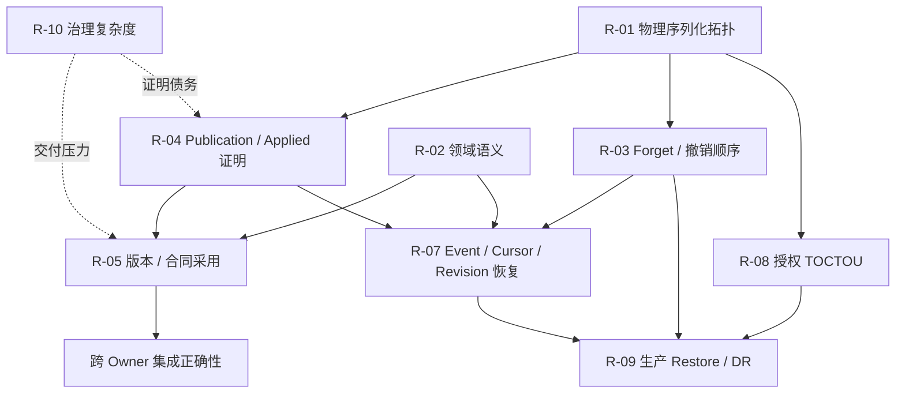

# R — 首席全系统架构风险评估

- 评估 ID：SYS-RISK-001
- 审查日期：2026-11-17
- 仓库：`oahcom/AiMemoryBrainArchitecture`
- Main 基线：`b372b62c640a2b656e54b6db62a4ee67d7d8c001`
- assessor: R — Principal System-wide Architecture Risk Assessment（历史来源；原始会话身份未记录）
- assessed_version: `b372b62c640a2b656e54b6db62a4ee67d7d8c001`
- evidence_baseline: `main@b372b62c640a2b656e54b6db62a4ee67d7d8c001`（源报告记载的历史基线；不声称存在同期会话签名）
- 审查分支：`review/session-1-system-wide-risk-2026-11-17`
- 状态：**全系统风险初步评估——不构成架构批准**
- 范围：A–I、Storage、跨 Owner 协议、治理和生产可运维性影响。
- 证据规则：Owner 分支工件只能作为候选证据；分支中存在不等于已批准、已采用、已实现或已证明。
- 语言：中文；对应英文文档：[SYS-RISK-001.en.md](SYS-RISK-001.en.md)。

## 1. 总体结论

**裁决：NOT PROVEN / 尚不具备架构冻结条件。** 当前逻辑分工具有合理性，但尚未证明架构能够在完整的写入、发布、召回、撤销/遗忘、恢复和还原路径中持续保持不变量。最高系统性风险并非某个模块缺失，而是：尚未选定物理序列化基础，也尚未形成一套精确、跨 Owner 统一的状态与权威模型，无法证明其在并发、部分失败、重试和恢复条件下仍然安全。

本评估区分以下证据状态：
- **VERIFIED（已验证）**：引用的仓库工件或 API 状态直接证明了该事实。
- **PARTIALLY VERIFIED（部分验证）**：部分内容有证据，但端到端结论未得到证明。
- **NOT PROVEN（尚未证明）**：本次审查证据不足以支持该结论。
- **BLOCKED（阻塞）**：必要的上游决策或证据明确未解决。

文档、Schema、候选 Manifest、静态测试向量或 CI 结果本身均不能证明运行时行为。本次没有执行 Rust 实现验证、数据库事务测试、并发压力测试、崩溃注入、安全渗透、恢复演练或生产基准测试。

### 1.1 全系统结论

| 领域 | 评估状态 | 原因 |
|---|---|---|
| 逻辑职责划分 | PARTIALLY VERIFIED | A 的整合文档描述了 Canonical Memory、投影/Context、Provider 副作用、授权、Wire 合同和 Storage 的合理分离。 |
| 领域真值与认识语义 | BLOCKED | B 的 Fact/Claim ADR 仍为 ADR-BLOCKED，下游类型语义不能视为完全确定。 |
| 物理原子性/序列化 | BLOCKED | Storage 拓扑 ADR 明确尚未选定拓扑。 |
| 精确协议/Schema 兼容性 | PARTIALLY VERIFIED | 存在更新的候选工件，但历史证据记录了版本绑定不一致；当前 Owner 分支 HEAD 已变化，需要重新完整核验版本包。 |
| Forget/撤销与恢复安全 | NOT PROVEN | 已有合同和 Gate，但尚未证明副本、衍生物、缓存、备份和重放路径上的端到端不复活。 |
| Applied/Publication 终态真实性 | NOT PROVEN | 候选 Outcome/Participant 合同尚未证明所有 Owner 共享一条完整权威证明链。 |
| Identity/Scope/Authorization 组合 | PARTIALLY VERIFIED | I 拥有相关策略和执行合同，但尚未端到端证明无绕过路径和 TOCTOU 闭环。 |
| 生产可运维性/灾难恢复 | NOT PROVEN | 尚未确立物理拓扑、部署/运维模型、恢复目标或经过测试的还原流程。 |

## 2. 审查基线与证据局限

### 2.1 Main 基线

审查开始时 Main HEAD：`b372b62c640a2b656e54b6db62a4ee67d7d8c001`。

已从该 Main Commit 创建独立审查分支：
`review/session-1-system-wide-risk-2026-11-17`。

创建分支不会修改 Main，不会合并任何 Owner 分支，不会批准 ADR、关闭 Gate 或授权实现。

### 2.2 本次读取的 Owner 分支快照

| Owner | 分支 | 读取的 HEAD |
|---|---|---|
| A | `session-a-integration-2026-11-16` | `d72dbac6e0f739cd00ac986176b78ec5cd385d88` |
| B | `session-b-domain-model-phase3` | `0df144ae25c2039c9934395fc88b2d17080eb119` |
| C | `session-c-agent-integration-2026-11-16` | `f3251081c49e697fe4739a252e27f59e2ecd0a8f` |
| D | `session-d-memory-brain-2026-11-16` | `97e68fbd225bdf0ac71860c01077481afc162d50` |
| E | `session-e-memory-compiler-2026-11-16` | `fdb4f67a83083d995930b88f93975b5ee36080f3` |
| F | `session-f-memory-runtime` | `8d5ef89ce9b1ff1471ffd1a03fe4f289addb0af3` |
| G | `session-g-memory-context` | `f9ca0ddc36e17f74041506f17039f0202d13042e` |
| H | `session-h-bmcp-protocol` | `f809be092a6c04db7982cc1bdbdd9c88787a4286` |
| I | `session-i-security-governance-2026-11-16` | `28df608b075e619563c6367a8a1c171185c1faaf` |
| Storage | `session-storage-consistency-forget-atomicity-2026-11-16` | `17be31915b06d98d7f822e6e5270b8cde39eb0bb` |

这些是快照标识，并不表示本次逐行穷尽审查了每个分支中的所有工件。尤其是持续变化的分支，最终冻结决策前必须重新固定版本。A 分支早先的 Phase 2 证据登记册记录的是旧快照，并明确指出 Blob 变化后必须重新审查。因此 Phase 2 是历史证据，不能替代本次实时快照。

### 2.3 主要来源工件

- A：`reviews/architecture-feasibility/phase-2-system-wide-consolidation.md`、`phase-2-exact-evidence-ledger.md`（A 分支；精确 Blob 见登记册）。
- A：`reviews/architecture-feasibility/phase-2-contradiction-register.md`（A 分支；ARC-01 起）。
- B：`02-domain-model/ADR-001-fact-claim-semantics.md`（B 分支；作为规范绑定使用前，须对当前分支确认精确路径和 Blob）。
- C：`07-agent-integration/phase-3.8.12-c-final-review-h-unified-1.2.13-csubmitoutcome-1.0.1-mapping.md` 及关联 Validator Review（C 分支）。
- D：`03-memory-brain/phase-3.8-d-publication-participant-and-terminal-contract.md`（D 分支）。
- E：`04-memory-compiler/phase-3.8-e-publication-orchestration-retry-recovery-contract.md`（E 分支）。
- F：`05-memory-runtime/phase-3.7-f-local-lifecycle-producer-derivative-queue-recall-context-restore.md`（F 分支）。
- G：`06-memory-context/phase-3.7-g-local-lifecycle-producer-derivative-queue-recall-context-restore.md`（G 分支）。
- H：`08-bmcp-protocol/phase-3.8.9-h-exact-mapping-unified-1.2.13-c-submit-outcome-1.0.1.md`（H 分支）。
- I：`09-security-governance/phase-3.8.9-i-p0-allowlists-unified-1.2.13-recoveryjoin-1.0.2.md` (not restored on main; see AID-2026-107 §10)（I 分支）。
- Storage：`reviews/storage-consistency/phase-3.8.2-storage-serialization-topology-adr.md`、`phase-3.8-storage-visibility-participant-and-atomic-outcome-contract.md`、`phase-3.6.15-storage-v3.2.5-protocol-bundle-exact-version-manifest.md`（Storage 分支）。

**证据局限：** 上述 B/D/E/F/G/H/I/Storage 工件路径已在各自分支树中定位；但本轮并未逐行重新读取所有被引用工件的完整内容。因此，凡缺少完整规范回读或精确绑定的具体结论，均按 BLOCKED 或 NOT PROVEN 处理。这一限制是有意保留的，不得用自信措辞掩盖。

## 3. 风险评级方法

概率采用定性评估，依据：(a) 根因是否明确未解决；(b) 必须协同工作的独立组件数量；(c) 是否存在确定性证明或强制执行点。影响依据对 Canonical Truth、机密性、完整性、可用性和可恢复性的后果评估。

- **Critical：** 可能破坏核心系统不变量，或造成不可逆/跨 Scope 数据损坏；阻塞架构冻结。
- **High：** 可能导致严重集成、安全、恢复或生产故障；阻塞受影响 Gate。
- **Medium：** 影响重大但边界相对明确，存在可信的控制路径。
- **Low：** 影响有限，且当前证据显示不存在系统性传播。

概率分档：High 表示根因明确未决或存在大量未同步依赖；Medium 表示风险合理存在且受到部分约束；Low 表示证据表明已有较强控制，但仍有边缘残余风险。风险等级不是简单数字相乘，也不能从文档长度推导。

## 4. 全系统风险登记册

| ID | 风险/根因 | 影响组件 | 概率/影响/等级 | 触发条件与失败后果 | 缓解措施/所需架构决策 | 责任 Owner | 验证证据与残余风险 | 阻塞 Gate |
|---|---|---|---|---|---|---|---|---|
| R-01 | **物理序列化权威未选定。** 定义了逻辑可见性/原子结果，却没有选定物理序列化拓扑。 | D、I、Storage、E、F、G | High / 灾难性 / **Critical** | 发布与 Forget/撤销并发、写入间崩溃、陈旧读取或重试。可能暴露部分提交状态、撤销后仍发布，或产生冲突终态。 | 选择并批准一种拓扑（例如每个 Canonical Memory 权威域采用 Serializable Transaction，或使用持久化线性协调器）；定义线性化点、锁/Hold 归属、原子写集合、隔离级别、读权威、超时与恢复语义。禁止用进程内 Mutex、Check-then-write 代替。 | Storage（物理拓扑）、D（Canonical 发布/Fence）、I（撤销策略）、A（集成 Gate） | A 的矛盾登记册指出 Storage 拓扑 ADR 明确为 ADR-BLOCKED / 未选拓扑。关闭需有选定 ADR、可执行确定性参考模型和对抗性交错证明。残余风险：真实 DB/集群行为仍属于 L4。 | **阻塞架构冻结和最终可见性/遗忘路径实现。** |
| R-02 | **Canonical 语义真值未完全闭环。** Fact/Claim 区分及 Evidence/时间语义仍依赖未决领域决策。 | B、D、E、F、G、C | Medium–High / 灾难性 / **Critical** | 冲突 Claim、来源撤回、时间修正、不确定推断或身份合并。错误断言可能成为 Canonical，污染召回/Context 且难以撤销。 | B 必须确定规范 Fact/Claim/Evidence/Confidence/valid-time/recorded-time 语义、来源、修正和矛盾规则；下游 Owner 必须明确采用精确决策版本。 | B（领域权威）、D/E/F/G（采用）、A（跨 Owner 验证） | Phase 2 矛盾登记册标记 Fact/Claim ADR 阻塞；当前 B 分支存在领域工件，但本轮未证明存在最终 ADR 决议。残余风险：Ontology 演进与迁移。 | **阻塞 Canonical Schema 冻结和语义一致性验收。** |
| R-03 | **Forget/撤销缺少端到端不复活证明。** 多种生命周期、衍生、缓存、还原和备份路径必须遵守同一个撤销/Fence 状态。 | I、D、Storage、E、F、G、H、C | Medium–High / 灾难性 / **Critical** | Forget 与发布竞争、投影重建、缓存回填、重放、备份还原或延迟 Provider 结果竞争。已删除/撤销数据可能重新出现或仍可召回。 | 定义唯一权威 Forget 状态和单调 Fence；枚举每份副本/衍生物/消费者；读、写、重放、还原、重建索引均须 Fail-closed 检查；规定 Retention/备份密码学擦除和证明 Receipt；定义其与在途 Provider 操作的顺序。 | I（全局策略/授权）、D（Canonical Fence）、Storage（持久化顺序）、E/F/G/C/H（消费者执行） | 存在合同和 Participant 工件，但本轮未验证覆盖所有路径的端到端证明。残余风险：外部备份和 Provider 保留策略难以控制。 | **阻塞 Forget/Restore 安全 Gate 和生产数据处理批准。** |
| R-04 | **Applied/Publication/Provider Outcome 可能存在权威分裂。** Receipt、Participant Intent、Provider 副作用和 Canonical 发布是不同事实，但终态证明链可能未统一。 | C、D、E、G、H、Storage、I | High / 严重 / **High** | Provider 副作用已发生但超时、重复回调、Receipt 丢失、Participant 部分提交、已确认送达但 Canonical 未 Apply。系统可能报告虚假成功或重复不可逆副作用。 | 分别定义 Provider Outcome、Publication、Canonical Commit、Delivery 和 Applied Ack 的状态机及权威证据；绑定 Idempotency Key、Attempt Identity、Revision、Principal 和因果 Receipt；定义 UNKNOWN/IN_DOUBT 和对账语义。 | C（Provider 真值）、D（Canonical 发布）、E（编排）、G（送达/Applied）、H（Wire）、Storage（持久化） | 存在候选 Schema/合同；尚未建立精确跨 Owner 终态映射和端到端故障证明。残余风险：Provider API 幂等能力不足。 | **阻塞端到端写入/Apply 验收和外部副作用工作流。** |
| R-05 | **Owner 间精确版本漂移。** Schema、Validator、Mapping、Manifest 和 Adoption 可独立推进。 | C、D、E、H、I、Storage、A | High / 严重 / **High** | 一个 Owner 验证 Schema N，另一个发出 N+1；旧批准被错误地认为覆盖后继版本。可能导致字段静默丢失、状态解释不兼容或授权绕过。 | 建立机器可校验的发布/绑定 Manifest，列出精确 Artifact Blob、Schema Revision、Validator Revision、Owner 决议和兼容范围；任何 Blob 变化都必须重新取得 Owner 采用确认并运行正负向向量。 | H（Wire Schema）、C（Outcome Schema）、Storage（Bundle Manifest）、各采用 Owner、A（治理） | Phase 2 精确证据登记册记录 H 1.2.12/1.2.11 和 CSubmitOutcome 1.0.1/1.0.0 的版本绑定不一致；当前 Owner 分支发现了 1.2.13/1.0.1 候选文件。仍需重新完整核验所有 Owner 的精确绑定。残余风险：协调发布期间的版本偏斜。 | **阻塞合同冻结和多 Owner 发布。** |
| R-06 | **Identity、Scope、Principal、Actor、Environment 尚未证明构成端到端统一安全上下文。** 策略权威和各边界执行可能分散。 | B、C、D、E、F、G、H、I、Storage | Medium / 灾难性 / **High** | Delegation、Tenant 切换、异步任务、Replay、Restore 或 Confused Deputy 路径丢失/替换 Principal、Scope、Actor 或 Environment。可能跨用户或跨 Tenant 访问数据。 | 定义规范身份元组和信任转换；将 Principal/Scope/Actor/Environment 密码学绑定到请求、Receipt、Event 和衍生对象；规定 Delegation、撤销、服务身份及每个受保护边界的不可绕过执行。 | I（安全权威）、B（身份语义）、C/H（入口/Wire）、D/E/F/G/Storage（执行） | I 的授权工件和 Allowlist 存在，但本轮未验证所有路径或对抗性 Confused Deputy 证明。残余风险：凭证生命周期和外部身份提供方被攻破。 | **阻塞安全架构验收和 Tenant 隔离声明。** |
| R-07 | **Recovery/Replay/Cursor/Revision/Manifest 语义可能分叉。** 持久化顺序、恢复 Cutoff、Replay 位置和投影 Revision 必须构成一致模型。 | Storage、D、E、F、G、H、I | Medium–High / 严重 / **High** | 持久化追加后、投影前崩溃；Cursor 陈旧；Manifest 部分写入；Replay 越过 Forget Fence；Event 重复/乱序。可能丢失、重复或复活状态。 | 规定 Event Identity 和排序范围；持久化 Commit 点；Cursor 单调性；Revision/Manifest 绑定；Replay 幂等；Recovery Cutoff；从权威重建规则；Gap 和 Poison Event 处理。 | Storage（Durable Log/Manifest）、D（Canonical Revision）、E（编译/Replay 编排）、F/G（投影/Context）、H（Wire） | Phase 2 指出 Publication/Forget/Recovery 参考模型证据不完整。存在更新的 RecoveryJoin 工件，但本轮未验证完整崩溃/Replay 模型。残余风险：存储引擎与副本故障行为。 | **阻塞恢复正确性 Gate 和灾难恢复验收。** |
| R-08 | **异步发布中的授权/策略 TOCTOU。** Admission 时授权检查通过，不代表发布或 Restore 时授权仍有效。 | I、C、D、E、Storage、H | Medium–High / 严重 / **High** | 撤销/权限变更与排队或在途任务竞争；过期 Receipt 或旧 Policy Epoch 被接受。导致未授权发布或 Provider 操作。 | 定义 Policy Epoch 和 Receipt 有效期；在发布时原子验证授权或与发布序列化；规定撤销切换点、在途取消/补偿语义；策略权威不可用时 Fail-closed。 | I（策略）、D/Storage（线性化）、C/E/H（执行边界） | 存在授权 Receipt 合同；未验证完整 TOCTOU 交错证明。残余风险：外部副作用不一定可补偿。 | **阻塞敏感发布与 Provider Egress。** |
| R-09 | **相对于安全声明，运维架构和灾难恢复定义不足。** 尚无选定物理拓扑或经过证明的运维恢复模型。 | Storage、I、D、A；所有 Runtime Owner | Medium / 严重 / **High** | Region 故障、密钥丢失、Coordinator 故障、部分还原、操作员错误、Schema 回滚或长时间分区。服务可能不可用或恢复出不安全数据。 | L1 拓扑决策后，定义部署单元、故障域、RPO/RTO、密钥托管/轮换、备份/还原顺序、Failover Fencing、可观测性、Runbook 和已测试还原演练。 | Storage（平台拓扑）、I（密钥/安全策略）、A（运维 Gate）、服务 Owner | NOT PROVEN：本轮未建立部署架构、已测试 DR 演练、RPO/RTO 或生产证据。这属于后续 L4 Gate，本身不代表合理 L1 设计不可行。 | **阻塞生产部署和运维就绪。** |
| R-10 | **治理/合同复杂度可能超过工程收益。** 多 Owner、阶段、精确版本 Manifest 和交叉审查可能形成第二套系统，其维护成本超过产品收益。 | A–I、Storage、工程治理 | Medium / 高 / **High** | 后继 Manifest 和局部修订不断增加，却没有可执行一致性验证；审查队列增长；Owner 优化文档状态而非产品不变量；实现停滞或分叉。 | 衡量治理成本与缺陷预防收益；合并重复状态机和工件；定义最小规范核心、机器可校验合同和按风险分级的 Gate；为候选文档设置废止/过期机制。不得为减少文书而削弱安全不变量。 | A（治理）、所有 Owner（合同简化）、工程负责人（交付经济性） | Phase 2 证据登记册指出分支工件和候选文件必须重新固定版本；跨 Owner 精确绑定仍在持续。没有交付和缺陷数据，实际成本收益仍为 NOT PROVEN。残余风险：过度简化导致治理不足。 | **阻塞可持续交付，但单独而言不否定核心正确性。** |

## 5. 根因优先排序与核心问题答复

### A. 最根本的十项风险
上表 R-01 至 R-10 按系统依赖关系排序，而非按模块目录排序。R-01 至 R-03 威胁正确 Canonical 系统能否成立；R-04 至 R-08 威胁跨组件正确性与安全；R-09 威胁生产运行；R-10 威胁长期工程可持续性。

### B. 可能使系统正确性无法成立的风险
R-01、R-02、R-03 是正确性关键风险。R-04、R-06、R-07、R-08 也可能在特定交错下破坏正确性或机密性。在其证明义务关闭之前，系统正确性状态为 **NOT PROVEN**。

### C. 尚未闭环的架构决策
1. Storage 序列化拓扑和线性化权威。
2. B 的 Fact/Claim 及 Evidence/Temporal 语义决策。
3. Canonical State Authority 与 Event/Revision/Cursor/Manifest 的精确关系。
4. Publication/Applied/Provider Outcome 的终态和 Receipt 权威。
5. Global Forget/Revocation 与在途发布、Replay、衍生重建和 Restore 的顺序。
6. 异步边界的 Identity Tuple、Delegation 和 Policy Epoch 语义。
7. H/C 及所有消费者的精确版本包采用关系。
8. 部署/故障域与恢复目标（L4，必须在 L1 拓扑决策后确定）。

### D. 集成时会放大的风险
R-01、R-03、R-04、R-05、R-06、R-07、R-08 具有乘数效应。局部合同分别正确，组合后仍可能对以下问题产生分歧：哪个 Event 权威、操作是否 Commit、验证哪个版本、哪个 Principal 授权、Forget Fence 是否支配 Replay，以及超时代表失败还是未知结果。

### E. 现在不解决会造成重大实现返工的风险
最终 Schema、持久化布局、Queue、Index、Cache、Receipt、Provider Adapter 和迁移实现前，应先解决 R-01/R-02/R-04/R-05/R-06/R-07。否则存储和服务边界可能固化互不兼容的假设，最终需要破坏性迁移或协议重构。

### F. 生产部署阻塞项
R-01 是架构阻塞；R-03/R-06/R-08 阻塞安全声明；R-07/R-09 阻塞恢复与可运维验收。真实部署证据（数据库行为、密钥运维、DR 演练、SLO）属于 L4，不能由设计文档替代。

### G. 看似安全但缺少证明的机制
- ForgetFence/Deny-list/Allowlist：必须证明所有读、写、Replay、Restore 和衍生路径都检查同一个权威 Fence。
- Receipt/Quorum/Manifest：必须证明其与所认证状态原子绑定，且不能跨 Principal、Revision 或 Epoch 重放。
- Applied/Terminal Outcome：必须区分送达、Provider 副作用、Canonical 发布和用户可见应用。
- Idempotency：必须证明稳定 Key 的作用域及“副作用已发生但超时”时的行为。
- RecoveryJoin/Cursor：必须证明单调性、Gap 处理、Cutoff 和 Replay 优先级。
- Encryption/Crypto-erasure：必须证明密钥层级、备份副本、轮换和不可恢复性，而不只是字段存在。

### H. 局部正确、组合错误的典型情况
1. D 在本地 Admission 检查后发布，而 I 的撤销同时 Commit。
2. Storage 已持久化 Participant，但 D 的 Canonical Pointer 尚不可见；重试观察到不同终态。
3. H Validator 接受新 Schema，而 C/D/I 仍按旧 Projection 解释。
4. D 已推进 ForgetFence 后，F 又从 Event Stream 重建衍生数据。
5. G 标记 Context 已 Delivered/Applied，但 Canonical Publication 仍处于 IN_DOUBT。
6. 还原的备份含有 Forget 前快照，在 Fence Replay 完成前即被暴露。
7. Provider 操作成功但 Receipt 丢失，重试导致外部副作用重复。

### I. 治理复杂度风险
存在，评级为 **High**，但目前仅 PARTIALLY VERIFIED。风险不在于“文档多”本身，而在于治理机制可能变成一套平行控制面：依赖人工维护版本、重复描述合同，却没有可执行的唯一事实源。应跟踪交付 Lead Time、审查等待时间、重复工件、过期文档比例、一致性自动化覆盖率和跨 Owner 缺陷逃逸率。只有在不变量可机器验证后，才可简化流程。

## 6. Critical 架构风险分析

### 6.1 R-01 — 原子性必须建立在已选定的物理权威上，而不是图示上
逻辑上的最终可见性事务不足以保证正确性，除非一个物理序列化权威能够决定 Publication、Forget 和 Revocation 的胜负。ADR 必须规定序列化域，以及哪些操作被一起线性化。进程内 Mutex、单进程 Queue、乐观 Check-then-write 或最终一致副本，均不能为独立写入者和恢复提供全局顺序。

**关闭证明：** 选定拓扑 ADR；形式化状态转移/线性化模型；枚举全部冲突操作；模型检查或确定性交错测试；每次持久化写入前后的崩溃点；重试和恢复一致性测试。生产 DB 验证仍属于独立 L4 Gate。

### 6.2 R-02 — Canonical Memory 的确定性不能高于其认识论基础
如果 Fact、Claim、Evidence、Inference、Confidence、valid time 和 recorded time 没有规范区分，系统可能把不确定或已被取代的信息提升为 Canonical Truth，污染所有召回和 Context 消费者。Schema 冻结前必须规定修正、矛盾、来源撤回和时间查询语义。

**关闭证明：** B 决议及稳定语义定义；正例和反例；下游采用矩阵；覆盖矛盾、过时、推断和撤回 Claim 的一致性向量；迁移策略。

### 6.3 R-03 — Forget 必须支配所有未来路径，而不只是删除一行数据
Forget 是时间和分布式不变量。删除 Canonical 内容，却保留能够重新生成它的 Event、Cache、Vector Index、Summary、Context、Backup 或在途任务，不构成成功遗忘。Restore 不得让已遗忘内容哪怕短暂重新可见。

**关闭证明：** 完整数据副本/衍生物清单；唯一权威单调 Fence；Publication/Replay/Restore 协议；不确定状态下 Fail-closed；备份/密钥策略；包含 Fence 前后 Restore、延迟 Queue、重复 Event 和 Index 重建的对抗性测试。

### 6.4 R-04 — “Applied” 不得把不同事实合并
Provider 执行、Provider Receipt、Canonical Publication、持久化 Commit、Context Delivery 和 Consumer Application 是不同事实。使用单一 Boolean 或含义过载的 Receipt 会造成虚假成功和重复副作用。

**关闭证明：** Owner 批准的独立状态机；唯一 Operation/Attempt/Idempotency Identity；明确 UNKNOWN/IN_DOUBT 和对账机制；绑定 Principal、Revision、Payload Digest 和 Policy Epoch 的证明；每个边界的故障注入测试。

## 7. 风险依赖关系图

依赖规则：下游实现不能通过增加局部代码来关闭上游架构阻塞。例如，增加 Retry 不能解决未定义的线性化点；增加 Manifest 不能确定领域语义；删除 Cache 不能证明 Restore 安全。

## 8. 未决架构决策

| 决策 ID | 所需决策 | 决策权威 | 当前状态 | 关闭要求 |
|---|---|---|---|---|
| UAD-01 | 物理序列化拓扑和线性化点 | Storage + D + I；A 集成 | BLOCKED | 选择拓扑；明确事务域、Fencing、持久化协调器（如有）、读一致性和恢复。 |
| UAD-02 | Fact/Claim/Evidence/Temporal 语义 | B | BLOCKED | 批准 ADR；下游采用；一致性案例。 |
| UAD-03 | Canonical Event/Revision/Cursor/Manifest 权威 | D + Storage + E/F/G/H | NOT PROVEN | 规范 Identity、顺序、Commit 和 Replay 规则。 |
| UAD-04 | Provider Outcome 与 Publication/Applied 终态 | C + D + E + G + H + Storage | NOT PROVEN | 状态机组合及故障模型。 |
| UAD-05 | Forget/Revocation 与在途 Publication/Restore | I + D + Storage | NOT PROVEN | 线性化切换及端到端不复活证明。 |
| UAD-06 | Principal/Scope/Actor/Environment 和 Delegation 模型 | I + B + C/H | PARTIALLY VERIFIED | 精确身份上下文和边界一致性。 |
| UAD-07 | 精确兼容协议/Schema 版本包 | H + C + Storage + 采用 Owner | PARTIALLY VERIFIED | 新的精确版本 Manifest 和 Owner 批准。 |
| UAD-08 | 部署、Failover、Backup 和 DR 目标 | Storage + I + A | NOT PROVEN（L4） | 部署 ADR、RPO/RTO、密钥托管、Restore 演练和 Runbook。 |
| UAD-09 | 最小可行治理控制面 | A + 所有 Owner | NOT PROVEN | 成本收益指标和可执行一致性验证策略。 |

R 不替 Owner 作出这些决定。本评估只明确决策内容和所需证据。

## 9. 风险关闭标准

风险不能仅凭编写文档或合并 PR 关闭。必须满足：
1. 指定权威作出所需决策，并明确状态。
2. 固定精确源 Blob/Commit 和下游采用版本。
3. 所有受影响 Owner 确认语义兼容；不得推定采用。
4. 适用时具备正向、负向、并发、崩溃、重试和恢复案例。
5. 证据可复现，并经过独立回读。
6. 明确残余风险、适用范围和运行假设。
7. Gate Owner 单独记录裁决；不得自动关闭 Gate。

### 各风险最低关闭条件
- **R-01：** 拓扑 ADR + 线性化模型 + 交错/崩溃/重试证明。
- **R-02：** B 规范 ADR + 类型语义 + 矛盾/时间向量 + 下游采用。
- **R-03：** 完整数据血缘清单 + 包含 Restore 和衍生路径的不复活证明。
- **R-04：** 分离状态机 + 精确 Receipt/幂等绑定 + 故障注入/对账证明。
- **R-05：** 机器可读精确版本包 + 全 Owner 重新审查 + 版本偏斜测试。
- **R-06：** 规范身份/Delegation 模型 + 全边界授权矩阵 + Confused Deputy 测试。
- **R-07：** Event/Cursor/Revision/Manifest 参考模型 + 崩溃/Replay/Gap/重复测试。
- **R-08：** Policy Epoch/Receipt 有效性 + 撤销与发布交错证明。
- **R-09：** 部署与威胁模型 + RPO/RTO + 密钥托管 + 成功的 Restore/Failover 演练。
- **R-10：** 治理指标 + 自动一致性覆盖 + 重复/人工工作下降且安全性不降低的证据。

## 10. 根因优先整改建议

1. **冻结依赖未决 B 语义或 Storage 拓扑的新下游规范承诺；** 不依赖这些问题的研究可继续。
2. **首先解决 UAD-01：** Storage/D/I 联合选定物理序列化和可见性权威。任何实现捷径都不能替代这一决策。
3. **解决 UAD-02：** B 关闭 Fact/Claim 与 Temporal/Evidence 语义；下游 Owner 明确采用。
4. **组合 Publication 与安全状态机：** C/D/E/G/H/I/Storage 对 Operation Identity、Principal、Policy Epoch、Provider Outcome、Canonical Commit 和 Applied 语义达成一致。
5. **证明 Forget 支配性：** 枚举 Canonical 和衍生副本，证明写入/Replay/Restore 无法复活 Fence 内容。
6. **收敛精确版本：** 从精确 Blob 重新生成唯一权威 Bundle Manifest，并要求 Owner 重新审查；明确废止旧引用。
7. **证明恢复正确性：** 定义 Event/Cursor/Revision/Manifest 顺序，并针对选定拓扑测试全部崩溃/重试边界。
8. **只有之后才冻结面向实现的合同，** 再进入 L4 部署、性能、安全运维和 DR 验证。
9. **通过自动化降低治理成本：** 机器检查精确引用、双语一致性、Schema、状态转移和一致性向量；不能用状态标签替代证据。

## 11. 范围边界与明确非结论

- 本评估不宣称项目不可行；本快照下核心正确性为 **NOT PROVEN**。
- 本评估不声称已经发生生产数据泄露、数据丢失或 Provider 重复执行。
- 本评估不声称 Rust 代码、测试或 CI 的存在能够证明或否定架构。
- 本评估不批准、否决或改写任何 Owner 的规范 ADR。
- 本评估不合并 Owner 分支、不关闭 Issue #43、不批准架构冻结，也不授权生产部署。
- 本评估不判断详细基准可行性或真实云/Provider 成本；这些需要先选定拓扑并建立工程工作负载。

## 12. 来源引用

所有引用均限定分支。后续 Gate 决策使用前，必须重新读取精确工件和 Blob。

1. Main 基线：`b372b62c640a2b656e54b6db62a4ee67d7d8c001`。
2. A Phase 2 整合：`reviews/architecture-feasibility/phase-2-system-wide-consolidation.md`；A 审查分支 `review/arch-consol-001-system-wide-2026-11-17` 上 Blob `6f5fbe13a5c12ab6cad833b2326ae595f8d047d0`。
3. A 精确证据登记册：`phase-2-exact-evidence-ledger.md`；同一分支 Blob `8be676b28d32efd1f214f8644010f187eb6b3c17`。
4. A 矛盾登记册：`phase-2-contradiction-register.md`；同一分支 Blob `0fb013e7148acfc3d042dd6be310c61c9632ad3d`。ARC-01 将 Storage 拓扑 ADR Blob `080433f8e13a500522bc2754da64057edb0ae9d8` 记为 ADR-BLOCKED / 未选拓扑；ARC-02/03 记录 H/C 版本绑定漂移。
5. B 分支 HEAD：`0df144ae25c2039c9934395fc88b2d17080eb119`；作为规范依据前须确认 Fact/Claim ADR 的精确路径/Blob。
6. C 分支 HEAD：`f3251081c49e697fe4739a252e27f59e2ecd0a8f`；Phase 3.8.12 Mapping 和 Validator 工件。
7. D 分支 HEAD：`97e68fbd225bdf0ac71860c01077481afc162d50`；Phase 3.8 Publication Participant/Terminal 合同。
8. E 分支 HEAD：`fdb4f67a83083d995930b88f93975b5ee36080f3`；Phase 3.8 Publication Orchestration/Retry/Recovery 合同。
9. F 分支 HEAD：`8d5ef89ce9b1ff1471ffd1a03fe4f289addb0af3`；Phase 3.7 Lifecycle/Derivative/Restore 工件。
10. G 分支 HEAD：`f9ca0ddc36e17f74041506f17039f0202d13042e`；Phase 3.7 Lifecycle/Context/Restore 工件。
11. H 分支 HEAD：`f809be092a6c04db7982cc1bdbdd9c88787a4286`；Unified 1.2.13 Mapping 工件。
12. I 分支 HEAD：`28df608b075e619563c6367a8a1c171185c1faaf`；Authorization Allowlist/RecoveryJoin 工件。
13. Storage 分支 HEAD：`17be31915b06d98d7f822e6e5270b8cde39eb0bb`；拓扑 ADR、Visibility 合同和 v3.2.5 Manifest。
14. 双语规范：`00-governance/bilingual-documentation-policy.md`；Main 上 Blob `b51b054b9f1022133666542680df74dfe19de2fb`。该规范要求架构文档中英文成对交付并保持语义一致。

---
**最终状态：暂不具备架构冻结条件。** 这是风险评估裁决，不是 Gate 关闭决策。

## 13. 2026-11-17 实时源刷新与风险状态校正

本节补充本次 R 会话对关键 Owner 文件的精确回读。它不覆盖前述风险 ID，也不把候选提案升级为批准决策。Owner HEAD 与 Blob 如下：

| Owner | 当前分支 HEAD | 精确工件 Path | Blob SHA | 本轮直接读取确认的状态 |
|---|---|---|---|---|
| B | 0df144ae25c2039c9934395fc88b2d17080eb119 | 02-domain-model/ADR-001-fact-claim-semantics.md | a1024938ff5baba069cf128c69496a44e143330c | ADR-BLOCKED；无正式治理主体、批准人、时间与决策；B 推荐仍是 Candidate |
| C | f3251081c49e697fe4739a252e27f59e2ecd0a8f | 07-agent-integration/phase-3.8.12-c-final-review-h-unified-1.2.13-csubmitoutcome-1.0.1-mapping.md | 92ed89a308ad97f6846960bb7182e0916949978e | C 对 H 1.2.13 / CSubmitOutcome 1.0.1 映射的当前复审工件已存在；不能由此推导所有消费者批准或当前 CI 通过 |
| C | 同上 | 07-agent-integration/phase-3.8.12-c-exact-review-h-1.2.13-c-submit-outcome-1.0.1-validator.md | c1dcc4049205b8b9315e3b284433625e9893a711 | Validator 精确复审工件存在；需以当前分支 CI 和 Owner 正式决定作为单独证据 |
| D | 97e68fbd225bdf0ac71860c01077481afc162d50 | 03-memory-brain/phase-3.8-d-publication-participant-and-terminal-contract.md | 17e53890dd6cce9bea9eacc1be2e64b0ef55ac78 | D-role proposal；独立 D Owner 批准、Callable API、Conformance OPEN；UNKNOWN/IN_DOUBT 保持 Barrier 开放 |
| E | fdb4f67a83083d995930b88f93975b5ee36080f3 | 04-memory-compiler/phase-3.8-e-publication-orchestration-retry-recovery-contract.md | 475fee41e5eea527af4edefbfe88c58c86967d0a | E-role proposal；D/I/Storage API 与独立 Owner 批准 OPEN；本地状态不构成 D ProducerWork 终态 |
| F | 8d5ef89ce9b1ff1471ffd1a03fe4f289addb0af3 | 05-memory-runtime/phase-3.7-f-local-lifecycle-producer-derivative-queue-recall-context-restore.md | 29e9504c75d737c2dd200ebc3306eda555f0b0ac | F-local proposal；跨 Owner 接口/实现 OPEN；IndexWatermark 是分区本地连续覆盖，不是 Forget 完成证明 |
| G | f9ca0ddc36e17f74041506f17039f0202d13042e | 06-memory-context/phase-3.7-g-local-lifecycle-producer-derivative-queue-recall-context-restore.md | c1de241ec69834377d9b0e24aa4770a809796d4b | G-local proposal；C/G/H 交付和跨 Owner 接口 OPEN；Transport ACK 不等于 Applied |
| H | f809be092a6c04db7982cc1bdbdd9c88787a4286 | 08-bmcp-protocol/phase-3.8.9-h-exact-mapping-unified-1.2.13-c-submit-outcome-1.0.1.md | 32bf9b0fd42abe8b58749b858b1d5c9aef39c5fd | CURRENT SUCCESSOR MAPPING CANDIDATE；exact CI rerun required；not frozen；最新测试未绑定本次读取的精确 HEAD 运行 |
| I | 28df608b075e619563c6367a8a1c171185c1faaf | 09-security-governance/phase-3.8.10-i-p0-allowlists-unified-1.2.14-recoveryjoin-1.0.2.md (not restored on main; see AID-2026-107 §10) | 44986f5f864bcdc1a79d34978273644d381a68c0 | I-owned P0 projection candidate；生产 Profile、Trust Roots、Key Custody、anti-rollback 和完整 P0 vectors 仍未完成；phase-3.8.9 Blob 5c0e2049513d391dfc118f4f629a5ec95de456d6（SUPERSEDED_BY）；reconciled_by: AID-2026-170 |
| Storage | 17be31915b06d98d7f822e6e5270b8cde39eb0bb | reviews/storage-consistency/phase-3.8.2-storage-serialization-topology-adr.md | 1ef47d4e5711c7db73a24d249adf1992be1f6aa4 | ADR-BLOCKED；候选选项而非已选拓扑；T1–T8 全部 OPEN |
| Storage | 同上 | reviews/storage-consistency/phase-3.8-storage-visibility-participant-and-atomic-outcome-contract.md | 175ee7b1349cfdb79a19898b311a88391ed88010 | 逻辑事务提案；物理拓扑、跨 Owner API、读路径执行和实现证明 OPEN |
| Storage | 同上 | reviews/storage-consistency/phase-3.6.15-storage-v3.2.5-protocol-bundle-exact-version-manifest.md | bea90697e7a61d43bed00543d636a5cdf40cf5ca | successor bundle published；NOT JOINTLY ACCEPTED / NOT FROZEN |
| A | 4f3181fdf9d5b7785887381fde83e33026308c31 | reviews/architecture-feasibility/phase-2-system-wide-consolidation.md | 6f5fbe13a5c12ab6cad833b2326ae595f8d047d0 | A Phase 2 历史整合快照；不能替代本轮 Owner HEAD 精确复核 |
| A | 同上 | reviews/architecture-feasibility/phase-2-exact-evidence-ledger.md | 8be676b28d32efd1f214f8644010f187eb6b3c17 | 记录精确证据和历史版本；必须按 Blob 变化刷新 |
| A | 同上 | reviews/architecture-feasibility/phase-2-contradiction-register.md | 0fb013e7148acfc3d042dd6be310c61c9632ad3d | ARC-01 至 ARC-10 作为集成矛盾线索，不替代 R 根因风险模型 |

### 13.1 证据边界与 CI 解读

- H 当前 Mapping 文件明确标记 **CANDIDATE / EXACT CI RE-RUN REQUIRED / NOT FROZEN**。本次看到的 H Recovery Cutoff CI run 44042074640 对应 head `fb9a2ab8b528c2b7010d935372f76a14d6676755`，并非本轮读取的 H HEAD `f809be092a6c04db7982cc1bdbdd9c88787a4286`，因此不能证明当前 H 1.2.13/C 1.0.1 组合。
- H Provider Outcome CI run 44063916718 对应 head `c326e561145e9558f48f199128814643d8720e45`，同样不是本轮 C 分支 HEAD `f3251081c49e697fe4739a252e27f59e2ecd0a8f` 的 exact-head 端到端证明。
- Storage 的 PostgreSQL 18.7 Prepared-XID/PITR 能力运行记录（run 43958775001）是受限引擎能力证据。它不证明真实 Canonical Authority 拓扑、COC/JF-10/I/D 集成、生产读路径或生产部署。
- D/E/F/G 当前文件都明确区分本地提案与跨 Owner 接受/实现符合性。不得将角色模拟视为独立 Owner 签署。
- Issue #43 仍为 Open；R 本报告不替代 A 的 G1–G8 集成裁决，也不关闭任何 Owner Gate。

### 13.2 对原风险登记册的状态校正

原登记册的十项风险 ID 保持不变：R-01 物理序列化、R-02 Canonical 语义、R-03 Forget/反复活、R-04 Applied/Publication/Provider Outcome、R-05 精确版本、R-06 Identity/Scope、R-07 Recovery/Cursor、R-08 Authorization TOCTOU、R-09 生产 DR、R-10 治理复杂度。

本次刷新后：
- R-01、R-02、R-03 仍为 **Critical / BLOCKED 或 NOT PROVEN**。
- R-04 至 R-10 仍为 **High / NOT PROVEN 或 BLOCKED**；其中 R-04 的语义边界已更清晰，但 exact bundle、跨 Owner 批准和端到端证明仍未闭环。
- 当前存在更多候选工件，不等于风险下降；只有精确版本采用、权威批准和可复现验证完成后，才能下调风险。
- 本次没有发现足以将任何 Critical/High 风险标记为 CLOSED 的新证据。

## 14. R-01 实时来源增量审查 — 2026-11-17 / 取代过期拓扑表述

对 D 与 Storage Owner 分支进行定向实时刷新后，R-01 的 **L1 逻辑决策**状态需要修正。但这并不意味着 R-01 整体关闭。

### 14.1 当前精确来源锚点

| Owner | 分支 | 本轮读取的当前 HEAD | 精确工件 | Blob SHA | 直接读回的状态 |
|---|---|---|---|---|---|
| Storage | `session-storage-consistency-forget-atomicity-2026-11-16` | `830a559bd2f4ec72608f5a51e1a0b43779f2b989` | `reviews/storage-consistency/phase-3.8.2-storage-serialization-topology-adr.md` | `bb544ba2f346bdc130d524bd5c7310d86f367988` | §§8–8.7 选择 L1 逻辑 Option A；L4 引擎/部署仍 OPEN |
| Storage | 同一 HEAD | 同上 | `reviews/storage-consistency/phase-3.8-storage-visibility-participant-and-atomic-outcome-contract.md` | `175ee7b1349cfdb79a19898b311a88391ed88010` | Storage 角色逻辑提案；§7 的候选措辞仅在 L1 范围内被后续 ADR 补充取代；实现证明仍 OPEN |
| D | `session-d-memory-brain-2026-11-16` | `194c4c8d64972547cdbcf3fe64bd806c4d1d6a2f` | `03-memory-brain/phase-3.8-d-publication-participant-and-terminal-contract.md` | `17e53890dd6cce9bea9eacc1be2e64b0ef55ac78` | D 角色提案；D/Storage 物理序列化权威、D 独立批准、可调用 API 与符合性仍 OPEN |

### 14.2 R-01 修正后的评估

Storage ADR 的 §8 补充条款已将 **Option A 选为 v1 规范 L1 逻辑架构**：每个 `BrainAuthorityRef` 使用一个逻辑 Serializable Transaction Domain 和一个持久化 `CanonicalAuthoritySerializationAnchor`。§8.7 将锚点具体化：D Admission/Dependency/Participant/Fence 受保护变更，以及 Storage 最终 Visibility/NO_PUBLICATION 变更，必须在同一事务中更新同一锚点并追加 Transition Record。事务提交即线性化点。同时保留语义权威边界：D 拥有 ForgetFence 与 Participant 语义；Storage 拥有物理序列化和可见性；I 仍是独立 PolicyDomain 权威；COC 仍是独立 Quorum Log。

这在 **仅限 L1 的范围内**取代了 ADR 补充条款之前“尚未选择 Option”的旧措辞。此前 R-01 中“Storage 拓扑 ADR 整体仍 ADR-BLOCKED”的表述已经过期，不应继续作为当前 L1 状态引用。

但 D 当前工件仍标记为 D 角色提案，并明确将 D/Storage 物理序列化权威及 D 独立批准列为 OPEN。Storage Visibility Contract 也仍是逻辑提案，实现证明 OPEN。因此，Storage 当前工件中的 L1 选择可标记为**文本证据 VERIFIED**；跨 Owner 的 D 采纳/批准则是 **NOT PROVEN**。这不是 D+Storage 联合批准的合同，更不是已实现的拓扑。

### 14.3 按层划分的 R-01 状态

| 层级 | 更新后的状态 | 原因 |
|---|---|---|
| L1 逻辑拓扑选择 | PARTIALLY VERIFIED | Storage 当前 ADR 选择 Option A 并定义锚点；D 当前提案尚未采纳/批准共同物理序列化权威 |
| 跨 Owner 语义/事务边界 | NOT PROVEN | D/Storage 精确行归属、API、事务边界和 D 独立批准仍未关闭 |
| L3 确定性逻辑/物理竞态证明 | NOT PROVEN | 已规定所需交错与 Lost-ACK/Restore 场景，但本轮未验证绑定当前双方 HEAD 的联合证明包 |
| L4 引擎/部署/符合性 | BLOCKED / OPEN | 实际 DB 产品/配置、部署、Operator、HA/PITR、权威读路径、旧主隔离及物理崩溃/故障切换/恢复演练仍 OPEN |

R-01 继续保持 **Critical / OPEN**，仍阻塞架构冻结和 Visibility/Forget 路径的最终实现。风险范围已收窄：缺失项不再是“没有任何 L1 拓扑提案/选择”，而是跨 Owner 采纳，以及 L3/L4 证明和符合性。不得据此降级风险或放行 Gate。

### 14.4 下一步关闭条件

1. D 必须明确审查并采纳或拒绝精确 Storage ADR Blob `bb544ba2f346bdc130d524bd5c7310d86f367988`，包括 §8.7 的锚点身份、受保护变更清单、名义类型边界和 Fail-closed 行为。
2. D 与 Storage 发布联合精确版本事务/行归属/API 合同，明确每一行由谁拥有、每一类 Transition 由谁有权追加。
3. 证明 Fence 与 ProducerWork Admission、Dependency Registration、PublicationParticipant Admission、最终 Visibility Commit 的两个串行顺序；覆盖 I REVOCATION_WON 与 COMMIT_WON、序列化重试、Lost ACK、主库故障切换、旧主重新加入及 Restore Rollback。
4. 确定性测试结果必须绑定精确 D/Storage 源 HEAD 与 Schema/Adapter Revision；历史 CI 不可替代。
5. 在实际引擎/配置、权威读路径、HA/PITR、Operator 和物理故障/恢复证据被明确并验证前，L4 必须保持 OPEN。

**本 R 审查不推定任何 Owner 已批准。** 本补充仅修正独立风险状态。

## 15. R-02 实时来源增量 — Fact / Claim Canonical 语义 / 2026-11-17

### 15.1 B 当前精确来源锚点

| 来源 | B 分支当前 HEAD | 精确路径 | Blob SHA | 直接观察到的状态 |
|---|---|---|---|---|
| B ADR-001 | `2faf8ec38f14dba49e7263d7a60804dae1a74ee2` | `02-domain-model/ADR-001-fact-claim-semantics.md` | `a1024938ff5baba069cf128c69496a44e143330c` | ADR-BLOCKED；没有正式决策权威、批准人、时间戳、批准选项或批准记录 |
| Domain Model Overview | 同一 HEAD | `02-domain-model/domain-model-overview.md` | `4d1debc0ec19b3917f9e76d04bb66da4df4cd346` | DECIDED 基线文字规定 Claim 是规范命题对象，Fact 是 Claim 的限定解释，当前不是独立对象类型 |
| Architecture Invariants | 同一 HEAD | `00-governance/architecture-invariants.md` | `66266667bdbb1cf15a2644fa98db5ecaaf3bb23b` | I-04 将 Event、Memory、Fact、Entity、Relation、Evidence 列为不同领域概念 |
| Design Principles | 同一 HEAD | `00-governance/design-principles.md` | `192e6ba6e9287792a02b679dda0d391844270228` | P-04 将 Event、Memory、Fact、Entity、Relation、Evidence 定义为不同对象 |
| Consumer Mapping | 同一 HEAD | `02-domain-model/fact-claim-consumer-mapping.md` | `dd45a37199c9b69ab6b68f65e051a484a04691d4` | CANDIDATE；规范 Fact/Claim 部分明确 ADR-BLOCKED |

ADR 自身的 “Last reviewed baseline” 为 `ab19afbf92f67fe0a7679e9aa3a35b015fed89f4`，并非当前 B HEAD。此次评估以当前分支实时读回为准；该内嵌基线标签已过期，不得作为当前来源锚点。

### 15.2 规范冲突与当前决策状态

该冲突是实质性的：

- 治理不变量 I-04 和设计原则 P-04 将 Fact 与 Claim 列为不同领域概念/对象。
- 当前 Domain Model Overview 却规定 Claim 是规范命题对象，而 Fact 是 Claim 的限定解释，当前不作为独立对象类型。
- ADR-001 明确将其记录为规范基线冲突，而非命名差异，并明确 B 无权单方面解决。
- B 推荐 Option A（独立 Fact Attestation 对象）作为候选，但前提是存在真实独立 Attestation 用例且 D/I 同意；这不是决策。
- Consumer Mapping 将两个分支都保留为条件映射，并明确禁止在 ADR 批准前冻结规范 Fact/Claim Identity 字段。

因此 R-02 在**治理决策层面处于 BLOCKED**，不只是字段定义不足。Option A 和 Option B 都尚未成为规范决策。当前 Overview 的文字不能默默修改 I-04/P-04；B 对 Option A 的推荐也不能默默批准新的 Canonical Fact Identity。

### 15.3 跨 Owner 影响

正式决策记录完成之前：
- E 必须保持 CandidateProposition / ExtractionIR 中立，不得分配 Canonical ClaimRef 或 FactRef。
- D 不得冻结 Canonical Fact/Claim Schema、ID、Storage 或 API 形态。
- F/G 不得假定 FactRef 存在，也不得将 Fact-qualified View 折叠为稳定 Canonical 字段。
- H 不得冻结 Fact/Claim Wire 字段。
- C Telemetry 仍是 Source/Producer Observation，不是 Fact Attestation。
- Consumer Mapping 仍是候选；任何 Consumer 分支工件或实现都不能证明治理批准。

候选 Mapping 已包含有价值的保护措施（精确指向 ClaimRevision、Evidence/Provenance 关联、禁止仅凭 Confidence 晋升 Fact、不可变 Correction/Retraction 历史及 Conflict 保留）。这些是设计约束，不能替代 Canonical Object Model 的正式选择。

### 15.4 R-02 关闭条件

1. 在规范治理工件中明确正式 Architecture Governance 权威及其决策权。
2. 由有权批准者签署带时间戳的 Option A 或 Option B 决策，记录理由和已接受的真实用例。
3. 若选 Option A：定义 Fact/FactRevision Identity、精确 ClaimRevisionRefs、Attestor ActorRef、Method/Version、Evidence、Scope、Validity、Revocation/Supersession 和 I Authorization；Canonical Commit 由 D 拥有。
4. 若选 Option B：通过授权变更控制正式修改 I-04/P-04 及所有受影响的基线/术语引用；定义精确 ClaimRevision Qualification Object 与历史语义。
5. B/D/E/F/G/H/I 针对精确 Blob 完成明确 Consumer Mapping 采纳；保留 C Telemetry 与 Extraction Confidence 不得被推定为 Attestation 的边界。
6. 发布 Creation、Correction、Retraction、Conflict、Expiry/Revocation、Temporal Validity 和 As-of Read 的迁移/兼容计划及符合性向量。

R-02 继续为 **Critical / BLOCKED**，阻塞 Canonical Schema/Identity Freeze。本 R 审查不选择任何方案，也不模拟或替代治理权威。

## 16. R-03 实时来源增量 — Forget / Revocation / Restore 防复活 / 2026-11-17

### 16.1 当前实时来源精确锚点

| Owner | 当前分支 HEAD | 精确工件 | Blob SHA | 直接观察到的状态 |
|---|---|---|---|---|
| D | `194c4c8d64972547cdbcf3fe64bd806c4d1d6a2f` | `03-memory-brain/forget-fence-and-completion-contract.md` | `1f0391bc49d007c44ec74165bd33d37412cc7990` | D Canonical Forget 语义 DECIDED；跨模块执行和全局完成政策 OPEN / 由 I 拥有 |
| D | 同一 HEAD | `03-memory-brain/forget-fence-operation-and-publication-gate.md` | `4da0b61ba3656a768ea56b4a2a24e09da4e21cd5` | D 操作语义 DECIDED；D/E 接口 Schema、Storage 实现和跨 Owner 符合性 OPEN |
| I | `0d071bf1ee7cc71912398c6ae57e4496e08f44ab` | `09-security-governance/forget-retention-backup-and-erasure-policy.md` | `f14cb2149ca3f817229533005ab89dbdc7f0b3a8` | 全局治理合同 CANDIDATE；D/E/F/G/H 实现及外部接收方证明 OPEN |
| I | 同一 HEAD | `09-security-governance/global-forget-target-inventory-and-completion-evidence.md` | `9100061fa986fb6676656169de3fcf9fc1c72664` | CANDIDATE Inventory/Completion 合同；各 Owner 符合性 OPEN |
| I | 同一 HEAD | `09-security-governance/phase-3.7-i-current-authorization-enforcement-and-restore-proof.md` (not restored on main; see AID-2026-107 §10) | `e3b1b5d99eb36ac0b395854d8c19287d2b64b752` | I 语义执行提案；Token Schema 和符合性 OPEN |
| Storage | `830a559bd2f4ec72608f5a51e1a0b43779f2b989` | `reviews/storage-consistency/phase-3.6.5-restore-control-highwater-and-quarantine-contract.md` | `4f656163aeba532a441eaed1d293a48e2363cb4a` | 架构合同候选；需要 I/D/A 精确审查 |
| Storage | 同一 HEAD | `reviews/storage-consistency/phase-3.6.5-storage-restore-highwater-owner-acceptance.md` | `d3923fe42bec04d9f5233c7a810303da80b73bc2` | 仅 Storage 技术接受；I/D/A 接受和物理恢复演练仍 OPEN |
| Storage | 同一 HEAD | `reviews/integration/phase-3.6-forget-atomicity-verification-report.md` | `9f224722a40844686d275e44a8ab6ba72fa1ddb8` | 历史验证报告明确标记 I 治理阻塞、测试阻塞/未运行、实现未验证且未声称 Global Forget；其内嵌分支快照早于当前 HEAD |
| F | `1908ce4d233b20f7cafd00cb679affd01bd15174` | `05-memory-runtime/phase-3.6-runtime-forget-suppression-and-invalidation.md` | `ce59252dbbdc5d10d016704797e9ba12d5a941bd` | F Runtime 语义 DECIDED；跨 Owner 接口 OPEN；实现/执行 NOT VERIFIED |
| F | 同一 HEAD | `05-memory-runtime/phase-3.6-anti-resurrection-reference-model-evidence.md` | `15049d448ace5ad24a6c02eba3fc906fcac149f6` | 证据文件报告旧 F Commit `f1ba5c478e395da6b126423e32e20d0990e61920` 上逻辑测试 19/19 通过；明确列出非生产限制 |
| G | `3367438f7b6ba5fa1b7d7540a0fd03a72bbebdbe` | `06-memory-context/phase-3.6-applied-forget-reconciliation-contract.md` | `aa3afa73d8a76cc6f025839c52bfbff6a983046a` | G 语义决策已记录；C/G/H Applied 合同 FREEZE BLOCKED；实现/执行 NOT VERIFIED |

### 16.2 已规定的内容与未被证明的内容

**D Canonical Fence/Barrier 语义已有较完整规定。** 当前 D 合同区分即时逻辑抑制、异步衍生清理和物理擦除；定义持久化单调 Fence、Closed-world Producer Registration、Barrier High-Water 捕获、Dependency Inventory、Register-before-visible、迟到衍生物导致证明失效，以及 UNKNOWN 时 Fail-closed。D 操作合同要求 ProducerWork Registration 与 Fence Installation 处于同一个线性化顺序域，并要求在 Artifact 从 Private 变为 Visible 的同一边界再次检查最新 Fence。

**I 全局完成仍是候选治理政策，而非已批准的运行权威。** I 政策要求 Closed-world Producer Domain Inventory、不可变 Target Inventory Seal、逐目标认证证据、显式例外，以及覆盖 D/E/F/G/H、外部接收方、Backup/Replica 和 Audit 的类型化完成向量。它区分 Suppression、Cleanup 与 Physical Erasure；Offline/Unsupported/Timeout 必须保持 Unknown。但全局政策和 Inventory 合同都标记 CANDIDATE，当前 I Restore Enforcement 文档也将 Token Schema/Conformance 保留为 OPEN。这是任何 Global Forget Completion 声明的直接治理阻塞。

**F 本地 Anti-resurrection 有价值但范围有限的逻辑证据。** 当前 F Model/Test/Workflow Blob 分别为 `33fa2ca2dc29771aca241e194f13e078a4f8d774`、`c2575327a75577923440ef770d42122218a1e091` 和 `c0fac9eff93ca46e466cda5fe04613bd4565e9b3`。证据文件报告在旧 Commit `f1ba5c478e395da6b126423e32e20d0990e61920` 上 19/19 测试通过，而非当前 F 分支 HEAD `1908ce4d233b20f7cafd00cb679affd01bd15174`。Model/Test 源 Blob 与当前分支相同，但 CI 并非当前 HEAD 的精确运行。更重要的是，该模型是内存模型，不执行真实 Index、Cache、并发进程、Storage Transaction、网络分区、Adapter Reconnect、外部目标或 Backup Restore。其自身明确不认证 Global Forget。

**I 与 Storage 逻辑模型同样是有限测试证据，不是生产证明。** I 当前 Model/Test Blob 为 `5233da028e409ec3f41848582dad73a923e7155b` 和 `428e15c6263b5b2d730b93ce5412d55e782a449b`；证据记录旧 Commit `8a6a6e67696c496e265b3d87f1a550fe5e8bb2a0` 上 30/30 测试通过。当前 Model/Test Blob 与该证据一致，但运行 Commit 不是当前 I HEAD `0d071bf1ee7cc71912398c6ae57e4496e08f44ab`。Storage 当前 Restore Model/Test Blob `be0aef6232c8ee2ed6179df7b0a74473c3e25b3b` / `a9e1a96b449c6bf0e2b52c5fea394a8c32961a24` 与其报告的旧 Commit `19798634fb0d55cb0c901c8f4194506fab96b75b` 上 25/25 测试通过相匹配。两者均为内存逻辑模型；均未执行真实 Proof API 验证、数据库恢复、旧主隔离、外部密钥验证或生产恢复。

**G 合同不是 Purge 证明。** 它要求 Context Tombstone、Snapshot/Delta 失效、Delivery 取消、Applied 历史事实/当前可用性分离及 Reconciliation。它明确不声称 F Index/Cache 清理、H Adapter 本地清除或 I Global Completion。自身状态仍为实现/执行 NOT VERIFIED。

### 16.3 仍未关闭的 R-03 失败路径缺口

1. **跨 Owner 原子顺序：** D Fence/Producer Barrier、Storage Final Visibility、I Revocation/PolicyDomain Sequencer 和 COC Recovery Log 仍是不同权威。必须用当前精确部署/API/崩溃协议证明所有相关顺序；不得推定跨日志原子提交。
2. **Closed-world 完整性：** I Inventory 仍为候选。迟到 Producer、外部接收方、Backup 路径、新 Replica 或未登记衍生物都可能使先前 Seal/Completion 失效。
3. **进行中工作和延迟发布：** D/E 语义规定稳定 WorkItem Identity、Attempt/Lease、Retry/DLQ/Replay 和 Delayed Publisher 处理，但尚未证明真实 E Queue/Worker 与 Storage Outbox Handler 在并发和进程崩溃下遵守同一 Fence。
4. **Runtime 与 Context 本地清理：** F/G 模型和合同不能证明所有生产 Partition、Cache Shard、Working Set、Snapshot、Delta、Offline Adapter 和 Pending Delivery 均已抑制或物理清除。
5. **Restore Anti-rollback：** Storage Restore 合同要求 Quarantine 并重新核验 COC/I/D/Storage High-Water，但仍是需要 I/D/A 审查的候选。模型产生的成功 Receipt 状态为 RECONCILED_BUT_FENCED，不会放行 Serving。
6. **物理擦除与外部副本：** I 政策区分逻辑抑制和物理擦除；Provider、人工导出、外部接收方、Backup 到期及 Legal Hold 证据仍是治理/运维义务。本轮没有执行或验证任何外部删除或物理介质擦除。

### 16.4 R-03 结论与关闭条件

R-03 继续为 **Critical / NOT PROVEN**。逻辑 Owner 合同和内存回归模型减少了语义歧义，但没有端到端证据证明 Forgotten Target 不会通过 Producer Retry、Dependency Expansion、Index Rebuild、Cache Fill、Context Replay、Adapter Reconnect、External Provider Copy、Backup Restore 或 Delayed Outbox Delivery 重新出现。

关闭条件：
1. I 正式批准 Global Inventory、Completion Vector、Exception、Retention 和 External-copy Policy；每类 Target 及实例均在有责任人的权威注册表中登记。
2. D/E/Storage 联合采纳当前精确版本的 Producer Registration、Barrier Snapshot、Complete Dependency Inventory、Visibility Linearization 和 NO_PUBLICATION Proof；R-01 的 D/Storage Anchor 采纳必须明确。
3. F/G/H 发布逐目标 Suppression/Cleanup/Clear 证据，并绑定类型化 Scope、Authority、Attempt、Watermark 和 Capability；UNKNOWN/Offline 保持未解决。
4. Restore 使用当前签名 COC/I/D/Storage High-Water Proof，先 Quarantine 再服务，隔离旧主，核对所有 Participant，并在释放前重新读取控制状态。
5. 确定性对抗测试覆盖 Publish-vs-Forget 两个串行顺序，以及 Retry/DLQ/Replay、迟到衍生物、Cache Fill、Index Rebuild、Context Delta、Adapter Reconnect、Outbox Replay、Backup Restore、Stale Primary 和 Registry Expansion 的崩溃点。
6. 所有测试绑定精确当前 Source/Schema/Adapter/Database Revision；随后执行实现级并发/崩溃/故障测试及有见证的 Restore Drill。
7. 获取外部接收方和 Backup/Physical Erasure 证据，或取得明确、限定范围、独立批准且未过期的政策例外。

任何本地 Owner 模型、角色模拟、候选政策或历史 CI 都不能关闭 R-03。本报告不声称 Global Forget 已完成。

## 17. R-04 实时来源增量 — Provider Outcome / Publication / Applied 权威证据链 / 2026-11-17

### 17.1 当前精确来源锚点

| Owner | 当前分支 HEAD | 工件 | Blob SHA | 直接观察到的状态 |
|---|---|---|---|---|
| C | `71047cdb51139ca4080ac67f451e38a48698859d` | `07-agent-integration/phase-3.8.27-c-rereview-h-gateway-attestation-ordering.md` | `3ca06dbfd7d59483e9604b7a68df924c719f60aa` | 委托 C 角色复审接受 C 验证 → H 签名 → Receiver 验证 → Durable Ingress 顺序；明确不是独立人工 C Owner 签名 |
| C | 同一 HEAD | `07-agent-integration/phase-3.8.26-c-exact-review-h-unified-1.2.15-gateway-attestation-schema.md` | `c5ff68814be49ec5e6e2c081004e7fa058d276fa` | 有条件接受 1.2.15 结构；本 C 复审尚未审 Validator/CI |
| C | 同一 HEAD | `07-agent-integration/phase-3.8.4-c-normative-provider-submit-outcome-contract.md` | `819705037da89834e10b6dd2ec6e66c1b8c70886` | C 语义合同仍待精确 Owner 审查；未冻结共享 Wire |
| C | 同一 HEAD | `07-agent-integration/schemas/c-submit-outcome-1.0.1.schema.json` | `a631bc7a519be7ce93fcfd7c548fa2ca8e8c1cda` | 精确不可变 CSubmitOutcome 1.0.1 结构 Schema |
| E | `ee098e14747d9915de5b3efb63b3a8dd77f670ed` | `04-memory-compiler/phase-3.8-e-publication-orchestration-retry-recovery-contract.md` | `475fee41e5eea527af4edefbfe88c58c86967d0a` | E 角色提案；D/I/Storage 精确 API 和独立 Owner 批准 OPEN |
| D | `194c4c8d64972547cdbcf3fe64bd806c4d1d6a2f` | `03-memory-brain/phase-3.8-d-publication-participant-and-terminal-contract.md` | `17e53890dd6cce9bea9eacc1be2e64b0ef55ac78` | D 角色提案；精确 Owner 批准、可调用 API 和符合性 OPEN |
| G | `3367438f7b6ba5fa1b7d7540a0fd03a72bbebdbe` | `06-memory-context/phase-3.6-applied-forget-reconciliation-contract.md` | `aa3afa73d8a76cc6f025839c52bfbff6a983046a` | G 语义决策已记录；C/G/H Applied 合同 FREEZE BLOCKED；实现/执行 NOT VERIFIED |
| H | `0d36324457e39bd50ad56ae902d477c4ea765b61` | `08-bmcp-protocol/phase-3.8.21-h-exact-schema-mapping-unified-1.2.15-gateway-attestation.md` | `2dc30f193d9c4f4bdc05ca4c137103687db28924` | H 1.2.15 Schema 候选；需要 C/I 精确复审；Mapping 未声称 Validator/CI；未冻结 |
| H | 同一 HEAD | `08-bmcp-protocol/schemas/bmcp.coc-jf10-unified-1.2.15.schema.json` | `860fc4cec658db7d2703cd6adf72aa31a2723f6d` | 仅结构 Schema；Semantic Validator 与 Trust 依赖仍独立 |
| H | 同一 HEAD | `08-bmcp-protocol/validators/provider_outcome_validator_1_2_15.py` | `90a2d4b6f5b05590e3e0a7daecb5a01d9bf525c0` | 本地 Validator 实现；源文件说明它不是安全 Ingress Acceptance，且需要部署 Callback |
| H | 同一 HEAD | `08-bmcp-protocol/validators/gateway_attestation_validator.py` | `9cc426d4c26deb452f39daff34c1008dd535e969` | Gateway Validator 参考实现；Trust/Origin/Key/Replay Callback 是部署接缝，不是生产 Trust 实现 |
| H | 同一 HEAD | `08-bmcp-protocol/tests/conformance/provider_outcome/test_gateway_attestation_validator.py` | `9a5051b001a6e59d7b71e6dd175e84bb7d01d252` | 21 项本地 Gateway Attestation 测试；Authority Callback 为确定性 Test Double |
| H | 同一 HEAD | `08-bmcp-protocol/validators/provider_outcome_validator.py` 与 `tests/.../test_provider_outcome_validator.py` | Validator Blob 不作为 1.2.15 证明；Test Blob `da1454ed985c84160c4cb6a0462df9d1225fab7f` | 36 项测试导入旧 1.2.14 Validator，不是 1.2.15 Validator 符合性 |
| H | 同一 HEAD | `08-bmcp-protocol/adapter-capability-and-applied-attestation.md` | `74be8374a67da385a5f0f8e34c7aef2b38b72bcf` | CANDIDATE；Final-request Proof Profile 与 C 仍 OPEN；Authorization Binding 与 I 仍 OPEN |
| H | 同一 HEAD | `.github/workflows/h-provider-outcome-conformance.yml` | `2ad679952ce5499a16c8fffa0a1543e26460e6eb` | Workflow 已包含 1.2.15 文件/测试，但当前 H Mapping 未声称精确 1.2.15 CI 通过 |

### 17.2 语义边界更清楚，但终态权威尚未集成

C 的 Provider Outcome 代数正确区分：
- HANDOFF_ACCEPTED：Provider 接受 Handoff，仅对 Handoff 事实终态；
- HANDOFF_REJECTED / NOT_INVOKED：只有具备所需正向证据才可终态；
- UNKNOWN：尚不能确定是否越过 Handoff Boundary；
- IN_DOUBT：可能已经发生副作用，非终态且不自动过期。

C 明确禁止把 Timeout、ACK 缺失、进程崩溃、队列为空或 Provider Lookup 故障转换成 NOT_INVOKED。UNKNOWN/IN_DOUBT 禁止新 Attempt，并保留同一 Attempt/Provider Idempotency Key。

D 的 PublicationParticipantRef 是 Forget Barrier 中的进行中 Participant，不是 Visibility Permission。D 只能依据 Storage 权威 COMMITTED_VISIBLE 或正向 NO_PUBLICATION 终态化；UNKNOWN 必须保持 Participant 和 Fence 开放。E 的生命周期顺序为 Hidden Storage Prepare → D Admission → I Consumption → Storage Final Visibility → D/I Closeout，E 本地状态不是跨 Owner 证明。G Applied 要求在精确 Submission Boundary 同时具备 C Final-request Evidence、H Authenticated Delivery/Capability、I 当前授权和 D 当前 Fence；历史 Applied 与当前可用性分离。

这些权威边界是正确方向，但 C/D/E/G/H 的源文件状态仍然是 Proposed/Blocked。尚未建立一个同时覆盖 C Outcome、H Gateway Envelope、D Publication Participant、Storage Outcome、I Proof、G Applied Record 和 E Orchestration 的精确当前联合采纳版本包。

### 17.3 H 1.2.15 证据上限

H 当前分支包含 1.2.15 Schema、Provider Validator、Gateway-attestation Validator、Tests 和 Workflow。这比“没有代码”更进一步，但仍不等于符合性通过：

- H 的 1.2.15 Mapping 明确将 Schema 标记为候选，未声称 Validator/CI 通过。
- 新 1.2.15 Provider Validator 声明：直接调用 Validator 不会认证外层 BMCP Envelope、Transport Principal、Channel Binding 或 Replay；安全 Ingress 必须调用 Gateway Validator 并提供真实 Owner-authority Verifier。
- Gateway Validator 自称 Reference Integration Implementation。Profile Registration、Key Status、H Signature、Integrity、Identity Binding、Origin Transport Receipt、Durable Replay Commit 和 Replay Disclosure Authorization 均通过注入 Callback 提供。缺少 Callback 必须 UNKNOWN。
- 21 项 Gateway 测试使用确定性 Callback/Test Double。它们证明这些 Double 下的本地编排和 Fail-closed Predicate，不证明真实密码学身份、I Registry、C Adapter Registry、Durable Replay 或已部署 Transport。
- 独立 36 项 Provider Test 导入旧 `provider_outcome_validator.py`（1.2.14），而不是 1.2.15 Validator。文档中 63/63 精确 HEAD CI 明确针对 1.2.14 Schema，Commit 为 `a36c34897545316942c7cda8da5d8bea7dacec5b`；不能重新标记为 1.2.15 符合性。
- C 的 Phase 3.8.27 只以委托 C 角色决议接受顺序，明确不是独立人工 C Owner 签名。C 的 1.2.15 Schema Review 也说明当时尚未审查 Validator/CI。

### 17.4 R-04 结论与关闭条件

R-04 继续为 **High / NOT PROVEN**。合同已更清晰地区分 Provider Handoff、Canonical Publication、Storage Visibility、Transport Delivery、Final-request Submission 和 Applied。但精确跨 Owner 采纳、当前 1.2.15 验证、Trust Callback、Durable Replay、Storage Outcome 与 G Applied 符合性尚未联合证明。

关闭条件：
1. C 正式接受其不可变 CSubmitOutcome 1.0.1 语义合同，并针对精确 H 1.2.15 Mapping 签署确认，包括先 C 验证再 H 签名的修正顺序。
2. I 批准 H Signer/Profile Registry、Gateway-to-C Delegation、Key Status/History、Anti-rollback 和 Durable Replay/Disclosure Policy；使用真实 Verifier 替换所有 Test Double。
3. H 将 1.2.15 Schema、1.2.15 Validator、Gateway P0 和精确 C 1.0.1 Object 绑定为一个版本包；在该精确 HEAD 上运行 Workflow，并发布 Raw Log 和 Mutation Coverage。
4. D 与 Storage 批准精确 Publication/Visibility Participant Tuple、最终 Linearization Proof 和不可变 COMMITTED_VISIBLE/NO_PUBLICATION/UNKNOWN Resolution；D Terminal Receipt 必须消费同一 Storage Outcome Digest。
5. E 的 Retry/Recovery 实现必须在 Crash/Lost ACK 后保留同一 Operation/Attempt/Idempotency Tuple；E 本地状态不得终结 D/C/G。
6. G/C/H 联合证明 Prepared→Delivered→Materialized→FinalRequestSubmitted→Applied，并绑定 Request/Region Digest、Session、Capability Epoch、PermissionEpoch 和 ForgetFence Currentness；Tier 2/3 永不得声称 Full Applied。
7. 执行 Duplicate Callback、Delayed/Late Evidence、Lost ACK、Provider Side Effect 后 Timeout、Stale Authorization/Fence、Replay Reservation Crash、Gateway Restart 和 Storage Outcome Ambiguity 的端到端故障测试。

任何角色模拟 Owner 决议、Schema 存在或本地 Validator 测试都不能关闭 R-04。

## 18. R-05 实时精确版本漂移审计 — 2026-11-18

### 18.1 精确来源锚点

| Owner | 分支 HEAD | 工件 / Blob | 观察到的状态 |
|---|---|---|---|
| Storage | `830a559bd2f4ec72608f5a51e1a0b43779f2b989` | v3.3.2 Manifest `5c614375e10698e4931d83deb57d20321445e068` | 明确绑定 H 1.2.14 + C 1.0.1；60 项 Reference-ingress 证据；未联合采纳/冻结；要求新的 A Review |
| C | `71047cdb51139ca4080ac67f451e38a48698859d` | Phase 3.8.26 Review `c5ff68814be49ec5e6e2c081004e7fa058d276fa` | 有条件接受 H 1.2.15 Schema Shape；Validator/CI 未审查 |
| C | 同一 HEAD | Phase 3.8.27 Ordering Review `3ca06dbfd7d59483e9604b7a68df924c719f60aa` | 委托 C 角色决议接受修正顺序，不是独立人工 Owner 签名 |
| C | 同一 HEAD | CSubmitOutcome 1.0.1 Schema `a631bc7a519be7ce93fcfd7c548fa2ca8e8c1cda` | 精确 C Object Schema |
| C | 同一 HEAD | Phase 3.8.4 Exact-owner Binding `1353572f7d5655e3007b2fb5b3f10066f483e6bb` | C 语义源集合在列明例外下接受；文内 Reviewed HEAD `afacd82...` 和 H 1.2.11 Addendum 属历史记录 |
| D | `194c4c8d64972547cdbcf3fe64bd806c4d1d6a2f` | Phase 3.8.5 Adoption `46b6abd94f3396e5eef7d7456f9b62a3865d4ce2` | Unified 1.2.12 + RecoveryJoin 1.0.2 候选；要求 H 精确交叉审查；未冻结 |
| D | 同一 HEAD | Publication Terminal Contract `17e53890dd6cce9bea9eacc1be2e64b0ef55ac78` | D 提案；精确 Owner 批准、Callable API 和符合性 OPEN |
| E | `ee098e14747d9915de5b3efb63b3a8dd77f670ed` | Publication Orchestration `475fee41e5eea527af4edefbfe88c58c86967d0a` | E 提案；D/I/Storage 精确 API 和独立批准 OPEN |
| G | `3367438f7b6ba5fa1b7d7540a0fd03a72bbebdbe` | Applied/Forget Contract `aa3afa73d8a76cc6f025839c52bfbff6a983046a` | G 语义在列明例外下批准；C/G/H Applied Freeze 阻塞；实现/执行未验证 |
| H | `0d36324457e39bd50ad56ae902d477c4ea765b61` | Unified 1.2.15 Schema `860fc4cec658db7d2703cd6adf72aa31a2723f6d` | 不可变 1.2.15 Schema 候选；Wire Family 1.3.0 |
| H | 同一 HEAD | Phase 3.8.21 Mapping `2dc30f193d9c4f4bdc05ca4c137103687db28924` | 仅候选；明确未声称 Validator/CI；未冻结 |
| I | `0d071bf1ee7cc71912398c6ae57e4496e08f44ab` | Phase 3.8.22 Review `6ba4ce3a93f2adf6f8961d4927d9b87deb9696bf` | 接受 1.2.15 结构 Carrier 候选；Profile 注册、Key Status 和 Trust Root OPEN |
| I | 同一 HEAD | Phase 3.8.5 Adoption `b56b0c3690f1826f2fc965ec6af5d66a920004ae` | 仍绑定 Unified 1.2.12 + RecoveryJoin 1.0.2 候选；未冻结 |

### 18.2 发现

**R05-1 — Storage v3.3.2 对 H 1.2.14 精确，不是当前 H 1.2.15。** Manifest 绑定 H Unified 1.2.14 Blob `09fcd1fa29fe24255fbd87cae79dafb406594a59` 与 CSubmitOutcome 1.0.1。其 60 项测试绑定测试 Commit `0e212731073b36e4fa9ffda8467e60806da1b380`。当前 H 已有 1.2.15 Blob `860fc4...`。Manifest 正确地没有声称 1.2.15；消费者不得将 v3.3.2 误标为 1.2.15 Bundle。需要后继 Manifest 和新的 A Review。

**R05-2 — D/I RecoveryJoin 采纳仍绑定 H 1.2.12。** D Phase 3.8.5 与 I Phase 3.8.5 均绑定 Unified 1.2.12 Blob `a54f66914a819d77f00c6af04e76453ff9f654ee` + RecoveryJoin 1.0.2 Blob `4b664e3bce465499bcdfd93796349a4ba7074002`；均为 Candidate、要求 H 精确交叉审查且未冻结。H 1.2.14/1.2.15 不会自动修改 D/I 适用版本声明。RecoveryJoin Carrier 与 Provider Outcome/Gateway-attestation Schema 是不同消费者；各自需要显式逐字段映射。

**R05-3 — C 决议记录存在版本新鲜度混杂。** C Phase 3.8.4 Binding Decision 记录历史 Reviewed HEAD `afacd82...` 和 H 1.2.11 Addendum。该记录仍可证明 C 自有语义权威，但不是当前 1.2.15 批准。后续 C Phase 3.8.26 精确绑定 H 1.2.15 与 CSubmitOutcome 1.0.1，但仅接受 Schema Shape，明确尚未审查 Validator/CI。Phase 3.8.27 是委托角色决议，不是独立 Owner 批准。

**R05-4 — I 接受 1.2.15 Carrier，不代表生产 Trust Profile 已注册。** I Phase 3.8.22 仅接受结构 Shape，Profile 注册、Issuer/Key 批准、Key Status History、Trust Root、Custody、Anti-rollback 和生产验证均 OPEN。

**R05-5 — D/E/G 缺少统一可执行 Publication/Applied Bundle。** D Publication Terminal Contract 与 E Orchestration 仍为提案；Callable API 和独立批准 OPEN。G Applied 语义在列明例外下批准，但 C/G/H Applied Freeze 阻塞，实现/执行未验证。未发现精确 D/E/G/H/I/Storage Tuple Bundle 或联合符合性运行。

**R05-6 — Storage v3.3.2 Review 表属于前序版本范围。** 其 C/D/I/H 行引用 42-Test 阶段 Review 和 H 1.2.14 Reference-ingress 证据。A Review 是仅针对 v3.3.1 的 Phase 3.12.1，明确不转移至 v3.3.2。后续 C/I 1.2.15 Review 未纳入。Manifest 自身正确要求重新审查 v3.3.2。

### 18.3 R-05 结论

R-05 继续为 **High / NOT PROVEN**。证据证明存在版本族分歧，不证明 1.2.12/1.2.14/1.2.15 天然不兼容。它们服务不同消费者，需要显式逐字段兼容/采纳边。实际缺口是 RecoveryJoin、Provider Outcome、Publication 与 Applied 之间缺少当前联合审查的兼容图，以及机械化的后继版本失效和 Review 转移规则。

本轮未发现可称为当前联合采纳跨 Owner Freeze 的 Manifest。Storage v3.3.2 是委托协调 Manifest；D/I 1.2.12 Adoption 是候选；C/H 1.2.15 Schema Review 是委托角色决议；I Registration OPEN；D/E Publication 仍为提案；G Applied Freeze 阻塞。

### 18.4 关闭条件

1. 发布 Storage 后继 Manifest，区分 RecoveryJoin Carrier Version 与 Provider Outcome/Gateway-attestation Schema Version；分别绑定 Schema、Validator、P0 Profile、Fixtures、Workflow、Raw Run/Job、测试 Commit、源 Blob 和 Consumer Mapping。
2. C 针对 H 1.2.15 与 CSubmitOutcome 1.0.1 发布新的精确 HEAD Semantic/Validator Review。
3. H 发布精确 1.2.15 Validator/Gateway 符合性并在精确 Commit 运行 Workflow；测试双向 Revision 替换、每个条件字段、C/H Signature 组合、Origin-to-Adapter Binding、重复字段、Replay 和 UNKNOWN/INVALID。
4. I 独立注册精确 H Profile、Issuer、Key Lifecycle、Trust Root、Custody、Sequence/Anti-rollback 和 Transport Receipt Verifier；此前生产 Trust 保持 OPEN。
5. D/I 发布 RecoveryJoin 后继采纳修订映射 1.2.15（若该 Carrier 使用 1.2.15），或保留 1.2.12 并说明理由；不得推断 Provider Outcome Schema 会自动改变 RecoveryJoin Carrier。
6. D/E/Storage 发布精确 Publication Participant/API/Tuple Compatibility Bundle；G/C/H 发布独立精确 Applied Proof Bundle；每个 Owner 审查自己的 Blob。
7. A 审查精确后继 Manifest 与全部 Consumer Edge。变更 Blob 只使受影响范围的前序 Review 失效，不得跨变更范围转移批准。
8. CI 绑定测试 Commit、Workflow Blob、Test/Fixture Blob、Dependency Lock 和 Raw Log；前序 Commit 的绿色运行不能关闭后继版本 Gate。

**关闭状态：NOT CLOSED。** R-05 仍是 High 架构冻结阻塞项。

## 19. R-05 证据分类

| 声明 | 分类 | 依据 |
|---|---|---|
| Storage v3.3.2 精确 Pin 可识别 | VERIFIED | 直接读取当前 Manifest 和源 Blob Pin |
| H 1.2.15 Schema Shape 有 C/I 委托结构 Review | VERIFIED | 直接读取 C Phase 3.8.26 与 I Phase 3.8.22 Blob |
| C 已接受 H 1.2.15 Validator/CI | NOT PROVEN | C Review 明确尚未审查 |
| I 生产 H Gateway Profile 已注册 | NOT PROVEN | I Review 保留 Registration/Key/Trust OPEN |
| D/I RecoveryJoin 采纳已更新到 1.2.15 | NOT PROVEN | 当前 D/I 修订仍绑定 1.2.12 |
| D/E/G/Storage 共用已接受可执行 Publication/Applied Bundle | NOT PROVEN | D/E 提案、G Freeze 阻塞、无联合 Bundle/测试 |
| 前序 Review 自动转移到当前 HEAD | FALSE | Manifest 明确不转移；A Review 仅针对 v3.3.1 |

## 20. R-06 实时身份、主体、Actor、Scope 与 Environment 信任审查 — 2026-11-18

### 20.1 当前精确来源锚点

| Owner | 分支 HEAD | 工件 / Blob | 当前证据状态 |
|---|---|---|---|
| B | `0df144ae25c2039c9934395fc88b2d17080eb119` | ActorRef/ScopeRef/EnvironmentRef 正式映射 `3a1e77889cd9a90cd5822d9f0cb3437880868706` | B 批准语义类型区分和不可替代关系；具体 Consumer Field/Wire 仍由 Owner 负责或为候选 |
| B | 同一 HEAD | Typed Reference and Scope Semantics `e9a6bd21e06bc02a5208619f5a949217860b1c00` | 候选领域合同；Scope Registry 所有权和 Environment Registry Authority 未解决；跨 Scope/Environment 治理阻塞 |
| I | `0d071bf1ee7cc71912398c6ae57e4496e08f44ab` | Principal/Actor/Authorization Contract `03765efac4bb1153f303ce0030f9e277d602e81d` | 候选语义合同；较早基线仍称需联合批准且 INT-P0-02 OPEN |
| I | 同一 HEAD | PermissionEpoch 正式确认 `bae6a24fe3a374bc816993979a8fa9af52517dea` | I 确认规范技术基线；外部治理 Profile 批准阻塞；实现/符合性未验证 |
| I | 同一 HEAD | Current Authorization/Restore 提案 `e3b1b5d99eb36ac0b395854d8c19287d2b64b752` | 语义执行提案；Token Schema 与 Conformance OPEN |
| I | 同一 HEAD | Governance/Consumer Register `f8cfab7100e161ec4b8d0d9791a66337ab7a69de` | I36-GOV-01..10 全部 GOVERNANCE-BLOCKED；I36 未执行；后续附录记录设计 Consumer Acceptance |
| H | `0d36324457e39bd50ad56ae902d477c4ea765b61` | Authenticated Identity/Protected Operation Binding `e7ca5ce4ece5d8fd77fe0760e49a85afa0133248` | BIH36-JD-01..17 委托技术基线；治理、Consumer Acceptance 和执行边界仍在 |
| H | 同一 HEAD | H BIH Consumer Acceptance `ccbac2d30234df9b910565a7326d100d11a6494e` | 委托设计级接受；H36 未运行；不是独立人工签名 |
| C | `71047cdb51139ca4080ac67f451e38a48698859d` | C Final Request Evidence Contract `fd2f47ba6c89bb270e9f2bec956873cb7ae3592b` | 有例外地接受 BIH36 语义；C/G/H Freeze 阻塞；实现/执行未验证 |
| D | `194c4c8d64972547cdbcf3fe64bd806c4d1d6a2f` | D BIH Consumer Acceptance `184423d2d8191a12f2d4a869bc63f5e7fafaf96a` | 设计级接受；Runtime Conformance 未验证；以 I Governance 为条件 |
| E | `ee098e14747d9915de5b3efb63b3a8dd77f670ed` | E BIH Consumer Acceptance `6f4100618695fcf971560fb784f7887a72798c96` | 设计级接受；Runtime Conformance 未验证；以 I Governance 为条件 |
| F | `1908ce4d233b20f7cafd00cb679affd01bd15174` | F Runtime Forget Suppression/Invalidation `ce59252dbbdc5d10d016704797e9ba12d5a941bd` | 有例外地接受 BIH36；F Runtime 语义已决；实现/执行未验证 |
| G | `3367438f7b6ba5fa1b7d7540a0fd03a72bbebdbe` | G Applied/Forget/Reconciliation `aa3afa73d8a76cc6f025839c52bfbff6a983046a` | 有例外地接受 BIH36；Applied Freeze 阻塞；实现/执行未验证 |
| Storage | `830a559bd2f4ec72608f5a51e1a0b43779f2b989` | Storage BIH Consumer Acceptance `ec8e49d0d11c72d37ad0c291611a96a1122ba6f5` | 设计级接受；Runtime Conformance 未验证；I Governance 与 JF-10 OPEN |

### 20.2 已经真正决议的部分

现有证据确实建立了 BIH36-JD-01..17 的一致*技术语义基线*：
- PrincipalRef、IssuerRef、ActorRef、AgentRef、AdapterRef 和 ProducerRef 是不同身份；Payload Ref 是 Claim，不是 Authentication。
- ActorRef 是 Verifier 产生的、不可变、按 Operation 区分的 Attribution；它不是 Principal Alias、Credential、Grant 或可复用 Capability。
- ScopeRef 标识 Ownership/Applicability Boundary，不是 Permission。Ownership 与 Applicability 必须保持不同角色；Containment 不隐含 Permission Inheritance。
- EnvironmentRef 标识权威外部执行/状态域，与 ScopeRef 正交；跨 Environment 默认拒绝。
- I 管理 Issuer Trust、Principal Resolution、Delegation、Authorization、Revocation 和 PermissionEpoch。H 管理 Protected Transport/Session Binding 与 Wire Representation。B 管理 Typed-reference Meaning。每个 Consumer 保留自己的最终执行边界。
- PermissionEpoch 在一个 PolicyDomain 内由 I 管理且为不透明值；不得与 D ForgetFenceGeneration、COC Position、Storage Cursor 或 H Capability Epoch 比较。
- 缺失、伪造、陈旧、有 Gap、未知或无法验证的安全上下文必须 Deny/Pause；缓存 ALLOW 或 Payload Identity 不能创建 Trust。

B 的正式映射决议在其语义权威范围内已获 Owner 确认。I 的 PermissionEpoch 技术语义已由 I 正式确认。D/E/F/G/C/Storage 与 H 均有带例外的设计级 Consumer Acceptance 证据。I Register 后续 §11 / §6.3 明确协调了 C/F/G Acceptance，并称设计 Acceptance 子要求已完成；但 Register 顶部状态仍写 Consumer Acceptance OPEN。这是内部状态标签新鲜度不一致：后续附录控制其限定范围内的设计 Acceptance 更新，但 A 仍需刷新自己的 G6 Ledger。两种状态均不代表 Runtime Conformance。

### 20.3 实质性阻塞与限制

**R06-1 — Governance Approval 仍然阻塞。** I Register Blob `f8cf...` 表明 I36-GOV-01..10 全部 GOVERNANCE-BLOCKED，尚未找到授权外部批准人/生效 Policy Version。事项包括 Issuer Admission/Federation、Principal Collision/Alias Migration、Delegation Policy、ActorRef/Principal Attribution、Cross-Scope Grants、Cross-Environment Bridge 与 Environment Registry Authority、PermissionEpoch/Revocation Policy、Unsupported Adapter/Producer Handling，以及 Global Forget Exceptions。用户授权技术角色工作或架构师撰写决议都不是所需的 Governance Approval。

**R06-2 — Registry Authority 不完整。** B 确认语义类型，但明确保留 Authoritative Scope Registry 的所有权/生命周期与 Environment Registry Authority 指定为 OPEN。I Governance Register 也记录 Environment Registry Authority 尚未指定。在权威 Registry 和 Issuer/Key Lifecycle 未确定前，格式正确的 Typed Ref 不证明身份可信或关系获准。

**R06-3 — Current Authorization Enforcement 仍是提案。** I Phase 3.7 明确标记为 Semantic Enforcement Proposal；Token Schema 和 Conformance OPEN。它要求在每个受保护边界重新验证 I 当前授权，包括 Source Dereference、Publication、Retrieval、Context Dispatch、Adapter Apply、C Provider Submit 和 Restore/Reconnect。本轮没有证明已部署权威 Epoch Sequencer、Revocation Stream Continuity、Final-boundary Verifier 或 Restore Proof。

**R06-4 — 设计接受不是可执行 Consumer Enforcement。** H36-01..18 与 I36-01..20 已定义但 NOT RUN。C Final-request、F Retrieval/Cache/Rebuild 和 G Applied/COC 测试也均 NOT RUN。D/E/Storage Acceptance 明确不声称 Runtime Conformance。未发现端到端可执行证明，能证明每个 Consumer 在不可逆边界拒绝伪造身份、检查精确 Scope/Environment 角色、验证当前 PermissionEpoch，并保持独立 D Fence 检查。

**R06-5 — I Register 顶部状态与后续附录不一致。** 当前 I Register 顶部仍报告“consumer acceptance OPEN”，而后续 Reconciliation Sections 记录 C/D/E/F/G/H/Storage 的设计 Acceptance 已完成，设计 Acceptance 子要求带例外完成。这不证明 Runtime/G6 完全 PASS：相同附录仍明确 I Governance 阻塞、全部身份测试 NOT RUN，且 A 的整体 G6 关闭决议尚待完成。应通过新的 Append-only 状态修正确认，不应改写历史发现记录。

**R06-6 — 精确 Consumer Field Mapping 尚未全部冻结。** B 的类型决议明确不批准具体 Consumer Field Name、Requiredness、Cardinality、Serialization 或 DB Column。H Identity Binding 说明逻辑 Field Name 是候选而非冻结 Schema。Consumer Acceptance 针对固定的 BIH Design Package，不自动批准后续 Schema/Validator Revision 或所有变更后的 Protected Boundary。

### 20.4 R-06 结论与关闭条件

R-06 继续为 **High / NOT PROVEN**。技术语义和设计 Consumer Acceptance 已比“没有责任主体的设计空白”成熟得多；不能再报告“没有身份设计”或“所有 Consumer Acceptance 都 OPEN”。剩余阻塞是 Governance Activation、Registry Ownership/Lifecycle、精确可执行 Field Enforcement、当前 PermissionEpoch/Revocation Service 行为和对抗性 Runtime Proof。

关闭条件：
1. I 获取 I36-GOV-01..10 的授权、持久化、精确文本/Hash 批准，包括明确 Environment/Scope Registry Authority、生效 Policy Version/Jurisdiction、Expiry/Review 和 Revocation/Supersession。
2. B/I/H 发布更新后的精确 Source/Field Mapping Bundle；B 批准语义类型，I 批准 Policy/Trust，H 批准 Wire/Authentication，每个 Consumer 签署自己的精确 Enforcement Boundary。任何 Owner 不得批准其他 Owner 的权威。
3. I 定稿 PermissionEpoch Token/Profile Schema、权威 Sequencer/Currentness API、连续 Invalidation/Revocation Stream、Key/Issuer Lifecycle 和 Failover/Restore 语义。
4. C/D/E/F/G/H/Storage 实现并执行各自精确 Protected-boundary Check；保持 PermissionEpoch、D ForgetFenceGeneration、AdapterCapabilityEpoch 与 Storage/COC Cursor 的独立性。
5. 执行 Forged Principal/Actor/Producer/Adapter、Issuer/Key Unknown/Revoked/Rotated、Delegation Expiry/Cycle/Amplification、Scope/Environment Mismatch 与跨边界拒绝、Stale/Gap Epoch 和 Offline Partition、Revocation-vs-Commit 双顺序、Reconnect/旧 Session ACK Replay、Restore Rollback，以及无 Side-channel Retrieval 测试。
6. 每个 Consumer 发布 Raw Reproducible Log、精确 Source/Test/Fixture/Dependency Blob、测试 Commit 和独立 Owner 结果。
7. A 根据 I Append-only 修正状态和精确 Consumer 工件刷新 G6 Register；A 可以登记证据，但不能制造 Governance Approval。

**关闭状态：NOT CLOSED。** 不声称外部 Governance Activation、生产授权或 Security Certification。

## 21. R-07 实时 Recovery、Replay、Cursor、Restore 与 Anti-rollback 审查 — 2026-11-18

### 21.1 精确来源与执行证据

| Owner | 来源 | Blob / Run | 证据上限 |
|---|---|---|---|
| Storage | COC Durable Log / Recovery Protocol v3.2.3 | 5cee0d58575adc0fb3dd20a5c7ab68c2a2711792 | 修订技术提案；要求新的精确版本 Owner Review；实现/部署/符合性未运行 |
| Storage | Restore Control-high-water Contract | 4f656163aeba532a441eaed1d293a48e2363cb4a | 架构候选；要求 I/D/A 精确 Review；无真实 Proof API 或 Orchestration |
| Storage | Restore Reference Model / Tests / Workflow | Model be0aef6232c8ee2ed6179df7b0a74473c3e25b3b；Tests a9e1a96b449c6bf0e2b52c5fea394a8c32961a24；Workflow 57ac98e333abfc325bfb9f3d3606fa0801adec4b | Run 43965501810 / Job 133643756066 / Commit 19798634fb0d55cb0c901c8f4194506fab96b75b：25/25 PASS；仅内存逻辑模型 |
| Storage | PostgreSQL 18.7 Restore Probe | Script 81072ea2411af12f29c7a7a4d984df3f870321ca；Workflow 38369ed197665c4ed99a9ba30602cb5e3b04ba75 | Run 43959079703 / Job 133621314624 / Commit 83bdacbafa840808dca9be7a8c76c4df83c63504：物理 pg_basebackup Restore、Prepared XID 保留、Stale Restore Gate 关闭、Read 前回放 Current Control、Same-XID Commit 与 Pointer+Receipt Fixture PASS |
| Storage | Prepared-XID / Sync Failover / Sync Unavailable / Old-primary Rewind / PITR Probes | Scripts：184e0507fd225ee18f321f3f1ce6a63f869b13f3；cbe1f317479145dbf1467e426b0c0737a6ec054c；78d40d0d4e46dc9f286ca3f59bb159843c1dcf26；10461a2de093ad0c4944536ba686c217aa0aa835；6e7721ee8f8708357610e0bc564e015872b8263c | Runs 43959079736、43959079669、43959079760、43959079930、43959079745 均成功；详情见下文 |
| H | Recovery Cutoff Schema 1.0.5 / Two-phase Addendum | Schema 75cd1fedefd50a6ed570b5afaa2d1f9cc4c6a4c7；Addendum c216853412f654d92e2890ddcc2dffc12406cbe6 | 1.0.5 仍是结构候选；要求 H/C/A 精确 Review；未冻结 |
| H | Recovery Cutoff Runtime / Test / Workflow | Runtime 4c8dcafdb49db5279a1d1190b832a9c6c05d6b67；Test 690ab42b4f8f7e61adf38fd7b6006f20cc71a7f5；Workflow 65f25ef5d069be3ca9560784906b88c0d3854828 | Run 44079842878 / Job 134027249428，在当前 H HEAD 0d36324457e39bd50ad56ae902d477c4ea765b61：288 项测试 PASS |
| C / I | Recovery Cutoff Exact Reviews | C 694b19dd5c52db1b8206c0f5986464bd64194cbd；I a0fee9ef41c52ea3948286e6ec9a348cc1b17168 | 两者接受 H Schema 1.0.4 并附修订；为委托角色模拟，不是独立人工 Owner 批准；仅架构 |
| D / I / A | Restore Proof Acceptances | D 211e54acfb4573b1c51d96f07af297671dfc4c4b；I 85d62b8858fc86addacd3b83f49476e42f49b785；A fa5e066a208a64401c96a6b8790d8b53dc7f1585 | D/I 接受各自 Proof 语义；A 接受四 Proof 架构和 Owner-local Release Gate；均为委托/架构级，无实现 |
| A | Exact Owner Restore Matrix | 3b488ae3a7cf9aca9a70a659aba09ecba53ce17f | 所有 Owner Perspective 有条件接受架构；Gate A Design Conditional Pass、Implementation Not Passed、Gate C Deferred、JF-10 Runtime P0 Open |
| F / G | Restore Consumer Acceptances | F d630933a2aa70b9bc182fdeab47856dd8bbec386；G 0910fea807b96a896e361cd2722e4c94df55187b | F 接受 Anti-resurrection Gate；G 接受 Context/Applied/Delivery Restore Gate；生产 Integration 未实现/验证 |

### 21.2 已验证组件能力 — 不应低估

Storage PostgreSQL CI 明显强于 Mock：它启动固定版本 PostgreSQL 18.7 Docker 容器和 Ephemeral Volume，执行真实 PostgreSQL 物理 Backup/Restore、Prepared Transaction、WAL/PITR 与 Synchronous Standby/Failover Probe。

Run 43959079703 日志显示物理 pg_basebackup PASS、Prepared-XID 在物理 Restore 后保留 PASS、Stale Restore Read Gate Closed PASS、Read 前回放 Current Forget Control PASS、Forgotten Artifact Suppressed PASS、Unrelated Artifact Readable PASS、Restore 后 Same-XID Commit PASS，以及 Pointer+Receipt Fixture PASS。

其他成功 Run：
- 43959079736：Prepared Lock Retention、Restart 后 Same-XID Commit/Rollback、Atomic Visibility Pointer+Receipt。
- 43959079669：Synchronous Standby Promotion、Prepared XID Replay、Primary Loss 后 Same-XID Commit/Rollback。
- 43959079760：Synchronous Standby Unavailable；PREPARE 阻塞、Client Outcome UNKNOWN、Prepared Lock 保留、无 Protected Visibility。
- 43959079930：Old Primary Fenced、Stale Epoch Rejected、pg_rewind、Old Primary 作为 Standby 重新加入、No Dual Writer。
- 43959079745：WAL Archive PITR 到明确 Target LSN；Target 之后的数据不存在。

测试 Storage Commit 83bdacbafa840808dca9be7a8c76c4df83c63504 早于当前 Storage HEAD 830a559bd2f4ec72608f5a51e1a0b43779f2b989。直接 Git Tree 比较确认六个 Probe Script 和直接核对的 Restore/Sync-unavailable/Rewind Workflow 在两个 Commit 上 Blob 相同。因此证据仍适用于这些精确文件，但不是整个当前架构的全面证明。

H Recovery Cutoff Run 44079842878 运行于当前 H HEAD，288 项测试通过，包含 Two-phase Batch/Manifest Order、Digest Binding、Incomplete Prefix、Quorum Proof、Duplicate Participant、Same-identity/Different-digest Conflict、Owner Release 和 Currentness CAS。

### 21.3 尚未证明的部分

1. PostgreSQL Probe 明确限定为 CI Volume 和 Test-fixture Control Ledger，不是生产 Backup Service。它没有调用真实 COC/I/D Proof API、生产 KMS/Key Custody、Cloud Fencing、Object-store ACL 或已部署 Restore Orchestration。
2. 25/25 Restore Model 是内存模型；没有恢复 PostgreSQL、验证真实签名、枚举生产 Participant Ledger、协调真实 Owner High-water 或执行生产 Old-primary/Cloud Control Plane。
3. A 接受的四 Proof 架构（COC Prefix、I Control High-water、D Forget/Lineage High-water、Storage Participant/GID Ledger）仍仅架构级。A 明确表示生产 Proof API、Signature/Key Verification、Orchestration 和 Cross-owner Release Gate 未实现。Receipt 是 RECONCILED_BUT_FENCED，不是 Serving Permission。
4. D/I 接受 Proof Boundary，但 Durable Proof API 与 Restore Integration 仍 NOT IMPLEMENTED/NOT RUN。G/F 接受 Consumer Gate，但未证明生产 Index/Cache/Context/Adapter Restore Integration。
5. H Schema 1.0.5 和 Two-phase Addendum 仍为提案，要求 H/C/A 精确 Review。本轮 C/I Review 接受的是 Schema 1.0.4，不是 1.0.5。当前 HEAD 的 288 项测试不能升级为 C/I Owner Acceptance 或 Wire Freeze。
6. Storage COC v3.2.3 Proposal 要求新的精确版本 Owner Review，并明确实现/部署/符合性未运行。精确跨权威 JF-10/COC 组合仍是 P0。

### 21.4 R-07 结论

R-07 为 **组件能力层面 PARTIALLY VERIFIED；端到端 NOT PROVEN**。说“没有物理 PostgreSQL Restore/Failover 证据”不准确；但将这些测试称为生产 Global Forget/Restore Proof 同样不准确：真实 I/D/COC Proof Service、精确当前 1.0.5 C/I 采纳、真实 Signature/Registry Integration、完整 Participant Enumeration 和端到端 Restore Release 仍然缺失。

### 21.5 关闭条件

1. I/D 实现经过认证的单调 High-water Proof API，含外部 Anti-rollback Anchor、按 Domain/Operation 覆盖和 Currentness CAS；Unknown/Stale/Forked 状态持续 Fenced。
2. C 针对 Provider Admission/Side-effect Ledger 和 Same-key Outcome Reconciliation 发布精确 1.0.5 Recovery Cutoff Acceptance；H/C/I/A 对同一 Schema/Runtime/Fixture/Workflow Blob Bundle 复审。
3. Storage 集成真实 COC Quorum Prefix、I Sequencer/Registry/Revocation、D Forget/Lineage 和 Same-GID/Native-XID Participant Ledger；Fixture Ledger 不得替代 Owner 权威。
4. 执行跨 Owner 故障注入：Owner Crash、Quorum Loss、Leader Election、Delayed/Lost ACK、Partial Batch/Manifest、Missing Staged Payload、Duplicate/Changed Digest、Restore 期间 Owner High-water Advance、Stale Checkpoint、Restore Rollback、Unknown Prepared GID 和 Old-primary Rejoin。
5. 证明生产 Target Quarantine、独立 Old-primary/Cloud Fencing、WAL/Archive Custody、KMS/Signature Verification、Object-store/Backup ACL、真实 Inventory Completeness、Operator Identity、实测 RPO/RTO 和 Runbook。
6. 每个 Recovery Run 绑定精确 Commit、Workflow Blob、Script/Test Blob、Image Digest、Fixture、Raw Log 和 Owner Acceptance。前序 CI 与委托 Review 不得转移到变更后的 Protocol Version。
7. A 仅能在既有条件范围内关闭 Gate A Design；生产集成和 Fault-injection 证据经独立审查前，Implementation Gate A 与 Gate C 继续阻塞。

**关闭状态：NOT CLOSED。** JF-10 Runtime P0 与生产 Restore 仍 OPEN。

## 22. R-08 实时异步授权 / TOCTOU / 最终边界线性化审查 — 2026-11-18

### 22.1 当前精确来源锚点

| Owner | 分支 HEAD | 工件 / Blob | 状态 / 证据上限 |
|---|---|---|---|
| I | 0d071bf1ee7cc71912398c6ae57e4496e08f44ab | CommitAuthorizationReceipt / Causal-order Contract 5a5304d48aa912dcf6f817099bd5659371d8cdc8 | I Receipt/Ordering 语义已定义；Service Deployment、External Governance 和跨 Owner Acceptance OPEN；CausalOrderProfile/1.0 为提案，未冻结 |
| I | 同一 HEAD | Phase 3.8 Receipt/Revocation Sequencer Contract 54bab0484bd232a5a258e65e34cc7425288b39a6 | I 角色提案；精确 Owner 批准、Crypto Profile 和 Conformance OPEN |
| I | 同一 HEAD | I Owner-local Atomic Gate Amendment 0d0b4fb0f5921e63b6ebfd70b62afa31d3d5fdf7 | Candidate；要求独立 I Review；未实现/验证 |
| C | 71047cdb51139ca4080ac67f451e38a48698859d | C Provider-side-effect Gate Candidate 896b6538eeeaf0905fee994d210e43d435b0a5a5 | Coordinator-prepared C 角色候选；要求独立 C Review；未实现/部署/运行 |
| C | 同一 HEAD | C Local Admission/Recovery Amendment 9609b252fc38fd5ba7b2f8c0992b7bd33a13c5bb | C 本地提案；要求精确版本 C 复审；无符合性 |
| D | 194c4c8d64972547cdbcf3fe64bd806c4d1d6a2f | D Owner-local Forget Gate Candidate 84f6875ce382fb37f35b01140c19a482fcfa9fab | Candidate；要求独立 D Review；未实现/验证 |
| D | 同一 HEAD | Joint Forget Linearization Decision 1b6a312ecffd3947bbb4df59f902242482c98a40 | 用户委托的 DE-S 联合架构决议；实现未验证；不是独立 Owner 批准 |
| E | ee098e14747d9915de5b3efb63b3a8dd77f670ed | Publication Orchestration/Retry/Recovery Contract 475fee41e5eea527af4edefbfe88c58c86967d0a | E 角色提案；D/I/Storage 精确 API 和独立 Owner 批准 OPEN |
| Storage | 830a559bd2f4ec72608f5a51e1a0b43779f2b989 | JF-10 Reference Model 72fef7be1cd3f111a0151498c686d4556156339f；Tests a38d73b4a5e7c65210fb414a62fb91b30649b788；Workflow bbd393a3cf58d4bccbf0079724acbaa09ed9960f | Run 43895971452 / Job 133399514028 / Commit 684ac873bec331649c18a45a992007d04f211832：15/15 确定性逻辑测试 PASS；Model 明确无 I/O，不是生产 Coordinator/DB Participant |
| Storage | 同一 HEAD | PostgreSQL Prepared-XID / Sync Failover / Restore Probes | R-07 证据仅证明 Engine-level Capability；没有执行 I Receipt Service、D Gate 或 C Provider Egress CAS |

### 22.2 已经写清楚的正确架构顺序

审查过的合同已明确区分正确的权威边界：
- I 是当前授权、PermissionEpoch、撤权顺序、单次 CommitAuthorizationReceipt 和 I Terminal Proof 的唯一权威。
- D 是 ForgetFenceGeneration、Lineage/Barrier Membership 和 D Release 的唯一权威。
- C 管理 Provider-side-effect Admission Gate、真实 Provider Egress/Outcome。Reservation 或 Dispatch Authorization 不能证明请求字节已经越过 Provider Boundary。
- Storage 管理 Prepared Participant/GID Resolution 和最终 Visibility Transaction。
- E 编排不可变 Operation/Attempt Tuple，但不能签发 I Authorization、D Clearance 或 Storage Visibility。

I 的 Causal-order 语义区分 REVOCATION_WON 和 COMMIT_WON。Intent 前撤权阻断 Admission；Intent 后、Receipt Consumption 前撤权仍可能获胜；I COMMIT_WON 后的撤权必须在精确未解决 Participant 后等待，直到 C Outcome 或 Safe Abort 持久化。I Receipt 绑定精确 Operation/Action/Resource/Purpose/Audience、Final Request Boundary、Request Digest、D/Storage Participant Ref 和 Single-use State。Storage 在 Visibility Linearization Point 验证已消费的 Pre-commit I Proof；I Terminal Proof 仅在 Commit 后用于 Closeout，避免循环依赖。

D 计划使用同一 Serialization Domain 覆盖 RegisterProducerWork、InstallForgetFence、完整 Dependency Registration、最终 Publication Visibility 和 Barrier Terminal Disposition。C 计划在 Provider Egress 最终边界、Outbound Request Bytes 释放前检查同一当前 CGateGeneration。每个 Owner Gate 必须有自己的持久化 Linearization Point；Read-then-act、Cache Flag、Process Mutex、Queue Pause、Timestamp 或 Detached Token 均不足。

### 22.3 缺口在实现与共同版本采纳，不在文案

**R08-1 — I Receipt Service 仍是提案。** 当前 I Phase 3.8 Receipt Contract 明确写明精确 Owner 批准、Crypto Profile 和 Conformance OPEN。它要求权威 PolicyDomain Sequencer、单次 Receipt Consumption、Replay Protection、精确 Tuple Binding、Key Status 和 Storage 后置 Terminal Closeout。本轮没有证明已部署 Sequencer、Durable Receipt Store、真实 Key Lifecycle 或 Storage Proof Verifier。

**R08-2 — D/C Gate 代码仍是 Candidate。** D Phase 3.6.7 与 C Phase 3.6.7/3.6.9 要求持久化 Local CAS/Transaction、Captured High-water 和每个 Protected Boundary 的同 Generation 检查，但仍为 Candidate/Proposed，独立 Owner Review 未完成，所有 Conformance Case 未运行。D Joint Linearization Decision 明确是用户委托的架构工作，不是独立 D Owner 批准。

**R08-3 — E Orchestrator 没有已接受的 Callable API Bundle。** E 列出了期望顺序 Storage Prepare → D Publication Admission → I Single-use Sequencer Consumption → Storage Final Visibility → D/I Closeout，但 D/I/Storage 精确 Callable API 与独立 Owner 批准仍 OPEN。E-local Label/Queue ACK 不能建立权威。

**R08-4 — Gate Amendment 绑定前序 Storage/COC 版本。** C/D/I Phase 3.6.7 Gate Amendment 将 Storage Design v3.1 Blob d5bdc72... 和 COC Companion Blob 8ac178... 作为精确目标。当前 Storage 分支已推进至 v3.3.2，并出现更新的 COC/Recovery Amendment。Gate 文件没有证据表明其适用性自动转移到当前 Storage v3.3.2/COC；必须针对当前 Serialization/Participant API 进行新的精确版本 Owner Review。

**R08-5 — JF-10 Model 15/15 仅为逻辑测试。** Run 43895971452 通过 15 项测试，覆盖 Participant-first/Fence-first、Storage Commit 前 COMMIT_WON、Same-XID Recovery、Commit 前后 Crash、Immutable Terminal Decision、Receipt Binding 和 Multi-domain Rejection。Model Docstring 明确它是无 I/O 的确定性 State Machine，不是生产 Coordinator/DB Participant。Test File 也明确不执行真实 DB、Prepared Transaction、I Service 或 HA Stack。Model/Test/Workflow Blob 在测试 Commit 与当前 Storage HEAD 完全相同，因此逻辑证据适用于这些当前文件，但证据上限仍是逻辑模型。

**R08-6 — Multi-PolicyDomain Atomic Authorization 仍阻塞。** Logical Model 明确拒绝 Multi-domain Atomicity。I 合同保留每个 PolicyDomain 独立的 PermissionEpoch 与 Sequencer Order；没有建立全局总序或跨域原子授权。这是刻意保留的边界，不应通过比较不透明 Epoch 或 Timestamp 掩盖。

### 22.4 R-08 结论

R-08 继续为 **High / PARTIALLY SPECIFIED；部署执行 NOT PROVEN**。已有一致的 Causal-order/Local-gate 设计、15/15 Logical Reference Test 和真实 PostgreSQL Engine Capability Test。但尚未证明 I Sequencer、D Gate、C Final Egress CAS、Storage Final Proof Verification 和 E Orchestration 在同一当前精确版本包中共同运行。因此不能声称撤权/发布/Provider Submit 无竞态、Provider Side Effect Exactly-once 或生产 TOCTOU 已关闭。

### 22.5 关闭条件

1. I 批准并部署精确 CommitAuthorizationReceipt/ITerminalProof Schema、Key/Profile Lifecycle、PolicyDomain Sequencer、Durable Single-use Consumption、Replay/Restore 和 Currentness API。
2. D 批准并部署 Gate/Fence Linearization Transaction、完整 Lineage/Work Inventory 和 Monotonic Gate Release。
3. C 批准并部署 Final Provider-egress Gate CAS，证明 Gate Close 后不释放任何 Request Bytes；Ambiguous Send 必须使用同一 Provider Idempotency Key 直到权威解析。
4. Storage 证明 Pre-commit I Proof、D Participant/Fence 和 Prepared Storage Participant Tuple 在同一 Physical Visibility Linearization Point 被验证；Post-commit I Terminal Proof 不得循环地成为前置条件。
5. E 将 Retry/Recovery Orchestration 绑定到精确 Owner API 和不可变 OperationId/TupleDigest/ParticipantRefs；本地状态不得关闭 Owner Gate。
6. 将 C/D/I Gate Amendment 从 Storage v3.1/COC 8ac 前序 Pin 刷新到当前精确 Storage/COC 版本，并取得独立 Owner Acceptance。
7. 执行跨服务并发/故障测试：Revoke-vs-Intent、Revoke-vs-Receipt-consume、Gate-close-vs-Admission、Gate-close-vs-Final-Egress、Lost ACK、每个 Linearization Point 前后 Process Crash、Duplicate Receipt、Changed Digest、Sequencer Rollback、Key Rotation/Revocation、D Fence Advance、Storage Outcome UNKNOWN 和 Provider Side Effect 后 Timeout。
8. 先证明单一 PolicyDomain 端到端；Multi-PolicyDomain All-or-none 作为独立阻塞决策，不得假定自动扩展。

**关闭状态：NOT CLOSED。** 不声称生产 Authorization、Publication 或 Provider-egress Race-freedom。

## 23. R-09 实时生产部署、灾难恢复与运维就绪审查 — 2026-11-18

### 23.1 当前精确来源锚点

| 来源 | Blob | 观察到的决议/状态 |
|---|---|---|
| A COC Deployment Architecture | a3c51ec18f61dda46bb5e57d1155d1bcb2c7cc4d | A 提案；C/I/D/H/Storage 精确采纳待定；3 Voter/3 Failure Domain Quorum 是目标，不是已部署基础设施 |
| A JF-10 Deployment Binding Record | c54c21321c8a115f3ea4b6bfed19a96cac8ccffe | 所有项目部署绑定字段 NOT DESIGNATED；Gate A 实际部署绑定 OPEN；Gate B/C 阻塞；JF-10 P0 OPEN |
| Storage Deployment Readiness | ef4eff1708e4bd6072b86cc234340dd848bb5fbc | 逻辑部署 Profile 已选；PostgreSQL 18.7 CI Candidate 已验证；生产 Canonical Authority Deployment NOT DESIGNATED |
| A Physical Race/Crash/Failover/Restore Matrix | 29125b89ddf47af4c358c0cddbd5c3d6077e1f53 | 必需物理测试计划 NOT EXECUTED；无 Physical Conformance PASS |
| I Retention/Backup/Physical Erasure Policy | f14cb2149ca3f817229533005ab89dbdc7f0b3a8 | Global Governance Contract Candidate；D/E/F/G/H 实现与 External Recipient Proof OPEN |
| A Restore Integration Acceptance | fa5e066a208a64401c96a6b8790d8b53dc7f1585 | 有条件接受四 Proof Restore 架构与 Owner-local Release Gate；生产 Proof API/Orchestration 未实现 |
| A Restore Owner Matrix | 3b488ae3a7cf9aca9a70a659aba09ecba53ce17f | 架构有条件接受；实现未实现；Gate A Design Conditional Pass；Gate C 延后 |

### 23.2 架构/候选层面已经选择的内容

- Storage 逻辑实现选择每个 Canonical Authority Boundary 一个 Transaction Domain，以 PostgreSQL SERIALIZABLE 为目标隔离级别；Fence/Admission/Dependency/Visibility/Outcome 在同一事务中写入；使用 Prepared-XID Recovery、Authoritative-primary Read Path 和 Private Artifact Staging。
- PostgreSQL 18.7 仅被选为固定 CI Capability Candidate Image（Digest 已记录）。物理 CI 覆盖 Prepared-XID、Synchronous Standby Promotion、Same-XID Commit/Rollback、Physical Backup/Restore、PITR、Stale-control Replay、Required-standby-unavailable Fail-closed 和 pg_rewind/Rejoin。
- COC 提案规定单一逻辑 Append-only Quorum Log，目标拓扑为三个独立 Failure Domain 的三个 Voter、Quorum 为二，Minority Partition 不允许写入。Storage 是拟议 Custodian；激活前必须确认真实部署位置、持久性、备份和 SLO。
- Restore 架构有条件接受四种独立 Owner Proof（COC Prefix、I Control High-water、D Forget/Lineage High-water、Storage Participant/GID Ledger），并以 RECONCILED_BUT_FENCED 开始。任何 Proof 不能替代其他权威。
- 项目已明确修正阶段：生产 Runtime/DB Adapter 实现按设计延后到 Engineering Phase。架构仓库没有生产代码本身不是设计缺陷，也不是架构阶段 Gate A 前置条件。

### 23.3 未解决的架构与运维决策

**R09-1 — 尚无部署绑定或责任 Operator。** A Binding Table 仍将 Canonical Authority Service Name、Environment、Accountable Service Owner、Production Operator/On-call、精确 Database Build/Image、Configuration、Primary/Standby Topology、Failure Domain、Participant Adapter、D/I Integration、COC Quorum、Authoritative Read Path、Fencing、Backup/Restore Procedure、RPO/RTO 和 Runbook 标记为 NOT DESIGNATED。这不是要求现在加入生产代码，而是说明尚无真实部署或运维责任批准。

**R09-2 — COC Consensus Target 不是实际拓扑。** 三 Voter/三 Failure Domain/Quorum 二是目标架构。尚未指定 Cloud/Account/Region/AZ/Host Placement、Failure Independence、Network Partition Policy、Operator、Quorum Witness、Disk Durability Class 或生产 COC Service。Raft 仍是选项，不是已 Pin 的实现。

**R09-3 — PostgreSQL 18.7 是 CI Candidate，不是生产 DB 选型。** Storage 明确区分 Candidate Engine Capability 与 Production Canonical Authority Deployment。尚未指定生产 DB Build/Config、Schema Migration、实际 DB Adapter、Live Primary/Standby Routing、Authoritative Read Service、Production STONITH/Fencing 或 Split-brain Arbitration。双节点 CI Promotion/pg_rewind Probe 不是生产 HA Manager 或 Cloud Fencing 证明。

**R09-4 — RPO/RTO/SLO/Capacity 未获批准。** A Restore Acceptance 将 RPO 0 限定在指定同步持久性故障模型，不覆盖相关的全 Cluster/Site Loss；数值 RTO TBD。Storage 将 Throughput、Manifest/Transaction Size、Lock Wait、Prepared-XID Age/Volume、WAL Rate、Archive Bandwidth、Restore Duration、Service SLO 和 Sizing 保留为 TBD，等待代表性负载测试。没有具备责任批准人的 SLO/SLA 或恢复目标。

**R09-5 — Backup/DR Custody 和 Physical-erasure Policy 仍是候选。** I 的 Forget/Retention/Backup/Physical Erasure Policy 仍为 Global Governance Contract Candidate。Backup Inventory、Off-site Immutable Archive、独立 Control-ledger Custody、Retention Class/Expiry、Jurisdiction/Data Residency、Key Custody/KMS/HSM、Object-store ACL、External Recipient Guarantee 和 Physical-erasure Evidence 尚未批准为运维服务。CI PITR 仅证明固定 Fixture。

**R09-6 — Operational Control 是要求，不是已部署控制。** COC Architecture 要求独立 Operator Role、Append-only Admin Audit、Restore/Rollback/Key-compromise 双人批准、Encryption、Metrics 和永不自动过期的 Unresolved Participant。尚未指定 Named On-call、职责分离名单、Incident Escalation、Restore Runbook、人工交接演练、Key Ceremony 或 Disaster Exercise。

**R09-7 — 物理集成符合性仍延后。** A 的 36 项 Matrix 明确 NOT EXECUTED / NO PHYSICAL CONFORMANCE PASS。H Candidate Suite 和 Storage Engine Capability Probe 不是 D/E/I/COC Application-path Test。Gate C 按计划延后到实现阶段。没有测试 COC 三 Voter 与 Primary/Standby/Backup/Control-plane 依赖同时丢失的相关灾难。

### 23.4 阶段感知结论

R-09 为 **High / PARTIALLY SPECIFIED；PRODUCTION READINESS NOT PROVEN**。阶段修正确实重要：生产 Runtime 缺失是有意延后，不应当作架构仓库的缺陷。但目标拓扑、持久性/故障假设、RPO/RTO、Retention、Data Residency、Operator Ownership、Backup Custody 和 Release Gate 仍需明确决议，或正式接受为 Engineering-phase 前置条件。当前证据支持逻辑/CI 候选 Profile，不支持生产部署就绪结论。

架构设计可保留 IMPLEMENTATION_BINDING=DEFERRED_TO_ENGINEERING_PHASE，但不得声称 Production-ready、Production-deployed、Operationally Accepted、DR-certified 或具备 Physical-erasure 能力。

### 23.5 关闭条件

1. A/Storage/I 记录最终架构阶段 Deployment Profile：单 Authority DB Transaction Boundary、PostgreSQL Candidate 理由、COC Topology/Failure Model、Backup/Control-ledger Independence、Restore Quarantine 和 Owner-local Release Condition。
2. Storage/Infrastructure 明确接受三 Voter Placement/Failure-domain Model，或发布带实际 Quorum/Fencing 语义的后继拓扑。没有独立 Failure-domain 证据，不得笼统声称“三个 Zone”。
3. 由 Named Service Owner 和 Risk Approver 批准 RPO/RTO/SLO/Capacity Envelope；区分 Single-node、One-zone、Region Loss 和 Correlated Total-cluster Loss。
4. I/Legal/Privacy 批准 Retention Class、Legal Hold、Data Residency、Backup Expiry、External Recipient Policy、KMS/Key Lifecycle 和 Physical-erasure Promise。未批准的承诺不得纳入范围。
5. 生产激活前指定 Accountable Engineering/Service Owner、Operator/On-call 和 Privileged Operation 双人职责；批准 Incident、Restore、Key Compromise 和 Split-brain Runbook。
6. Engineering Phase 绑定精确 Application Repo/Commit、DB Adapter/Schema/Migration、COC Service、I/D Service、Image/Config Digest 和 Authoritative Read Path；随后执行 A 的 36 项物理测试及生产 DR/Failure-domain 演练。
7. 独立测试 Full-cluster/Region Loss、COC Quorum Loss、DB/COC 同时恢复、Stale Checkpoint、Backup Archive Gap/Corruption、KMS/Key Loss/Rotation、Operator Error、Old-primary Rejoin 和 Read Enablement 前 Control-ledger Replay。
8. Gate A Design、Gate B Design Acceptance 必须与 Implementation Gate A、Gate B Deployment、Gate C Physical Conformance 和 Production Activation 分开。CI Engine Capability 结果不能替代。

**关闭状态：** 仅架构候选 Profile；生产部署/运维 NOT DESIGNATED；Production Activation NOT AUTHORIZED。

## 24. R-10 实时治理复杂度、集成吞吐与基线控制审查 — 2026-11-18

### 24.1 当前仓库事实

| 指标 | 实时观察 | 解释 |
|---|---|---|
| Main HEAD | b3c666e67982cb3d3374e759cfb6552c7765aacb | Main 较本次 Review 原始 b372 基线前进 32 个 Commit |
| Main Tree Identity | b372 与 b3c666 均解析为 Tree 7096e0bc3fdc9a390fccff388f9261522fa424f2；Compare API 没有净文件变化 | 重要更正：Main SHA 前进，但跟踪内容树与锁定 R 基线完全相同；对 PR #50 而言这是历史漂移，不是内容漂移 |
| Main 跟踪文件 | 82 个文件，全部 Markdown；无可执行源码、Schema、Migration 或生产部署代码 | 与 README/Roadmap 一致：按设计尚未开始实现；本身不是缺陷 |
| Main 模块分布 | 00 Governance 4；01 System 7；02 Domain 6；07 Agent Integration 4；13 Engineering Decisions 1；14 AI Development 5；docs 38；reviews 15；root 2 | Main 是紧凑基线/入口，详细 Owner 合同仍分散在各分支 |
| Open PR | 共 40 个；38 个 Draft；2 个非 Draft | WIP 队列较大，多数工作尚未达到集成接受 |
| Open Issue | 24 个 | 多个决策/审查轨道仍未解决 |
| Main-target PR | 30 个目标为 main；其中 25 个 Base SHA 与当前 Main 不同 | Base Lineage 分散；SHA 不同本身不证明内容冲突 |
| 重复 Risk Assessment | PR #48 和 #50 都发布 Session 1 System-wide Risk Assessment，且使用相同 b372 内容基线 | 形成竞争性交付物/事实来源风险；未发现明确 Supersession 决议 |
| 重复 Complexity Assessment | PR #47 和 #49 都发布独立双语 Architecture Complexity Assessment，且使用相同 b372 内容基线 | 形成竞争 X 交付物/事实来源风险；未发现明确 Supersession 决议 |
| Consolidation/Topology 轨道 | PR #44/#51（Consolidation）、#52/#54（B→A/Topology）、#65/#67/#70/#73（Current-source、H Validator、B-02 与 Technology Remediation）仍并行开放 | 多条相互依赖的 Review/Remediation Chain 可能互相使精确 Pin 失效 |

### 24.2 项目文件自身的说明及其含义

README 明确将仓库标记为 Architecture Definition，当前阶段为 System Architecture Baseline，Implementation Not Started by Design。因此没有生产代码不是复杂度缺陷，也不能作为错误失败指标。

但 Roadmap 自身要求每个组件具有有界职责、输入/输出、依赖和已知开放问题；Phase 3 要求 System Contract 与可度量 Acceptance；Phase 4 的技术选型仍为 CANDIDATE/TO_VALIDATE。当前并行精确版本 Review 和未合并 Owner 工件的增加，构成另一种集成/治理风险。

### 24.3 复杂度风险信号

**R10-1 — Review 工件重复，缺少唯一权威 Supersession Chain。** PR #47 与 #49 目的/标题属于同一系列，但路径、篇幅和评分结构不同；PR #48 与 #50 是两份独立 R 全系统风险评估。两组均为 Draft，且共享原始 b372 基线。当前 Main 中未发现选定其中一个作为 Canonical 或明确 Supersede 另一个的决议。读者可能得到不同结论或关闭条件。

**R10-2 — WIP 数量超过可见集成吞吐。** 40 个 Open PR 中 38 个为 Draft，另有 24 个 Open Issue。该数量不能证明工程生产率低，因为项目处于设计阶段，许多 Draft 是有意的；但它证明大部分工作尚未进入单一被接受基线。如果每个 Draft 都产生一份竞争合同，审查对象数量可能快于已解决决策数量增长。

**R10-3 — Main/Owner Branch 分裂形成双层架构。** Main 只有紧凑的 82 个 Markdown 基线文件；详细 B/C/D/E/F/G/H/I/Storage 合同位于独立 Owner Branch 和 Draft PR。审查者必须协调 Current Main、Branch HEAD、嵌入式 Source Pin、PR Base SHA 和 Supersession Note。只有在存在唯一权威版本 Ledger 和严格 Stale-review Invalidation 规则时，这种方式才可控。

**R10-4 — 版本变更可能压过语义进展。** H 1.2.12/1.2.14/1.2.15、Recovery Cutoff 1.0.4/1.0.5、Storage v3.1/v3.2.3/v3.3.2、COC Revision 和 JF-10 Bridge Amendment 形成大量精确 Pin。安全/权威变更确实需要版本管理，但如果每次文字或映射修正都生成并行后继版本，却没有机器可读兼容图，成本会很高。

**R10-5 — 尚未有一个 Vertical Slice，Proof Object/State Machine 数量已经很高。** 设计区分 PermissionEpoch、ForgetFenceGeneration、COC Position、Participant GID/XID、RecoveryCutoff Batch/Manifest/JoinProof、PublicationOperationId、AttemptId、Provider Idempotency Key、Applied Request Digest、Capability Epoch 和多种 Owner Receipt。这些区分通常有必要，不应随意合并。风险在于尚未证明一个有界端到端 Slice，就实现所有组合状态。

**R10-6 — Governance Gate 很多，但 Owner 决策吞吐不均。** I36-GOV-01..10、I36 Consumer Acceptance、D/C Gate Amendment、Storage Topology、COC/RecoveryJoin 和 Applied Freeze 各有独立批准轨道。部分决议仅为委托角色模拟或架构级接受。若没有明确授权批准人、生效 Policy Version 和关闭条件，系统可能积累大量形式上详细、实际永远无法执行的 Gate。

**R10-7 — 技术与运维假设仍为候选。** TAB-001 为 v0.1 CANDIDATE；Storage PostgreSQL 18.7 是 CI Capability Profile；COC Topology 是提案；RPO/RTO/Capacity 未批准。尚未通过测量证明这些 State Machine、Log、Index、Backup 和验证流程能适应目标工作负载或工程团队承载能力。

### 24.4 R-10 结论

R-10 继续为 **High / PARTIALLY VERIFIED（治理/集成风险）；是否已经形成经济或工程承载失败 NOT PROVEN**。架构正确性机制不天然等于无谓复杂度。Typed Authority Separation、Immutable Evidence、Anti-resurrection、Prepared Participant Recovery 和 Fail-closed 语义都有明确安全目的。当前证据不支持删除这些保护。

已证明的风险是流程和集成开销：重复报告、大量并行 Draft PR、未决 Owner Decision、多版本族，以及在一个集成 Vertical Slice 被接受前就存在很大的精确证据负担。尚未测量真实工程成本、认知负荷、Runtime Performance 或 Support Burden，因此不能无依据声称架构复杂度已经超过业务价值。

### 24.5 根本性简化与关闭条件

1. 建立唯一 Canonical Review Registry：一个 Current Main SHA/Tree、一份 Current Owner HEAD 表、一份精确 Artifact/Blob Ledger、每个决策族一个 PR/Issue，并建立明确 Supersession Link。不得删除历史证据。
2. 解决重复 X/R 交付物：选择一份 Canonical Complexity Assessment 和一份 Canonical System Risk Assessment，或明确记录两者不重叠的范围。其他 Draft 只能通过明确 Owner 决议标记 Superseded/Merged/Closed。
3. 每个语义权威使用一个 Append-only Decision Record。优先在一个 Canonical Contract 上追加 Amendment 和版本化兼容矩阵，而不是创建近似重复文件。
4. 定义第一版正确性 Slice：一个 Canonical Authority Boundary、一个 I PolicyDomain、一个 Provider Adapter、一条有界 Memory→Compiler→Storage Publication Path、一个 Forget Fence、一条 Retrieval/Context Suppression Path 和一个 Restore-quarantine Path。明确延后 Multi-domain Atomicity、Multi-region Active-active、Generalized Adapter Tier 和广泛 External-recipient Erasure Guarantee。
5. 维护 Complexity Budget，记录独立 State Machine、Proof Object、Protocol Version、同步 Cross-owner Call、Registry、Durable Log 和 Mandatory Test 的数量与理由。每个新机制必须说明现有权威为什么无法保持该 Invariant。
6. 每个 Owner 先提供自己权威范围的最小 Executable Contract Harness 和 Failure Matrix，再增加更多集成层；先端到端跑通第一个 Vertical Slice，再扩大合同面。
7. 跟踪 Decision Throughput：每周关闭的精确 Owner Decision 数、阻塞决议年龄、Stale Pin 数、PR Rebase/Review Cycle、重复工件和测试维护负担。不要用文档数量或代码量衡量成功。
8. Engineering Pilot 后测量代表性工作负载、p95/p99 Latency、Storage/WAL 增长、Index Rebuild 成本、Prepared-XID Age、Recovery Time、Operator Hours 和 Review/Maintenance Effort。只有之后才能判断复杂度是否超过收益。
9. 明确保留 2026-11-18 Main History Correction：b3c666 比 b372 多 32 个 Commit，但 Tree SHA 相同。PR #50 的 b372 Base 与当前 Main 内容一致，不应误报为内容过期。未来 Main 内容发生变化时仍必须刷新精确来源。

**关闭状态：NOT CLOSED。** 尚无证据证明该设计在经济上不可行；在继续扩大协议面之前，需要先整合治理/集成控制系统。

## 25. 当前 Owner 分支刷新与新增提案增量 — 2026-11-18

本节在早先 B/G 分支 HEAD 不同时予以替代。Main 内容仍与 b372 相同（Tree SHA 7096e0...），但 Owner Branch 已前进。

### 25.1 B 当前 Serialization Type 决议

- 当前 B Branch HEAD：2faf8ec38f14dba49e7263d7a60804dae1a74ee2（比之前 R 快照多两个 Commit）。
- B Phase 3.8.5 Exact Logical Serialization Type Review Blob：ad1cc3c3f934b88e8fc3d0200612269198345e2f；审查的 Storage ADR Blob：1ef47d4e5711c7db73a24d249adf1992be1f6aa4。
- B Phase 3.8.6 Per-authority Anchor Nominal-type Review Blob：e2bc4c8dde9706bfbe443269b702f1b5aa6965f6；精确 Storage ADR Blob：bb544ba2f346bdc130d524bd5c7310d86f367988。
- 当前 Storage Branch 的 Phase 3.8.2 ADR 正是 Blob bb544ba2f346bdc130d524bd5c7310d86f367988，状态为 L1 LOGICAL TOPOLOGY SELECTED — OPTION A；L4 PHYSICAL ENGINE/DEPLOYMENT OPEN。

B 批准名义类型边界与具体 CanonicalAuthoritySerializationAnchor，并附明确澄清。但这是委托 B 角色技术 Review，明确不是独立人工 B Owner 签名。它仅批准 L1/L2 类型区分，不批准 DB Schema、Serializable Runtime、HA/Restore 或 L4 Performance。它加强 R-01/R-06 语义清晰度，但没有关闭物理线性化或实现证明。

A PR #54 仍为 Draft，有条件接受 Option A 作为 V1 逻辑拓扑，同时写明 L1 尚未完全关闭且“do not freeze”，并列出 A-01..A-05 澄清。它是 Review Branch，不是已合并权威。其 PR Body 引用 v3.2.9 前序 Bundle；当前 Storage Manifest 已是 v3.3.2，因此精确 Bundle 引用必须协调后才能作为当前 Acceptance。

### 25.2 G 当前 Applied Persistence / Identity 合同

- 当前 G Branch HEAD：763b3d31e910db8fd29c6e4dbaff9273b7fb66b8（比之前 R 快照多六个 Commit）。
- 新 G Phase 3.8.22 Contract Blob：bd297873bc1e593280484a43cb44b56058d9c4ff。
- 状态：G 自有规范性设计草案；委托 G 角色起草/自审，不是独立人工 G Owner 签名；实现 NOT VERIFIED；跨 Owner Acceptance REQUIRED。
- 它分别定义 C ProviderAttempt/Outcome Identity、H Delivery/Evidence/Observation Identity、COC Participant Identity 和 G Applied Identity；定义不可变 Evidence Revision、Digest Conflict Quarantine、同 Identity Crash/Retry、Restore Fencing，以及 Historical Applied 与 Current-use Projection 的分离。
- 它绑定 CSubmitOutcome 1.0.1、H Unified 1.2.15 和独立 H Applied ACK 1.1.0 JF-10 Bridge Schema。明确指出 H 1.2.14、此前 G Consumer Review 或仅 Schema Acceptance 均不会自动转移批准。

这是 R-04/R-07 的有价值设计进展，但不是可执行持久化证明。它要求精确 C/H/COC/Storage Acceptance、I/D 字段确认、生成式 Schema/SDK、Durable Unique Index、Crash/Restart/Restore Test 和独立 Readback。

### 25.3 对 G 的 H 字段缺口声明作独立更正

G 草案声称 H Unified 1.2.15 缺少全部七个 HDeliveryBindingIdentity 字段。我独立读取了精确 H Schema Blob 860fc4cec658db7d2703cd6adf72aa31a2723f6d 和 Gateway Validator Blob 9cc426d4c26deb452f39daff34c1008dd535e969。

H 1.2.15 的 Provider Outcome 分支和 Signed P0 Allowlist 确实包含 actual_inference_request_id 与 final_request_boundary_id。因此 G 声称这两个精确属性也不存在，是过度概括。字段名 inference_request_id 本身不存在；它是否由 actual_inference_request_id 语义表示，需要显式映射，不能假定等价。

以下 HDeliveryBindingIdentity 字段确实没有作为一等字段出现在本次检查的 H 1.2.15 Schema 中：adapter_instance_ref、runtime_session_ref、delivery_id、delivery_attempt_id、adapter_capability_epoch。独立 H Applied ACK 1.1.0 JF-10 Schema Blob a8a945cc3623c2907003b93625e3c79742150944 包含 runtime_session_ref，但不包含 adapter_instance_ref、delivery_id、delivery_attempt_id、inference_request_id、actual_inference_request_id、final_request_boundary_id 或 adapter_capability_epoch；它是独立 JF-10 Bridge Candidate，不能替代 Unified 1.2.15 Provider-outcome Schema。

**R-04/R-06 更正结论：** 完整 H Delivery Binding Tuple 仍未在一份已采纳、经过认证、版本化的合同中建立。但精确缺失字段清单必须区分真正缺失字段、名称不同且存在候选语义映射的字段，以及只存在于另一 Schema Family 的字段。G 在 C/H 精确 Review 前应更正字段清单。这不推翻更广泛的 Identity Binding Gap。

### 25.4 新 Phase 3.9 Forget Terminalization 提案 — 不是关闭证据

当前 Draft PR：
- PR #66 D Forget Terminal/Linearization Closure Proposal：19 项逻辑模型在 ChatGPT Python Runtime 报告 19/19；没有 GitHub CI 或生产 D/Storage/I 符合性。
- PR #68 I D/I Forget Terminalization Authorization Proposal：仍需精确 I/D 批准、Storage Commit-boundary Acceptance 和可复现测试；未声称实现。
- PR #71 Storage 对 PR #66/#68 的角色审查：Conditional Logical Acceptance，明确是角色模拟而非独立 Storage Owner 签名；物理实现未验证。
- PR #72 Joined Forget Lifecycle/Governance Proposal：D/I 批准及 E/F/G/H/C/Storage Boundary Acknowledgement 待定；测试和 Schema/Manifest Validation 未运行。

这些提案有助于明确 D Canonical Suppression/Lifecycle Terminalization、I Global Governance Completion 和 Physical-erasure Evidence 的分离。但它们不能关闭 R-03：均未合并，均没有生产实现，跨 Owner Acceptance/Fault Proof 仍待完成。

### 25.5 当前来源结论更新

- R-01：B 已对当前精确 Storage ADR Blob bb544... 作出委托 Nominal-type Approval；Option A 仍是 L1 Selected、L4 Open，A PR #54 为 Draft/Conditional。D/Storage Transaction Authority 与可执行 L1/L2/L4 证明完成前，保持 Critical。
- R-03：Phase 3.9 D/I/Storage 提案已出现，但仍为 Draft/Proposal-only。保持 Critical / NOT PROVEN。
- R-04：G Applied Persistence/Idempotency/Restore Contract 更明确，但仍是 G 草案；H Identity Tuple 存在精确字段映射缺口，且 G 有一项过度声称字段不存在。保持 High / NOT PROVEN。
- R-05：G 新增独立 H Applied ACK 1.1.0 JF-10 Bridge Schema，与 Unified 1.2.15 和 CSubmitOutcome 1.0.1 并存。必须纳入版本/Consumer Graph；仍无共享 Freeze。
- R-06：B 最新 Nominal-type Decision 加强 Actor/Scope/Environment/Serialization 类型区分，但属于委托决议，不等于 Governance/Runtime Authorization。保持 High / NOT PROVEN。

